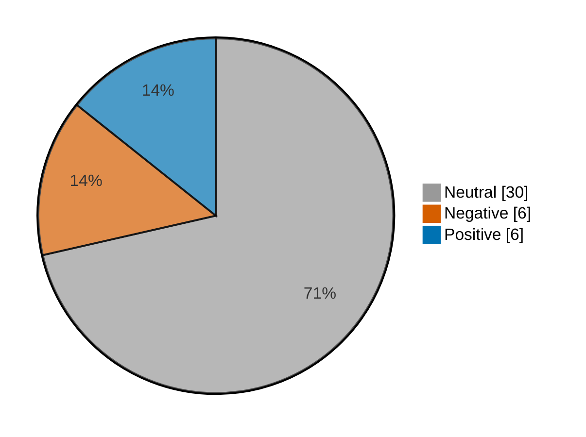

# Newsmood — 2026-10-26

**Mood index: +0.9** (roughly flat) · 42 headlines from 2 sources · model unsure on 7

_Data notes: cnbc-finance had nothing newer than 36 h._

## Mood at a glance

Negative 6 (14.3%) · Positive 6 (14.3%) · Neutral 30 (71.4%)

## What happened

Financial coverage was roughly flat today (index +0.9, 27.5 higher than yesterday) from 42 headlines, with no dominant theme.

**Clusters:** no clear theme today.

_Themes use TF-IDF fit on 569 headlines (2026-09-26–2026-10-26)._

## Recommended articles (highest model certainty, not most important)

### Negative

- [JetBlue Airways posts wider quarterly loss on surging fuel costs](<https://www.investing.com/news/stock-market-news/jetblue-airways-posts-wider-quarterly-loss-on-surging-fuel-costs-4973617>) · 94% · 10.5% of the day's movement · investing-stocks
- [Some Republicans are opposing Trump on tariffs. Maine’s Susan Collins just got him to back down on Canadian levies.](<https://www.marketwatch.com/story/some-republicans-are-opposing-trump-on-tariffs-maines-susan-collins-just-got-him-to-back-down-on-canadian-levies-02b202ae?mod=mw_rss_topstories>) · 78% · 8.7% of the day's movement · marketwatch-top
- [McDonald’s new bet on chicken hits a snag as franchisees say the birds are too big](<https://www.marketwatch.com/story/mcdonalds-new-bet-on-chicken-hits-a-snag-as-franchisees-say-the-birds-are-too-big-c3e8dd77?mod=mw_rss_topstories>) · 72% · 8.0% of the day's movement · marketwatch-top

### Positive

- [Denmark stocks higher at close of trade; OMX Copenhagen 20 up 1.16%](<https://www.investing.com/news/stock-market-news/denmark-stocks-higher-at-close-of-trade-omx-copenhagen-20-up-116-4973300>) · 97% · 10.8% of the day's movement · investing-stocks
- [Poland stocks higher at close of trade; WIG30 up 0.85%](<https://www.investing.com/news/stock-market-news/poland-stocks-higher-at-close-of-trade-wig30-up-085-4973308>) · 96% · 10.8% of the day's movement · investing-stocks
- [Dividend stocks are having an excellent October as tech sector struggles](<https://www.marketwatch.com/story/dividend-stocks-are-having-an-excellent-october-as-tech-sector-struggles-5ae40b02?mod=mw_rss_topstories>) · 90% · 10.0% of the day's movement · marketwatch-top

### Neutral

- [With the Anthropic IPO, the devil is in the details](<https://www.marketwatch.com/story/with-the-anthropic-ipo-the-devil-is-in-the-details-239d571d?mod=mw_rss_topstories>) · 99% · marketwatch-top
- [This strategist says it’s a matter of when, not if, the AI bubble pops. Here’s how to prepare for that.](<https://www.marketwatch.com/story/this-strategist-says-its-a-matter-of-when-not-if-the-ai-bubble-pops-heres-how-to-prepare-for-that-86ffbf30?mod=mw_rss_topstories>) · 98% · marketwatch-top

## Sources

| Source | Headlines | Negative | Neutral | Positive |
|---|--:|--:|--:|--:|
| investing-stocks | 28 | 4 | 20 | 4 |
| marketwatch-top | 14 | 2 | 10 | 2 |

All 42 headlines

| Sentiment | Certainty | Headline | Source |
|---|--:|---|---|
| negative | 94% | [JetBlue Airways posts wider quarterly loss on surging fuel costs](<https://www.investing.com/news/stock-market-news/jetblue-airways-posts-wider-quarterly-loss-on-surging-fuel-costs-4973617>) | investing-stocks |
| negative | 78% | [Some Republicans are opposing Trump on tariffs. Maine’s Susan Collins just got him to back down on Canadian levies.](<https://www.marketwatch.com/story/some-republicans-are-opposing-trump-on-tariffs-maines-susan-collins-just-got-him-to-back-down-on-canadian-levies-02b202ae?mod=mw_rss_topstories>) | marketwatch-top |
| negative | 72% | [McDonald’s new bet on chicken hits a snag as franchisees say the birds are too big](<https://www.marketwatch.com/story/mcdonalds-new-bet-on-chicken-hits-a-snag-as-franchisees-say-the-birds-are-too-big-c3e8dd77?mod=mw_rss_topstories>) | marketwatch-top |
| negative | 67% | [Anthropic’s IPO filing shows explosive growth, risks and staggering costs](<https://www.investing.com/news/stock-market-news/anthropic-opens-books-on-ais-explosive-growth-and-staggering-costs-4972801>) | investing-stocks |
| negative | 66% | [Goldman Sachs sees AI buildout adding to inflation pressures](<https://www.investing.com/news/stock-market-news/goldman-sachs-sees-ai-buildout-adding-to-inflation-pressures-93CH-4973311>) | investing-stocks |
| negative | 55% (unsure) | [Apple says it will replace iPhone Duo units showing screen problems](<https://www.investing.com/news/stock-market-news/apple-says-it-will-replace-iphone-duo-units-showing-screen-problems-4973703>) | investing-stocks |
| positive | 97% | [Denmark stocks higher at close of trade; OMX Copenhagen 20 up 1.16%](<https://www.investing.com/news/stock-market-news/denmark-stocks-higher-at-close-of-trade-omx-copenhagen-20-up-116-4973300>) | investing-stocks |
| positive | 96% | [Poland stocks higher at close of trade; WIG30 up 0.85%](<https://www.investing.com/news/stock-market-news/poland-stocks-higher-at-close-of-trade-wig30-up-085-4973308>) | investing-stocks |
| positive | 90% | [Dividend stocks are having an excellent October as tech sector struggles](<https://www.marketwatch.com/story/dividend-stocks-are-having-an-excellent-october-as-tech-sector-struggles-5ae40b02?mod=mw_rss_topstories>) | marketwatch-top |
| positive | 65% | [Wall Street banks, Blackstone line up $63 billion to finance Broadcom AI chips for Anthropic](<https://www.investing.com/news/stock-market-news/wall-street-banks-blackstone-line-up-63-billion-to-finance-broadcom-chips-for-anthropic-4973662>) | investing-stocks |
| positive | 60% (unsure) | [Why Lumentum’s stock led the S&P 500 higher on Monday](<https://www.marketwatch.com/story/why-lumentums-stock-led-the-s-p-500-higher-on-monday-0dff125b?mod=mw_rss_topstories>) | marketwatch-top |
| positive | 55% (unsure) | [Anthropic’s IPO: A close look at AI frontrunner’s rapid growth, spiraling costs](<https://www.investing.com/news/stock-market-news/anthropics-ipo-a-close-look-at-ai-frontrunners-rapid-growth-spiraling-costs-4972917>) | investing-stocks |
| neutral | 99% | [With the Anthropic IPO, the devil is in the details](<https://www.marketwatch.com/story/with-the-anthropic-ipo-the-devil-is-in-the-details-239d571d?mod=mw_rss_topstories>) | marketwatch-top |
| neutral | 98% | [This strategist says it’s a matter of when, not if, the AI bubble pops. Here’s how to prepare for that.](<https://www.marketwatch.com/story/this-strategist-says-its-a-matter-of-when-not-if-the-ai-bubble-pops-heres-how-to-prepare-for-that-86ffbf30?mod=mw_rss_topstories>) | marketwatch-top |
| neutral | 98% | [Nvidia, AMD and Broadcom could buy Meta shares as part of $35 billion stock offering](<https://www.marketwatch.com/story/nvidia-amd-and-broadcom-could-buy-meta-shares-as-part-of-35-billion-stock-offering-d816fec2?mod=mw_rss_topstories>) | marketwatch-top |
| neutral | 98% | [Sorry investors, but there’s no such thing as an early ‘Santa Claus rally.’ Here’s when the real gains typically happen.](<https://www.marketwatch.com/story/sorry-investors-but-theres-no-such-thing-as-an-early-santa-claus-rally-heres-when-the-real-gains-typically-happen-7af822cd?mod=mw_rss_topstories>) | marketwatch-top |
| neutral | 98% | [The house, the kids’ college and the raise: Where people in their 30s and 40s go wrong](<https://www.marketwatch.com/story/the-house-the-kids-college-and-the-raise-where-people-in-their-30s-and-40s-go-wrong-69ec6c90?mod=mw_rss_topstories>) | marketwatch-top |
| neutral | 97% | [Microsoft offers buyouts to around 60,000 employees to contain costs](<https://www.investing.com/news/stock-market-news/microsoft-is-offering-buyouts-to-around-60000-employees-business-insider-reports-4973294>) | investing-stocks |
| neutral | 96% | [Pimco buys $4 billion of SpaceX AI debt package led by Apollo - Bloomberg](<https://www.investing.com/news/stock-market-news/pimco-buys-4-billion-of-spacex-ai-debt-package-led-by-apollo--bloomberg-93CH-4973850>) | investing-stocks |
| neutral | 96% | [Exclusive: HyProMag USA maps three new magnet plants to quadruple U.S. capacity](<https://www.investing.com/news/stock-market-news/exclusive-hypromag-usa-maps-three-new-magnet-plants-to-quadruple-us-capacity-4973754>) | investing-stocks |
| neutral | 96% | [Ben & Jerry’s founders explore deal to separate brand from owner, WSJ reports](<https://www.investing.com/news/stock-market-news/ben--jerrys-exploring-deal-with-kkr-executive-to-separate-ice-cream-brand-from-owner-wsj-reports-4973492>) | investing-stocks |
| neutral | 96% | [A possible DoorDash-Instacart deal is all about keeping up with Walmart and Amazon, analysts say](<https://www.marketwatch.com/story/a-possible-doordash-instacart-deal-is-all-about-keeping-up-with-walmart-and-amazon-analysts-say-17049bb1?mod=mw_rss_topstories>) | marketwatch-top |
| neutral | 95% | [Volkswagen considers using Chinese software for Europe, report says](<https://www.investing.com/news/stock-market-news/volkswagen-considers-using-chinese-software-for-europe-report-says-4973202>) | investing-stocks |
| neutral | 95% | [TikTok parent ByteDance’s chatbot is now giving travel-booking sites a run for their money. And yours.](<https://www.marketwatch.com/story/tiktok-parent-bytedances-chatbot-is-now-giving-travel-booking-sites-a-run-for-their-money-and-yours-028e4aa0?mod=mw_rss_topstories>) | marketwatch-top |
| neutral | 94% | [Analysis-China’s lab-grown diamond makers target AI, chip sectors for next wave of growth](<https://www.investing.com/news/stock-market-news/analysischinas-labgrown-diamond-makers-target-ai-chip-sectors-for-next-wave-of-growth-4973927>) | investing-stocks |
| neutral | 94% | [Why is Telesat stock rallying today?](<https://www.investing.com/news/stock-market-news/why-is-telesat-stock-rallying-today-93CH-4973322>) | investing-stocks |
| neutral | 93% | [Telesat shares rally as CIBC highlights undervalued Lightspeed LEO asset](<https://www.investing.com/news/stock-market-news/telesat-shares-rally-as-cibc-highlights-undervalued-lightspeed-leo-asset-4973314>) | investing-stocks |
| neutral | 92% | [Universal Music discussed buyout options with private equity giants - Bloomberg](<https://www.investing.com/news/stock-market-news/universal-music-discussed-buyout-options-with-private-equity-giants--bloomberg-4973836>) | investing-stocks |
| neutral | 92% | [‘You need only watch episodes of Judge Judy’: I’m in my 70s. Why do people keep making the same avoidable financial mistakes?](<https://www.marketwatch.com/story/you-need-only-watch-episodes-of-judge-judy-im-in-my-70s-why-do-people-keep-making-the-same-avoidable-financial-mistakes-bbf60fe4?mod=mw_rss_topstories>) | marketwatch-top |
| neutral | 91% | [DoorDash in talks to buy Instacart in roughly $17 billion deal, source says](<https://www.investing.com/news/stock-market-news/doordash-in-talks-to-buy-instacart-wsj-reports-4973478>) | investing-stocks |
| neutral | 90% | [Anthropic discloses month-long training pause, AI security breaches in IPO filing](<https://www.investing.com/news/stock-market-news/anthropic-discloses-monthlong-training-pause-ai-security-breaches-in-ipo-filing-4973293>) | investing-stocks |
| neutral | 88% | [Why is Nutanix stock climbing today?](<https://www.investing.com/news/stock-market-news/why-is-nutanix-stock-climbing-today-93CH-4973319>) | investing-stocks |
| neutral | 81% | [My wife has only $80,000 saved for retirement. I have $2.2 million. Am I wrong to be shocked?](<https://www.marketwatch.com/story/my-wife-has-only-80-000-saved-for-retirement-i-have-2-2-million-am-i-wrong-to-be-shocked-3e27b490?mod=mw_rss_topstories>) | marketwatch-top |
| neutral | 79% | [US judge refuses to block Eli Lilly weight-loss drug ads, rules against Novo Nordisk](<https://www.investing.com/news/stock-market-news/us-judge-lets-eli-lilly-continue-ads-for-weightloss-drugs-rules-against-novo-nordisk-4973544>) | investing-stocks |
| neutral | 78% | [Why is Whirlpool stock tumbling today?](<https://www.investing.com/news/stock-market-news/why-is-whirlpool-stock-tumbling-today-93CH-4973684>) | investing-stocks |
| neutral | 74% | [Why is Nucor stock sliding today?](<https://www.investing.com/news/stock-market-news/why-is-nucor-stock-sliding-today-93CH-4973697>) | investing-stocks |
| neutral | 68% | [Why is Life Time Group stock surging today?](<https://www.investing.com/news/stock-market-news/why-is-life-time-group-stock-surging-today-93CH-4973320>) | investing-stocks |
| neutral | 63% | [Ex-FBI chief Comey faces third prosecution attempt by Trump Justice Department](<https://www.investing.com/news/stock-market-news/exfbi-director-comey-charged-again-by-us-justice-department-nbc-news-reports-4973795>) | investing-stocks |
| neutral | 59% (unsure) | [Why is Greenbrier Companies stock sliding today?](<https://www.investing.com/news/stock-market-news/why-is-greenbrier-companies-stock-sliding-today-93CH-4973723>) | investing-stocks |
| neutral | 50% (unsure) | [Options traders are seizing control of the S&P 500](<https://www.marketwatch.com/story/options-traders-are-seizing-control-of-the-s-p-500-1add94ca?mod=mw_rss_topstories>) | marketwatch-top |
| neutral | 49% (unsure) | [Why is Cadence Design Systems stock surging today?](<https://www.investing.com/news/stock-market-news/why-is-cadence-design-systems-stock-surging-today-93CH-4973681>) | investing-stocks |
| neutral | 49% (unsure) | [Why is JetBlue Airways stock surging today?](<https://www.investing.com/news/stock-market-news/why-is-jetblue-airways-stock-surging-today-93CH-4973745>) | investing-stocks |

---

Certainty is the model's confidence in its label; below 60% it is marked unsure.

"Of the day's movement" is a headline's certainty over the sum of every non-neutral headline's certainty: its part in moving the index. Neutral headlines move it by 0.

Links go to the original publisher; some limit free articles.

Model: kkrit-tinna/newsmood-distilbert-financial@be7b809e0d8f7bd50e77d902aee199363b7e2a66 · Gates: 2/2 passed · 1 data note · Not financial advice.
