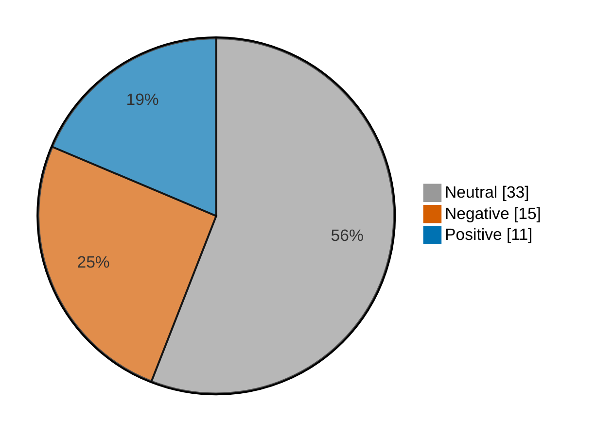

# Newsmood — 2026-10-27

**Mood index: -5.0** (mildly negative) · 59 headlines from 2 sources · model unsure on 10

_Data notes: cnbc-finance had nothing newer than 36 h._

## Mood at a glance

Negative 15 (25.4%) · Positive 11 (18.6%) · Neutral 33 (55.9%)

## What happened

Financial coverage leaned mildly negative today (index -5.0, 5.9 lower than yesterday) from 59 headlines, with no single theme in the lead.

**Clusters:**

- 3 headlines on higher close, stocks higher, close trade: 3 positive · +13.4% of the day's movement
- 7 headlines on sliding, sliding today, stock sliding: 7 neutral · +0.0% of the day's movement

_Themes use TF-IDF fit on 625 headlines (2026-09-27–2026-10-27)._

## Recommended articles (highest model certainty, not most important)

### Negative

- [Bucher Industries sees lower 2026 sales, margins as glass, farm units slump](<https://www.investing.com/news/stock-market-news/bucher-industries-sees-lower-2026-sales-margins-as-glass-farm-units-slump-93CH-4974206>) · 97% · 4.5% of the day's movement · investing-stocks
- [The big reason Boeing’s stock is falling so hard after earnings](<https://www.marketwatch.com/story/the-big-reason-boeings-stock-is-falling-so-hard-after-earnings-d31b400d?mod=mw_rss_topstories>) · 96% · 4.4% of the day's movement · marketwatch-top
- [HCA signals flat 2027 earnings as Medicaid payments drop; shares slide](<https://www.investing.com/news/stock-market-news/hca-signals-flat-2027-earnings-as-medicaid-payments-drop-shares-slide-4976567>) · 96% · 4.4% of the day's movement · investing-stocks

### Positive

- [Mexico stocks higher at close of trade; S&P/BMV IPC up 0.35%](<https://www.investing.com/news/stock-market-news/mexico-stocks-higher-at-close-of-trade-spbmv-ipc-up-035-4977075>) · 97% · 4.5% of the day's movement · investing-stocks
- [Russia stocks higher at close of trade; MOEX Russia Index up 0.92%](<https://www.investing.com/news/stock-market-news/russia-stocks-higher-at-close-of-trade-moex-russia-index-up-092-4977054>) · 97% · 4.5% of the day's movement · investing-stocks
- [Australia stocks higher at close of trade; S&P/ASX 200 up 0.46%](<https://www.investing.com/news/stock-market-news/australia-stocks-higher-at-close-of-trade-spasx-200-up-046-4974203>) · 97% · 4.5% of the day's movement · investing-stocks

### Neutral

- [When will Anthropic go public? Here’s what to know about the IPO timeline.](<https://www.marketwatch.com/story/when-will-anthropic-go-public-heres-what-to-know-about-the-ipo-timeline-431eca78?mod=mw_rss_topstories>) · 98% · marketwatch-top
- [AstraZeneca may start work on cancer vaccines, CEO says](<https://www.investing.com/news/stock-market-news/astrazeneca-may-start-work-on-cancer-vaccines-ceo-says-4976543>) · 98% · investing-stocks

## Sources

| Source | Headlines | Negative | Neutral | Positive |
|---|--:|--:|--:|--:|
| investing-stocks | 39 | 11 | 21 | 7 |
| marketwatch-top | 20 | 4 | 12 | 4 |

All 59 headlines

| Sentiment | Certainty | Headline | Source |
|---|--:|---|---|
| negative | 97% | [Bucher Industries sees lower 2026 sales, margins as glass, farm units slump](<https://www.investing.com/news/stock-market-news/bucher-industries-sees-lower-2026-sales-margins-as-glass-farm-units-slump-93CH-4974206>) | investing-stocks |
| negative | 96% | [The big reason Boeing’s stock is falling so hard after earnings](<https://www.marketwatch.com/story/the-big-reason-boeings-stock-is-falling-so-hard-after-earnings-d31b400d?mod=mw_rss_topstories>) | marketwatch-top |
| negative | 96% | [HCA signals flat 2027 earnings as Medicaid payments drop; shares slide](<https://www.investing.com/news/stock-market-news/hca-signals-flat-2027-earnings-as-medicaid-payments-drop-shares-slide-4976567>) | investing-stocks |
| negative | 95% | [Indonesia bond auction raises $1.14bn, falls short of target](<https://www.investing.com/news/stock-market-news/indonesia-bond-auction-raises-114bn-falls-short-of-target-93CH-4975244>) | investing-stocks |
| negative | 94% | [FTSE 100 today: Stocks slip further as HSBC, Reckitt drag; budget, Fed caution](<https://www.investing.com/news/stock-market-news/ftse-100-today-stocks-fall-as-hsbc-slides-budget-and-fed-caution-4974398>) | investing-stocks |
| negative | 94% | [Robinhood misses quarterly profit estimates as softer crypto activity outweighs robust trading](<https://www.investing.com/news/stock-market-news/robinhood-quarterly-profit-falls-as-softer-crypto-activity-outweighs-robust-trading-4976781>) | investing-stocks |
| negative | 92% | [European shares mostly higher amid tech gains; HSBC and Reckitt fall](<https://www.investing.com/news/stock-market-news/european-shares-fall-as-hsbc-slump-and-energy-fears-offset-ai-glow-4974295>) | investing-stocks |
| negative | 88% | [Citic Securities shares fall on soft Q3 profit](<https://www.investing.com/news/stock-market-news/citic-securities-shares-fall-on-soft-q3-profit-4974189>) | investing-stocks |
| negative | 84% | [JetBlue has been losing money for years. It just charted a path to profitability.](<https://www.marketwatch.com/story/jetblue-has-been-losing-money-for-years-it-just-charted-a-path-to-profitability-03be75c8?mod=mw_rss_topstories>) | marketwatch-top |
| negative | 76% | [Exclusive-JetBlue CEO says no creditor talks as bond selloff raises doubts about turnaround](<https://www.investing.com/news/stock-market-news/exclusivejetblue-ceo-says-company-not-in-talks-with-its-creditors-4976528>) | investing-stocks |
| negative | 66% | [Why is Enphase Energy stock plunging today?](<https://www.investing.com/news/stock-market-news/why-is-enphase-energy-stock-plunging-today-93CH-4977002>) | investing-stocks |
| negative | 63% | [The rest of the market is leaving Big Tech behind after a historic comeback](<https://www.marketwatch.com/story/the-rest-of-the-market-is-leaving-big-tech-behind-after-a-historic-comeback-324e9fb2?mod=mw_rss_topstories>) | marketwatch-top |
| negative | 58% (unsure) | [AI debt trouble could help Fed’s Warsh get his way with fewer rate hikes](<https://www.marketwatch.com/story/ai-debt-trouble-could-help-feds-warsh-get-his-way-with-fewer-rate-hikes-b3dc4525?mod=mw_rss_topstories>) | marketwatch-top |
| negative | 57% (unsure) | [Walmart’s margins in Mexico tighten as costs outpace sales growth](<https://www.investing.com/news/stock-market-news/walmarts-margins-in-mexico-tighten-as-costs-outpace-sales-growth-4977085>) | investing-stocks |
| negative | 52% (unsure) | [Why is Polaris stock surging today?](<https://www.investing.com/news/stock-market-news/why-is-polaris-stock-surging-today-93CH-4975233>) | investing-stocks |
| positive | 97% | [Mexico stocks higher at close of trade; S&P/BMV IPC up 0.35%](<https://www.investing.com/news/stock-market-news/mexico-stocks-higher-at-close-of-trade-spbmv-ipc-up-035-4977075>) | investing-stocks |
| positive | 97% | [Russia stocks higher at close of trade; MOEX Russia Index up 0.92%](<https://www.investing.com/news/stock-market-news/russia-stocks-higher-at-close-of-trade-moex-russia-index-up-092-4977054>) | investing-stocks |
| positive | 97% | [Australia stocks higher at close of trade; S&P/ASX 200 up 0.46%](<https://www.investing.com/news/stock-market-news/australia-stocks-higher-at-close-of-trade-spasx-200-up-046-4974203>) | investing-stocks |
| positive | 97% | [Colombia stocks higher at close of trade; COLCAP up 0.06%](<https://www.investing.com/news/stock-market-news/colombia-stocks-higher-at-close-of-trade-colcap-up-006-4977069>) | investing-stocks |
| positive | 96% | [SoFi’s stock climbs as lending surge drives an earnings beat and rosy outlook](<https://www.marketwatch.com/story/sofis-stock-climbs-as-lending-surge-drives-an-earnings-beat-and-rosy-outlook-0c978535?mod=mw_rss_topstories>) | marketwatch-top |
| positive | 94% | [CoreWeave and other AI stocks rise as Anthropic restores the market’s faith in sustained spending](<https://www.marketwatch.com/story/coreweave-and-other-ai-stocks-rise-as-anthropic-restores-the-markets-faith-in-sustained-spending-c71d7186?mod=mw_rss_topstories>) | marketwatch-top |
| positive | 94% | [How Broadcom’s stock can surge and overcome ‘the biggest dislocation in the market’](<https://www.marketwatch.com/story/how-broadcoms-stock-can-surge-and-overcome-the-biggest-dislocation-in-the-market-9719e2a8?mod=mw_rss_topstories>) | marketwatch-top |
| positive | 88% | [US energy firms to produce record natgas in 2026 as global demand soars](<https://www.investing.com/news/stock-market-news/us-energy-firms-to-produce-record-natgas-in-2026-as-global-demand-soars-4976556>) | investing-stocks |
| positive | 79% | [Asia stocks jump as Anthropic IPO filing revives AI trade](<https://www.investing.com/news/stock-market-news/asia-stocks-jump-as-anthropic-ipo-filing-revives-ai-trade-4974091>) | investing-stocks |
| positive | 67% | [As Trump touts energy companies’ fortunes, U.S. consumers face the most expensive year for gas prices ever](<https://www.marketwatch.com/story/as-trump-touts-energy-companies-fortunes-u-s-consumers-face-the-most-expensive-year-for-gas-prices-ever-c467268c?mod=mw_rss_topstories>) | marketwatch-top |
| positive | 53% (unsure) | [Why is Caesars Entertainment stock edging higher today?](<https://www.investing.com/news/stock-market-news/why-is-caesars-entertainment-stock-edging-higher-today-93CH-4977000>) | investing-stocks |
| neutral | 98% | [When will Anthropic go public? Here’s what to know about the IPO timeline.](<https://www.marketwatch.com/story/when-will-anthropic-go-public-heres-what-to-know-about-the-ipo-timeline-431eca78?mod=mw_rss_topstories>) | marketwatch-top |
| neutral | 98% | [AstraZeneca may start work on cancer vaccines, CEO says](<https://www.investing.com/news/stock-market-news/astrazeneca-may-start-work-on-cancer-vaccines-ceo-says-4976543>) | investing-stocks |
| neutral | 98% | [Bank of England reviews Revolut’s product approval controls - report](<https://www.investing.com/news/stock-market-news/bank-of-england-reviews-revoluts-product-approval-controls--report-93CH-4974220>) | investing-stocks |
| neutral | 98% | [Tensor Auto and Munich taxi operator plan autonomous fleet](<https://www.investing.com/news/stock-market-news/tensor-auto-and-munich-taxi-operator-plan-autonomous-fleet-93CH-4977020>) | investing-stocks |
| neutral | 98% | [Novartis earnings analysis: questions answered and next catalysts](<https://www.investing.com/news/stock-market-news/novartis-earnings-analysis-questions-answered-and-next-catalysts-93CH-4976534>) | investing-stocks |
| neutral | 98% | [Advent raises $30 billion for latest buyout, mid-market funds](<https://www.investing.com/news/stock-market-news/advent-raises-30-billion-for-latest-buyout-midmarket-funds-4975243>) | investing-stocks |
| neutral | 98% | [GM to offer hybrid versions of top-selling SUV models - report](<https://www.investing.com/news/stock-market-news/gm-to-offer-hybrid-versions-of-topselling-suv-models--report-4976560>) | investing-stocks |
| neutral | 97% | [What gold and platinum are telling us about the stock market’s direction](<https://www.marketwatch.com/story/what-gold-and-platinum-are-telling-us-about-the-stock-markets-direction-81405633?mod=mw_rss_topstories>) | marketwatch-top |
| neutral | 97% | [CDC deputy director to leave Trump admin after midterms, Post reports](<https://www.investing.com/news/stock-market-news/cdc-deputy-director-to-leave-trump-admin-after-midterms-post-reports-93CH-4974196>) | investing-stocks |
| neutral | 97% | [‘CryptoDad’ on stablecoins, bitcoin’s role in a portfolio and why he does not directly own any crypto](<https://www.marketwatch.com/story/cryptodad-on-stablecoins-bitcoins-role-in-a-portfolio-and-why-he-does-not-directly-own-any-crypto-72472bc1?mod=mw_rss_topstories>) | marketwatch-top |
| neutral | 97% | [SK Hynix tests SuperTrend resistance at KRW 1,348,500: Live](<https://www.investing.com/news/stock-market-news/sk-hynix-neutral-in-notrade-zone-awaiting-breakout-live-93CH-4971337>) | investing-stocks |
| neutral | 96% | [How to use I-bonds to create guaranteed, inflation-proof income in retirement](<https://www.marketwatch.com/story/how-to-use-i-bonds-to-create-guaranteed-inflation-proof-income-in-retirement-50753fea?mod=mw_rss_topstories>) | marketwatch-top |
| neutral | 96% | [Here’s the question three tech-sector earnings reports raise about the future of AI](<https://www.marketwatch.com/story/heres-the-question-three-tech-sector-earnings-reports-raise-about-the-future-of-ai-5676248b?mod=mw_rss_topstories>) | marketwatch-top |
| neutral | 96% | [GM moves to Nasdaq as first legacy automaker on the exchange](<https://www.investing.com/news/stock-market-news/gm-to-transfer-stock-listing-to-nasdaq-4974848>) | investing-stocks |
| neutral | 96% | [The U.S. economy is gathering steam. This is the chief reason why.](<https://www.marketwatch.com/story/u-s-economy-is-gathering-steam-this-is-the-chief-reason-why-9772978f?mod=mw_rss_topstories>) | marketwatch-top |
| neutral | 94% | [SEC’s Atkins seeks changes to crowdfunding regulations](<https://www.investing.com/news/stock-market-news/secs-atkins-seeks-changes-to-crowdfunding-regulations-4976569>) | investing-stocks |
| neutral | 94% | [Big Tech’s earnings are on deck. There’s more for investors to watch than AI spending.](<https://www.marketwatch.com/story/big-techs-earnings-are-on-deck-theres-more-for-investors-to-watch-than-ai-spending-bb566c90?mod=mw_rss_topstories>) | marketwatch-top |
| neutral | 94% | [Why is On stock sliding today?](<https://www.investing.com/news/stock-market-news/why-is-on-stock-sliding-today-93CH-4975250>) | investing-stocks |
| neutral | 93% | [AI stocks haven’t played by the normal valuation rules. Now that rates are higher, they may have to, says UBS](<https://www.marketwatch.com/story/ai-stocks-havent-played-by-the-normal-valuation-rules-now-that-rates-are-higher-they-may-have-to-says-ubs-f8c78948?mod=mw_rss_topstories>) | marketwatch-top |
| neutral | 90% | [What gave this city its ‘best place to retire’ crown? You can actually afford to live there.](<https://www.marketwatch.com/story/what-gave-this-city-its-best-place-to-retire-crown-you-can-actually-afford-to-live-there-a06f8f4d?mod=mw_rss_topstories>) | marketwatch-top |
| neutral | 89% | [Nikkei 225 tests VWAP/Kijun resistance in counter-trend bounce: Live](<https://www.investing.com/news/stock-market-news/nikkei-225-in-strong-downtrend-tests-key-support-live-levels-93CH-4971336>) | investing-stocks |
| neutral | 85% | [Why is Armstrong World stock sliding today?](<https://www.investing.com/news/stock-market-news/why-is-armstrong-world-stock-sliding-today-93CH-4975228>) | investing-stocks |
| neutral | 81% | [Why is CommVault stock sliding today?](<https://www.investing.com/news/stock-market-news/why-is-commvault-stock-sliding-today-93CH-4975251>) | investing-stocks |
| neutral | 80% | [Why is Xylem stock sliding today?](<https://www.investing.com/news/stock-market-news/why-is-xylem-stock-sliding-today-93CH-4975235>) | investing-stocks |
| neutral | 80% | [Trump says he will visit tanker in Texas with first oil from Venezuela deal](<https://www.investing.com/news/stock-market-news/trump-says-he-will-visit-tanker-in-texas-with-first-oil-from-venezuela-deal-4976575>) | investing-stocks |
| neutral | 73% | [Why is Hilton Worldwide stock sliding today?](<https://www.investing.com/news/stock-market-news/why-is-hilton-worldwide-stock-sliding-today-93CH-4975226>) | investing-stocks |
| neutral | 69% | [French minister says UAE role in Rafale upgrade still undecided](<https://www.investing.com/news/stock-market-news/french-minister-says-uae-role-in-rafale-upgrade-still-undecided-93CH-4976536>) | investing-stocks |
| neutral | 58% (unsure) | [Why reported Khamenei call for end to ‘neither war nor peace’ moved markets — a bit](<https://www.marketwatch.com/story/why-reported-khamenei-call-for-end-to-neither-war-nor-peace-moved-markets-a-bit-dd94b602?mod=mw_rss_topstories>) | marketwatch-top |
| neutral | 50% (unsure) | [Why is CITIC Securities stock sliding today?](<https://www.investing.com/news/stock-market-news/why-is-citic-securities-stock-sliding-today-93CH-4974194>) | investing-stocks |
| neutral | 50% (unsure) | [Why is Nabors Industries stock sliding today?](<https://www.investing.com/news/stock-market-news/why-is-nabors-industries-stock-sliding-today-93CH-4977017>) | investing-stocks |
| neutral | 49% (unsure) | [Retail traders buy the dip on chip stocks — but Robinhood gets burned by the crypto market](<https://www.marketwatch.com/story/retail-traders-buy-the-dip-on-chip-stocks-but-robinhood-gets-burned-by-the-crypto-market-33cea913?mod=mw_rss_topstories>) | marketwatch-top |
| neutral | 48% (unsure) | [A leading Silicon Valley cheerleader just showed all the reasons to be worried about the AI bubble](<https://www.marketwatch.com/story/a-leading-silicon-valley-cheerleader-just-showed-all-the-reasons-to-be-worried-about-the-ai-bubble-e3b32fe1?mod=mw_rss_topstories>) | marketwatch-top |
| neutral | 47% (unsure) | [Why is Herc Holdings stock surging today?](<https://www.investing.com/news/stock-market-news/why-is-herc-holdings-stock-surging-today-93CH-4975237>) | investing-stocks |

---

Certainty is the model's confidence in its label; below 60% it is marked unsure.

"Of the day's movement" is a headline's certainty over the sum of every non-neutral headline's certainty: its part in moving the index. Neutral headlines move it by 0.

Links go to the original publisher; some limit free articles.

Model: kkrit-tinna/newsmood-distilbert-financial@be7b809e0d8f7bd50e77d902aee199363b7e2a66 · Gates: 2/2 passed · 1 data note · Not financial advice.
