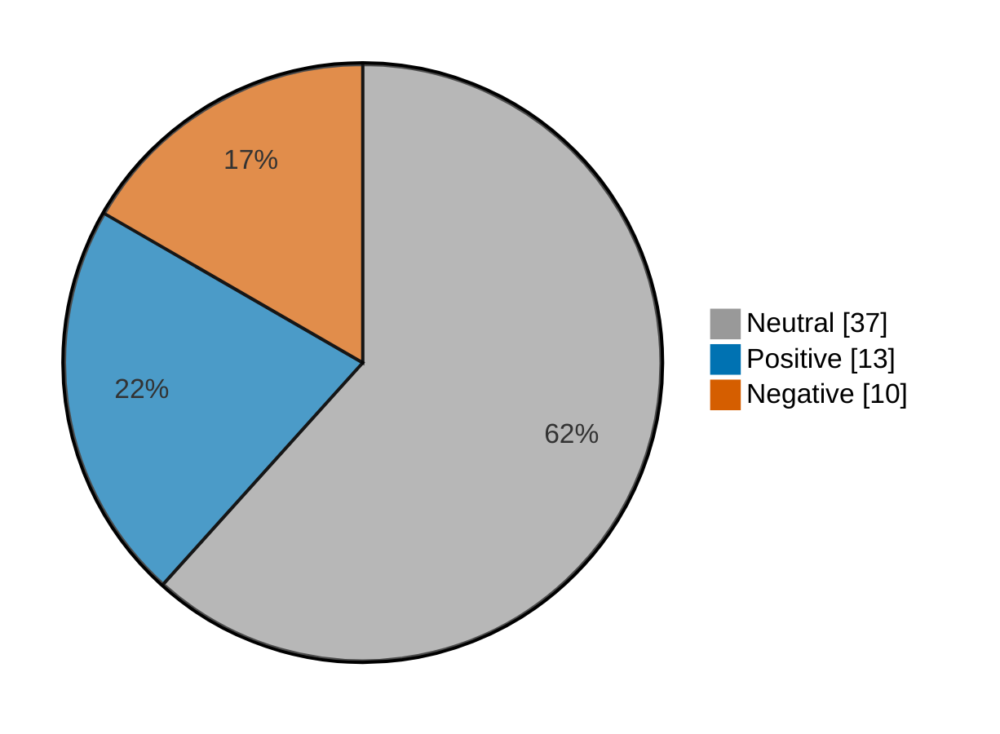

# Newsmood — 2026-10-28

**Mood index: +4.0** (roughly flat) · 60 headlines from 2 sources · model unsure on 10

_Data notes: cnbc-finance had nothing newer than 36 h._

## Mood at a glance

Negative 10 (16.7%) · Positive 13 (21.7%) · Neutral 37 (61.7%)

## What happened

Market news was roughly flat today (index +4.0, 8.3 higher than yesterday) over 60 headlines, with no dominant theme.

**Clusters:**

- 8 headlines on sliding, sliding today, stock sliding: 8 neutral · +0.0% of the day's movement
- 5 headlines on surging today, stock surging, surging: 5 neutral · +0.0% of the day's movement

_Themes use TF-IDF fit on 688 headlines (2026-09-28–2026-10-28)._

## Recommended articles (highest model certainty, not most important)

### Negative

- [FedEx margins decline, shares fall despite bigger than expected quarterly profit](<https://www.investing.com/news/stock-market-news/fedex-forecasts-annual-profit-above-estimates-posts-higher-quarterly-earnings-on-better-pricing-volumes-4980618>) · 97% · 5.1% of the day's movement · investing-stocks
- [Australia stocks lower at close of trade; S&P/ASX 200 down 0.03%](<https://www.investing.com/news/stock-market-news/australia-stocks-lower-at-close-of-trade-spasx-200-down-003-4977489>) · 97% · 5.1% of the day's movement · investing-stocks
- [Alphabet shares fall after revenue miss, cash burn worsens](<https://www.investing.com/news/stock-market-news/alphabets-heavy-cloud-spending-drives-biggerthanexpected-cash-burn-4980612>) · 96% · 5.0% of the day's movement · investing-stocks

### Positive

- [Dormakaba Q1 organic sales up 4% on price increases; outlook confirmed](<https://www.investing.com/news/stock-market-news/dormakaba-q1-organic-sales-up-4-on-price-increases-outlook-confirmed-93CH-4977494>) · 97% · 5.1% of the day's movement · investing-stocks
- [Ambani’s Jio surges 21% in Mumbai debut as valuation soars to $131.5 billion](<https://www.investing.com/news/stock-market-news/ambanis-jio-surges-21-in-mumbai-debut-after-record-32-billion-india-ipo-4977466>) · 97% · 5.1% of the day's movement · investing-stocks
- [Jio shares surge over 20% in blockbuster market debut](<https://www.investing.com/news/stock-market-news/jio-shares-surge-over-20-in-blockbuster-market-debut-4977495>) · 96% · 5.0% of the day's movement · investing-stocks

### Neutral

- [Bullish on Anthropic but don’t want to wait until the IPO? Here’s how you can invest today.](<https://www.marketwatch.com/story/bullish-on-anthropic-but-dont-want-to-wait-until-the-ipo-heres-how-you-can-invest-today-c5cb329e?mod=mw_rss_topstories>) · 98% · marketwatch-top
- [Bill Ackman owns only a handful of stocks. Here is his rule for picking a winner.](<https://www.marketwatch.com/story/bill-ackman-owns-only-a-handful-of-stocks-here-is-his-rule-for-picking-a-winner-82a0ee98?mod=mw_rss_topstories>) · 98% · marketwatch-top

## Sources

| Source | Headlines | Negative | Neutral | Positive |
|---|--:|--:|--:|--:|
| investing-stocks | 40 | 7 | 23 | 10 |
| marketwatch-top | 20 | 3 | 14 | 3 |

All 60 headlines

| Sentiment | Certainty | Headline | Source |
|---|--:|---|---|
| negative | 97% | [FedEx margins decline, shares fall despite bigger than expected quarterly profit](<https://www.investing.com/news/stock-market-news/fedex-forecasts-annual-profit-above-estimates-posts-higher-quarterly-earnings-on-better-pricing-volumes-4980618>) | investing-stocks |
| negative | 97% | [Australia stocks lower at close of trade; S&P/ASX 200 down 0.03%](<https://www.investing.com/news/stock-market-news/australia-stocks-lower-at-close-of-trade-spasx-200-down-003-4977489>) | investing-stocks |
| negative | 96% | [Alphabet shares fall after revenue miss, cash burn worsens](<https://www.investing.com/news/stock-market-news/alphabets-heavy-cloud-spending-drives-biggerthanexpected-cash-burn-4980612>) | investing-stocks |
| negative | 92% | [TV’s Nick and Vanessa Lachey cut price of Southern California home to $7.6 million](<https://www.marketwatch.com/story/tvs-nick-and-vanessa-lachey-cut-price-of-southern-california-home-to-7-6-million-24dc3d7a?mod=mw_rss_topstories>) | marketwatch-top |
| negative | 91% | [Airbus Q3 revenue misses as deliveries slow; 2026 guidance kept](<https://www.investing.com/news/stock-market-news/airbus-q3-revenue-misses-as-deliveries-slow-2026-guidance-kept-4980382>) | investing-stocks |
| negative | 91% | [US bans imports from BGI Genomics, MGI Tech, citing ties to forced labor in Xinjiang](<https://www.investing.com/news/stock-market-news/us-bans-imports-from-three-chinese-genomics-companies-citing-forced-labor-4979357>) | investing-stocks |
| negative | 89% | [Food and household brands warn of more price hikes as Iran war costs bite](<https://www.investing.com/news/stock-market-news/food-and-household-brands-warn-of-more-price-hikes-as-iran-war-costs-bite-4976615>) | investing-stocks |
| negative | 85% | [ServiceNow’s stock slides as earnings miss clouds a raised AI outlook](<https://www.marketwatch.com/story/servicenows-stock-slides-as-earnings-miss-clouds-a-raised-ai-outlook-96e48385?mod=mw_rss_topstories>) | marketwatch-top |
| negative | 73% | [Four reasons to start worrying about inflation — including the end of tariff refunds](<https://www.marketwatch.com/story/four-reasons-to-start-worrying-about-inflation-including-the-end-of-tariff-refunds-978a5cfd?mod=mw_rss_topstories>) | marketwatch-top |
| negative | 49% (unsure) | [Palantir defense chief says AI advances may force China to invade Taiwan](<https://www.investing.com/news/stock-market-news/palantir-defense-chief-says-ai-advances-may-force-china-to-invade-taiwan-4980393>) | investing-stocks |
| positive | 97% | [Dormakaba Q1 organic sales up 4% on price increases; outlook confirmed](<https://www.investing.com/news/stock-market-news/dormakaba-q1-organic-sales-up-4-on-price-increases-outlook-confirmed-93CH-4977494>) | investing-stocks |
| positive | 97% | [Ambani’s Jio surges 21% in Mumbai debut as valuation soars to $131.5 billion](<https://www.investing.com/news/stock-market-news/ambanis-jio-surges-21-in-mumbai-debut-after-record-32-billion-india-ipo-4977466>) | investing-stocks |
| positive | 96% | [Jio shares surge over 20% in blockbuster market debut](<https://www.investing.com/news/stock-market-news/jio-shares-surge-over-20-in-blockbuster-market-debut-4977495>) | investing-stocks |
| positive | 96% | [European shares edge higher ahead of Big Tech, Fed test](<https://www.investing.com/news/stock-market-news/european-shares-stutter-as-bank-earnings-fail-to-offset-prefed-jitters-4977566>) | investing-stocks |
| positive | 86% | [Chipotle expects modestly higher sales this year as drive-thru ‘Chipotlanes’ come to more stores](<https://www.marketwatch.com/story/chipotle-expects-modestly-higher-sales-this-year-as-drive-thru-chipotlanes-come-to-more-stores-4f255bbc?mod=mw_rss_topstories>) | marketwatch-top |
| positive | 85% | [SAP swaps costly AI models for cheaper alternatives, targets over €2 billion in gains](<https://www.investing.com/news/stock-market-news/sap-swaps-costly-ai-models-for-cheaper-alternatives-targets-over-2-billion-in-gains-4979724>) | investing-stocks |
| positive | 84% | [China’s CXMT plans advanced AI memory production despite low yields - Reuters](<https://www.investing.com/news/stock-market-news/chinas-cxmt-plans-advanced-ai-memory-production-despite-low-yields--reuters-4977497>) | investing-stocks |
| positive | 78% | [UBS meets expectations with $2.7 billion Q3 profit](<https://www.investing.com/news/stock-market-news/ubs-meets-expectations-with-27-billion-q3-profit-4977500>) | investing-stocks |
| positive | 75% | [Vertiv earnings just sent an upbeat signal about AI ahead of Big Tech results](<https://www.marketwatch.com/story/vertiv-earnings-just-sent-an-upbeat-signal-about-ai-ahead-of-big-tech-results-5714a105?mod=mw_rss_topstories>) | marketwatch-top |
| positive | 72% | [Prediction market bets set the tone for Anthropic’s much-awaited IPO](<https://www.investing.com/news/stock-market-news/prediction-market-bets-set-the-tone-for-anthropics-muchawaited-ipo-4980048>) | investing-stocks |
| positive | 62% | [Micron’s stock rises after SK Hynix earnings. Here’s its next major test.](<https://www.marketwatch.com/story/microns-stock-rises-after-sk-hynix-earnings-heres-its-next-major-test-99853d0e?mod=mw_rss_topstories>) | marketwatch-top |
| positive | 61% | [Marvell nears deal for optical supplier Lumentum to bolster hardware, report says](<https://www.investing.com/news/stock-market-news/marvell-nears-deal-for-optical-supplier-lumentum-to-bolster-hardware-report-says-4981052>) | investing-stocks |
| positive | 60% (unsure) | [BNP Paribas beats Q3 profit forecast, unveils €1.3 billion share buyback](<https://www.investing.com/news/stock-market-news/bnp-paribas-beats-q3-profit-forecast-unveils-13-billion-share-buyback-4977499>) | investing-stocks |
| neutral | 98% | [Bullish on Anthropic but don’t want to wait until the IPO? Here’s how you can invest today.](<https://www.marketwatch.com/story/bullish-on-anthropic-but-dont-want-to-wait-until-the-ipo-heres-how-you-can-invest-today-c5cb329e?mod=mw_rss_topstories>) | marketwatch-top |
| neutral | 98% | [Bill Ackman owns only a handful of stocks. Here is his rule for picking a winner.](<https://www.marketwatch.com/story/bill-ackman-owns-only-a-handful-of-stocks-here-is-his-rule-for-picking-a-winner-82a0ee98?mod=mw_rss_topstories>) | marketwatch-top |
| neutral | 98% | [Premarket movers: Vertiv, SK Hynix jump; Enphase, NXP slide](<https://www.investing.com/news/stock-market-news/premarket-movers-vertiv-sk-hynix-jump-enphase-nxp-slide-4978698>) | investing-stocks |
| neutral | 98% | [Anthropic to offer IPO shares to UK retail investors with RetailBook](<https://www.investing.com/news/stock-market-news/anthropic-to-offer-ipo-shares-to-uk-retail-investors-with-retailbook-4980386>) | investing-stocks |
| neutral | 98% | [Apple shows first touchscreen laptops amid product blitz](<https://www.investing.com/news/stock-market-news/apple-expected-to-show-first-touchscreen-laptops-amid-product-blitz-4978532>) | investing-stocks |
| neutral | 97% | [Anthropic is said to plan UK share offering via retailbook - Bloomberg](<https://www.investing.com/news/stock-market-news/anthropic-is-said-to-plan-uk-share-offering-via-retailbook--bloomberg-432SI-4980380>) | investing-stocks |
| neutral | 97% | [The real way to tell if Amazon’s AI spending is paying off](<https://www.marketwatch.com/story/the-real-way-to-tell-if-amazons-ai-spending-is-paying-off-42a8a637?mod=mw_rss_topstories>) | marketwatch-top |
| neutral | 96% | [We are in our 70s. Should we pay off our 2.5% mortgage or build up our savings?](<https://www.marketwatch.com/story/we-are-in-our-70s-should-we-pay-off-our-2-5-mortgage-or-build-up-our-savings-5a35e9c1?mod=mw_rss_topstories>) | marketwatch-top |
| neutral | 95% | [Why is SanDisk stock rallying today?](<https://www.investing.com/news/stock-market-news/why-is-sandisk-stock-rallying-today-93CH-4978749>) | investing-stocks |
| neutral | 93% | [Here’s what just sent Oracle’s stock soaring](<https://www.marketwatch.com/story/heres-what-just-sent-oracles-stock-soaring-7a1a91e2?mod=mw_rss_topstories>) | marketwatch-top |
| neutral | 90% | [We’re spending more than $11,000 a year of our own money caring for our aging parents and loved ones](<https://www.marketwatch.com/story/were-spending-more-than-11-000-a-year-of-our-own-money-caring-for-our-aging-parents-and-loved-ones-8fc5b2dc?mod=mw_rss_topstories>) | marketwatch-top |
| neutral | 89% | [Gail India to invest $63.1 million in Ratnagiri LNG heating unit](<https://www.investing.com/news/stock-market-news/gail-india-to-invest-631-million-in-ratnagiri-lng-heating-unit-93CH-4977501>) | investing-stocks |
| neutral | 89% | [Healthcare stocks are on their biggest hot streak in a generation. Think twice before chasing the rally.](<https://www.marketwatch.com/story/healthcare-stocks-are-on-their-biggest-hot-streak-in-a-generation-think-twice-before-chasing-the-rally-a043adfe?mod=mw_rss_topstories>) | marketwatch-top |
| neutral | 84% | [Why did the Fed hold off on raising interest rates? Warsh says it’s because an ‘information-rich’ period is coming.](<https://www.marketwatch.com/story/why-did-the-fed-hold-off-on-raising-interest-rates-warsh-says-its-because-an-information-rich-period-is-coming-098ced8d?mod=mw_rss_topstories>) | marketwatch-top |
| neutral | 84% | [TPG in talks to buy Ark Data Centres for about $5 billion- FT](<https://www.investing.com/news/stock-market-news/tpg-in-talks-to-buy-ark-data-centres-for-about-5-billion-ft-93CH-4977487>) | investing-stocks |
| neutral | 84% | [London’s FTSE edges up, sterling steadies as Healey unveils UK Budget](<https://www.investing.com/news/stock-market-news/ftse-100-today-stocks-slip-ahead-of-budget-gsk-unilever-results-weigh-4977691>) | investing-stocks |
| neutral | 82% | [Why is Parsons stock sliding today?](<https://www.investing.com/news/stock-market-news/why-is-parsons-stock-sliding-today-93CH-4978768>) | investing-stocks |
| neutral | 82% | [SK Hynix delivered on third-quarter results — but the outlook is what really mattered to Wall Street and the AI trade](<https://www.marketwatch.com/story/sk-hynix-delivered-on-third-quarter-results-but-the-outlook-is-what-really-mattered-to-wall-street-and-the-ai-trade-2fde9a57?mod=mw_rss_topstories>) | marketwatch-top |
| neutral | 81% | [Why is Marvell Technology stock sliding today?](<https://www.investing.com/news/stock-market-news/why-is-marvell-technology-stock-sliding-today-93CH-4981081>) | investing-stocks |
| neutral | 78% | [Why is Lennox International stock sliding today?](<https://www.investing.com/news/stock-market-news/why-is-lennox-international-stock-sliding-today-93CH-4978775>) | investing-stocks |
| neutral | 74% | [Why is Endesa stock sliding today?](<https://www.investing.com/news/stock-market-news/why-is-endesa-stock-sliding-today-93CH-4978706>) | investing-stocks |
| neutral | 72% | [Why is Darling Ingredients stock sliding today?](<https://www.investing.com/news/stock-market-news/why-is-darling-ingredients-stock-sliding-today-93CH-4981046>) | investing-stocks |
| neutral | 71% | [Why is Constellium stock surging today?](<https://www.investing.com/news/stock-market-news/why-is-constellium-stock-surging-today-93CH-4978701>) | investing-stocks |
| neutral | 69% | [Why is Lumentum stock surging today?](<https://www.investing.com/news/stock-market-news/why-is-lumentum-stock-surging-today-93CH-4981083>) | investing-stocks |
| neutral | 69% | [Why is Generac stock sliding today?](<https://www.investing.com/news/stock-market-news/why-is-generac-stock-sliding-today-93CH-4978703>) | investing-stocks |
| neutral | 68% | [Why is Smurfit WestRock stock tumbling today?](<https://www.investing.com/news/stock-market-news/why-is-smurfit-westrock-stock-tumbling-today-93CH-4978770>) | investing-stocks |
| neutral | 66% | [The U.S. government will no longer penalize American companies for making six popular peptides](<https://www.marketwatch.com/story/trump-administration-clears-the-way-for-production-of-peptides-like-bpc-157-and-tb-500-28ac2d11?mod=mw_rss_topstories>) | marketwatch-top |
| neutral | 65% | [Why is Equinix stock surging today?](<https://www.investing.com/news/stock-market-news/why-is-equinix-stock-surging-today-93CH-4981045>) | investing-stocks |
| neutral | 64% | [Why is Honeywell Aerospace stock sliding today?](<https://www.investing.com/news/stock-market-news/why-is-honeywell-aerospace-stock-sliding-today-93CH-4981018>) | investing-stocks |
| neutral | 56% (unsure) | [The AI boom is starting to break time-tested stock-market signals](<https://www.marketwatch.com/story/the-ai-boom-is-starting-to-break-time-tested-stock-market-signals-b172d67e?mod=mw_rss_topstories>) | marketwatch-top |
| neutral | 52% (unsure) | [Why is Evercore stock surging today?](<https://www.investing.com/news/stock-market-news/why-is-evercore-stock-surging-today-93CH-4978772>) | investing-stocks |
| neutral | 51% (unsure) | [Why is HF Sinclair stock surging today?](<https://www.investing.com/news/stock-market-news/why-is-hf-sinclair-stock-surging-today-93CH-4978702>) | investing-stocks |
| neutral | 51% (unsure) | [Why is MGM Resorts stock sliding today?](<https://www.investing.com/news/stock-market-news/why-is-mgm-resorts-stock-sliding-today-93CH-4981008>) | investing-stocks |
| neutral | 51% (unsure) | [Lumentum’s stock pops as investors cheer a possible sale to Marvell](<https://www.marketwatch.com/story/lumentums-stock-pops-as-investors-cheer-a-possible-sale-to-marvell-07c1d0e8?mod=mw_rss_topstories>) | marketwatch-top |
| neutral | 47% (unsure) | [Meta and Snap face major US legal test of youth social media addiction claims](<https://www.investing.com/news/stock-market-news/meta-and-snap-face-major-us-legal-test-of-youth-social-media-addiction-claims-4978233>) | investing-stocks |
| neutral | 44% (unsure) | [Wendy’s buyout offer suggests the burger chain’s overhaul could be very expensive](<https://www.marketwatch.com/story/wendys-buyout-offer-suggests-the-burger-chains-overhaul-could-be-very-expensive-ff2c92bb?mod=mw_rss_topstories>) | marketwatch-top |
| neutral | 41% (unsure) | [3 reasons home prices keep going up, even though fewer people are buying](<https://www.marketwatch.com/story/3-reasons-why-home-prices-keep-going-up-even-though-fewer-people-are-buying-9afa6106?mod=mw_rss_topstories>) | marketwatch-top |

---

Certainty is the model's confidence in its label; below 60% it is marked unsure.

"Of the day's movement" is a headline's certainty over the sum of every non-neutral headline's certainty: its part in moving the index. Neutral headlines move it by 0.

Links go to the original publisher; some limit free articles.

Model: kkrit-tinna/newsmood-distilbert-financial@be7b809e0d8f7bd50e77d902aee199363b7e2a66 · Gates: 2/2 passed · 1 data note · Not financial advice.
