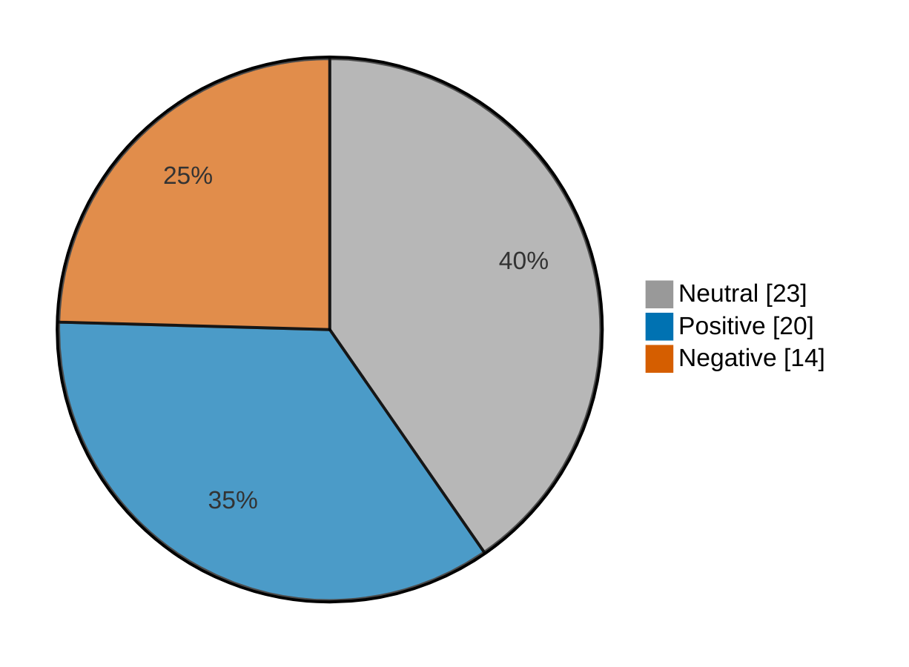

# Newsmood — 2026-10-29

**Mood index: +12.9** (mildly positive) · 57 headlines from 2 sources · model unsure on 6

_Data notes: cnbc-finance had nothing newer than 36 h._

## Mood at a glance

Negative 14 (24.6%) · Positive 20 (35.1%) · Neutral 23 (40.4%)

## What happened

Market news leaned mildly positive today (index +12.9, a rise of 9.1 from yesterday) across 57 headlines, with 3 headlines on higher close, stocks higher and close trade doing most of the work.

**Clusters:**

- 3 headlines on higher close, stocks higher, close trade: 3 positive · +10.1% of the day's movement
- 3 headlines on plunging, plunging today, stock plunging: 2 negative, 1 neutral · -4.8% of the day's movement
- 3 headlines on sliding, sliding today, stock sliding: 3 neutral · +0.0% of the day's movement

_Themes use TF-IDF fit on 755 headlines (2026-09-29–2026-10-29)._

## Recommended articles (highest model certainty, not most important)

### Negative

- [Medicare used AI to pre-approve patient care, and it immediately led to a large drop in medical services](<https://www.marketwatch.com/story/medicare-used-ai-to-pre-approve-patient-care-and-it-immediately-led-to-a-large-drop-in-medical-services-dc38a210?mod=mw_rss_topstories>) · 97% · 3.4% of the day's movement · marketwatch-top
- [Spain stocks lower at close of trade; IBEX 35 down 0.26%](<https://www.investing.com/news/stock-market-news/spain-stocks-lower-at-close-of-trade-ibex-35-down-026-4984805>) · 97% · 3.4% of the day's movement · investing-stocks
- [Hitachi shares slide as Q2 profit drop overshadows strong top-line earnings](<https://www.investing.com/news/stock-market-news/hitachi-shares-slide-as-q2-profit-drop-overshadows-strong-topline-earnings-4981528>) · 95% · 3.3% of the day's movement · investing-stocks

### Positive

- [Merck to boost next decade revenue forecast on new drugs optimism](<https://www.investing.com/news/stock-market-news/merck-tops-thirdquarter-estimates-as-keytruda-gardasil-outperform-4982557>) · 97% · 3.4% of the day's movement · investing-stocks
- [Australia stocks higher at close of trade; S&P/ASX 200 up 0.50%](<https://www.investing.com/news/stock-market-news/australia-stocks-higher-at-close-of-trade-spasx-200-up-050-4981503>) · 97% · 3.4% of the day's movement · investing-stocks
- [U.K. stocks higher at close of trade; Investing.com United Kingdom 100 up 0.24%](<https://www.investing.com/news/stock-market-news/uk-stocks-higher-at-close-of-trade-investingcom-united-kingdom-100-up-024-4984806>) · 97% · 3.4% of the day's movement · investing-stocks

### Neutral

- [Wall Street’s AI bet: Own the infrastructure, collect the rent](<https://www.investing.com/news/stock-market-news/wall-streets-ai-bet-own-the-infrastructure-collect-the-rent-4984798>) · 99% · investing-stocks
- [Clorox appoints Unilever executive as its new CEO](<https://www.investing.com/news/stock-market-news/clorox-appoints-unilever-executive-as-its-new-ceo-4983032>) · 98% · investing-stocks

## Sources

| Source | Headlines | Negative | Neutral | Positive |
|---|--:|--:|--:|--:|
| investing-stocks | 39 | 11 | 13 | 15 |
| marketwatch-top | 18 | 3 | 10 | 5 |

All 57 headlines

| Sentiment | Certainty | Headline | Source |
|---|--:|---|---|
| negative | 97% | [Medicare used AI to pre-approve patient care, and it immediately led to a large drop in medical services](<https://www.marketwatch.com/story/medicare-used-ai-to-pre-approve-patient-care-and-it-immediately-led-to-a-large-drop-in-medical-services-dc38a210?mod=mw_rss_topstories>) | marketwatch-top |
| negative | 97% | [Spain stocks lower at close of trade; IBEX 35 down 0.26%](<https://www.investing.com/news/stock-market-news/spain-stocks-lower-at-close-of-trade-ibex-35-down-026-4984805>) | investing-stocks |
| negative | 95% | [Hitachi shares slide as Q2 profit drop overshadows strong top-line earnings](<https://www.investing.com/news/stock-market-news/hitachi-shares-slide-as-q2-profit-drop-overshadows-strong-topline-earnings-4981528>) | investing-stocks |
| negative | 94% | [Gilead hikes 2026 sales outlook, says Medicare cuts Biktarvy price by 38% starting in 2028](<https://www.investing.com/news/stock-market-news/gilead-hikes-2026-sales-outlook-says-medicare-cuts-biktarvy-price-by-38-starting-in-2028-4985399>) | investing-stocks |
| negative | 93% | [Samsung sees AI chip shortage worsening, keeps investors in suspense on returns](<https://www.investing.com/news/stock-market-news/samsung-posts-record-profit-in-q3-on-ai-chip-boom-4981289>) | investing-stocks |
| negative | 93% | [Caterpillar tops quarterly profit view, but shares sink after unchanged annual growth forecast](<https://www.investing.com/news/stock-market-news/caterpillar-thirdquarter-profit-rises-on-power-equipment-demand-4982548>) | investing-stocks |
| negative | 91% | [Premarket movers: Microsoft rises; Alphabet drags software stocks lower](<https://www.investing.com/news/stock-market-news/premarket-movers-microsoft-rises-alphabet-drags-software-stocks-lower-4982710>) | investing-stocks |
| negative | 87% | [ServiceNow stock is on track for its largest drop on record. But JPMorgan sees a bright spot.](<https://www.marketwatch.com/story/servicenow-stock-is-on-track-for-its-largest-drop-on-record-but-jpmorgan-sees-a-bright-spot-5e5b05c6?mod=mw_rss_topstories>) | marketwatch-top |
| negative | 83% | [The Fed held off on a rate hike. Today’s GDP and inflation reports could make waiting harder.](<https://www.marketwatch.com/story/the-fed-held-off-on-a-rate-hike-todays-gdp-and-inflation-reports-could-make-waiting-harder-693338e6?mod=mw_rss_topstories>) | marketwatch-top |
| negative | 70% | [Why is Hitachi stock plunging today?](<https://www.investing.com/news/stock-market-news/why-is-hitachi-stock-plunging-today-93CH-4981531>) | investing-stocks |
| negative | 69% | [Why is Sprouts Farmers Market stock plunging today?](<https://www.investing.com/news/stock-market-news/why-is-sprouts-farmers-market-stock-plunging-today-93CH-4982947>) | investing-stocks |
| negative | 57% (unsure) | [Micron shares dip as Samsung’s post-earnings selloff spreads to memory peers](<https://www.investing.com/news/stock-market-news/micron-shares-dip-as-samsungs-postearnings-selloff-spreads-to-memory-peers-4983079>) | investing-stocks |
| negative | 56% (unsure) | [BOK board member flags won volatility despite AI chip export boom - RTRS](<https://www.investing.com/news/stock-market-news/bok-board-member-flags-won-volatility-despite-ai-chip-export-boom--rtrs-93CH-4981506>) | investing-stocks |
| negative | 54% (unsure) | [Why is Glaukos stock surging today?](<https://www.investing.com/news/stock-market-news/why-is-glaukos-stock-surging-today-93CH-4983104>) | investing-stocks |
| positive | 97% | [Merck to boost next decade revenue forecast on new drugs optimism](<https://www.investing.com/news/stock-market-news/merck-tops-thirdquarter-estimates-as-keytruda-gardasil-outperform-4982557>) | investing-stocks |
| positive | 97% | [Australia stocks higher at close of trade; S&P/ASX 200 up 0.50%](<https://www.investing.com/news/stock-market-news/australia-stocks-higher-at-close-of-trade-spasx-200-up-050-4981503>) | investing-stocks |
| positive | 97% | [U.K. stocks higher at close of trade; Investing.com United Kingdom 100 up 0.24%](<https://www.investing.com/news/stock-market-news/uk-stocks-higher-at-close-of-trade-investingcom-united-kingdom-100-up-024-4984806>) | investing-stocks |
| positive | 97% | [Netherlands stocks higher at close of trade; AEX up 0.59%](<https://www.investing.com/news/stock-market-news/netherlands-stocks-higher-at-close-of-trade-aex-up-059-4984803>) | investing-stocks |
| positive | 97% | [Crocs shares surge on raised forecast as HEYDUDE turnaround gains traction](<https://www.investing.com/news/stock-market-news/crocs-shares-surge-on-raised-forecast-as-heydude-turnaround-gains-traction-4984820>) | investing-stocks |
| positive | 97% | [Portugal stocks higher at close of trade; PSI up 0.80%](<https://www.investing.com/news/stock-market-news/portugal-stocks-higher-at-close-of-trade-psi-up-080-4984804>) | investing-stocks |
| positive | 97% | [Starbucks sees annual profit above estimates as turnaround gains traction](<https://www.investing.com/news/stock-market-news/starbucks-beats-quarterly-sales-and-profit-expectations-4984998>) | investing-stocks |
| positive | 96% | [Italy stocks higher at close of trade; Investing.com Italy 40 up 0.39%](<https://www.investing.com/news/stock-market-news/italy-stocks-higher-at-close-of-trade-investingcom-italy-40-up-039-4984801>) | investing-stocks |
| positive | 96% | [European shares climb to near 2-month highs as ECB holds rates](<https://www.investing.com/news/stock-market-news/european-shares-steady-ahead-of-ecb-us-core-pce-in-focus-4981622>) | investing-stocks |
| positive | 94% | [Lilly raises outlook for third time this year as Zepbound sales soar](<https://www.marketwatch.com/story/lilly-raises-outlook-for-third-time-this-year-as-zepbound-sales-soar-6d987407?mod=mw_rss_topstories>) | marketwatch-top |
| positive | 94% | [Adidas sees Europe rebound in fourth quarter, streaks ahead in China](<https://www.investing.com/news/stock-market-news/adidas-confirms-preliminary-results-raises-guidance-4981583>) | investing-stocks |
| positive | 93% | [Shell and Total post highest quarterly profit since 2022](<https://www.investing.com/news/stock-market-news/shell-beats-expectations-with-108-billion-thirdquarter-profit-4981606>) | investing-stocks |
| positive | 91% | [Hong Kong keeps base rate at 4.25% after Fed holds steady](<https://www.investing.com/news/stock-market-news/hong-kong-keeps-base-rate-at-425-after-fed-holds-steady-93CH-4981500>) | investing-stocks |
| positive | 89% | [Looking for income? These dividend stocks have high yields that seem well supported.](<https://www.marketwatch.com/story/looking-for-income-these-dividend-stocks-have-high-yields-that-seem-well-supported-81093bdf?mod=mw_rss_topstories>) | marketwatch-top |
| positive | 89% | [This credit card is the ‘best weapon’ to fight debt while interest rates keep climbing](<https://www.marketwatch.com/story/this-credit-card-is-the-best-weapon-to-fight-debt-while-interest-rates-keep-climbing-8378fcf2?mod=mw_rss_topstories>) | marketwatch-top |
| positive | 87% | [Advantest shares jump as AI chip demand drives earnings outlook upgrade](<https://www.investing.com/news/stock-market-news/advantest-shares-jump-as-ai-chip-demand-drives-earnings-outlook-upgrade-4981509>) | investing-stocks |
| positive | 68% | [Coinbase returns to profit as crypto investment gains cushion trading weakness](<https://www.investing.com/news/stock-market-news/coinbase-snaps-losing-streak-with-thirdquarter-profit-on-crypto-trading-rebound-4985073>) | investing-stocks |
| positive | 68% | [Reserve Bank of India steps in to support rupee- Reuters](<https://www.investing.com/news/stock-market-news/reserve-bank-of-india-steps-in-to-support-rupee-reuters-93CH-4981494>) | investing-stocks |
| positive | 61% | [Samsung Electronics earned nearly as much as Microsoft and Alphabet combined. What the Korean giant is now saying about the memory-chip outlook.](<https://www.marketwatch.com/story/samsung-electronics-earned-nearly-as-much-as-microsoft-and-alphabet-combined-what-the-korean-giant-is-now-saying-about-the-memory-chip-outlook-e5c94b94?mod=mw_rss_topstories>) | marketwatch-top |
| positive | 41% (unsure) | [Did the Fed make a mistake with its October rate pause? The Treasury could help save the day.](<https://www.marketwatch.com/story/did-the-fed-make-a-mistake-with-its-october-rate-pause-the-treasury-could-help-save-the-day-77d84993?mod=mw_rss_topstories>) | marketwatch-top |
| neutral | 99% | [Wall Street’s AI bet: Own the infrastructure, collect the rent](<https://www.investing.com/news/stock-market-news/wall-streets-ai-bet-own-the-infrastructure-collect-the-rent-4984798>) | investing-stocks |
| neutral | 98% | [Clorox appoints Unilever executive as its new CEO](<https://www.investing.com/news/stock-market-news/clorox-appoints-unilever-executive-as-its-new-ceo-4983032>) | investing-stocks |
| neutral | 97% | [Analyst explains why you should buy the pullback in Google shares](<https://www.investing.com/news/stock-market-news/analyst-explains-why-you-should-buy-the-pullback-in-google-shares-4983041>) | investing-stocks |
| neutral | 97% | [You can’t rely on the S&P 500 as much as you may think](<https://www.marketwatch.com/story/you-cant-rely-on-the-s-p-500-as-much-as-you-may-think-a3ac0cb7?mod=mw_rss_topstories>) | marketwatch-top |
| neutral | 96% | [The midterms are crucial to the future of Social Security — no matter how old you are](<https://www.marketwatch.com/story/the-midterms-are-crucial-to-the-future-of-social-security-no-matter-how-old-you-are-0f080a9c?mod=mw_rss_topstories>) | marketwatch-top |
| neutral | 95% | [Why is The Star Entertainment stock rallying today?](<https://www.investing.com/news/stock-market-news/why-is-the-star-entertainment-stock-rallying-today-93CH-4981497>) | investing-stocks |
| neutral | 92% | [Is it dumb to take travel advice from influencers?](<https://www.marketwatch.com/story/im-planning-a-trip-to-europe-is-it-dumb-to-take-travel-advice-from-influencers-f25ae756?mod=mw_rss_topstories>) | marketwatch-top |
| neutral | 89% | [Why is DexCom stock climbing today?](<https://www.investing.com/news/stock-market-news/why-is-dexcom-stock-climbing-today-93CH-4985376>) | investing-stocks |
| neutral | 86% | [Aon CEO warns AI data center carry insurance risks](<https://www.investing.com/news/stock-market-news/aon-ceo-warns-ai-data-center-carry-insurance-risks-4984832>) | investing-stocks |
| neutral | 86% | [A Starbucks turnaround is brewing — but perhaps not quickly enough](<https://www.marketwatch.com/story/a-starbucks-turnaround-is-brewing-but-perhaps-not-quickly-enough-3b5f57ac?mod=mw_rss_topstories>) | marketwatch-top |
| neutral | 86% | [Get ready for the ‘Year of Starlink’ as airlines battle over superfast WiFi](<https://www.marketwatch.com/story/get-ready-for-the-year-of-starlink-as-airlines-battle-over-superfast-wifi-6bce32c1?mod=mw_rss_topstories>) | marketwatch-top |
| neutral | 80% | [All the reasons Marvell investors are ’freaking out’ as Lumentum deal rumors swirl](<https://www.marketwatch.com/story/marvell-is-reportedly-close-to-buying-lumentum-analysts-say-they-see-logic-in-a-potential-deal-d7539c59?mod=mw_rss_topstories>) | marketwatch-top |
| neutral | 79% | [It’s the strangest job market the U.S. has ever seen. The low-hire, low-fire economy turns 3 years old.](<https://www.marketwatch.com/story/its-the-strangest-job-market-the-u-s-has-ever-seen-the-low-hire-low-fire-economy-turns-3-years-old-ce8d0dfe?mod=mw_rss_topstories>) | marketwatch-top |
| neutral | 77% | [‘Fancy cars hold no appeal’: We have a 99% chance of outliving our life savings. Why not spend, spend, spend?](<https://www.marketwatch.com/story/fancy-cars-hold-no-appeal-my-wife-and-i-have-a-99-chance-of-outliving-our-savings-why-dont-we-spend-it-all-932a2166?mod=mw_rss_topstories>) | marketwatch-top |
| neutral | 75% | [Why is Strategy stock sliding today?](<https://www.investing.com/news/stock-market-news/why-is-strategy-stock-sliding-today-93CH-4985380>) | investing-stocks |
| neutral | 72% | [Why is Coinbase stock sliding today?](<https://www.investing.com/news/stock-market-news/why-is-coinbase-stock-sliding-today-93CH-4985369>) | investing-stocks |
| neutral | 72% | [Sandisk sees revenue nearly quintuple — and a stock split is on the way](<https://www.marketwatch.com/story/sandisk-sees-revenue-nearly-quintuple-and-its-stock-is-heading-higher-b9318916?mod=mw_rss_topstories>) | marketwatch-top |
| neutral | 69% | [Why is Cavco Industries stock climbing today?](<https://www.investing.com/news/stock-market-news/why-is-cavco-industries-stock-climbing-today-93CH-4985384>) | investing-stocks |
| neutral | 64% | [London’s FTSE edges up as Shell rally and UK budget discipline absorb ECB pause](<https://www.investing.com/news/stock-market-news/ftse-100-today-stocks-edge-up-as-budget-fed-pause-reassure-investors-4981822>) | investing-stocks |
| neutral | 62% | [Why is Renesas Electronics stock sliding today?](<https://www.investing.com/news/stock-market-news/why-is-renesas-electronics-stock-sliding-today-93CH-4981499>) | investing-stocks |
| neutral | 61% | [‘There may be better investment options’: My church received $1.5 million from a parishioner. Is 3.75% interest enough?](<https://www.marketwatch.com/story/there-may-be-better-investment-options-my-church-received-1-5-million-from-a-parishioner-is-3-75-interest-enough-5164d790?mod=mw_rss_topstories>) | marketwatch-top |
| neutral | 53% (unsure) | [Why is Gilead Sciences stock surging today?](<https://www.investing.com/news/stock-market-news/why-is-gilead-sciences-stock-surging-today-93CH-4985390>) | investing-stocks |
| neutral | 52% (unsure) | [Why is Roblox stock plunging today?](<https://www.investing.com/news/stock-market-news/why-is-roblox-stock-plunging-today-93CH-4985377>) | investing-stocks |

---

Certainty is the model's confidence in its label; below 60% it is marked unsure.

"Of the day's movement" is a headline's certainty over the sum of every non-neutral headline's certainty: its part in moving the index. Neutral headlines move it by 0.

Links go to the original publisher; some limit free articles.

Model: kkrit-tinna/newsmood-distilbert-financial@be7b809e0d8f7bd50e77d902aee199363b7e2a66 · Gates: 2/2 passed · 1 data note · Not financial advice.
