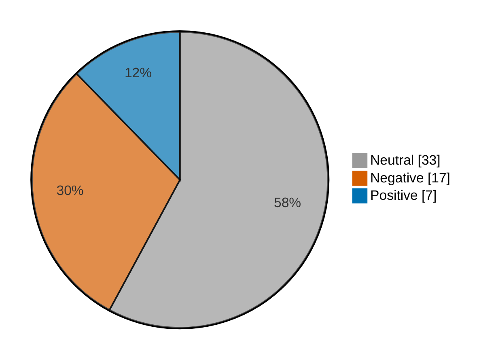

# Newsmood — 2026-10-30

**Mood index: -15.8** (moderately negative) · 57 headlines from 2 sources · model unsure on 10

_Data notes: cnbc-finance had nothing newer than 36 h._

## Mood at a glance

Negative 17 (29.8%) · Positive 7 (12.3%) · Neutral 33 (57.9%)

## What happened

Financial news leaned moderately negative today (index -15.8, down 24.5 from yesterday) over 57 headlines, with no single theme in the lead.

**Clusters:** no clear theme today.

_Themes use TF-IDF fit on 799 headlines (2026-09-30–2026-10-30)._

## Recommended articles (highest model certainty, not most important)

### Negative

- [Taiwan stocks lower at close of trade; Taiwan Weighted down 2.53%](<https://www.investing.com/news/stock-market-news/taiwan-stocks-lower-at-close-of-trade-taiwan-weighted-down-253-4985842>) · 97% · 5.0% of the day's movement · investing-stocks
- [Mexico stocks lower at close of trade; S&P/BMV IPC down 0.01%](<https://www.investing.com/news/stock-market-news/mexico-stocks-lower-at-close-of-trade-spbmv-ipc-down-001-4988776>) · 96% · 5.0% of the day's movement · investing-stocks
- [Reddit, Pinterest shares tumble on weak user and revenue growth](<https://www.investing.com/news/stock-market-news/reddit-pinterest-shares-tumble-on-weak-user-and-revenue-growth-4987225>) · 96% · 5.0% of the day's movement · investing-stocks

### Positive

- [Australia stocks higher at close of trade; S&P/ASX 200 up 0.18%](<https://www.investing.com/news/stock-market-news/australia-stocks-higher-at-close-of-trade-spasx-200-up-018-4985813>) · 97% · 5.0% of the day's movement · investing-stocks
- [Colombia stocks higher at close of trade; COLCAP up 0.04%](<https://www.investing.com/news/stock-market-news/colombia-stocks-higher-at-close-of-trade-colcap-up-004-4988773>) · 97% · 5.0% of the day's movement · investing-stocks
- [Microsoft is winning the cloud wars and becoming Wall Street’s new golden child](<https://www.marketwatch.com/story/microsoft-is-winning-the-cloud-wars-and-becoming-wall-streets-new-golden-child-62eecbbd?mod=mw_rss_topstories>) · 95% · 4.9% of the day's movement · marketwatch-top

### Neutral

- [CD&R pursues buyout of $40 billion payments processor Global Payments, FT reports](<https://www.investing.com/news/stock-market-news/cdr-pursues-buyout-of-40-billion-payments-processor-global-payments-ft-reports-4988379>) · 99% · investing-stocks
- [You can expect the stock market to rally no matter who wins on Election Day](<https://www.marketwatch.com/story/you-can-expect-the-stock-market-to-rally-no-matter-who-wins-on-election-day-d4a3c282?mod=mw_rss_topstories>) · 98% · marketwatch-top

## Sources

| Source | Headlines | Negative | Neutral | Positive |
|---|--:|--:|--:|--:|
| investing-stocks | 37 | 12 | 19 | 6 |
| marketwatch-top | 20 | 5 | 14 | 1 |

All 57 headlines

| Sentiment | Certainty | Headline | Source |
|---|--:|---|---|
| negative | 97% | [Taiwan stocks lower at close of trade; Taiwan Weighted down 2.53%](<https://www.investing.com/news/stock-market-news/taiwan-stocks-lower-at-close-of-trade-taiwan-weighted-down-253-4985842>) | investing-stocks |
| negative | 96% | [Mexico stocks lower at close of trade; S&P/BMV IPC down 0.01%](<https://www.investing.com/news/stock-market-news/mexico-stocks-lower-at-close-of-trade-spbmv-ipc-down-001-4988776>) | investing-stocks |
| negative | 96% | [Reddit, Pinterest shares tumble on weak user and revenue growth](<https://www.investing.com/news/stock-market-news/reddit-pinterest-shares-tumble-on-weak-user-and-revenue-growth-4987225>) | investing-stocks |
| negative | 96% | [Why gold plunged to its lowest price in a year despite renewed Iran jitters](<https://www.marketwatch.com/story/why-gold-plunged-to-its-lowest-price-in-a-year-despite-renewed-iran-jitters-365be0e2?mod=mw_rss_topstories>) | marketwatch-top |
| negative | 95% | [Global chip stocks slide after Intel’s weak outlook](<https://www.investing.com/news/stock-market-news/global-chip-stocks-slide-after-intels-weak-outlook-4987152>) | investing-stocks |
| negative | 91% | [Reddit’s stock logs its biggest one-day drop ever. It’s not the last of the bad news, analysts say.](<https://www.marketwatch.com/story/reddit-shares-on-track-for-largest-ever-one-day-drop-and-analysts-say-the-bad-news-hasnt-ended-25d46284?mod=mw_rss_topstories>) | marketwatch-top |
| negative | 90% | [Nasdaq futures sink as Amazon, Intel intensify AI spending fears](<https://www.investing.com/news/stock-market-news/nasdaq-futures-tumble-as-amazon-intel-results-deepen-ai-spending-woes-4986163>) | investing-stocks |
| negative | 89% | [American workers are finding their take-home pay isn’t keeping up with inflation, with their wallets ‘stretched thinner and thinner’](<https://www.marketwatch.com/story/american-workers-are-finding-their-take-home-pay-isnt-keeping-up-with-inflation-with-their-wallets-stretching-thinner-and-thinner-6a1af690?mod=mw_rss_topstories>) | marketwatch-top |
| negative | 87% | [Intel warning sparks chip rout as PC weakness clouds turnaround](<https://www.investing.com/news/stock-market-news/intel-warning-sparks-chip-rout-as-pc-weakness-clouds-turnaround-4987123>) | investing-stocks |
| negative | 83% | [Trump administration is illegally delaying student-debt forgiveness for tens of thousands of public servants, lawsuit alleges](<https://www.marketwatch.com/story/trump-administration-is-illegally-delaying-student-debt-forgiveness-for-tens-of-thousands-of-public-servants-lawsuit-alleges-e4d31e59?mod=mw_rss_topstories>) | marketwatch-top |
| negative | 69% | [Why is BYD stock slipping today?](<https://www.investing.com/news/stock-market-news/why-is-byd-stock-slipping-today-93CH-4985820>) | investing-stocks |
| negative | 66% | [Premarket movers: Intel, Amazon drop; Crypto stocks slide after Binance theft](<https://www.investing.com/news/stock-market-news/premarket-movers-intel-amazon-drop-crypto-stocks-slide-after-binance-theft-4987099>) | investing-stocks |
| negative | 63% | [BYD shares dip as Q3 earnings disappoint](<https://www.investing.com/news/stock-market-news/byd-shares-dip-as-q3-earnings-disappoint-4985808>) | investing-stocks |
| negative | 55% (unsure) | [Ford targets 20% sales jump by 2032 to 5 million cars annually - report](<https://www.investing.com/news/stock-market-news/ford-targets-20-sales-jump-by-2032-to-5-million-cars-annually--report-4988459>) | investing-stocks |
| negative | 53% (unsure) | [VW suspends work on electric Golf as retrenchment hits HQ](<https://www.investing.com/news/stock-market-news/vw-suspends-work-on-electric-golf-as-retrenchment-hits-hq-4987167>) | investing-stocks |
| negative | 49% (unsure) | [Amazon’s and Intel’s stocks are set to plunge. But Wall Street’s October winners may surprise you.](<https://www.marketwatch.com/story/amazons-and-intels-stocks-are-set-to-plunge-but-wall-streets-october-winners-may-surprise-you-4d74e4d4?mod=mw_rss_topstories>) | marketwatch-top |
| negative | 44% (unsure) | [S&P Global revises Meta’s outlook to ’negative’ on AI spending, cash flow concerns](<https://www.investing.com/news/stock-market-news/sp-global-revises-outlook-on-meta-to-negative-on-cashflow-concerns-4988756>) | investing-stocks |
| positive | 97% | [Australia stocks higher at close of trade; S&P/ASX 200 up 0.18%](<https://www.investing.com/news/stock-market-news/australia-stocks-higher-at-close-of-trade-spasx-200-up-018-4985813>) | investing-stocks |
| positive | 97% | [Colombia stocks higher at close of trade; COLCAP up 0.04%](<https://www.investing.com/news/stock-market-news/colombia-stocks-higher-at-close-of-trade-colcap-up-004-4988773>) | investing-stocks |
| positive | 95% | [Microsoft is winning the cloud wars and becoming Wall Street’s new golden child](<https://www.marketwatch.com/story/microsoft-is-winning-the-cloud-wars-and-becoming-wall-streets-new-golden-child-62eecbbd?mod=mw_rss_topstories>) | marketwatch-top |
| positive | 91% | [Sanofi teases appetite for larger deals, lifts 2026 growth targets under new CEO Garijo](<https://www.investing.com/news/stock-market-news/sanofi-lifts-expectations-for-2026-sales-growth-looks-to-ma-4985889>) | investing-stocks |
| positive | 89% | [Exxon, Chevron profits beat forecasts, refining margins surge during wars](<https://www.investing.com/news/stock-market-news/exxon-chevron-earnings-propelled-by-wardriven-refining-surge-4986750>) | investing-stocks |
| positive | 79% | [Foxconn unveils three new EV models as it expands contract manufacturing push](<https://www.investing.com/news/stock-market-news/foxconn-unveils-three-new-ev-models-as-it-expands-contract-manufacturing-push-4985791>) | investing-stocks |
| positive | 59% (unsure) | [Inovio Pharmaceuticals gets FDA approval for first product](<https://www.investing.com/news/stock-market-news/inovio-pharmaceuticals-gets-fda-approval-for-first-product-93CH-4988824>) | investing-stocks |
| neutral | 99% | [CD&R pursues buyout of $40 billion payments processor Global Payments, FT reports](<https://www.investing.com/news/stock-market-news/cdr-pursues-buyout-of-40-billion-payments-processor-global-payments-ft-reports-4988379>) | investing-stocks |
| neutral | 98% | [You can expect the stock market to rally no matter who wins on Election Day](<https://www.marketwatch.com/story/you-can-expect-the-stock-market-to-rally-no-matter-who-wins-on-election-day-d4a3c282?mod=mw_rss_topstories>) | marketwatch-top |
| neutral | 98% | [Spotify targets 2027 launch for AI remix service, FT reports](<https://www.investing.com/news/stock-market-news/spotify-targets-2027-launch-for-ai-remix-service-ft-reports-4985847>) | investing-stocks |
| neutral | 97% | [My father has early Alzheimer’s and his caregiver is using his debit card for DoorDash. What can I do?](<https://www.marketwatch.com/story/theres-a-lot-of-hurt-between-us-my-fathers-caregiver-is-using-his-debit-card-for-doordash-orders-what-can-i-do-714de7a5?mod=mw_rss_topstories>) | marketwatch-top |
| neutral | 96% | [The big winners of the tech wreck are biopharma stocks](<https://www.marketwatch.com/story/the-big-winners-of-the-tech-wreck-are-biopharma-stocks-2ac4d175?mod=mw_rss_topstories>) | marketwatch-top |
| neutral | 93% | [The selloff in tech stocks is shifting into overdrive](<https://www.marketwatch.com/story/the-selloff-in-tech-stocks-is-shifting-into-overdrive-afb50975?mod=mw_rss_topstories>) | marketwatch-top |
| neutral | 93% | [Why is Colgate-Palmolive stock rallying today?](<https://www.investing.com/news/stock-market-news/why-is-colgatepalmolive-stock-rallying-today-93CH-4987129>) | investing-stocks |
| neutral | 93% | [SpaceX’s Shotwell says 2 million shares to be gifted to children’s Trump Accounts](<https://www.investing.com/news/stock-market-news/spacexs-shotwell-says-2-million-shares-to-be-gifted-to-childrens-trump-accounts-4988802>) | investing-stocks |
| neutral | 92% | [Here’s when Binance plans to reopen after what’s believed to be the largest-ever $6.3 billion hack](<https://www.marketwatch.com/story/heres-when-binance-plans-to-reopen-after-whats-believed-to-be-the-largest-ever-6-3-billion-hack-d3cb8154?mod=mw_rss_topstories>) | marketwatch-top |
| neutral | 92% | [Solidcore founder Anne Mahlum plans enormous 10-bedroom ‘dream home’](<https://www.marketwatch.com/story/solidcore-founder-anne-mahlum-plans-enormous-10-bedroom-dream-home-032e0444?mod=mw_rss_topstories>) | marketwatch-top |
| neutral | 89% | [Here’s the math on Amazon CEO’s claim to be on path to two trillion-dollar revenue businesses](<https://www.marketwatch.com/story/heres-the-math-on-amazon-ceos-claim-to-be-on-path-to-two-trillion-dollar-revenue-businesses-34d648e8?mod=mw_rss_topstories>) | marketwatch-top |
| neutral | 89% | [McDonald’s must face lawsuit over McRib, US judge rules](<https://www.investing.com/news/stock-market-news/mcdonalds-must-face-lawsuit-overmcrib-us-judge-rules-4988646>) | investing-stocks |
| neutral | 88% | [Okta jumps after-hours following tapped inclusion in the S&P 500](<https://www.investing.com/news/stock-market-news/okta-jumps-afterhours-following-tapped-inclusion-in-the-sp-500-4988775>) | investing-stocks |
| neutral | 87% | [Google weighs cybersecurity role in Pentagon’s Golden Dome project - Bloomberg](<https://www.investing.com/news/stock-market-news/google-weighs-cybersecurity-role-in-pentagons-golden-dome-project--bloomberg-4988811>) | investing-stocks |
| neutral | 86% | [FBI and US Secret Service working with Binance after $6.3 billion hack, source says](<https://www.investing.com/news/stock-market-news/fbi-and-us-secret-service-working-withbinance-after63-billion-hack-source-says-4987288>) | investing-stocks |
| neutral | 84% | [In a wild October for markets, these stocks were the biggest winners and losers](<https://www.marketwatch.com/story/in-a-wild-october-for-markets-these-stocks-were-the-biggest-winners-and-losers-3736f043?mod=mw_rss_topstories>) | marketwatch-top |
| neutral | 82% | [Warsh wants the Fed to say less. Two officials are pushing for more transparency.](<https://www.marketwatch.com/story/the-fed-held-interest-rates-steady-but-these-officials-see-more-hikes-coming-soon-2098bbd8?mod=mw_rss_topstories>) | marketwatch-top |
| neutral | 77% | [Why is Arm stock tumbling today?](<https://www.investing.com/news/stock-market-news/why-is-arm-stock-tumbling-today-93CH-4988444>) | investing-stocks |
| neutral | 77% | [‘He was heartbroken’: My husband’s kids abandoned him when he was dying. Was he right to leave everything to me?](<https://www.marketwatch.com/story/he-was-heartbroken-my-husbands-kids-never-helped-when-he-was-gravely-ill-was-he-right-to-leave-everything-to-me-1ad0616b?mod=mw_rss_topstories>) | marketwatch-top |
| neutral | 74% | [OpenAI to limit weapons information for teens on ChatGPT in violence-prevention push](<https://www.investing.com/news/stock-market-news/openai-to-limit-weapons-information-for-teens-on-chatgpt-in-violenceprevention-push-4988471>) | investing-stocks |
| neutral | 74% | [ARM vs Qualcomm: growth premium against valuation cushion](<https://www.investing.com/news/stock-market-news/arm-vs-qualcomm-growth-premium-against-valuation-cushion-93CH-4988447>) | investing-stocks |
| neutral | 72% | [Why is AIA Group stock rising today?](<https://www.investing.com/news/stock-market-news/why-is-aia-group-stock-rising-today-93CH-4985821>) | investing-stocks |
| neutral | 71% | [AMD’s stock slides after Intel earnings reveal two big issues](<https://www.marketwatch.com/story/amds-stock-slides-after-intel-earnings-reveal-two-big-issues-d3afed91?mod=mw_rss_topstories>) | marketwatch-top |
| neutral | 69% | [Private equity in your 401(k)? Heed Warren Buffett’s warning.](<https://www.marketwatch.com/story/private-equity-in-your-401-k-heed-warren-buffetts-warning-6f318cd0?mod=mw_rss_topstories>) | marketwatch-top |
| neutral | 67% | [Why is Apple supplier Luxshare Precision Industry stock sliding today?](<https://www.investing.com/news/stock-market-news/why-is-apple-supplier-luxshare-precision-industry-stock-sliding-today-93CH-4985823>) | investing-stocks |
| neutral | 65% | [Vail Resorts’ biggest investor backs company in fight with activist Oasis](<https://www.investing.com/news/stock-market-news/vail-resorts-biggest-investor-backs-company-in-fight-with-activist-oasis-4988370>) | investing-stocks |
| neutral | 65% | [Why is Qualcomm stock tumbling today?](<https://www.investing.com/news/stock-market-news/why-is-qualcomm-stock-tumbling-today-93CH-4988443>) | investing-stocks |
| neutral | 64% | [Why is Georgia Banking stock climbing today?](<https://www.investing.com/news/stock-market-news/why-is-georgia-banking-stock-climbing-today-93CH-4988812>) | investing-stocks |
| neutral | 58% (unsure) | [AI could hit consumers’ ability to manage their debt. Here’s the trade.](<https://www.marketwatch.com/story/ai-could-hit-consumers-ability-to-manage-their-debt-heres-the-trade-43d1787e?mod=mw_rss_topstories>) | marketwatch-top |
| neutral | 57% (unsure) | [European shares stumble at end of best month since June on AI worries](<https://www.investing.com/news/stock-market-news/european-shares-ease-as-aidriven-tech-selloff-deepens-4986074>) | investing-stocks |
| neutral | 56% (unsure) | [After Intel’s historic stock drop, analysts say there’s no reason to buy the dip](<https://www.marketwatch.com/story/after-intels-historic-stock-drop-analysts-say-theres-no-reason-to-buy-the-dip-068446af?mod=mw_rss_topstories>) | marketwatch-top |
| neutral | 53% (unsure) | [Why is General Dynamics stock surging today?](<https://www.investing.com/news/stock-market-news/why-is-general-dynamics-stock-surging-today-93CH-4987151>) | investing-stocks |
| neutral | 48% (unsure) | [Why is Inovio Pharmaceuticals stock surging today?](<https://www.investing.com/news/stock-market-news/why-is-inovio-pharmaceuticals-stock-surging-today-93CH-4988814>) | investing-stocks |

---

Certainty is the model's confidence in its label; below 60% it is marked unsure.

"Of the day's movement" is a headline's certainty over the sum of every non-neutral headline's certainty: its part in moving the index. Neutral headlines move it by 0.

Links go to the original publisher; some limit free articles.

Model: kkrit-tinna/newsmood-distilbert-financial@be7b809e0d8f7bd50e77d902aee199363b7e2a66 · Gates: 2/2 passed · 1 data note · Not financial advice.
