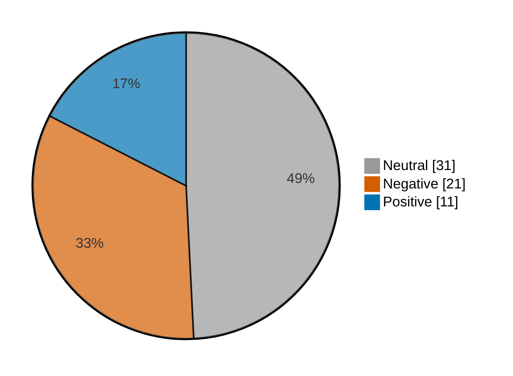

# Newsmood — 2026-11-02

**Mood index: -14.1** (mildly negative) · 63 headlines from 3 sources · model unsure on 11

## Mood at a glance

Negative 21 (33.3%) · Positive 11 (17.5%) · Neutral 31 (49.2%)

## What happened

Market news leaned mildly negative today (index -14.1, down 20.0 from yesterday) across 63 headlines, with no dominant theme.

**Clusters:**

- 4 headlines on surging today, stock surging, surging: 2 negative, 2 neutral · -4.7% of the day's movement
- 4 headlines on analysis, analysis questions, answered: 4 neutral · +0.0% of the day's movement

_Themes use TF-IDF fit on 911 headlines (2026-10-03–2026-11-02)._

## Recommended articles (highest model certainty, not most important)

### Negative

- [Jefferies sees Airbus stock October deliveries down 17% year-over-year](<https://www.investing.com/news/stock-market-news/jefferies-sees-airbus-stock-october-deliveries-down-17-yearoveryear-93CH-4990909>) · 97% · 3.7% of the day's movement · investing-stocks
- [Russia stocks lower at close of trade; MOEX Russia Index down 2.20%](<https://www.investing.com/news/stock-market-news/russia-stocks-lower-at-close-of-trade-moex-russia-index-down-220-4992791>) · 97% · 3.7% of the day's movement · investing-stocks
- [Australia stocks lower at close of trade; S&P/ASX 200 down 0.58%](<https://www.investing.com/news/stock-market-news/australia-stocks-lower-at-close-of-trade-spasx-200-down-058-4989884>) · 97% · 3.7% of the day's movement · investing-stocks

### Positive

- [Apple results beat Wall Street expectations on strong iPhone sales](<https://www.investing.com/news/stock-market-news/apple-results-beat-wall-street-expectationson-strong-iphone-sales-4992898>) · 97% · 3.7% of the day's movement · investing-stocks
- [Goldman upgrades BAT on clearer path to sustained revenue growth](<https://www.investing.com/news/stock-market-news/goldman-upgrades-bat-on-clearer-path-to-sustained-revenue-growth-4990995>) · 96% · 3.7% of the day's movement · investing-stocks
- [MediaTek shares rise as CEO flags strong AI-fueled chip demand](<https://www.investing.com/news/stock-market-news/mediatek-shares-rise-as-ceo-flags-strong-aifueled-chip-demand-4989903>) · 96% · 3.7% of the day's movement · investing-stocks

### Neutral

- [Marine sniper turned macro strategist says this bull market has six to 12 months left. Here’s his playbook.](<https://www.marketwatch.com/story/marine-sniper-turned-macro-strategist-says-this-bull-market-has-six-to-12-months-left-heres-his-playbook-8b48ce6e?mod=mw_rss_topstories>) · 98% · marketwatch-top
- [Marriott earnings analysis: questions answered and next catalysts](<https://www.investing.com/news/stock-market-news/marriott-earnings-analysis-questions-answered-and-next-catalysts-93CH-4992520>) · 98% · investing-stocks

## Sources

| Source | Headlines | Negative | Neutral | Positive |
|---|--:|--:|--:|--:|
| investing-stocks | 37 | 12 | 17 | 8 |
| marketwatch-top | 24 | 9 | 13 | 2 |
| cnbc-finance | 2 | 0 | 1 | 1 |

All 63 headlines

| Sentiment | Certainty | Headline | Source |
|---|--:|---|---|
| negative | 97% | [Jefferies sees Airbus stock October deliveries down 17% year-over-year](<https://www.investing.com/news/stock-market-news/jefferies-sees-airbus-stock-october-deliveries-down-17-yearoveryear-93CH-4990909>) | investing-stocks |
| negative | 97% | [Russia stocks lower at close of trade; MOEX Russia Index down 2.20%](<https://www.investing.com/news/stock-market-news/russia-stocks-lower-at-close-of-trade-moex-russia-index-down-220-4992791>) | investing-stocks |
| negative | 97% | [Australia stocks lower at close of trade; S&P/ASX 200 down 0.58%](<https://www.investing.com/news/stock-market-news/australia-stocks-lower-at-close-of-trade-spasx-200-down-058-4989884>) | investing-stocks |
| negative | 96% | [Anthropic revenue growth slows, compute financing risks mount ahead of IPO](<https://www.investing.com/news/stock-market-news/anthropics-quarterly-loss-shrinks-revenue-jumps-ahead-of-blockbuster-ipo-4992139>) | investing-stocks |
| negative | 96% | [Australian lithium stocks slide as Citi cuts forecasts on weaker battery demand](<https://www.investing.com/news/stock-market-news/australian-lithium-stocks-slide-as-citi-cuts-forecasts-on-weaker-battery-demand-4989875>) | investing-stocks |
| negative | 95% | [Behind Anthropic’s 1,127% revenue surge — and the computing bill that erased its profit](<https://www.marketwatch.com/story/behind-anthropics-1-127-revenue-surge-and-the-computing-bill-that-erased-its-profit-2fe7e513?mod=mw_rss_topstories>) | marketwatch-top |
| negative | 95% | [European shares flat as markets weigh France’s outlook cut; earnings in focus](<https://www.investing.com/news/stock-market-news/european-shares-inch-lower-as-fitch-cuts-frances-outlook-4989985>) | investing-stocks |
| negative | 95% | [DraftKings stock falls as Susquehanna cites unfavorable October hold](<https://www.investing.com/news/stock-market-news/draftkings-stock-falls-as-susquehanna-cites-unfavorable-october-hold-93CH-4990932>) | investing-stocks |
| negative | 93% | [These tech stocks got unfairly swept up in last week’s selloff, analysts say](<https://www.marketwatch.com/story/these-tech-stocks-got-unfairly-swept-up-in-last-weeks-selloff-analysts-say-e296c1b3?mod=mw_rss_topstories>) | marketwatch-top |
| negative | 90% | [S&P 500 ends down; Apple dips ahead of quarterly report](<https://www.investing.com/news/stock-market-news/wall-street-futures-rise-as-ai-stocks-catch-their-breath-midterms-in-focus-4990733>) | investing-stocks |
| negative | 87% | [German metal workers step up strikes in pay dispute](<https://www.investing.com/news/stock-market-news/german-metal-workers-step-up-strikes-in-pay-dispute-4991798>) | investing-stocks |
| negative | 82% | [Booming U.S. manufacturers can’t keep up with demand — and high inflation isn’t helping](<https://www.marketwatch.com/story/booming-u-s-manufacturers-cant-keep-up-with-demand-and-high-inflation-isnt-helping-128a3902?mod=mw_rss_topstories>) | marketwatch-top |
| negative | 73% | [How soon gas prices could go down now that oil is tumbling](<https://www.marketwatch.com/story/how-soon-gas-prices-could-go-down-now-that-oil-is-tumbling-a1140dc2?mod=mw_rss_topstories>) | marketwatch-top |
| negative | 73% | [6 dividend stocks for investors who want to cut their exposure to the S&P 500](<https://www.marketwatch.com/story/6-dividend-stocks-for-investors-who-want-to-cut-their-exposure-to-the-s-p-500-52519928?mod=mw_rss_topstories>) | marketwatch-top |
| negative | 62% | [Why is LG CNS stock surging today?](<https://www.investing.com/news/stock-market-news/why-is-lg-cns-stock-surging-today-93CH-4989910>) | investing-stocks |
| negative | 61% | [Citi throws in the towel on hyperscalers after a key market bet misfires](<https://www.marketwatch.com/story/the-latest-market-wobble-sees-citi-giving-up-on-this-big-tech-trade-181b0dea?mod=mw_rss_topstories>) | marketwatch-top |
| negative | 61% | [Chip stocks are suffering from a ‘crisis of confidence’ — but things aren’t as gloomy as they seem](<https://www.marketwatch.com/story/chip-stocks-are-suffering-from-a-crisis-of-confidence-but-things-arent-as-gloomy-as-they-seem-6ed14ea9?mod=mw_rss_topstories>) | marketwatch-top |
| negative | 59% (unsure) | [Snap settles with two teens during trial testing claims social media caused depression, eating disorders](<https://www.investing.com/news/stock-market-news/snap-settles-with-two-teens-during-trial-testing-claims-social-media-caused-depression-eating-disorders-4992523>) | investing-stocks |
| negative | 58% (unsure) | [Why is Xiaomi stock surging today?](<https://www.investing.com/news/stock-market-news/why-is-xiaomi-stock-surging-today-93CH-4989876>) | investing-stocks |
| negative | 49% (unsure) | [Traders rushing into a leveraged ETF to make a bullish bet on the Nasdaq-100 just got burned](<https://www.marketwatch.com/story/traders-rushing-into-a-leveraged-etf-to-make-a-bullish-bet-on-the-nasdaq-100-just-got-burned-d6775191?mod=mw_rss_topstories>) | marketwatch-top |
| negative | 45% (unsure) | [Wall Street’s most hated stocks are faring far better than its favorites](<https://www.marketwatch.com/story/wall-streets-most-hated-stocks-are-faring-far-better-than-its-favorites-4c1d6c68?mod=mw_rss_topstories>) | marketwatch-top |
| positive | 97% | [Apple results beat Wall Street expectations on strong iPhone sales](<https://www.investing.com/news/stock-market-news/apple-results-beat-wall-street-expectationson-strong-iphone-sales-4992898>) | investing-stocks |
| positive | 96% | [Goldman upgrades BAT on clearer path to sustained revenue growth](<https://www.investing.com/news/stock-market-news/goldman-upgrades-bat-on-clearer-path-to-sustained-revenue-growth-4990995>) | investing-stocks |
| positive | 96% | [MediaTek shares rise as CEO flags strong AI-fueled chip demand](<https://www.investing.com/news/stock-market-news/mediatek-shares-rise-as-ceo-flags-strong-aifueled-chip-demand-4989903>) | investing-stocks |
| positive | 96% | [Tech stocks have made big V-shaped rebounds five times in 30 months — and now Deutsche Bank forecasts another bounce](<https://www.marketwatch.com/story/tech-stocks-have-made-big-v-shaped-rebounds-five-times-in-30-months-and-now-deutsche-bank-forecasts-another-bounce-0a552a62?mod=mw_rss_topstories>) | marketwatch-top |
| positive | 96% | [Tesla’s monthly registrations surge in Northern Europe even as Chinese competition rises](<https://www.investing.com/news/stock-market-news/teslas-monthly-registrations-surge-in-northern-europe-even-as-chinese-competition-rises-4990675>) | investing-stocks |
| positive | 91% | [BofA Securities Keeps Software Top Picks Despite AI Worries](<https://www.investing.com/news/stock-market-news/bofa-securities-keeps-software-top-picks-despite-ai-worries-4990826>) | investing-stocks |
| positive | 90% | [Estee Lauder raises annual forecasts on resilient demand ahead of holiday season](<https://www.investing.com/news/stock-market-news/estee-lauder-raises-annual-forecasts-on-resilient-demand-ahead-of-holiday-season-4990805>) | investing-stocks |
| positive | 80% | [The election will be good news, regardless of outcome, says Morgan Stanley’s chief stock-market strategist](<https://www.marketwatch.com/story/the-election-will-be-good-news-regardless-of-outcome-says-morgan-stanleys-chief-stock-market-strategist-ffa320ed?mod=mw_rss_topstories>) | marketwatch-top |
| positive | 76% | [DeepSeek adds creator mode to boost AI agent tools](<https://www.investing.com/news/stock-market-news/deepseek-adds-creator-mode-to-boost-ai-agent-tools-93CH-4992533>) | investing-stocks |
| positive | 63% | [Xiaomi shares climb as October EV deliveries top 50,000](<https://www.investing.com/news/stock-market-news/xiaomi-shares-climb-as-october-ev-deliveries-top-50000-4989880>) | investing-stocks |
| positive | 42% (unsure) | [Texas governor race tightens in prediction markets, but Abbott remains favored](<https://www.cnbc.com/2026/11/02/texas-governor-prediction-markets-abbott-hinojosa.html>) | cnbc-finance |
| neutral | 98% | [Marine sniper turned macro strategist says this bull market has six to 12 months left. Here’s his playbook.](<https://www.marketwatch.com/story/marine-sniper-turned-macro-strategist-says-this-bull-market-has-six-to-12-months-left-heres-his-playbook-8b48ce6e?mod=mw_rss_topstories>) | marketwatch-top |
| neutral | 98% | [Marriott earnings analysis: questions answered and next catalysts](<https://www.investing.com/news/stock-market-news/marriott-earnings-analysis-questions-answered-and-next-catalysts-93CH-4992520>) | investing-stocks |
| neutral | 98% | [Fox Corp earnings analysis: questions answered and next catalysts](<https://www.investing.com/news/stock-market-news/fox-corp-earnings-analysis-questions-answered-and-next-catalysts-93CH-4992519>) | investing-stocks |
| neutral | 98% | [Tower Semiconductor earnings analysis: questions answered and next catalysts](<https://www.investing.com/news/stock-market-news/tower-semiconductor-earnings-analysis-questions-answered-and-next-catalysts-93CH-4992521>) | investing-stocks |
| neutral | 98% | [Retired World Series champ Matt Holliday lists $11.6 million Arizona estate he bought months ago](<https://www.marketwatch.com/story/retired-world-series-champ-matt-holliday-lists-11-6-million-arizona-estate-he-bought-months-ago-a48b6a9b?mod=mw_rss_topstories>) | marketwatch-top |
| neutral | 98% | [Estee Lauder earnings analysis: questions answered and next catalysts](<https://www.investing.com/news/stock-market-news/estee-lauder-earnings-analysis-questions-answered-and-next-catalysts-93CH-4992522>) | investing-stocks |
| neutral | 98% | [Stock market after midterm elections: What S&P 500 history shows](<https://www.cnbc.com/2026/11/02/stock-market-after-midterm-elections-sp-500-history.html>) | cnbc-finance |
| neutral | 97% | [‘She’s a Type A personality’: My stepmother wants me to repay my late father’s $40,000 wedding gift. Should I oblige?](<https://www.marketwatch.com/story/shes-a-type-a-personality-my-stepmother-wants-me-to-repay-my-late-fathers-40-000-wedding-gift-should-i-oblige-51fc64f7?mod=mw_rss_topstories>) | marketwatch-top |
| neutral | 97% | [New cyberattack on supermarket fridges sweeps across Europe](<https://www.investing.com/news/stock-market-news/cyberattack-on-fridges-hits-supermarkets-across-europe-4991995>) | investing-stocks |
| neutral | 97% | [It may take weeks to tally the midterm election results. Here’s why Wall Street isn’t worried.](<https://www.marketwatch.com/story/it-may-take-weeks-to-tally-the-midterm-election-results-heres-why-wall-street-isnt-worried-ed9313fd?mod=mw_rss_topstories>) | marketwatch-top |
| neutral | 97% | [Your stock portfolio increasingly hinges on the bond market — and the midterm elections](<https://www.marketwatch.com/story/your-stock-portfolio-increasingly-hinges-on-the-bond-market-and-the-midterm-elections-dc1abadb?mod=mw_rss_topstories>) | marketwatch-top |
| neutral | 97% | [Exclusive-Veteran US proxy solicitors launch new firm Senpoint Partners](<https://www.investing.com/news/stock-market-news/exclusiveveteran-us-proxy-solicitors-launch-new-firm-senpoint-partners-4991280>) | investing-stocks |
| neutral | 96% | [5 celebrities who waited years to buy their dream homes](<https://www.marketwatch.com/story/5-celebrities-who-waited-years-to-buy-their-dream-homes-f1551973?mod=mw_rss_topstories>) | marketwatch-top |
| neutral | 94% | [Oracle wants $20 billion to fund its AI future — and its stock is paying the price](<https://www.marketwatch.com/story/oracles-stock-falls-as-the-company-details-plan-to-raise-20-billion-f03f5e16?mod=mw_rss_topstories>) | marketwatch-top |
| neutral | 94% | [Glencore proposes CEO pay changes to speed takeover payouts- FT](<https://www.investing.com/news/stock-market-news/glencore-proposes-ceo-pay-changes-to-speed-takeover-payouts-ft-93CH-4989879>) | investing-stocks |
| neutral | 93% | [‘It seems bizarre’: We’re in our 80s with $950,000 in traditional IRAs. Why is our adviser pushing us to do Roth conversions?](<https://www.marketwatch.com/story/it-seems-bizarre-were-in-our-80s-with-950-000-in-traditional-iras-why-is-our-adviser-pushing-us-to-do-roth-conversions-a665f990?mod=mw_rss_topstories>) | marketwatch-top |
| neutral | 91% | [UBS flags Chipotle stock among most crowded restaurant longs](<https://www.investing.com/news/stock-market-news/ubs-flags-chipotle-stock-among-most-crowded-restaurant-longs-93CH-4990871>) | investing-stocks |
| neutral | 90% | [The stock market has gone nowhere for the past 5 months. It’s now looking like a bargain.](<https://www.marketwatch.com/story/the-stock-market-has-gone-nowhere-for-the-past-5-months-its-now-looking-like-a-bargain-150914c2?mod=mw_rss_topstories>) | marketwatch-top |
| neutral | 90% | [When you turn this age, it’s your best chance to get crucial tax and healthcare plans in place for retirement](<https://www.marketwatch.com/story/when-you-turn-this-age-its-your-best-chance-to-get-crucial-tax-and-healthcare-plans-in-place-for-retirement-e9400392?mod=mw_rss_topstories>) | marketwatch-top |
| neutral | 90% | [Crypto.com to exit Hong Kong consumer app citing operations - Bloomberg](<https://www.investing.com/news/stock-market-news/cryptocom-to-exit-hong-kong-consumer-app-citing-operations--bloomberg-93CH-4992534>) | investing-stocks |
| neutral | 89% | [SpaceX in talks to buy Boost Mobile or use its network, Washington Post reports](<https://www.investing.com/news/stock-market-news/spacex-in-talks-to-buy-boost-mobile-or-use-its-network-washington-post-reports-4990666>) | investing-stocks |
| neutral | 89% | [Why is BYD stock rising today?](<https://www.investing.com/news/stock-market-news/why-is-byd-stock-rising-today-93CH-4989867>) | investing-stocks |
| neutral | 81% | [Marvell’s deal for Lumentum is giving flashbacks to the dot-com bubble](<https://www.marketwatch.com/story/marvell-and-lumentum-officially-plan-to-combine-heres-what-to-know-5599b98a?mod=mw_rss_topstories>) | marketwatch-top |
| neutral | 73% | [Why is Hanwha Ocean stock surging today?](<https://www.investing.com/news/stock-market-news/why-is-hanwha-ocean-stock-surging-today-93CH-4989909>) | investing-stocks |
| neutral | 71% | [Binance clients pull $4.7 billion after hack as crypto world studies fallout](<https://www.investing.com/news/stock-market-news/binance-sees-outflows-stabilising-as-exchange-returns-online-after-63-billionheist-4989802>) | investing-stocks |
| neutral | 60% (unsure) | [Why is Kosmos Energy stock sliding today?](<https://www.investing.com/news/stock-market-news/why-is-kosmos-energy-stock-sliding-today-93CH-4991013>) | investing-stocks |
| neutral | 55% (unsure) | [Why is Sungrow Power Supply stock surging today?](<https://www.investing.com/news/stock-market-news/why-is-sungrow-power-supply-stock-surging-today-93CH-4989878>) | investing-stocks |
| neutral | 55% (unsure) | [How oil prices could average $130 per barrel next year, according to Goldman Sachs](<https://www.marketwatch.com/story/how-oil-prices-could-average-130-per-barrel-next-year-according-to-goldman-sachs-235ce32b?mod=mw_rss_topstories>) | marketwatch-top |
| neutral | 53% (unsure) | [Palantir earnings reveal a major AI turning point](<https://www.marketwatch.com/story/palantir-earnings-reveal-a-major-ai-turning-point-db766110?mod=mw_rss_topstories>) | marketwatch-top |
| neutral | 50% (unsure) | [Why is Palantir Technologies stock rising today?](<https://www.investing.com/news/stock-market-news/why-is-palantir-technologies-stock-rising-today-93CH-4992945>) | investing-stocks |
| neutral | 41% (unsure) | [Major automakers urge US Congress to pass permanent ban on Chinese vehicles](<https://www.investing.com/news/stock-market-news/major-automakers-urge-us-congress-to-pass-permanent-ban-on-chinese-vehicles-4992433>) | investing-stocks |

---

Certainty is the model's confidence in its label; below 60% it is marked unsure.

"Of the day's movement" is a headline's certainty over the sum of every non-neutral headline's certainty: its part in moving the index. Neutral headlines move it by 0.

Links go to the original publisher; some limit free articles.

Model: kkrit-tinna/newsmood-distilbert-financial@be7b809e0d8f7bd50e77d902aee199363b7e2a66 · Gates: 2/2 passed · Not financial advice.
