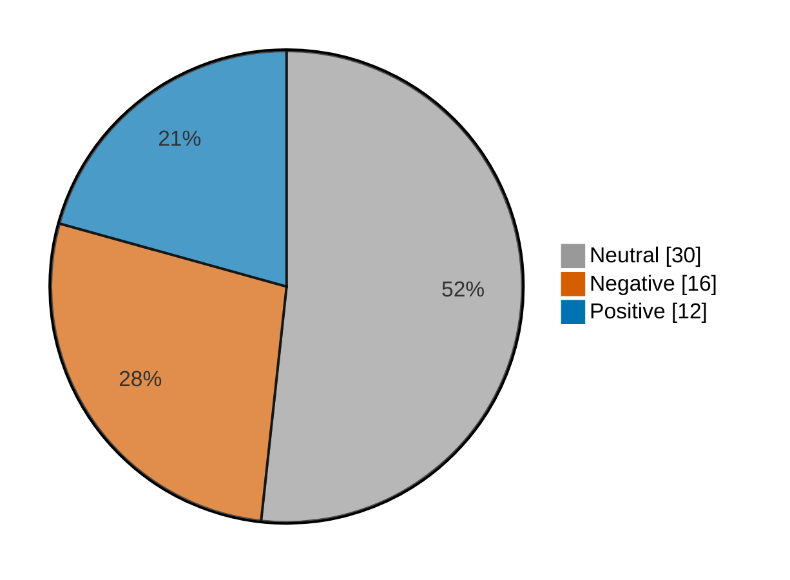

# Newsmood — 2026-11-03

**Mood index: -5.8** (mildly negative) · 58 headlines from 3 sources · model unsure on 10

## Mood at a glance

Negative 16 (27.6%) · Positive 12 (20.7%) · Neutral 30 (51.7%)

## What happened

Financial coverage leaned mildly negative today (index -5.8, up 11.3 from yesterday) from 58 headlines, with no dominant theme.

**Clusters:**

- 3 headlines on surging today, stock surging, surging: 3 neutral · +0.0% of the day's movement

_Themes use TF-IDF fit on 980 headlines (2026-10-04–2026-11-03)._

## Recommended articles (highest model certainty, not most important)

### Negative

- [U.K. stocks lower at close of trade; Investing.com United Kingdom 100 down 1.22%](<https://www.investing.com/news/stock-market-news/uk-stocks-lower-at-close-of-trade-investingcom-united-kingdom-100-down-122-4996092>) · 97% · 4.3% of the day's movement · investing-stocks
- [Spain stocks lower at close of trade; IBEX 35 down 0.79%](<https://www.investing.com/news/stock-market-news/spain-stocks-lower-at-close-of-trade-ibex-35-down-079-4996091>) · 97% · 4.3% of the day's movement · investing-stocks
- [Thomson Reuters revenue rises, shares drop on investment costs](<https://www.investing.com/news/stock-market-news/thomson-reuters-reports-higher-thirdquarter-revenue-4994698>) · 94% · 4.2% of the day's movement · investing-stocks

### Positive

- [Australia stocks higher at close of trade; S&P/ASX 200 up 0.34%](<https://www.investing.com/news/stock-market-news/australia-stocks-higher-at-close-of-trade-spasx-200-up-034-4993512>) · 97% · 4.3% of the day's movement · investing-stocks
- [DuPont raises full-year profit forecasts on strong healthcare, aerospace demand](<https://www.investing.com/news/stock-market-news/dupont-raises-fullyear-profit-forecasts-on-strong-healthcare-aerospace-demand-4994426>) · 96% · 4.2% of the day's movement · investing-stocks
- [AMD forecasts quarterly revenue above estimates as data-center growth accelerates](<https://www.investing.com/news/stock-market-news/amd-forecasts-quarterly-revenue-above-estimates-as-datacenter-growth-accelerates-4996502>) · 96% · 4.2% of the day's movement · investing-stocks

### Neutral

- [After-Hours Movers: AMD, SMCI, SWKS, NRIX, TOST, BKNG](<https://www.investing.com/news/stock-market-news/afterhours-movers-amd-smci-swks-nrix-tost-bkng-432SI-4996579>) · 99% · investing-stocks
- [U.S. clears path for first regulated equity perpetual futures](<https://www.marketwatch.com/story/u-s-clears-path-for-first-regulated-equity-perpetual-futures-6bb35905?mod=mw_rss_topstories>) · 98% · marketwatch-top

## Sources

| Source | Headlines | Negative | Neutral | Positive |
|---|--:|--:|--:|--:|
| investing-stocks | 38 | 12 | 17 | 9 |
| marketwatch-top | 19 | 4 | 13 | 2 |
| cnbc-finance | 1 | 0 | 0 | 1 |

All 58 headlines

| Sentiment | Certainty | Headline | Source |
|---|--:|---|---|
| negative | 97% | [U.K. stocks lower at close of trade; Investing.com United Kingdom 100 down 1.22%](<https://www.investing.com/news/stock-market-news/uk-stocks-lower-at-close-of-trade-investingcom-united-kingdom-100-down-122-4996092>) | investing-stocks |
| negative | 97% | [Spain stocks lower at close of trade; IBEX 35 down 0.79%](<https://www.investing.com/news/stock-market-news/spain-stocks-lower-at-close-of-trade-ibex-35-down-079-4996091>) | investing-stocks |
| negative | 94% | [Thomson Reuters revenue rises, shares drop on investment costs](<https://www.investing.com/news/stock-market-news/thomson-reuters-reports-higher-thirdquarter-revenue-4994698>) | investing-stocks |
| negative | 94% | [Apple shares slide as higher memory costs fuel margin concerns](<https://www.investing.com/news/stock-market-news/apple-shares-slide-as-higher-memory-costs-fuel-margin-concerns-4994517>) | investing-stocks |
| negative | 94% | [What analysts are saying as Apple’s stock falls after earnings report](<https://www.marketwatch.com/story/what-analysts-are-saying-as-apples-stock-falls-after-earnings-report-f0afa357?mod=mw_rss_topstories>) | marketwatch-top |
| negative | 90% | [Setback for Google as EU court adviser sides with publishers against AI chatbot](<https://www.investing.com/news/stock-market-news/googles-use-of-press-by-ai-chatbot-may-infringe-copyright-rules-eu-court-adviser-says-4994030>) | investing-stocks |
| negative | 87% | [AI-related debt binge may pressure European bond markets](<https://www.investing.com/news/stock-market-news/airelated-debt-binge-may-pressure-european-bond-markets-4993497>) | investing-stocks |
| negative | 86% | [Medicare prescription drug costs will jump 50% in 2027. Doing nothing could cost you.](<https://www.marketwatch.com/story/medicare-prescription-drug-costs-will-jump-50-in-2027-doing-nothing-could-cost-you-b701dfb7?mod=mw_rss_topstories>) | marketwatch-top |
| negative | 84% | [European shares slide as Apple margin warning trigger global tech rout](<https://www.investing.com/news/stock-market-news/european-shares-slide-as-apple-margin-warning-trigger-global-tech-rout-4993704>) | investing-stocks |
| negative | 74% | [Australian, Chinese airline stocks jump as oil prices plunge more than 7%](<https://www.investing.com/news/stock-market-news/australian-chinese-airline-stocks-jump-as-oil-prices-plunge-more-than-7-4993511>) | investing-stocks |
| negative | 71% | [The internet is ‘dying’: AI is eating it and obliterating these business models](<https://www.marketwatch.com/story/the-internet-is-dying-ai-is-eating-it-and-obliterating-these-business-models-435ae2b0?mod=mw_rss_topstories>) | marketwatch-top |
| negative | 68% | [This signal from the corporate bond market has historically preceded big drawdowns for the S&P 500](<https://www.marketwatch.com/story/this-signal-from-the-corporate-bond-market-has-historically-preceded-big-drawdowns-for-the-s-p-500-8c1a3d25?mod=mw_rss_topstories>) | marketwatch-top |
| negative | 65% | [Rising shorts cool U.S. large-cap positioning, cutting liquidation risk: Citi](<https://www.investing.com/news/stock-market-news/rising-shorts-cool-us-largecap-positioning-cutting-liquidation-risk-citi-4994458>) | investing-stocks |
| negative | 59% (unsure) | [Why is Skyworks Solutions stock plunging today?](<https://www.investing.com/news/stock-market-news/why-is-skyworks-solutions-stock-plunging-today-93CH-4996569>) | investing-stocks |
| negative | 56% (unsure) | [Betting on US midterms brings rush, stress as serious money goes on the line](<https://www.investing.com/news/stock-market-news/betting-on-us-midterms-brings-rush-stress-as-serious-money-goes-on-the-line-4994404>) | investing-stocks |
| negative | 52% (unsure) | [Big-ticket tech deals need to keep pace with AI boom but risks remain high, financial leaders say](<https://www.investing.com/news/stock-market-news/blackstone-president-says-more-tech-sector-fundraising-ahead-to-keep-up-with-ai-industry-growth-4993385>) | investing-stocks |
| positive | 97% | [Australia stocks higher at close of trade; S&P/ASX 200 up 0.34%](<https://www.investing.com/news/stock-market-news/australia-stocks-higher-at-close-of-trade-spasx-200-up-034-4993512>) | investing-stocks |
| positive | 96% | [DuPont raises full-year profit forecasts on strong healthcare, aerospace demand](<https://www.investing.com/news/stock-market-news/dupont-raises-fullyear-profit-forecasts-on-strong-healthcare-aerospace-demand-4994426>) | investing-stocks |
| positive | 96% | [AMD forecasts quarterly revenue above estimates as data-center growth accelerates](<https://www.investing.com/news/stock-market-news/amd-forecasts-quarterly-revenue-above-estimates-as-datacenter-growth-accelerates-4996502>) | investing-stocks |
| positive | 95% | [ADM beats quarterly estimates, lifts annual profit forecast on stronger processing margins](<https://www.investing.com/news/stock-market-news/adm-beats-quarterly-estimates-lifts-annual-profit-forecast-on-stronger-processing-margins-4994514>) | investing-stocks |
| positive | 95% | [Super Micro’s stock pops as earnings show booming demand for AI servers](<https://www.marketwatch.com/story/super-micros-stock-pops-as-earnings-show-booming-demand-for-ai-servers-2d179658?mod=mw_rss_topstories>) | marketwatch-top |
| positive | 95% | [S&P lifts Ford outlook to stable on cost cuts and cash flow recovery](<https://www.investing.com/news/stock-market-news/sp-lifts-ford-outlook-to-stable-on-cost-cuts-and-cash-flow-recovery-4996100>) | investing-stocks |
| positive | 94% | [Yorkville Ives names top software pick for 2027: Microsoft leads on AI strength](<https://www.investing.com/news/stock-market-news/yorkville-ives-names-top-software-pick-for-2027-microsoft-leads-on-ai-strength-4996121>) | investing-stocks |
| positive | 89% | [AI’s control over the bond market is growing — even rivaling war and elections](<https://www.marketwatch.com/story/ais-control-over-the-bond-market-is-growing-even-rivaling-war-and-elections-5d727b35?mod=mw_rss_topstories>) | marketwatch-top |
| positive | 85% | [S&P futures dip, Nasdaq futures higher ahead of U.S. midterms](<https://www.investing.com/news/stock-market-news/us-stock-futures-steady-apple-dips-after-mixed-earnings-4993314>) | investing-stocks |
| positive | 61% | [Ackman’s Pershing Square adds seven investments in 2026, reports Q3 loss](<https://www.investing.com/news/stock-market-news/ackmans-pershing-squareadds-seven-investments-in-2026-reports-q3-loss-4993496>) | investing-stocks |
| positive | 58% (unsure) | [Blackstone president calls for more equity to fund AI buildout as debt risks mount](<https://www.cnbc.com/2026/11/03/equity-ai-debt-blackstone-pimco-financing.html>) | cnbc-finance |
| positive | 36% (unsure) | [Wall Street bull HSBC’s Kettner says ‘more pain to come’ for stocks](<https://www.investing.com/news/stock-market-news/wall-street-bull-hsbcs-kettner-says-more-pain-to-come-for-stocks-4994456>) | investing-stocks |
| neutral | 99% | [After-Hours Movers: AMD, SMCI, SWKS, NRIX, TOST, BKNG](<https://www.investing.com/news/stock-market-news/afterhours-movers-amd-smci-swks-nrix-tost-bkng-432SI-4996579>) | investing-stocks |
| neutral | 98% | [U.S. clears path for first regulated equity perpetual futures](<https://www.marketwatch.com/story/u-s-clears-path-for-first-regulated-equity-perpetual-futures-6bb35905?mod=mw_rss_topstories>) | marketwatch-top |
| neutral | 98% | [5 questions to ask if your boss offers you a buyout, as Microsoft did with 60,000 employees](<https://www.marketwatch.com/story/5-questions-to-ask-if-your-boss-offers-you-a-buyout-as-microsoft-did-with-60-000-employees-03d037a5?mod=mw_rss_topstories>) | marketwatch-top |
| neutral | 98% | [Roundup settlement expected before Christmas, Bayer CEO says](<https://www.investing.com/news/stock-market-news/roundup-settlement-expected-before-christmas-bayer-ceo-says-4994305>) | investing-stocks |
| neutral | 97% | [Depressing, but true: If you want to get ahead at work, embrace virtue signaling](<https://www.marketwatch.com/story/depressing-but-true-if-you-want-to-get-ahead-at-work-embrace-virtue-signaling-b4e72f0a?mod=mw_rss_topstories>) | marketwatch-top |
| neutral | 97% | [AIG beats profit estimates on premium growth, investment income](<https://www.investing.com/news/stock-market-news/aig-beats-profit-estimates-on-premium-growth-investment-income-4996500>) | investing-stocks |
| neutral | 97% | [Berkshire-owned utility’s wildfire lawsuits head to Oregon Supreme Court](<https://www.investing.com/news/stock-market-news/berkshireowned-utilitys-wildfire-lawsuits-head-to-oregon-supreme-court-4994396>) | investing-stocks |
| neutral | 97% | [Marathon beats quarterly estimates, to sell two refineries to CVR Energy](<https://www.investing.com/news/stock-market-news/marathon-beats-quarterly-estimates-to-sell-two-refineries-to-cvr-energy-4995111>) | investing-stocks |
| neutral | 96% | [S&P 500 is looking over the edge of a technical cliff — what happens if it falls off?](<https://www.marketwatch.com/story/s-p-500-is-looking-over-the-edge-of-a-technical-cliff-what-happens-if-it-falls-off-be97ebd9?mod=mw_rss_topstories>) | marketwatch-top |
| neutral | 94% | [Motivational speaker Mel Robbins’ real estate journey from a Massachusetts farmhouse to a Vermont retreat](<https://www.marketwatch.com/story/motivational-speaker-mel-robbins-real-estate-journey-from-a-massachusetts-farmhouse-to-a-vermont-retreat-85b4d958?mod=mw_rss_topstories>) | marketwatch-top |
| neutral | 94% | [The Texas governor’s race might be a make-or-break contest for a wobbling AI trade](<https://www.marketwatch.com/story/the-texas-governors-race-might-be-a-make-or-break-contest-for-a-wobbling-ai-trade-7764aa29?mod=mw_rss_topstories>) | marketwatch-top |
| neutral | 93% | [SK Hynix tests SMA(50) cloud resistance after Double Bottom: Live](<https://www.investing.com/news/stock-market-news/sk-hynix-trapped-in-cloud-resistance-bear-flag-live-levels-93CH-4989796>) | investing-stocks |
| neutral | 93% | [Booking Holdings takes $900 million hit to quarterly revenue linked to FTC action](<https://www.investing.com/news/stock-market-news/booking-holdings-takes-900-million-hit-to-quarterly-revenue-linked-to-ftc-action-4996593>) | investing-stocks |
| neutral | 92% | [‘It’s good to be old’: I’ve been invited to a dozen free meals that turn into annuity sales pitches. Should I stop going?](<https://www.marketwatch.com/story/its-good-to-be-old-ive-been-invited-to-a-dozen-free-meals-that-turn-into-annuity-sales-pitches-should-i-stop-going-63df67ca?mod=mw_rss_topstories>) | marketwatch-top |
| neutral | 88% | [Why is Unum stock gaining in after-hours trading today?](<https://www.investing.com/news/stock-market-news/why-is-unum-stock-gaining-in-afterhours-trading-today-93CH-4996572>) | investing-stocks |
| neutral | 88% | [Anthropic’s IPO is a high-stakes referendum on Big Tech — and this chart proves it](<https://www.marketwatch.com/story/anthropics-ipo-is-a-high-stakes-referendum-on-big-tech-and-this-chart-proves-it-d1c54d33?mod=mw_rss_topstories>) | marketwatch-top |
| neutral | 85% | [Shopify’s stock slides after earnings. This is what’s worrying Wall Street.](<https://www.marketwatch.com/story/shopifys-stock-slides-after-earnings-this-is-whats-worrying-wall-street-e2e8d52b?mod=mw_rss_topstories>) | marketwatch-top |
| neutral | 79% | [Why is Amgen stock sliding today?](<https://www.investing.com/news/stock-market-news/why-is-amgen-stock-sliding-today-93CH-4996548>) | investing-stocks |
| neutral | 78% | [CVR Energy nears $4 bln deal for Marathon refineries- WSJ](<https://www.investing.com/news/stock-market-news/cvr-energy-nears-4-bln-deal-for-marathon-refineries-wsj-4993499>) | investing-stocks |
| neutral | 76% | [Thousands of Disney job cuts may be coming. Investors are asking what comes next.](<https://www.marketwatch.com/story/thousands-of-disney-job-cuts-may-be-coming-investors-are-asking-what-comes-next-19cc0662?mod=mw_rss_topstories>) | marketwatch-top |
| neutral | 73% | [Why is Fresenius Medical Care stock rallying today?](<https://www.investing.com/news/stock-market-news/why-is-fresenius-medical-care-stock-rallying-today-93CH-4994425>) | investing-stocks |
| neutral | 66% | [Why is Block stock surging today?](<https://www.investing.com/news/stock-market-news/why-is-block-stock-surging-today-93CH-4996549>) | investing-stocks |
| neutral | 66% | [Why is Haidilao stock surging today?](<https://www.investing.com/news/stock-market-news/why-is-haidilao-stock-surging-today-93CH-4993500>) | investing-stocks |
| neutral | 64% | [Why is Lenovo stock sliding today?](<https://www.investing.com/news/stock-market-news/why-is-lenovo-stock-sliding-today-93CH-4993528>) | investing-stocks |
| neutral | 60% | [Why is Duolingo stock surging today?](<https://www.investing.com/news/stock-market-news/why-is-duolingo-stock-surging-today-93CH-4996571>) | investing-stocks |
| neutral | 55% (unsure) | [An overlooked energy source could solve AI’s power crunch — and these 2 stocks are prime plays](<https://www.marketwatch.com/story/an-overlooked-energy-source-could-solve-ais-power-crunch-and-these-2-stocks-are-prime-plays-bc5d988a?mod=mw_rss_topstories>) | marketwatch-top |
| neutral | 55% (unsure) | [Oil has had a massive run, but a prominent bull sees a turning point on midterm eve](<https://www.marketwatch.com/story/oil-has-had-a-massive-run-but-a-prominent-bull-sees-a-turning-point-on-midterm-eve-be2c5fa7?mod=mw_rss_topstories>) | marketwatch-top |
| neutral | 54% (unsure) | [Polymarket unit gets US industry organization’s approval to be futures broker](<https://www.investing.com/news/stock-market-news/polymarket-unit-gets-us-industry-organizations-approval-to-be-futures-broker-4996123>) | investing-stocks |
| neutral | 50% (unsure) | [Reddit blasts Australia’s ’inept’ social media ban as court challenge begins](<https://www.investing.com/news/stock-market-news/reddit-blasts-australias-inept-social-media-ban-as-court-challenge-begins-4993479>) | investing-stocks |
| neutral | 48% (unsure) | [U.S. jobs market perks up, but it’s still not a great time to get hired](<https://www.marketwatch.com/story/u-s-jobs-market-perks-up-but-its-still-not-a-great-time-to-get-hired-bc39f44f?mod=mw_rss_topstories>) | marketwatch-top |

---

Certainty is the model's confidence in its label; below 60% it is marked unsure.

"Of the day's movement" is a headline's certainty over the sum of every non-neutral headline's certainty: its part in moving the index. Neutral headlines move it by 0.

Links go to the original publisher; some limit free articles.

Model: kkrit-tinna/newsmood-distilbert-financial@be7b809e0d8f7bd50e77d902aee199363b7e2a66 · Gates: 2/2 passed · Not financial advice.
