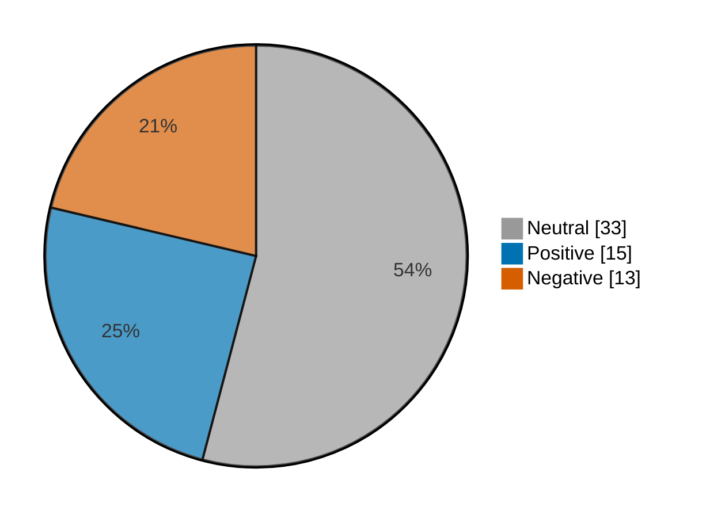

# Newsmood — 2026-11-04

**Mood index: +3.1** (roughly flat) · 61 headlines from 2 sources · model unsure on 6

## Mood at a glance

Negative 13 (21.3%) · Positive 15 (24.6%) · Neutral 33 (54.1%)

## What happened

Financial coverage was roughly flat today (index +3.1, up 10.0 from yesterday) over 61 headlines, with no dominant theme.

**Clusters:**

- 6 headlines on analysis, analysis questions, answered: 6 neutral · +0.0% of the day's movement
- 3 headlines on surging today, stock surging, surging: 3 neutral · +0.0% of the day's movement

_Themes use TF-IDF fit on 1051 headlines (2026-10-05–2026-11-04)._

## Recommended articles (highest model certainty, not most important)

### Negative

- [Australia stocks lower at close of trade; S&P/ASX 200 down 0.59%](<https://www.investing.com/news/stock-market-news/australia-stocks-lower-at-close-of-trade-spasx-200-down-059-4997355>) · 97% · 3.9% of the day's movement · investing-stocks
- [Qualcomm’s smartphone chip sales miss estimates, shares fall](<https://www.investing.com/news/stock-market-news/qualcomm-forecasts-upbeat-sales-on-strength-in-nonsmartphone-segments-5001228>) · 96% · 3.9% of the day's movement · investing-stocks
- [Uber’s profit forecast disappoints as driver shortages, Middle East conflict hurt](<https://www.investing.com/news/stock-market-news/ubers-profit-forecast-disappoints-as-driver-shortages-middle-east-conflict-hurt-4998735>) · 95% · 3.9% of the day's movement · investing-stocks

### Positive

- [Mexico stocks higher at close of trade; S&P/BMV IPC up 0.87%](<https://www.investing.com/news/stock-market-news/mexico-stocks-higher-at-close-of-trade-spbmv-ipc-up-087-5001377>) · 97% · 3.9% of the day's movement · investing-stocks
- [Microsoft and Amazon combined to see a $424 billion market-cap boost — and these factors show why](<https://www.marketwatch.com/story/microsoft-and-amazon-combine-for-a-400-billion-market-cap-boost-and-these-factors-show-why-6655d1a9?mod=mw_rss_topstories>) · 97% · 3.9% of the day's movement · marketwatch-top
- [These stocks soared the most today after the Democrats trounced Trump](<https://www.marketwatch.com/story/these-stocks-have-soared-the-most-today-after-the-democrats-trounced-trump-9d785314?mod=mw_rss_topstories>) · 96% · 3.9% of the day's movement · marketwatch-top

### Neutral

- [After-Hours Movers: QCOM, COHR, APP, HUBS, SNAP, FSLY, FIG, ZG, BROS, CDE](<https://www.investing.com/news/stock-market-news/afterhours-movers-qcom-cohr-app-hubs-snap-fsly-fig-zg-bros-cde-432SI-5001535>) · 98% · investing-stocks
- [Block earnings analysis: questions answered and next catalysts](<https://www.investing.com/news/stock-market-news/block-earnings-analysis-questions-answered-and-next-catalysts-93CH-5000834>) · 98% · investing-stocks

## Sources

| Source | Headlines | Negative | Neutral | Positive |
|---|--:|--:|--:|--:|
| investing-stocks | 39 | 9 | 21 | 9 |
| marketwatch-top | 22 | 4 | 12 | 6 |

All 61 headlines

| Sentiment | Certainty | Headline | Source |
|---|--:|---|---|
| negative | 97% | [Australia stocks lower at close of trade; S&P/ASX 200 down 0.59%](<https://www.investing.com/news/stock-market-news/australia-stocks-lower-at-close-of-trade-spasx-200-down-059-4997355>) | investing-stocks |
| negative | 96% | [Qualcomm’s smartphone chip sales miss estimates, shares fall](<https://www.investing.com/news/stock-market-news/qualcomm-forecasts-upbeat-sales-on-strength-in-nonsmartphone-segments-5001228>) | investing-stocks |
| negative | 95% | [Uber’s profit forecast disappoints as driver shortages, Middle East conflict hurt](<https://www.investing.com/news/stock-market-news/ubers-profit-forecast-disappoints-as-driver-shortages-middle-east-conflict-hurt-4998735>) | investing-stocks |
| negative | 95% | [Figma’s stock falls as investors worry that AI momentum is coming at a high price](<https://www.marketwatch.com/story/figmas-stock-falls-as-investors-worry-that-ai-momentum-is-coming-at-a-high-price-1aa2134d?mod=mw_rss_topstories>) | marketwatch-top |
| negative | 94% | [Citi cuts Adobe rating on ’rising risk of a hard reset’](<https://www.investing.com/news/stock-market-news/citi-cuts-adobe-rating-on-rising-risk-of-a-hard-reset-4998517>) | investing-stocks |
| negative | 93% | [Micron and other chip stocks slip as election results strike at the core of data-center optimism](<https://www.marketwatch.com/story/micron-and-other-chip-stocks-slip-as-election-results-strike-at-the-core-of-data-center-optimism-b55d19b3?mod=mw_rss_topstories>) | marketwatch-top |
| negative | 92% | [Qualcomm’s stock falls as twin forces pressure sales](<https://www.marketwatch.com/story/qualcomms-stock-falls-as-twin-forces-pressure-sales-fa161159?mod=mw_rss_topstories>) | marketwatch-top |
| negative | 92% | [Datadog’s stock extends steep declines in the wake of earnings](<https://www.marketwatch.com/story/datadogs-stock-extends-steep-declines-in-the-wake-of-earnings-af412874?mod=mw_rss_topstories>) | marketwatch-top |
| negative | 90% | [Air traffic controller poaching exposes global staffing shortage risks, officials say](<https://www.investing.com/news/stock-market-news/air-traffic-controller-poaching-exposes-global-staffing-shortage-risks-officials-say-4997335>) | investing-stocks |
| negative | 89% | [AI data center stocks dip, renewables surge after Democrat sweep in US midterm elections](<https://www.investing.com/news/stock-market-news/ai-data-center-stocks-dip-renewables-surge-after-democrat-sweep-in-us-midterm-elections-4998519>) | investing-stocks |
| negative | 86% | [Wingtech shares plunge more than 4% after Nexperia seeks damages in lawsuit](<https://www.investing.com/news/stock-market-news/wingtech-shares-plunge-more-than-4-after-nexperia-seeks-damages-in-lawsuit-4997351>) | investing-stocks |
| negative | 69% | [Oracle cancels $7 bln chip leasing deal with Tencent, FT reports](<https://www.investing.com/news/stock-market-news/oracle-cancels-7-bln-chip-leasing-deal-with-tencent-ft-reports-4997349>) | investing-stocks |
| negative | 66% | [Arm’s third-quarter revenue forecast above estimates but investors unimpressed](<https://www.investing.com/news/stock-market-news/arm-beats-secondquarter-revenue-estimates-on-ai-and-datacenter-demand-5001267>) | investing-stocks |
| positive | 97% | [Mexico stocks higher at close of trade; S&P/BMV IPC up 0.87%](<https://www.investing.com/news/stock-market-news/mexico-stocks-higher-at-close-of-trade-spbmv-ipc-up-087-5001377>) | investing-stocks |
| positive | 97% | [Microsoft and Amazon combined to see a $424 billion market-cap boost — and these factors show why](<https://www.marketwatch.com/story/microsoft-and-amazon-combine-for-a-400-billion-market-cap-boost-and-these-factors-show-why-6655d1a9?mod=mw_rss_topstories>) | marketwatch-top |
| positive | 96% | [These stocks soared the most today after the Democrats trounced Trump](<https://www.marketwatch.com/story/these-stocks-have-soared-the-most-today-after-the-democrats-trounced-trump-9d785314?mod=mw_rss_topstories>) | marketwatch-top |
| positive | 96% | [Apple cements its status as tech’s biggest heavyweight with the stock’s best day in over a year](<https://www.marketwatch.com/story/apple-cements-its-status-as-techs-biggest-heavyweight-with-the-stocks-best-day-in-over-a-year-c7fd9e6f?mod=mw_rss_topstories>) | marketwatch-top |
| positive | 95% | [European shares jump over 1% after Democrats sweep US Congress, Novo Nordisk surges](<https://www.investing.com/news/stock-market-news/europe-set-to-open-lower-as-democratic-sweep-fuels-ai-regulation-fears-4997537>) | investing-stocks |
| positive | 95% | [Beleaguered Novo offers relief to investors, thanks to Wegovy pill](<https://www.marketwatch.com/story/beleaguered-novo-offers-relief-to-investors-thanks-to-wegovy-pill-422c251b?mod=mw_rss_topstories>) | marketwatch-top |
| positive | 94% | [Dow scores its best day in 18 months in a broad relief rally after Democrats sweep to power in Congress](<https://www.marketwatch.com/story/dow-scores-its-best-day-in-18-months-in-a-broad-relief-rally-after-democrats-sweep-to-power-in-congress-d7348fc0?mod=mw_rss_topstories>) | marketwatch-top |
| positive | 93% | [Estee Lauder targets mid-single-digit annual sales growth through 2030](<https://www.investing.com/news/stock-market-news/estee-lauder-targets-midsingledigit-annual-sales-growth-through-2030-4997364>) | investing-stocks |
| positive | 91% | [Estee Lauder sets growth targets through 2030 amid China recovery](<https://www.investing.com/news/stock-market-news/estee-lauder-sets-growth-targets-through-2030-amid-china-recovery-93CH-4997398>) | investing-stocks |
| positive | 89% | [Coty forecasts soft second-quarter profit as higher costs clouds turnaround efforts](<https://www.investing.com/news/stock-market-news/coty-forecasts-soft-secondquarter-profit-as-higher-costs-clouds-turnaround-efforts-5001441>) | investing-stocks |
| positive | 89% | [Wall Street surges as investors cheer removal of midterms uncertainty](<https://www.investing.com/news/stock-market-news/us-stock-futures-steady-with-midterms-in-focus-amd-rallies-on-strong-earnings-4997029>) | investing-stocks |
| positive | 89% | [AI sales startup Nooks secures $500 million in funding for expansion](<https://www.investing.com/news/stock-market-news/ai-sales-startup-nooks-secures-500-million-in-funding-for-expansion-4998523>) | investing-stocks |
| positive | 83% | [The AI trade has been ‘sold to death’ but Goldman strategist highlights silver lining from Democratic sweep](<https://www.marketwatch.com/story/the-ai-trade-has-been-sold-to-death-but-goldman-strategist-highlights-silver-lining-from-democratic-sweep-3d1d6f07?mod=mw_rss_topstories>) | marketwatch-top |
| positive | 60% | [Citi upgrades Ferrovial as I-24 payment structure eases cash concerns](<https://www.investing.com/news/stock-market-news/citi-upgrades-ferrovial-as-i24-payment-structure-eases-cash-concerns-4998686>) | investing-stocks |
| positive | 57% (unsure) | [Barclays backs Technoprobe on surging demand for AI chip testing](<https://www.investing.com/news/stock-market-news/barclays-backs-technoprobe-on-surging-demand-for-ai-chip-testing-4998526>) | investing-stocks |
| neutral | 98% | [After-Hours Movers: QCOM, COHR, APP, HUBS, SNAP, FSLY, FIG, ZG, BROS, CDE](<https://www.investing.com/news/stock-market-news/afterhours-movers-qcom-cohr-app-hubs-snap-fsly-fig-zg-bros-cde-432SI-5001535>) | investing-stocks |
| neutral | 98% | [Block earnings analysis: questions answered and next catalysts](<https://www.investing.com/news/stock-market-news/block-earnings-analysis-questions-answered-and-next-catalysts-93CH-5000834>) | investing-stocks |
| neutral | 98% | [SMCI earnings analysis: questions answered and next catalysts](<https://www.investing.com/news/stock-market-news/smci-earnings-analysis-questions-answered-and-next-catalysts-93CH-5000813>) | investing-stocks |
| neutral | 98% | [Uber earnings analysis: questions answered and next catalysts](<https://www.investing.com/news/stock-market-news/uber-earnings-analysis-questions-answered-and-next-catalysts-93CH-5000839>) | investing-stocks |
| neutral | 98% | [L.A. home once owned by Mike Tyson’s former wife, actress Robin Givens, is on the market for $3.5 million](<https://www.marketwatch.com/story/l-a-home-once-owned-by-mike-tysons-former-wife-actress-robin-givens-is-on-the-market-for-3-5-million-0b9e11a1?mod=mw_rss_topstories>) | marketwatch-top |
| neutral | 98% | [Kraft Heinz earnings analysis: questions answered and next catalysts](<https://www.investing.com/news/stock-market-news/kraft-heinz-earnings-analysis-questions-answered-and-next-catalysts-93CH-5000842>) | investing-stocks |
| neutral | 98% | [Stanley Black & Decker earnings analysis: questions answered and next catalysts](<https://www.investing.com/news/stock-market-news/stanley-black--decker-earnings-analysis-questions-answered-and-next-catalysts-93CH-5000837>) | investing-stocks |
| neutral | 98% | [How do Americans feel about the midterm results? It depends on how much money they make.](<https://www.marketwatch.com/story/how-do-americans-feel-about-the-midterm-results-it-depends-on-how-much-money-they-make-e2a43f08?mod=mw_rss_topstories>) | marketwatch-top |
| neutral | 98% | [McDonald’s earnings analysis: questions answered and next catalysts](<https://www.investing.com/news/stock-market-news/mcdonalds-earnings-analysis-questions-answered-and-next-catalysts-93CH-5000844>) | investing-stocks |
| neutral | 97% | [Three things that explain what’s changing with Obamacare in 2027](<https://www.marketwatch.com/story/three-things-that-explain-whats-changing-with-obamacare-in-2027-7c94585b?mod=mw_rss_topstories>) | marketwatch-top |
| neutral | 97% | [How CVS built a healthcare empire it now plans to split](<https://www.investing.com/news/stock-market-news/how-cvs-built-a-healthcare-empire-it-now-plans-to-split-4998557>) | investing-stocks |
| neutral | 96% | [Ambani’s Jio explores tech-for-equity talks with Comcast and Charter, sources say](<https://www.investing.com/news/stock-market-news/exclusiveambanis-jio-explores-techforequity-talks-with-comcast-and-charter-sources-say-4996271>) | investing-stocks |
| neutral | 96% | [Qualcomm sat out the semiconductor rally. Can a SpaceX partnership change that?](<https://www.marketwatch.com/story/qualcomm-sat-out-the-semiconductor-rally-can-a-spacex-partnership-change-that-5bb4c0b2?mod=mw_rss_topstories>) | marketwatch-top |
| neutral | 96% | [What Trump can achieve without approval from a Democratic-led Congress](<https://www.marketwatch.com/story/what-trump-can-achieve-without-approval-from-a-democratic-led-congress-3401de75?mod=mw_rss_topstories>) | marketwatch-top |
| neutral | 96% | [Hospital stocks rally while drugmakers brace for scrutiny. Here’s what the Democratic wave means for healthcare.](<https://www.marketwatch.com/story/hospital-stocks-rally-while-drugmakers-brace-for-scrutiny-heres-what-the-democratic-wave-means-for-healthcare-625b79f3?mod=mw_rss_topstories>) | marketwatch-top |
| neutral | 95% | [Watch out for Big Tech companies like Meta and Alphabet issuing more shares and diluting your stock ownership](<https://www.marketwatch.com/story/watch-out-for-big-tech-companies-like-meta-and-alphabet-issuing-more-shares-and-diluting-your-stock-ownership-283e8c96?mod=mw_rss_topstories>) | marketwatch-top |
| neutral | 94% | [Jordyn Woods on her baby plans with Karl-Anthony Towns after buying $14 million home](<https://www.marketwatch.com/story/jordyn-woods-on-her-baby-plans-with-karl-anthony-towns-after-buying-14-million-home-e864ce5a?mod=mw_rss_topstories>) | marketwatch-top |
| neutral | 94% | [Why is CXMT stock rallying today?](<https://www.investing.com/news/stock-market-news/why-is-cxmt-stock-rallying-today-93CH-4997353>) | investing-stocks |
| neutral | 94% | [Goldman, Apollo seek buyers for $40 billion SpaceX AI chip deal, Bloomberg News reports](<https://www.investing.com/news/stock-market-news/goldman-apollo-seek-buyers-for-40-billion-spacex-ai-chip-deal-bloomberg-news-reports-5001393>) | investing-stocks |
| neutral | 93% | [‘My life could be cut short’: I’m 55, married with $4.3 million and have a brain tumor. Should I buy a $210,000 custom Porsche?](<https://www.marketwatch.com/story/my-life-could-be-cut-short-im-55-married-with-4-3-million-and-have-a-brain-tumor-should-i-buy-a-210-000-custom-porsche-ed825ada?mod=mw_rss_topstories>) | marketwatch-top |
| neutral | 92% | [EloElo raises $80 million with NBCUniversal backing](<https://www.investing.com/news/stock-market-news/eloelo-raises-80-million-with-nbcuniversal-backing-93CH-4997400>) | investing-stocks |
| neutral | 92% | [CVS Health to split in two, separating pharmacy business from insurance](<https://www.investing.com/news/stock-market-news/cvs-health-to-split-in-two-separating-pharmacy-business-from-insurance-4998559>) | investing-stocks |
| neutral | 88% | [Big Tech is driving a historic divide in the S&P 500. Why investors need to take notice.](<https://www.marketwatch.com/story/wall-street-veteran-says-these-are-some-of-the-most-unbelievable-charts-he-has-ever-seen-2c78e677?mod=mw_rss_topstories>) | marketwatch-top |
| neutral | 84% | [Analysis-Trump’s midterm drubbing demonstrates the power of data center opponents](<https://www.investing.com/news/stock-market-news/analysistrumps-midterm-drubbing-demonstrates-the-power-of-datacentre-opponents-4998061>) | investing-stocks |
| neutral | 84% | [Why is Arm stock sliding today?](<https://www.investing.com/news/stock-market-news/why-is-arm-stock-sliding-today-93CH-5001498>) | investing-stocks |
| neutral | 74% | [Why is Coherent stock surging today?](<https://www.investing.com/news/stock-market-news/why-is-coherent-stock-surging-today-93CH-5001411>) | investing-stocks |
| neutral | 73% | [Why is Wingtech Technology stock sliding today?](<https://www.investing.com/news/stock-market-news/why-is-wingtech-technology-stock-sliding-today-93CH-4997352>) | investing-stocks |
| neutral | 68% | [Why is Dutch Bros stock tumbling today?](<https://www.investing.com/news/stock-market-news/why-is-dutch-bros-stock-tumbling-today-93CH-5001388>) | investing-stocks |
| neutral | 60% (unsure) | [The U.S. economy is barreling ahead — but there’s one big problem](<https://www.marketwatch.com/story/the-u-s-economy-is-barreling-ahead-but-theres-one-big-problem-6d62e3b3?mod=mw_rss_topstories>) | marketwatch-top |
| neutral | 56% (unsure) | [CVS Health plans to split in two. Here’s what is driving the massive healthcare breakup.](<https://www.marketwatch.com/story/cvs-health-plans-to-split-in-two-heres-what-is-driving-the-massive-healthcare-breakup-27c0d6be?mod=mw_rss_topstories>) | marketwatch-top |
| neutral | 56% (unsure) | [Europe to invest €525 million in chip startups to catch up with US and China](<https://www.investing.com/news/stock-market-news/europe-to-invest-525-million-in-chip-startups-to-catch-up-with-us-and-china-5000867>) | investing-stocks |
| neutral | 55% (unsure) | [Why is Bloom Energy stock surging today?](<https://www.investing.com/news/stock-market-news/why-is-bloom-energy-stock-surging-today-93CH-4998617>) | investing-stocks |
| neutral | 49% (unsure) | [Why is Plug Power stock surging today?](<https://www.investing.com/news/stock-market-news/why-is-plug-power-stock-surging-today-93CH-4998700>) | investing-stocks |

---

Certainty is the model's confidence in its label; below 60% it is marked unsure.

"Of the day's movement" is a headline's certainty over the sum of every non-neutral headline's certainty: its part in moving the index. Neutral headlines move it by 0.

Links go to the original publisher; some limit free articles.

Model: kkrit-tinna/newsmood-distilbert-financial@be7b809e0d8f7bd50e77d902aee199363b7e2a66 · Gates: 2/2 passed · Not financial advice.
