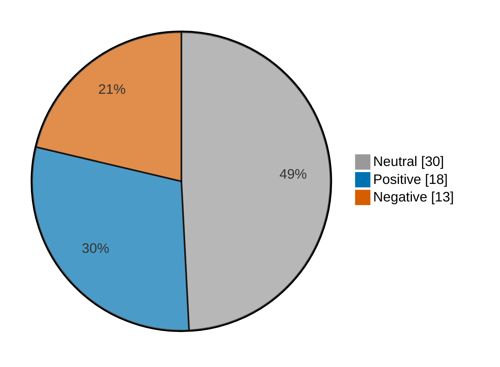

# Newsmood — 2026-11-05

**Mood index: +9.1** (mildly positive) · 61 headlines from 3 sources · model unsure on 12

## Mood at a glance

Negative 13 (21.3%) · Positive 18 (29.5%) · Neutral 30 (49.2%)

## What happened

Market news leaned mildly positive today (index +9.1, 10.0 higher than yesterday) from 61 headlines, with no dominant theme.

**Clusters:**

- 3 headlines on surging today, stock surging, surging: 1 negative, 2 neutral · -2.1% of the day's movement

_Themes use TF-IDF fit on 1125 headlines (2026-10-06–2026-11-05)._

## Recommended articles (highest model certainty, not most important)

### Negative

- [Colombia stocks lower at close of trade; COLCAP down 0.86%](<https://www.investing.com/news/stock-market-news/colombia-stocks-lower-at-close-of-trade-colcap-down-086-5005692>) · 97% · 3.9% of the day's movement · investing-stocks
- [Micron, Sandisk and other AI stocks are falling hard: ‘Investors don’t like uncertainty.’](<https://www.marketwatch.com/story/micron-sandisk-and-other-ai-stocks-are-falling-hard-investors-dont-like-uncertainty-94d2a3b9?mod=mw_rss_topstories>) · 96% · 3.9% of the day's movement · marketwatch-top
- [Tech stocks log worst day since 2020 as carnage comes to the AI trade](<https://www.marketwatch.com/story/tech-stocks-log-worst-day-since-2020-as-carnage-comes-to-the-ai-trade-56109845?mod=mw_rss_topstories>) · 95% · 3.8% of the day's movement · marketwatch-top

### Positive

- [European shares advance toward record highs on earnings momentum, midterm relief](<https://www.investing.com/news/stock-market-news/european-shares-advance-to-august-highs-on-ai-momentum-and-midterm-relief-5002355>) · 97% · 3.9% of the day's movement · investing-stocks
- [Audi may boost size of new US auto plant by $3 billion, add 3,000 jobs](<https://www.investing.com/news/stock-market-news/audi-may-boost-size-of-new-us-auto-plant-by-3-billion-add-3000-jobs-5005725>) · 97% · 3.9% of the day's movement · investing-stocks
- [Mexico stocks higher at close of trade; S&P/BMV IPC up 0.36%](<https://www.investing.com/news/stock-market-news/mexico-stocks-higher-at-close-of-trade-spbmv-ipc-up-036-5005711>) · 97% · 3.9% of the day's movement · investing-stocks

### Neutral

- [Richard Simmons’ L.A. estate sells for $3.8 million](<https://www.marketwatch.com/story/richard-simmons-l-a-estate-sells-for-3-8-million-abf43450?mod=mw_rss_topstories>) · 99% · marketwatch-top
- [After-Hours Movers: NET, TEAM, FIVN, ABNB, DKNG, AFRM, LRCX, MCHP, AAOI, IREN, AXON](<https://www.investing.com/news/stock-market-news/afterhours-movers-net-team-fivn-abnb-dkng-afrm-lrcx-mchp-aaoi-iren-axon-432SI-5005795>) · 98% · investing-stocks

## Sources

| Source | Headlines | Negative | Neutral | Positive |
|---|--:|--:|--:|--:|
| investing-stocks | 33 | 7 | 15 | 11 |
| marketwatch-top | 24 | 6 | 13 | 5 |
| cnbc-finance | 4 | 0 | 2 | 2 |

All 61 headlines

| Sentiment | Certainty | Headline | Source |
|---|--:|---|---|
| negative | 97% | [Colombia stocks lower at close of trade; COLCAP down 0.86%](<https://www.investing.com/news/stock-market-news/colombia-stocks-lower-at-close-of-trade-colcap-down-086-5005692>) | investing-stocks |
| negative | 96% | [Micron, Sandisk and other AI stocks are falling hard: ‘Investors don’t like uncertainty.’](<https://www.marketwatch.com/story/micron-sandisk-and-other-ai-stocks-are-falling-hard-investors-dont-like-uncertainty-94d2a3b9?mod=mw_rss_topstories>) | marketwatch-top |
| negative | 95% | [Tech stocks log worst day since 2020 as carnage comes to the AI trade](<https://www.marketwatch.com/story/tech-stocks-log-worst-day-since-2020-as-carnage-comes-to-the-ai-trade-56109845?mod=mw_rss_topstories>) | marketwatch-top |
| negative | 93% | [Microsoft declines Nscale Texas expansion ahead of $35 bln IPO - report](<https://www.investing.com/news/stock-market-news/microsoft-declines-nscale-texas-expansion-ahead-of-35-bln-ipo--report-5002260>) | investing-stocks |
| negative | 93% | [Bloom Energy’s stock is one of the S&P 500’s biggest losers amid fears of data-center delays](<https://www.marketwatch.com/story/bloom-energys-stock-is-one-of-the-s-p-500s-biggest-losers-amid-fears-of-data-center-delays-a44c96bb?mod=mw_rss_topstories>) | marketwatch-top |
| negative | 91% | [Why is CNOOC stock falling today?](<https://www.investing.com/news/stock-market-news/why-is-cnooc-stock-falling-today-93CH-5002236>) | investing-stocks |
| negative | 79% | [New wave of bomb threats hits passenger flights across Europe](<https://www.investing.com/news/stock-market-news/bomb-alerts-force-flights-to-land-in-france-bulgaria-belgium-5002910>) | investing-stocks |
| negative | 75% | [Toyota’s stock rallies after the company lowered sales guidance. Here’s how rare that is.](<https://www.marketwatch.com/story/toyota-stock-rallies-after-company-lowered-sales-guidance-heres-how-rare-that-is-c3d6c9bf?mod=mw_rss_topstories>) | marketwatch-top |
| negative | 70% | [After tech-stock rout, October jobs report could bring relief — or more pain](<https://www.marketwatch.com/story/after-tech-stock-rout-october-jobs-report-could-bring-relief-or-more-pain-db93357e?mod=mw_rss_topstories>) | marketwatch-top |
| negative | 69% | [Factbox-Companies most exposed to potential US data-center curbs after blue sweep](<https://www.investing.com/news/stock-market-news/factboxcompanies-most-exposed-to-potential-us-datacenter-curbs-after-blue-sweep-5005067>) | investing-stocks |
| negative | 53% (unsure) | [QatarEnergy eyes more US LNG deals to shield supply from Mideast conflict - report](<https://www.investing.com/news/stock-market-news/qatarenergy-eyes-more-us-lng-deals-to-shield-supply-from-mideast-conflict--report-5005292>) | investing-stocks |
| negative | 52% (unsure) | [Why is EPAM Systems stock surging today?](<https://www.investing.com/news/stock-market-news/why-is-epam-systems-stock-surging-today-93CH-5003234>) | investing-stocks |
| negative | 47% (unsure) | [Democrats’ big election win revives a difficult Social Security question: Who pays?](<https://www.marketwatch.com/story/democrats-big-election-win-revives-a-difficult-social-security-question-who-pays-17ba9448?mod=mw_rss_topstories>) | marketwatch-top |
| positive | 97% | [European shares advance toward record highs on earnings momentum, midterm relief](<https://www.investing.com/news/stock-market-news/european-shares-advance-to-august-highs-on-ai-momentum-and-midterm-relief-5002355>) | investing-stocks |
| positive | 97% | [Audi may boost size of new US auto plant by $3 billion, add 3,000 jobs](<https://www.investing.com/news/stock-market-news/audi-may-boost-size-of-new-us-auto-plant-by-3-billion-add-3000-jobs-5005725>) | investing-stocks |
| positive | 97% | [Mexico stocks higher at close of trade; S&P/BMV IPC up 0.36%](<https://www.investing.com/news/stock-market-news/mexico-stocks-higher-at-close-of-trade-spbmv-ipc-up-036-5005711>) | investing-stocks |
| positive | 97% | [Australia stocks higher at close of trade; S&P/ASX 200 up 2.61%](<https://www.investing.com/news/stock-market-news/australia-stocks-higher-at-close-of-trade-spasx-200-up-261-5002222>) | investing-stocks |
| positive | 96% | [Bombardier raises 2026 free cash flow forecast on strong private jet demand](<https://www.investing.com/news/stock-market-news/bombardier-raises-2026-free-cash-flow-forecast-on-strong-private-jet-demand-5003245>) | investing-stocks |
| positive | 96% | [Genmab nine-month revenue rises 22% as late-stage pipeline delivers](<https://www.investing.com/news/stock-market-news/genmab-ninemonth-revenue-rises-22-as-latestage-pipeline-delivers-5005279>) | investing-stocks |
| positive | 96% | [AutoStore raises 2026 revenue forecast after third-quarter sales jump](<https://www.investing.com/news/stock-market-news/autostore-raises-2026-revenue-forecast-after-thirdquarter-sales-jump-93CH-5002229>) | investing-stocks |
| positive | 95% | [Toyota posts profit surge and lifts annual outlook as hybrid sales shine](<https://www.investing.com/news/stock-market-news/toyota-profit-surges-34-first-rise-in-six-quarters-5002210>) | investing-stocks |
| positive | 90% | [Macquarie Group posts 50% growth in first-half profit](<https://www.investing.com/news/stock-market-news/macquarie-group-posts-50-growth-in-firsthalf-profit-5005775>) | investing-stocks |
| positive | 86% | [As Nvidia’s stock enters a bear market, bargain hunters see a golden buying opportunity](<https://www.marketwatch.com/story/as-nvidias-stock-heads-for-a-bear-market-bargain-hunters-see-a-golden-buying-opportunity-1a5917e6?mod=mw_rss_topstories>) | marketwatch-top |
| positive | 85% | [Australian carrier Qantas sees higher first-half fuel costs for fiscal 2027](<https://www.investing.com/news/stock-market-news/australian-carrier-qantas-sees-higher-firsthalf-fuel-costs-for-fiscal-2027-5005871>) | investing-stocks |
| positive | 85% | [This pancreatic cancer treatment is on track for ‘one of the best drug launches of all time’](<https://www.marketwatch.com/story/this-pancreatic-cancer-treatment-is-on-track-for-one-of-the-best-drug-launches-of-all-time-37bf86ce?mod=mw_rss_topstories>) | marketwatch-top |
| positive | 68% | [Barkin sees interest rate hikes ahead, but at a gradual pace](<https://www.cnbc.com/2026/11/05/barkin-sees-interest-rate-hikes-ahead-but-at-a-gradual-pace.html>) | cnbc-finance |
| positive | 68% | [Buy the dip or wait it out? Young investors react as retail stock selling hits one of its highest levels since COVID crash.](<https://www.marketwatch.com/story/buy-the-dip-or-wait-it-out-young-investors-react-as-retail-stock-selling-hits-one-of-its-highest-levels-since-covid-crash-610d8087?mod=mw_rss_topstories>) | marketwatch-top |
| positive | 60% | [5 of this year’s biggest stock losers that are good bets in 2027](<https://www.marketwatch.com/story/5-of-this-years-biggest-stock-losers-that-are-good-bets-in-2027-bb861d4c?mod=mw_rss_topstories>) | marketwatch-top |
| positive | 53% (unsure) | [The year’s most successful stock-market trades are unraveling — perhaps for good](<https://www.marketwatch.com/story/the-years-most-successful-stock-market-trades-are-unraveling-perhaps-for-good-45f7a0dd?mod=mw_rss_topstories>) | marketwatch-top |
| positive | 50% (unsure) | [Top Democrats call to rein in AI buildout after midterms sweep: 'National data center moratorium now'](<https://www.cnbc.com/2026/11/05/democrats-data-center-restrictions-midterms.html>) | cnbc-finance |
| positive | 44% (unsure) | [Google launches Gemini Omni 1.2 Flash with longer clips and lower cost](<https://www.investing.com/news/stock-market-news/google-launches-gemini-omni-12-flash-with-longer-clips-and-lower-cost-93CH-5005280>) | investing-stocks |
| neutral | 99% | [Richard Simmons’ L.A. estate sells for $3.8 million](<https://www.marketwatch.com/story/richard-simmons-l-a-estate-sells-for-3-8-million-abf43450?mod=mw_rss_topstories>) | marketwatch-top |
| neutral | 98% | [After-Hours Movers: NET, TEAM, FIVN, ABNB, DKNG, AFRM, LRCX, MCHP, AAOI, IREN, AXON](<https://www.investing.com/news/stock-market-news/afterhours-movers-net-team-fivn-abnb-dkng-afrm-lrcx-mchp-aaoi-iren-axon-432SI-5005795>) | investing-stocks |
| neutral | 98% | [A record number of first-time home buyers now pay in cash. Here’s where they get the money.](<https://www.marketwatch.com/story/a-record-10-of-first-time-home-buyers-now-pay-in-cash-heres-where-they-get-the-money-70f2e656?mod=mw_rss_topstories>) | marketwatch-top |
| neutral | 98% | [Democratic senator demands tech firms, FCC chair turn over documents](<https://www.investing.com/news/stock-market-news/democratic-senator-demands-tech-firms-fcc-chair-turn-over-documents-5005779>) | investing-stocks |
| neutral | 98% | [My 93-year-old father changed his will at the 11th hour, leaving my brother his entire $500,000 estate. Can I challenge it?](<https://www.marketwatch.com/story/my-93-year-old-father-changed-his-will-at-the-11th-hour-leaving-my-brother-his-entire-500-000-estate-can-i-challenge-it-ecfc63d2?mod=mw_rss_topstories>) | marketwatch-top |
| neutral | 97% | [‘I have no financial safety net’: I’m 66, rely on Social Security and have just $500 in savings. What hope do I have?](<https://www.marketwatch.com/story/i-have-no-financial-safety-net-im-66-rely-on-social-security-and-have-500-in-savings-what-politician-speaks-for-me-be2126cb?mod=mw_rss_topstories>) | marketwatch-top |
| neutral | 97% | [Nvidia chips stockpile in Hong Kong awaits China import approval - report](<https://www.investing.com/news/stock-market-news/nvidia-chips-stockpile-in-hong-kong-awaits-china-import-approval--report-5003235>) | investing-stocks |
| neutral | 96% | [Albertsons must pay $900 million for fueling opioid epidemic in Washington state, judge rules](<https://www.investing.com/news/stock-market-news/albertsons-must-pay-900-million-for-fueling-opioid-epidemic-in-washington-state-judge-rules-5005252>) | investing-stocks |
| neutral | 96% | [How to buy a new car for under $30,000 in this economy](<https://www.marketwatch.com/story/how-to-buy-a-new-car-for-under-30-000-in-this-economy-24b01f99?mod=mw_rss_topstories>) | marketwatch-top |
| neutral | 95% | [Nasdaq drops into correction territory — here’s what typically happens next](<https://www.cnbc.com/2026/11/05/nasdaq-drops-into-correction-territory-heres-what-typically-happens-next.html>) | cnbc-finance |
| neutral | 94% | [Why is Arkema stock climbing today?](<https://www.investing.com/news/stock-market-news/why-is-arkema-stock-climbing-today-93CH-5003249>) | investing-stocks |
| neutral | 93% | [What the Democratic midterms sweep changes for U.S.-China relations](<https://www.cnbc.com/2026/11/05/what-the-democrat-midterms-sweep-changes-for-us-china-tech-rivalry.html>) | cnbc-finance |
| neutral | 93% | [Why is Cigna stock climbing today?](<https://www.investing.com/news/stock-market-news/why-is-cigna-stock-climbing-today-93CH-5003246>) | investing-stocks |
| neutral | 91% | [I’m 65 and worth more than $5.6 million. Can I buy a $200,000 camper even though the price feels ‘crazy high’?](<https://www.marketwatch.com/story/im-65-and-worth-more-than-5-6-million-can-i-buy-a-200-000-camper-even-though-the-price-feels-crazy-high-55f668f8?mod=mw_rss_topstories>) | marketwatch-top |
| neutral | 90% | [Most investors are blind to the possibility of a market crash. Here is the five-part strategy to survive one.](<https://www.marketwatch.com/story/most-investors-are-blind-to-the-possibility-of-a-market-crash-here-is-the-five-part-strategy-to-survive-one-a1762911?mod=mw_rss_topstories>) | marketwatch-top |
| neutral | 89% | [US FAA says it will phase out floppy disks from air traffic control by 2028](<https://www.investing.com/news/stock-market-news/us-faa-says-it-will-phase-out-floppy-disks-from-air-traffic-control-by-2028-5005299>) | investing-stocks |
| neutral | 87% | [Microsoft tightens oversight of neocloud data center projects, Bloomberg News reports](<https://www.investing.com/news/stock-market-news/microsoft-tightens-oversight-of-neocloud-data-center-projects-bloomberg-news-reports-5005281>) | investing-stocks |
| neutral | 86% | [Mattel cuts annual forecasts as new CEO takes charge](<https://www.investing.com/news/stock-market-news/mattel-cuts-annual-forecasts-as-new-ceo-takes-charge-5005607>) | investing-stocks |
| neutral | 85% | [Is this ‘the big one’ for the stock market? Wall Street sounds off as tech plunges.](<https://www.marketwatch.com/story/is-this-the-big-one-for-the-stock-market-wall-street-sounds-off-as-tech-plunges-185df529?mod=mw_rss_topstories>) | marketwatch-top |
| neutral | 74% | [Democrats gearing up to probe JPMorgan’s relationship with Epstein, CNBC reports](<https://www.investing.com/news/stock-market-news/democrats-gearing-up-to-probe-jpmorgans-relationship-with-epstein-cnbc-reports-5005185>) | investing-stocks |
| neutral | 74% | [A strategist draws a 1980s parallel to argue bipartisanship could power a ‘bull stampede’](<https://www.marketwatch.com/story/a-strategist-draws-a-1980s-parallel-to-argue-bipartisanship-could-power-a-bull-stampede-609ddc9b?mod=mw_rss_topstories>) | marketwatch-top |
| neutral | 73% | [A prolonged war in Iran is the market’s real ‘black swan,’ says this strategist](<https://www.marketwatch.com/story/a-prolonged-war-in-iran-is-the-markets-real-black-swan-says-this-strategist-65d105c7?mod=mw_rss_topstories>) | marketwatch-top |
| neutral | 73% | [Research firm declares ‘end of the AI trade as we know it’ — and Asian tech stocks reflect the shift](<https://www.marketwatch.com/story/research-firm-declares-end-of-the-ai-trade-as-we-know-it-and-asian-tech-stocks-reflect-the-shift-25ac8e8f?mod=mw_rss_topstories>) | marketwatch-top |
| neutral | 68% | [Why is Legrand stock surging today?](<https://www.investing.com/news/stock-market-news/why-is-legrand-stock-surging-today-93CH-5003250>) | investing-stocks |
| neutral | 59% (unsure) | [Traders flock to Treasury market for safety as tech-led stock selloff deepens](<https://www.marketwatch.com/story/traders-flock-to-treasury-market-for-safety-as-tech-led-stock-selloff-deepens-cf548c8b?mod=mw_rss_topstories>) | marketwatch-top |
| neutral | 56% (unsure) | [Why is Celsius stock surging today?](<https://www.investing.com/news/stock-market-news/why-is-celsius-stock-surging-today-93CH-5003253>) | investing-stocks |
| neutral | 55% (unsure) | [’Our phones are exploding’: Goldman Sachs dissects historic Wall Street crash](<https://www.investing.com/news/stock-market-news/our-phones-are-exploding-goldman-sachs-dissects-historic-wall-street-crash-5005892>) | investing-stocks |
| neutral | 55% (unsure) | [Google faces claims student used AI chat on US school laptop to plan suicide attempt](<https://www.investing.com/news/stock-market-news/google-faces-claims-student-used-aichat-on-us-school-laptop-to-plan-suicide-attempt-5005261>) | investing-stocks |
| neutral | 54% (unsure) | [The ‘Musk selloff’ deepens as Tesla and SpaceX combine for $456 billion two-day wipeout](<https://www.marketwatch.com/story/the-musk-selloff-deepens-as-tesla-and-spacex-combine-for-450-billion-two-day-wipeout-d300ab4f?mod=mw_rss_topstories>) | marketwatch-top |
| neutral | 52% (unsure) | [S&P 500 futures steady after midterm rally; Nasdaq lags on chip weakness](<https://www.investing.com/news/stock-market-news/sp-500-futures-steady-after-midterm-rally-nasdaq-lags-on-chip-weakness-5003237>) | investing-stocks |

---

Certainty is the model's confidence in its label; below 60% it is marked unsure.

"Of the day's movement" is a headline's certainty over the sum of every non-neutral headline's certainty: its part in moving the index. Neutral headlines move it by 0.

Links go to the original publisher; some limit free articles.

Model: kkrit-tinna/newsmood-distilbert-financial@be7b809e0d8f7bd50e77d902aee199363b7e2a66 · Gates: 2/2 passed · Not financial advice.
