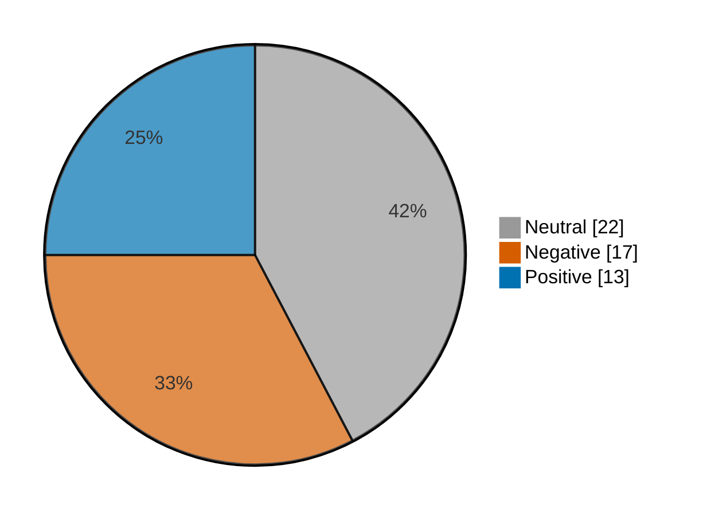

# Newsmood — 2026-11-06

**Mood index: -9.5** (mildly negative) · 52 headlines from 3 sources · model unsure on 5

## Mood at a glance

Negative 17 (32.7%) · Positive 13 (25.0%) · Neutral 22 (42.3%)

## What happened

Market news leaned mildly negative today (index -9.5, 13.9 lower than yesterday) across 52 headlines, with no dominant theme.

**Clusters:** no clear theme today.

_Themes use TF-IDF fit on 1188 headlines (2026-10-07–2026-11-06)._

## Recommended articles (highest model certainty, not most important)

### Negative

- [This chip inspection leader fell 24.5% in a month: is the dip worth a look?](<https://www.investing.com/news/stock-market-news/this-chip-inspection-leader-fell-245-in-a-month-is-the-dip-worth-a-look-5004711>) · 97% · 3.8% of the day's movement · investing-stocks
- [Under Armour flags broad-based weakness, sees steeper-than-expected third-quarter sales decline](<https://www.investing.com/news/stock-market-news/under-armour-warns-of-bigger-middle-east-hit-cuts-annual-gross-margin-growth-target-5008020>) · 97% · 3.7% of the day's movement · investing-stocks
- [Australia stocks lower at close of trade; S&P/ASX 200 down 0.49%](<https://www.investing.com/news/stock-market-news/australia-stocks-lower-at-close-of-trade-spasx-200-down-049-5006506>) · 97% · 3.7% of the day's movement · investing-stocks

### Positive

- [Russia stocks higher at close of trade; MOEX Russia Index up 0.42%](<https://www.investing.com/news/stock-market-news/russia-stocks-higher-at-close-of-trade-moex-russia-index-up-042-5009185>) · 97% · 3.7% of the day's movement · investing-stocks
- [Colombia stocks higher at close of trade; COLCAP up 0.07%](<https://www.investing.com/news/stock-market-news/colombia-stocks-higher-at-close-of-trade-colcap-up-007-5009200>) · 97% · 3.7% of the day's movement · investing-stocks
- [TSX ends higher as tech stocks recover, Celestica gains 2% after global selloff](<https://www.investing.com/news/stock-market-news/tsx-futures-edged-lower-amid-fallout-from-aidriven-stock-rout-5007774>) · 96% · 3.7% of the day's movement · investing-stocks

### Neutral

- [Alphabet discloses $548 million worth of Qualcomm stake](<https://www.investing.com/news/stock-market-news/alphabet-discloses-548-million-worth-of-qualcomm-stake-5007278>) · 99% · investing-stocks
- [Yangtze Memory targets 70% domestic equipment for new chip plant- Reuters](<https://www.investing.com/news/stock-market-news/yangtze-memory-targets-70-domestic-equipment-for-new-chip-plant-reuters-93CH-5006510>) · 98% · investing-stocks

## Sources

| Source | Headlines | Negative | Neutral | Positive |
|---|--:|--:|--:|--:|
| investing-stocks | 35 | 13 | 12 | 10 |
| marketwatch-top | 15 | 3 | 10 | 2 |
| cnbc-finance | 2 | 1 | 0 | 1 |

All 52 headlines

| Sentiment | Certainty | Headline | Source |
|---|--:|---|---|
| negative | 97% | [This chip inspection leader fell 24.5% in a month: is the dip worth a look?](<https://www.investing.com/news/stock-market-news/this-chip-inspection-leader-fell-245-in-a-month-is-the-dip-worth-a-look-5004711>) | investing-stocks |
| negative | 97% | [Under Armour flags broad-based weakness, sees steeper-than-expected third-quarter sales decline](<https://www.investing.com/news/stock-market-news/under-armour-warns-of-bigger-middle-east-hit-cuts-annual-gross-margin-growth-target-5008020>) | investing-stocks |
| negative | 97% | [Australia stocks lower at close of trade; S&P/ASX 200 down 0.49%](<https://www.investing.com/news/stock-market-news/australia-stocks-lower-at-close-of-trade-spasx-200-down-049-5006506>) | investing-stocks |
| negative | 96% | [Oracle falls 4% as Microsoft reportedly winds down AI cloud capacity deal](<https://www.investing.com/news/stock-market-news/oracle-falls-4-as-microsoft-reportedly-winds-down-ai-cloud-capacity-deal-5008936>) | investing-stocks |
| negative | 93% | [‘We’re losing to cottage cheese’: The protein-maxxing craze is hurting cream cheese sales](<https://www.marketwatch.com/story/were-losing-to-cottage-cheese-the-protein-maxxing-craze-is-hurting-cream-cheese-sales-40ae94f3?mod=mw_rss_topstories>) | marketwatch-top |
| negative | 92% | [Why is HKEX stock falling today?](<https://www.investing.com/news/stock-market-news/why-is-hkex-stock-falling-today-93CH-5006543>) | investing-stocks |
| negative | 91% | [DraftKings’ expensive bet on prediction markets is crushing its stock](<https://www.marketwatch.com/story/draftkings-expensive-bet-on-prediction-markets-is-crushing-its-stock-277bee0d?mod=mw_rss_topstories>) | marketwatch-top |
| negative | 90% | [While the market was crashing, this AI-picked stock jumped 22% yesterday](<https://www.investing.com/news/stock-market-news/while-the-market-was-crashing-this-aipicked-stock-jumped-22-yesterday-5007308>) | investing-stocks |
| negative | 88% | [Americans are on a 'treadmill of high inflation' and more rate hikes are likely, Fed's Daly says](<https://www.cnbc.com/2026/11/06/fed-daly-interest-rates-inflation.html>) | cnbc-finance |
| negative | 86% | [S&P revises Boston Scientific outlook to negative on franchise pressures](<https://www.investing.com/news/stock-market-news/sp-revises-boston-scientific-outlook-to-negative-on-franchise-pressures-5009270>) | investing-stocks |
| negative | 86% | [Data centers run on debt. That was a problem for bonds this year — and it’s only going to get worse.](<https://www.marketwatch.com/story/data-centers-run-on-debt-that-was-a-problem-for-bonds-this-year-and-its-only-going-to-get-worse-09c03be6?mod=mw_rss_topstories>) | marketwatch-top |
| negative | 85% | [Risk-off mood sweeps European stocks as AI concerns deepen](<https://www.investing.com/news/stock-market-news/european-shares-set-to-fall-as-global-ai-rout-gathers-pace-5006641>) | investing-stocks |
| negative | 84% | [Wave of bomb threats afflict European flights for third time this week](<https://www.investing.com/news/stock-market-news/wave-of-bomb-threats-afflict-european-flights-for-third-time-this-week-5007327>) | investing-stocks |
| negative | 82% | [Nasdaq rebounds but posts fourth straight weekly decline](<https://www.investing.com/news/stock-market-news/nasdaq-futures-rise-after-steep-ai-selloff-as-chip-stocks-stabilize-5007026>) | investing-stocks |
| negative | 82% | [Tesla to pull the plug on Cybertruck after years of poor sales](<https://www.investing.com/news/stock-market-news/tesla-to-wind-down-cybertruck-production-at-texas-gigafactory-next-year-musk-says-5006624>) | investing-stocks |
| negative | 80% | [Factbox-Tesla Cybertruck’s bumpy run: cracked windows, long delays and 11 recalls](<https://www.investing.com/news/stock-market-news/factboxtesla-cybertrucks-bumpy-run-cracked-windows-long-delays-and-11-recalls-5008935>) | investing-stocks |
| negative | 80% | [Microsoft is winding down Oracle deal to rent AI cloud capacity, Bloomberg News reports](<https://www.investing.com/news/stock-market-news/microsoft-is-winding-down-oracle-deal-to-rent-ai-cloud-capacity-bloomberg-news-reports-5008946>) | investing-stocks |
| positive | 97% | [Russia stocks higher at close of trade; MOEX Russia Index up 0.42%](<https://www.investing.com/news/stock-market-news/russia-stocks-higher-at-close-of-trade-moex-russia-index-up-042-5009185>) | investing-stocks |
| positive | 97% | [Colombia stocks higher at close of trade; COLCAP up 0.07%](<https://www.investing.com/news/stock-market-news/colombia-stocks-higher-at-close-of-trade-colcap-up-007-5009200>) | investing-stocks |
| positive | 96% | [TSX ends higher as tech stocks recover, Celestica gains 2% after global selloff](<https://www.investing.com/news/stock-market-news/tsx-futures-edged-lower-amid-fallout-from-aidriven-stock-rout-5007774>) | investing-stocks |
| positive | 94% | [Airbnb rises on upbeat outlook, bucking broader industry caution](<https://www.investing.com/news/stock-market-news/airbnb-rises-on-upbeat-outlook-bucking-broader-industry-caution-5007328>) | investing-stocks |
| positive | 93% | [Singapore Airlines to splash $1.6 billion on luxury long-haul cabins as rivals up their game](<https://www.investing.com/news/stock-market-news/singapore-airlines-to-splash-16-billion-on-luxury-longhaul-cabins-as-rivals-up-their-game-5006507>) | investing-stocks |
| positive | 92% | [Lotte Rental shares hit 52-week high as TPG launches $613 million tender offer](<https://www.investing.com/news/stock-market-news/lotte-rental-shares-hit-52week-high-as-tpg-launches-613-million-tender-offer-5006473>) | investing-stocks |
| positive | 86% | [EU electricity grid costs may rise up to 100% by 2050](<https://www.investing.com/news/stock-market-news/eu-electricity-grid-costs-may-rise-up-to-100-by-2050-93CH-5006502>) | investing-stocks |
| positive | 79% | [Firefly inks $1.3 billion deal to supply engines for new AST SpaceMobile ’Blacklift’ rocket](<https://www.investing.com/news/stock-market-news/firefly-inks-13-billion-deal-to-supply-engines-for-new-ast-spacemobile-blacklift-rocket-5008754>) | investing-stocks |
| positive | 79% | [The AI ‘credit card’ is getting costlier as CoreWeave bond yield tops 16%](<https://www.cnbc.com/2026/11/06/coreweave-bond-yield-tops-16percent-as-ai-credit-stress-rises.html>) | cnbc-finance |
| positive | 76% | [US approves potential $1.08 billion Black Hawk helicopter sale to Mexico](<https://www.investing.com/news/stock-market-news/us-approves-potential-108-billion-black-hawk-helicopter-sale-to-mexico-5009198>) | investing-stocks |
| positive | 74% | [Humana raises full-year profit forecast on lower medical costs](<https://www.investing.com/news/stock-market-news/humana-raises-fullyear-profit-forecast-on-lower-medical-costs-5007329>) | investing-stocks |
| positive | 67% | [Hims & Hers struck a GLP-1 deal with Lilly. Its stock is rallying.](<https://www.marketwatch.com/story/hims-hers-struck-a-glp-1-deal-with-lilly-its-stock-is-rallying-d06ebe60?mod=mw_rss_topstories>) | marketwatch-top |
| positive | 57% (unsure) | [Nvidia, AMD and other chip stocks rebound — but is relief from the ‘violent’ selloff only temporary?](<https://www.marketwatch.com/story/nvidia-amd-and-other-chip-stocks-rebound-is-the-violent-ai-selloff-over-8f7df533?mod=mw_rss_topstories>) | marketwatch-top |
| neutral | 99% | [Alphabet discloses $548 million worth of Qualcomm stake](<https://www.investing.com/news/stock-market-news/alphabet-discloses-548-million-worth-of-qualcomm-stake-5007278>) | investing-stocks |
| neutral | 98% | [Yangtze Memory targets 70% domestic equipment for new chip plant- Reuters](<https://www.investing.com/news/stock-market-news/yangtze-memory-targets-70-domestic-equipment-for-new-chip-plant-reuters-93CH-5006510>) | investing-stocks |
| neutral | 96% | [Democrats planning flood of AI bills when they take control of Congress](<https://www.investing.com/news/stock-market-news/democrats-planning-flood-of-ai-bills-when-they-take-control-of-congress-5007213>) | investing-stocks |
| neutral | 96% | [As tech swoon roils market, US inflation data on tap](<https://www.investing.com/news/stock-market-news/as-tech-swoon-roils-market-us-inflation-data-on-tap-5007256>) | investing-stocks |
| neutral | 96% | [What the governor-elect of Texas, at the epicenter of the AI-trade blowup, is now saying about data centers](<https://www.marketwatch.com/story/what-the-governor-elect-of-texas-at-the-epicenter-of-the-ai-trade-blowup-is-now-saying-about-data-centers-55876582?mod=mw_rss_topstories>) | marketwatch-top |
| neutral | 96% | [My adviser recommended an annuity. Is it the right move in this market environment?](<https://www.marketwatch.com/story/my-adviser-recommended-an-annuity-is-it-the-right-move-in-this-market-environment-00edbbf6?mod=mw_rss_topstories>) | marketwatch-top |
| neutral | 96% | [Exclusive-Apple’s predictive text restrictions include ’Dictator Trump’ and ’Sleepy Joe,’ researcher finds](<https://www.investing.com/news/stock-market-news/exclusiveapples-predictive-text-restrictions-include-dictator-trump-and-sleepy-joe-researcher-finds-5007215>) | investing-stocks |
| neutral | 95% | [The S&P 500 could be dangerously exposed to AI. Here are some simple alternatives.](<https://www.marketwatch.com/story/the-s-p-500-has-become-a-big-ai-bet-here-are-some-simple-alternatives-3c7574a4?mod=mw_rss_topstories>) | marketwatch-top |
| neutral | 95% | [What’s next for your portfolio after the decline in Big Tech stocks?](<https://www.marketwatch.com/story/whats-next-for-your-portfolio-after-the-decline-in-big-tech-stocks-2873452f?mod=mw_rss_topstories>) | marketwatch-top |
| neutral | 93% | [Why is Hims & Hers Health stock rallying today?](<https://www.investing.com/news/stock-market-news/why-is-hims--hers-health-stock-rallying-today-93CH-5008943>) | investing-stocks |
| neutral | 92% | [‘It feels like he’s quietly building a separate life’: My husband inherited $500,000, but he refuses to spend it on our home](<https://www.marketwatch.com/story/it-feels-like-hes-quietly-building-a-separate-life-my-husband-inherited-500-000-but-he-refuses-to-spend-it-on-our-home-06535cff?mod=mw_rss_topstories>) | marketwatch-top |
| neutral | 90% | [Elon Musk opens the door for a big SpaceX acquisition](<https://www.marketwatch.com/story/elon-musk-opens-the-door-for-a-big-spacex-acquisition-4f62bcad?mod=mw_rss_topstories>) | marketwatch-top |
| neutral | 87% | [Is it the end of the Cybertruck? Elon Musk announces factory will shift Tesla production.](<https://www.marketwatch.com/story/is-it-the-end-of-the-cybertruck-elon-musk-announces-factory-will-shift-production-3e33cafd?mod=mw_rss_topstories>) | marketwatch-top |
| neutral | 83% | [The $4 million mansion that author Sarah J. Maas bought after finding fame with ‘A Court of Thorns and Roses’](<https://www.marketwatch.com/story/the-4-million-mansion-that-author-sarah-j-maas-bought-after-finding-fame-with-a-court-of-thorns-and-roses-170bbe1b?mod=mw_rss_topstories>) | marketwatch-top |
| neutral | 82% | [Meta’s Muse app adds customizable spaces feature](<https://www.investing.com/news/stock-market-news/metas-muse-app-adds-customizable-spaces-feature-93CH-5009233>) | investing-stocks |
| neutral | 74% | [Layoffs with dignity? Why these tech companies are offering free laptops and LinkedIn Premium.](<https://www.marketwatch.com/story/layoffs-with-dignity-why-these-tech-firms-are-offering-free-laptops-and-linkedin-premium-28750d39?mod=mw_rss_topstories>) | marketwatch-top |
| neutral | 64% | [Citi explains why the AI trade may remain under pressure](<https://www.investing.com/news/stock-market-news/citi-explains-why-the-ai-trade-may-remain-under-pressure-5007312>) | investing-stocks |
| neutral | 62% | [Why is Hua Hong Grace Semiconductor stock rising today?](<https://www.investing.com/news/stock-market-news/why-is-hua-hong-grace-semiconductor-stock-rising-today-93CH-5006544>) | investing-stocks |
| neutral | 54% (unsure) | [Why is LightPath Technologies stock surging today?](<https://www.investing.com/news/stock-market-news/why-is-lightpath-technologies-stock-surging-today-93CH-5008941>) | investing-stocks |
| neutral | 51% (unsure) | [Exclusive-China’s top flash memory chipmaker targets more homegrown tools for new factory, sources say](<https://www.investing.com/news/stock-market-news/exclusivechinas-top-flash-memory-chipmaker-targets-more-homegrown-tools-for-new-factory-sources-say-5006408>) | investing-stocks |
| neutral | 49% (unsure) | [Why is X Energy stock surging today?](<https://www.investing.com/news/stock-market-news/why-is-x-energy-stock-surging-today-93CH-5008942>) | investing-stocks |
| neutral | 47% (unsure) | [Micron’s stock is dirt cheap — and that’s igniting a fierce online debate](<https://www.marketwatch.com/story/microns-stock-is-dirt-cheap-and-thats-igniting-a-fierce-online-debate-0626791d?mod=mw_rss_topstories>) | marketwatch-top |

---

Certainty is the model's confidence in its label; below 60% it is marked unsure.

"Of the day's movement" is a headline's certainty over the sum of every non-neutral headline's certainty: its part in moving the index. Neutral headlines move it by 0.

Links go to the original publisher; some limit free articles.

Model: kkrit-tinna/newsmood-distilbert-financial@be7b809e0d8f7bd50e77d902aee199363b7e2a66 · Gates: 2/2 passed · Not financial advice.
