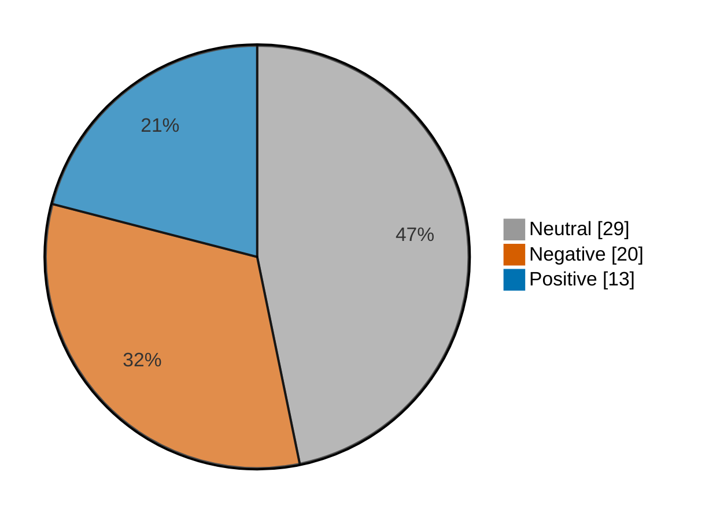

# Newsmood — 2026-11-09

**Mood index: -5.0** (mildly negative) · 62 headlines from 3 sources · model unsure on 9

## Mood at a glance

Negative 20 (32.3%) · Positive 13 (21.0%) · Neutral 29 (46.8%)

## What happened

Market news leaned mildly negative today (index -5.0, a rise of 6.8 from yesterday) over 62 headlines, with no single theme in the lead.

**Clusters:**

- 4 headlines on higher close, stocks higher, close trade: 4 positive · +14.5% of the day's movement
- 4 headlines on sliding, sliding today, stock sliding: 4 neutral · +0.0% of the day's movement
- 3 headlines on climbing today, stock climbing, climbing: 3 neutral · +0.0% of the day's movement

_Themes use TF-IDF fit on 1240 headlines (2026-10-10–2026-11-09)._

## Recommended articles (highest model certainty, not most important)

### Negative

- [Boeing to cut 5% of planemaking division’s workforce, Seattle Times reports](<https://www.investing.com/news/stock-market-news/boeing-to-cut-5-of-planemaking-divisions-workforce-seattle-times-reports-5012939>) · 95% · 3.6% of the day's movement · investing-stocks
- [Companies risk fines of 6% global turnover for unfair digital trade practices, EU draft law shows](<https://www.investing.com/news/stock-market-news/companies-risk-fines-of-6-global-turnover-for-unfair-digital-trade-practices-eu-draft-law-shows-5012950>) · 94% · 3.5% of the day's movement · investing-stocks
- [Jensen Huang exit odds are low on prediction markets after Nvidia probe](<https://www.cnbc.com/2026/11/09/jensen-huang-nvidia-exit-prediction-markets.html>) · 93% · 3.5% of the day's movement · cnbc-finance

### Positive

- [Canada stocks higher at close of trade; S&P/TSX Composite up 1.84%](<https://www.investing.com/news/stock-market-news/canada-stocks-higher-at-close-of-trade-sptsx-composite-up-184-5013279>) · 97% · 3.6% of the day's movement · investing-stocks
- [Mexico stocks higher at close of trade; S&P/BMV IPC up 0.61%](<https://www.investing.com/news/stock-market-news/mexico-stocks-higher-at-close-of-trade-spbmv-ipc-up-061-5013301>) · 97% · 3.6% of the day's movement · investing-stocks
- [Russia stocks higher at close of trade; MOEX Russia Index up 0.45%](<https://www.investing.com/news/stock-market-news/russia-stocks-higher-at-close-of-trade-moex-russia-index-up-045-5013245>) · 97% · 3.6% of the day's movement · investing-stocks

### Neutral

- [After-Hours Movers: TTD, TTWO, APPS, SANM, RKLB, HIMS](<https://www.investing.com/news/stock-market-news/afterhours-movers-ttd-ttwo-apps-sanm-rklb-hims-432SI-5013360>) · 98% · investing-stocks
- [There is no one at Nvidia who would be ready to replace Jensen Huang](<https://www.marketwatch.com/story/there-is-no-one-at-nvidia-who-would-be-ready-to-replace-jensen-huang-816cc405?mod=mw_rss_topstories>) · 98% · marketwatch-top

## Sources

| Source | Headlines | Negative | Neutral | Positive |
|---|--:|--:|--:|--:|
| investing-stocks | 40 | 14 | 16 | 10 |
| marketwatch-top | 20 | 5 | 13 | 2 |
| cnbc-finance | 2 | 1 | 0 | 1 |

All 62 headlines

| Sentiment | Certainty | Headline | Source |
|---|--:|---|---|
| negative | 95% | [Boeing to cut 5% of planemaking division’s workforce, Seattle Times reports](<https://www.investing.com/news/stock-market-news/boeing-to-cut-5-of-planemaking-divisions-workforce-seattle-times-reports-5012939>) | investing-stocks |
| negative | 94% | [Companies risk fines of 6% global turnover for unfair digital trade practices, EU draft law shows](<https://www.investing.com/news/stock-market-news/companies-risk-fines-of-6-global-turnover-for-unfair-digital-trade-practices-eu-draft-law-shows-5012950>) | investing-stocks |
| negative | 93% | [Jensen Huang exit odds are low on prediction markets after Nvidia probe](<https://www.cnbc.com/2026/11/09/jensen-huang-nvidia-exit-prediction-markets.html>) | cnbc-finance |
| negative | 91% | [Canadian 10-yr bond yield dips as global debt markets navigate shifting sentiment](<https://www.investing.com/news/stock-market-news/canadian-10yr-bond-yield-dips-as-global-debt-markets-navigate-shifting-sentiment-5012952>) | investing-stocks |
| negative | 90% | [HSBC says tech selloff appears overdone amid AI regulation concerns](<https://www.investing.com/news/stock-market-news/hsbc-says-tech-selloff-appears-overdone-amid-ai-regulation-concerns-93CH-5011446>) | investing-stocks |
| negative | 88% | [Ozempic, Zepbound and other GLP-1 drugs have a possible risk of vision loss](<https://www.marketwatch.com/story/ozempic-zepbound-and-other-glp-1-drugs-have-a-possible-risk-of-vision-loss-b3738f36?mod=mw_rss_topstories>) | marketwatch-top |
| negative | 87% | [Canada’s inflation warning may be overblown](<https://www.investing.com/news/stock-market-news/canadas-inflation-warning-may-be-overblown-5012951>) | investing-stocks |
| negative | 85% | [Hims & Hers cuts 2026 profit forecast as margins contract](<https://www.investing.com/news/stock-market-news/hims--hers-narrows-2026-revenue-forecast-as-margins-contract-5013239>) | investing-stocks |
| negative | 79% | [UBS turns cautious on Schott Pharma as glass syringe demand risks mount](<https://www.investing.com/news/stock-market-news/ubs-turns-cautious-on-schott-pharma-as-glass-syringe-demand-risks-mount-5011444>) | investing-stocks |
| negative | 78% | [Nvidia falls about 3% in after-hours and perpetual futures trade](<https://www.investing.com/news/stock-market-news/nvidia-falls-about-3-in-afterhours-and-perpetual-futures-trade-5010425>) | investing-stocks |
| negative | 76% | [A failed trial for a heart drug casts shadow over rivals developing similar therapies](<https://www.marketwatch.com/story/a-failed-trial-for-a-heart-drug-casts-shadow-over-rivals-developing-similar-therapies-2d9bd79f?mod=mw_rss_topstories>) | marketwatch-top |
| negative | 75% | [Why is Taiwan Semiconductor Manufacturing stock surging today?](<https://www.investing.com/news/stock-market-news/why-is-taiwan-semiconductor-manufacturing-stock-surging-today-93CH-5011429>) | investing-stocks |
| negative | 70% | [Why is Ventia Services stock plunging today?](<https://www.investing.com/news/stock-market-news/why-is-ventia-services-stock-plunging-today-93CH-5010494>) | investing-stocks |
| negative | 69% | [Hot U.S. inflation hasn’t cooled off. Rising consumer prices to keep Fed rate hike on track.](<https://www.marketwatch.com/story/hot-u-s-inflation-hasnt-cooled-off-rising-consumer-prices-to-keep-fed-rate-hike-on-track-926c44b0?mod=mw_rss_topstories>) | marketwatch-top |
| negative | 67% | [‘We had the worst fight we’ve ever had’: I want my husband to retire at 65. But I don’t want to lose his $280,000 salary.](<https://www.marketwatch.com/story/we-had-the-worst-fight-weve-ever-had-i-want-my-husband-to-retire-at-65-but-i-dont-want-to-lose-his-280-000-salary-48511469?mod=mw_rss_topstories>) | marketwatch-top |
| negative | 53% (unsure) | [Why is Mitsui Chemicals stock tumbling today?](<https://www.investing.com/news/stock-market-news/why-is-mitsui-chemicals-stock-tumbling-today-93CH-5010473>) | investing-stocks |
| negative | 48% (unsure) | [Why is Atalaya Mining stock surging today?](<https://www.investing.com/news/stock-market-news/why-is-atalaya-mining-stock-surging-today-93CH-5011436>) | investing-stocks |
| negative | 41% (unsure) | [Dow sees its third 1,000-point swing in four days. Why the volatility isn’t over yet.](<https://www.marketwatch.com/story/dow-sees-its-third-1-000-point-swing-in-four-days-why-volatility-isnt-over-yet-5380567b?mod=mw_rss_topstories>) | marketwatch-top |
| negative | 40% (unsure) | [Anthropic targets next-week IPO despite AI market volatility, WSJ reports](<https://www.investing.com/news/stock-market-news/anthropic-targets-nextweek-ipo-despite-ai-market-volatility-wsj-reports-5013324>) | investing-stocks |
| negative | 37% (unsure) | [Trump administration’s embrace of "perp" futures sets off risk alarms for Wall Street stalwarts](<https://www.investing.com/news/stock-market-news/trump-administrations-embrace-of-perp-futures-sets-off-risk-alarms-for-wall-street-stalwarts-5011271>) | investing-stocks |
| positive | 97% | [Canada stocks higher at close of trade; S&P/TSX Composite up 1.84%](<https://www.investing.com/news/stock-market-news/canada-stocks-higher-at-close-of-trade-sptsx-composite-up-184-5013279>) | investing-stocks |
| positive | 97% | [Mexico stocks higher at close of trade; S&P/BMV IPC up 0.61%](<https://www.investing.com/news/stock-market-news/mexico-stocks-higher-at-close-of-trade-spbmv-ipc-up-061-5013301>) | investing-stocks |
| positive | 97% | [Russia stocks higher at close of trade; MOEX Russia Index up 0.45%](<https://www.investing.com/news/stock-market-news/russia-stocks-higher-at-close-of-trade-moex-russia-index-up-045-5013245>) | investing-stocks |
| positive | 97% | [Colombia stocks higher at close of trade; COLCAP up 3.67%](<https://www.investing.com/news/stock-market-news/colombia-stocks-higher-at-close-of-trade-colcap-up-367-5013293>) | investing-stocks |
| positive | 97% | [Australia stocks higher at close of trade; S&P/ASX 200 up 0.10%](<https://www.investing.com/news/stock-market-news/australia-stocks-higher-at-close-of-trade-spasx-200-up-010-5010492>) | investing-stocks |
| positive | 97% | [Lucid expands credit line from top investor by $1.75 billion amid turnaround](<https://www.investing.com/news/stock-market-news/lucid-expands-credit-line-from-top-investor-by-175-billion-amid-turnaround-5013343>) | investing-stocks |
| positive | 96% | [U.S. stocks higher at close of trade; Dow Jones Industrial Average up 2.15%](<https://www.investing.com/news/stock-market-news/us-stocks-higher-at-close-of-trade-dow-jones-industrial-average-up-215-5013309>) | investing-stocks |
| positive | 95% | [Goldman CEO Solomon says AI financing remains strong despite market jitters](<https://www.cnbc.com/2026/11/09/goldman-ceo-ai-financing-market.html>) | cnbc-finance |
| positive | 95% | [The Trade Desk shares surge 21% after earnings crush Wall Street estimates](<https://www.investing.com/news/stock-market-news/the-trade-desk-struggles-to-reignite-growth-as-quarterly-revenue-slips-5013203>) | investing-stocks |
| positive | 86% | [How SpaceX was able to avert one of the market’s biggest fears about its stock](<https://www.marketwatch.com/story/how-spacex-was-able-to-avert-one-of-the-markets-biggest-fears-about-its-stock-93870736?mod=mw_rss_topstories>) | marketwatch-top |
| positive | 86% | [Chinese robotics stock surge on Apple robotics research](<https://www.investing.com/news/stock-market-news/chinese-robotics-stock-surge-on-apple-robotics-research-5010497>) | investing-stocks |
| positive | 84% | [RBC names this Canadian retirement home operator among the best-positioned stocks](<https://www.investing.com/news/stock-market-news/rbc-names-this-canadian-retirement-home-operator-among-the-bestpositioned-stocks-5012953>) | investing-stocks |
| positive | 83% | [Until AI sentiment improves, Citi tells investors it’s better to sit out the global tech trade](<https://www.marketwatch.com/story/until-sentiment-in-the-ai-trade-improves-citi-tells-investors-its-better-to-sit-out-the-global-tech-trade-ed939f30?mod=mw_rss_topstories>) | marketwatch-top |
| neutral | 98% | [After-Hours Movers: TTD, TTWO, APPS, SANM, RKLB, HIMS](<https://www.investing.com/news/stock-market-news/afterhours-movers-ttd-ttwo-apps-sanm-rklb-hims-432SI-5013360>) | investing-stocks |
| neutral | 98% | [There is no one at Nvidia who would be ready to replace Jensen Huang](<https://www.marketwatch.com/story/there-is-no-one-at-nvidia-who-would-be-ready-to-replace-jensen-huang-816cc405?mod=mw_rss_topstories>) | marketwatch-top |
| neutral | 98% | [Analysts say these chip stocks are bargains. Is it time to buy?](<https://www.marketwatch.com/story/analysts-say-these-chip-stocks-are-bargains-is-it-time-to-buy-fb5fdde8?mod=mw_rss_topstories>) | marketwatch-top |
| neutral | 98% | [Explainer-What we know about Nvidia’s probe into CEO Jensen Huang](<https://www.investing.com/news/stock-market-news/explainerwhat-we-know-about-nvidias-probe-into-ceo-jensen-huang-5010580>) | investing-stocks |
| neutral | 97% | [The biggest takeaway from Berkshire Hathaway’s latest quarter isn’t the $357 billion cash or its stock buybacks](<https://www.marketwatch.com/story/the-biggest-takeaway-from-berkshire-hathaways-latest-quarter-isnt-the-357-billion-cash-or-its-stock-buybacks-3069f6a9?mod=mw_rss_topstories>) | marketwatch-top |
| neutral | 97% | [The market’s correction is entering its final phase — but wait before buying the dip, says Morgan Stanley chief strategist](<https://www.marketwatch.com/story/the-markets-correction-is-entering-its-final-phase-but-wait-before-buying-the-dip-says-morgan-stanley-chief-strategist-2c1be13e?mod=mw_rss_topstories>) | marketwatch-top |
| neutral | 96% | [Brewers star Christian Yelich is selling his hillside Malibu mansion for $30 million](<https://www.marketwatch.com/story/brewers-star-christian-yelich-is-selling-his-hillside-malibu-mansion-for-30-million-92bee567?mod=mw_rss_topstories>) | marketwatch-top |
| neutral | 96% | [Are AMD and Broadcom the real winners of the Nvidia spy scandal?](<https://www.marketwatch.com/story/are-amd-and-broadcom-the-real-winners-of-the-nvidia-spy-scandal-d2343072?mod=mw_rss_topstories>) | marketwatch-top |
| neutral | 95% | [Ryan Serhant of ‘Owning Manhattan’ on why you shouldn’t wait to buy a house, and the hot spots to watch for](<https://www.marketwatch.com/story/ryan-serhant-of-owning-manhattan-on-why-you-shouldnt-wait-to-buy-a-house-and-the-hot-spots-to-watch-for-9c2731c3?mod=mw_rss_topstories>) | marketwatch-top |
| neutral | 93% | [Mizuho names its top SMID biotech pick for November](<https://www.investing.com/news/stock-market-news/mizuho-names-its-top-smid-biotech-pick-for-november-5010490>) | investing-stocks |
| neutral | 93% | [Why is Starbucks stock rallying today?](<https://www.investing.com/news/stock-market-news/why-is-starbucks-stock-rallying-today-93CH-5012940>) | investing-stocks |
| neutral | 90% | [Why is Veradermics stock climbing today?](<https://www.investing.com/news/stock-market-news/why-is-veradermics-stock-climbing-today-93CH-5012943>) | investing-stocks |
| neutral | 88% | [I’m 53 and not sure how to handle merging finances with my long-term partner.](<https://www.marketwatch.com/story/his-mine-or-ours-im-53-and-not-sure-how-to-handle-merging-finances-with-my-long-term-partner-4c34c914?mod=mw_rss_topstories>) | marketwatch-top |
| neutral | 87% | [Should a widow leave her late partner’s home to her stepkids — or cut off contact with them?](<https://www.marketwatch.com/story/she-can-always-change-her-mind-should-a-widow-leave-the-family-home-to-her-stepchildren-649b06af?mod=mw_rss_topstories>) | marketwatch-top |
| neutral | 87% | [Why is ANZ stock sliding today?](<https://www.investing.com/news/stock-market-news/why-is-anz-stock-sliding-today-93CH-5011430>) | investing-stocks |
| neutral | 86% | [Why is Mineralys Therapeutics stock climbing today?](<https://www.investing.com/news/stock-market-news/why-is-mineralys-therapeutics-stock-climbing-today-93CH-5012942>) | investing-stocks |
| neutral | 85% | [Why is Andrada Mining stock climbing today?](<https://www.investing.com/news/stock-market-news/why-is-andrada-mining-stock-climbing-today-93CH-5011435>) | investing-stocks |
| neutral | 78% | [How Wall Street is reacting to the news of Nvidia’s investigation into Jensen Huang spy claims](<https://www.marketwatch.com/story/how-wall-street-is-reacting-to-the-news-of-nvidias-jensen-huang-investigation-into-spy-claims-d8c839ab?mod=mw_rss_topstories>) | marketwatch-top |
| neutral | 78% | [Why is PDD stock sliding today?](<https://www.investing.com/news/stock-market-news/why-is-pdd-stock-sliding-today-93CH-5012941>) | investing-stocks |
| neutral | 77% | [Why renters are obsessed with these $300 ‘boneless couches’](<https://www.marketwatch.com/story/why-renters-are-obsessed-with-these-300-boneless-couches-65a2e4fe?mod=mw_rss_topstories>) | marketwatch-top |
| neutral | 77% | [Why is Sanrio stock sliding today?](<https://www.investing.com/news/stock-market-news/why-is-sanrio-stock-sliding-today-93CH-5010472>) | investing-stocks |
| neutral | 73% | [Why is Dyno Nobel stock tumbling today?](<https://www.investing.com/news/stock-market-news/why-is-dyno-nobel-stock-tumbling-today-93CH-5010495>) | investing-stocks |
| neutral | 67% | [European shares jump as Tech rebounds; Nvidia probe weighs](<https://www.investing.com/news/stock-market-news/european-equities-flatline-as-markets-digest-nvidia-board-probe-5010645>) | investing-stocks |
| neutral | 63% | [Why prediction markets and Wall Street pros so often fail to see what’s coming](<https://www.marketwatch.com/story/why-prediction-markets-and-wall-street-pros-so-often-fail-to-see-whats-coming-c516b6e3?mod=mw_rss_topstories>) | marketwatch-top |
| neutral | 62% | [This Canadian energy stock trades at a steep discount to peers, Scotiabank says](<https://www.investing.com/news/stock-market-news/this-canadian-energy-stock-trades-at-a-steep-discount-to-peers-scotiabank-says-5012954>) | investing-stocks |
| neutral | 60% (unsure) | [Why is Akamai Technologies stock sliding today?](<https://www.investing.com/news/stock-market-news/why-is-akamai-technologies-stock-sliding-today-93CH-5011432>) | investing-stocks |
| neutral | 58% (unsure) | [The stock-market rally keeps spreading beyond Big Tech. October inflation data could put it to the test.](<https://www.marketwatch.com/story/the-stock-market-rally-keeps-spreading-beyond-big-tech-october-inflation-data-could-put-it-to-the-test-c1b87dcd?mod=mw_rss_topstories>) | marketwatch-top |
| neutral | 56% (unsure) | [Why is Unitree Robotics stock surging today?](<https://www.investing.com/news/stock-market-news/why-is-unitree-robotics-stock-surging-today-93CH-5010491>) | investing-stocks |
| neutral | 50% (unsure) | [Why is Seegene stock plunging today?](<https://www.investing.com/news/stock-market-news/why-is-seegene-stock-plunging-today-93CH-5010498>) | investing-stocks |

---

Certainty is the model's confidence in its label; below 60% it is marked unsure.

"Of the day's movement" is a headline's certainty over the sum of every non-neutral headline's certainty: its part in moving the index. Neutral headlines move it by 0.

Links go to the original publisher; some limit free articles.

Model: kkrit-tinna/newsmood-distilbert-financial@be7b809e0d8f7bd50e77d902aee199363b7e2a66 · Gates: 2/2 passed · Not financial advice.
