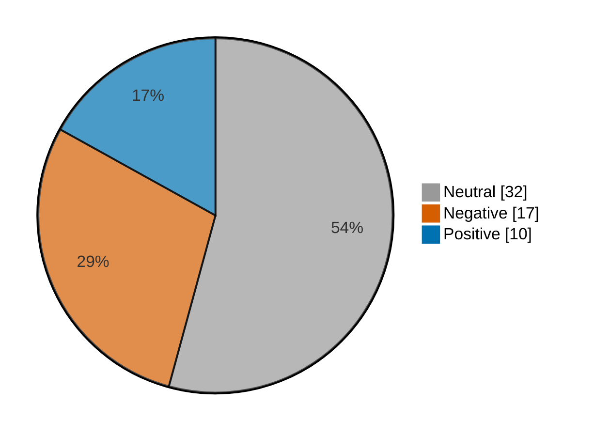

# Newsmood — 2026-11-10

**Mood index: -10.1** (mildly negative) · 59 headlines from 3 sources · model unsure on 4

## Mood at a glance

Negative 17 (28.8%) · Positive 10 (16.9%) · Neutral 32 (54.2%)

## What happened

Financial coverage leaned mildly negative today (index -10.1) from 59 headlines, with no dominant theme.

**Clusters:**

- 3 headlines on surging today, stock surging, surging: 1 negative, 2 neutral · -3.4% of the day's movement
- 6 headlines on analysis, analysis questions, answered: 6 neutral · +0.0% of the day's movement

_Themes use TF-IDF fit on 1289 headlines (2026-10-11–2026-11-10)._

## Recommended articles (highest model certainty, not most important)

### Negative

- [U.S. stocks lower at close of trade; Dow Jones Industrial Average down 0.30%](<https://www.investing.com/news/stock-market-news/us-stocks-lower-at-close-of-trade-dow-jones-industrial-average-down-030-5016940>) · 97% · 4.5% of the day's movement · investing-stocks
- [BofA downgrades Wix to underperform as AI coding tools threaten core growth](<https://www.investing.com/news/stock-market-news/bofa-downgrades-wix-to-underperform-as-ai-coding-tools-threaten-core-growth-5017069>) · 97% · 4.5% of the day's movement · investing-stocks
- [Deutsche Bank cuts Hugo Boss on falling sales, distribution reset](<https://www.investing.com/news/stock-market-news/deutsche-bank-cuts-hugo-boss-on-falling-sales-distribution-reset-5014925>) · 96% · 4.5% of the day's movement · investing-stocks

### Positive

- [Polymarket says annualized revenue has topped $1.8 billion](<https://www.cnbc.com/2026/11/10/polymarket-annualized-revenue-us-growth.html>) · 97% · 4.5% of the day's movement · cnbc-finance
- [Australia stocks higher at close of trade; S&P/ASX 200 up 1.10%](<https://www.investing.com/news/stock-market-news/australia-stocks-higher-at-close-of-trade-spasx-200-up-110-5014106>) · 97% · 4.5% of the day's movement · investing-stocks
- [LEM half-year operating profit more than doubles on data-centre demand](<https://www.investing.com/news/stock-market-news/lem-halfyear-operating-profit-more-than-doubles-on-datacentre-demand-93CH-5014141>) · 96% · 4.5% of the day's movement · investing-stocks

### Neutral

- [Factbox-What we know about Megaspeed, Singapore-based customer of Nvidia](<https://www.investing.com/news/stock-market-news/factboxwhat-we-know-about-megaspeed-singaporebased-customer-of-nvidia-5014126>) · 99% · investing-stocks
- [Anthropic files for 825M share IPO at $70-$78/sh](<https://www.investing.com/news/stock-market-news/anthropic-files-for-825m-share-ipo-at-7078sh-432SI-5014878>) · 99% · investing-stocks

## Sources

| Source | Headlines | Negative | Neutral | Positive |
|---|--:|--:|--:|--:|
| investing-stocks | 39 | 10 | 21 | 8 |
| marketwatch-top | 17 | 6 | 11 | 0 |
| cnbc-finance | 3 | 1 | 0 | 2 |

All 59 headlines

| Sentiment | Certainty | Headline | Source |
|---|--:|---|---|
| negative | 97% | [U.S. stocks lower at close of trade; Dow Jones Industrial Average down 0.30%](<https://www.investing.com/news/stock-market-news/us-stocks-lower-at-close-of-trade-dow-jones-industrial-average-down-030-5016940>) | investing-stocks |
| negative | 97% | [BofA downgrades Wix to underperform as AI coding tools threaten core growth](<https://www.investing.com/news/stock-market-news/bofa-downgrades-wix-to-underperform-as-ai-coding-tools-threaten-core-growth-5017069>) | investing-stocks |
| negative | 96% | [Deutsche Bank cuts Hugo Boss on falling sales, distribution reset](<https://www.investing.com/news/stock-market-news/deutsche-bank-cuts-hugo-boss-on-falling-sales-distribution-reset-5014925>) | investing-stocks |
| negative | 96% | [U.S. gas prices fall below $4 for the first time since July](<https://www.cnbc.com/2026/11/10/us-gas-prices-below-four-dollars.html>) | cnbc-finance |
| negative | 95% | [Stocks fall as the 10-year Treasury yield reclaims 5%](<https://www.marketwatch.com/story/why-stocks-are-falling-and-10-year-yields-are-climbing-back-near-5-after-tuesdays-inflation-report-389b8392?mod=mw_rss_topstories>) | marketwatch-top |
| negative | 94% | [Anthropic reportedly retracts IPO terms sent to banks by mistake, exposing jitters over AI investments](<https://www.marketwatch.com/story/anthropic-reportedly-retracts-ipo-terms-sent-to-banks-by-mistake-exposing-jitters-over-ai-investments-6116578d?mod=mw_rss_topstories>) | marketwatch-top |
| negative | 90% | [Nvidia could soon face tougher export rules, making it harder to sell chips to China after scandal](<https://www.marketwatch.com/story/nvidia-could-soon-face-tougher-export-rules-making-it-harder-to-sell-chips-to-china-69c88cc8?mod=mw_rss_topstories>) | marketwatch-top |
| negative | 89% | [Aggressive Fed rate hikes are quickly becoming the biggest risk to stocks in 2027, says economist](<https://www.marketwatch.com/story/an-overzealous-fed-is-quickly-becoming-the-biggest-risk-to-stocks-in-2027-ba28e51d?mod=mw_rss_topstories>) | marketwatch-top |
| negative | 80% | [Nasdaq futures slip with Nvidia woes, Anthropic IPO in focus](<https://www.investing.com/news/stock-market-news/sp-500-dow-futures-climb-as-oil-slide-lifts-sentiment-5014579>) | investing-stocks |
| negative | 77% | [Wall Street’s only Nvidia bear says forcing out CEO Jensen Huang ‘would be a mistake for everyone’](<https://www.marketwatch.com/story/wall-streets-only-nvidia-bear-says-forcing-out-ceo-jensen-huang-would-be-a-mistake-for-everyone-78043738?mod=mw_rss_topstories>) | marketwatch-top |
| negative | 72% | [Why is iHeartMedia stock collapsing today?](<https://www.investing.com/news/stock-market-news/why-is-iheartmedia-stock-collapsing-today-93CH-5016431>) | investing-stocks |
| negative | 69% | [Microsoft presses Trump to scuttle expected ban on Chinese data center technology](<https://www.investing.com/news/stock-market-news/exclusivemicrosoft-presses-trump-to-scuttle-expected-ban-on-chinese-data-center-technology-5014745>) | investing-stocks |
| negative | 67% | [Microsoft pushes Trump to halt Chinese data center component ban: Reuters](<https://www.investing.com/news/stock-market-news/microsoft-pushes-trump-to-halt-chinese-data-center-component-ban-reuters-5014871>) | investing-stocks |
| negative | 61% | [US lawmakers push China chip rules after Nvidia CEO allegations](<https://www.investing.com/news/stock-market-news/schumer-says-congress-must-have-answers-on-trump-defense-of-nvidia-ceo-5016683>) | investing-stocks |
| negative | 51% (unsure) | [Five US states join FTC suit over alleged Hims & Hers unlawful practices](<https://www.investing.com/news/stock-market-news/five-us-states-join-ftc-suit-over-alleged-hims--hers-unlawful-practices-5016982>) | investing-stocks |
| negative | 51% (unsure) | [Three workers die at Indian facility making Apple iPhone components - report](<https://www.investing.com/news/stock-market-news/three-workers-die-at-tata-facility-making-apple-iphone-components--report-5014086>) | investing-stocks |
| negative | 42% (unsure) | [Fed’s Waller puts half-point rate hike into the mix for December](<https://www.marketwatch.com/story/feds-waller-puts-half-point-rate-hike-into-the-mix-for-december-1bebdffc?mod=mw_rss_topstories>) | marketwatch-top |
| positive | 97% | [Polymarket says annualized revenue has topped $1.8 billion](<https://www.cnbc.com/2026/11/10/polymarket-annualized-revenue-us-growth.html>) | cnbc-finance |
| positive | 97% | [Australia stocks higher at close of trade; S&P/ASX 200 up 1.10%](<https://www.investing.com/news/stock-market-news/australia-stocks-higher-at-close-of-trade-spasx-200-up-110-5014106>) | investing-stocks |
| positive | 96% | [LEM half-year operating profit more than doubles on data-centre demand](<https://www.investing.com/news/stock-market-news/lem-halfyear-operating-profit-more-than-doubles-on-datacentre-demand-93CH-5014141>) | investing-stocks |
| positive | 95% | [Amazon receives UK approval to expand drone delivery service](<https://www.investing.com/news/stock-market-news/amazon-receives-uk-approval-to-expand-drone-delivery-service-93CH-5014854>) | investing-stocks |
| positive | 92% | [Moonshot AI rents Nvidia’s top chips in China, Bloomberg reports](<https://www.investing.com/news/stock-market-news/moonshot-ai-rents-nvidias-top-chips-in-china-bloomberg-reports-5014089>) | investing-stocks |
| positive | 78% | [Fed Governor Waller sees December hike likely, opens door to possible half-point increase](<https://www.cnbc.com/2026/11/10/fed-governor-waller-sees-december-hike-likely.html>) | cnbc-finance |
| positive | 75% | [Embraer raises 2026 guidance after record third-quarter revenue](<https://www.investing.com/news/stock-market-news/embraer-raises-2026-guidance-after-record-thirdquarter-revenue-5014849>) | investing-stocks |
| positive | 70% | [Gedeon Richter upgrades 2026 guidance on strong delivery](<https://www.investing.com/news/stock-market-news/gedeon-richter-upgrades-2026-guidance-on-strong-delivery-93CH-5014121>) | investing-stocks |
| positive | 67% | [Bank of Japan ETF sales to bring in $6.3 bln annually, finmin Katayama says](<https://www.investing.com/news/stock-market-news/bank-of-japan-etf-sales-to-bring-in-63-bln-annually-finmin-katayama-says-93CH-5014101>) | investing-stocks |
| positive | 53% (unsure) | [Lawmakers vow aggressive oversight of FCC chair after Democrats take over](<https://www.investing.com/news/stock-market-news/lawmakers-vow-aggressive-oversight-of-fcc-chair-after-democrats-take-over-5016452>) | investing-stocks |
| neutral | 99% | [Factbox-What we know about Megaspeed, Singapore-based customer of Nvidia](<https://www.investing.com/news/stock-market-news/factboxwhat-we-know-about-megaspeed-singaporebased-customer-of-nvidia-5014126>) | investing-stocks |
| neutral | 99% | [Anthropic files for 825M share IPO at $70-$78/sh](<https://www.investing.com/news/stock-market-news/anthropic-files-for-825m-share-ipo-at-7078sh-432SI-5014878>) | investing-stocks |
| neutral | 98% | [After-Hours Movers: CRWV, NBIS, RGTI, STUB , FOSL, COST](<https://www.investing.com/news/stock-market-news/afterhours-movers-crwv-nbis-rgti-stub--fosl-cost-432SI-5016945>) | investing-stocks |
| neutral | 98% | [Take-Two Interactive earnings analysis: questions answered and next catalysts](<https://www.investing.com/news/stock-market-news/taketwo-interactive-earnings-analysis-questions-answered-and-next-catalysts-93CH-5016419>) | investing-stocks |
| neutral | 98% | [AST SpaceMobile earnings analysis: questions answered and next catalysts](<https://www.investing.com/news/stock-market-news/ast-spacemobile-earnings-analysis-questions-answered-and-next-catalysts-93CH-5016422>) | investing-stocks |
| neutral | 98% | [Rocket Lab earnings analysis: questions answered and next catalysts](<https://www.investing.com/news/stock-market-news/rocket-lab-earnings-analysis-questions-answered-and-next-catalysts-93CH-5016433>) | investing-stocks |
| neutral | 98% | [ON Holding earnings analysis: questions answered and next catalysts](<https://www.investing.com/news/stock-market-news/on-holding-earnings-analysis-questions-answered-and-next-catalysts-93CH-5016437>) | investing-stocks |
| neutral | 98% | [Trade Desk earnings analysis: questions answered and next catalysts](<https://www.investing.com/news/stock-market-news/trade-desk-earnings-analysis-questions-answered-and-next-catalysts-93CH-5016421>) | investing-stocks |
| neutral | 98% | [Occidental Petroleum earnings analysis: questions answered and next catalysts](<https://www.investing.com/news/stock-market-news/occidental-petroleum-earnings-analysis-questions-answered-and-next-catalysts-93CH-5016432>) | investing-stocks |
| neutral | 98% | [Retirees should be big beneficiaries of the midterms: ‘Democrats will hold every gavel that matters for aging and public policy’](<https://www.marketwatch.com/story/retirees-should-be-big-beneficiaries-of-the-midterms-democrats-will-hold-every-gavel-that-matters-for-aging-and-public-policy-71e966f0?mod=mw_rss_topstories>) | marketwatch-top |
| neutral | 97% | [N.Y. Knicks star Josh Hart relists Florida home for $5.7 million](<https://www.marketwatch.com/story/n-y-knicks-star-josh-hart-relists-florida-home-for-5-7-million-5fd3f18c?mod=mw_rss_topstories>) | marketwatch-top |
| neutral | 96% | [Former ISS executive Guerra and partners launch Niscaya Governance](<https://www.investing.com/news/stock-market-news/former-iss-executive-guerra-and-partners-launch-niscaya-governance-5015464>) | investing-stocks |
| neutral | 96% | [Ignore the wild swings in chip stocks until they reach these ‘lines in the sand’](<https://www.marketwatch.com/story/ignore-the-wild-swings-in-chip-stocks-until-they-reach-these-lines-in-the-sand-feb6e00f?mod=mw_rss_topstories>) | marketwatch-top |
| neutral | 96% | [Forget happy hour. ‘Money parties’ are having a moment.](<https://www.marketwatch.com/story/forget-happy-hour-money-parties-are-having-a-moment-6bc6f02a?mod=mw_rss_topstories>) | marketwatch-top |
| neutral | 96% | [Meet the former prosecutor Nvidia hired to investigate the Jensen Huang spy scandal](<https://www.marketwatch.com/story/meet-the-former-prosecutor-nvidia-hired-to-investigate-the-jensen-huang-spy-scandal-e8078f67?mod=mw_rss_topstories>) | marketwatch-top |
| neutral | 95% | [My friend feels trapped at her job but won’t do anything about it. Am I supposed to step in?](<https://www.marketwatch.com/story/my-friend-feels-trapped-at-her-job-but-wont-do-anything-about-it-am-i-supposed-to-step-in-7e55604e?mod=mw_rss_topstories>) | marketwatch-top |
| neutral | 91% | [Anthropic brings Claude to Google Meet to tackle tasks live](<https://www.investing.com/news/stock-market-news/anthropic-brings-claude-to-google-meet-to-tackle-tasks-live-5016423>) | investing-stocks |
| neutral | 91% | [Alice Huang, Chinese businesswoman tied to Nvidia CEO, went from finance to chips](<https://www.investing.com/news/stock-market-news/alice-huang-chinese-businesswoman-tied-to-nvidia-ceo-went-from-finance-to-chips-5014096>) | investing-stocks |
| neutral | 90% | [Analysis-Nvidia’s clubby board faces a sticky ’honey pot’ test](<https://www.investing.com/news/stock-market-news/analysisnvidias-clubby-board-faces-a-sticky-honey-pot-test-5014779>) | investing-stocks |
| neutral | 90% | [‘The thought of living to 100 terrifies me’: Is Social Security a giant Ponzi scheme?](<https://www.marketwatch.com/story/the-thought-of-living-to-100-terrifies-me-is-social-security-a-giant-ponzi-scheme-84a64e7e?mod=mw_rss_topstories>) | marketwatch-top |
| neutral | 88% | [Actor Justin Baldoni quietly sold his L.A. home for $2.1 million after moving to Nashville](<https://www.marketwatch.com/story/actor-justin-baldoni-quietly-sold-his-l-a-home-for-2-1-million-after-moving-to-nashville-4cb8041e?mod=mw_rss_topstories>) | marketwatch-top |
| neutral | 88% | [How the stock market has performed after Veterans Day over the past decade](<https://www.marketwatch.com/story/how-the-stock-market-has-performed-after-veterans-day-over-the-past-decade-7b47233e?mod=mw_rss_topstories>) | marketwatch-top |
| neutral | 88% | [Why is Chiba Bank stock rallying today?](<https://www.investing.com/news/stock-market-news/why-is-chiba-bank-stock-rallying-today-93CH-5014087>) | investing-stocks |
| neutral | 82% | [Elon Musk was half right in his comment last week about SoftBank backpedaling on a gas-turbine order](<https://www.marketwatch.com/story/elon-musk-was-half-right-in-his-comment-last-week-about-softbank-back-pedaling-on-a-gas-turbine-order-c293d335?mod=mw_rss_topstories>) | marketwatch-top |
| neutral | 82% | [Why is Riot Platforms stock climbing today?](<https://www.investing.com/news/stock-market-news/why-is-riot-platforms-stock-climbing-today-93CH-5014884>) | investing-stocks |
| neutral | 81% | [H.C. Wainwright reiterates Strive as top pick after bitcoin holdings surge](<https://www.investing.com/news/stock-market-news/hc-wainwright-reiterates-strive-as-top-pick-after-bitcoin-holdings-surge-5017060>) | investing-stocks |
| neutral | 76% | [Wall Street regulator poised to bring charges against Kalshi, Politico reports](<https://www.investing.com/news/stock-market-news/wall-street-regulator-poised-to-bring-charges-against-kalshi-politico-reports-5017029>) | investing-stocks |
| neutral | 72% | [Microsoft stock falls as Anthropic takes aim at Excel and workplace software](<https://www.investing.com/news/stock-market-news/microsoft-stock-falls--as-anthropic-takes-aim-at-excel-and-workplace-software-5016411>) | investing-stocks |
| neutral | 72% | [Why is Sanmina stock surging today?](<https://www.investing.com/news/stock-market-news/why-is-sanmina-stock-surging-today-93CH-5014898>) | investing-stocks |
| neutral | 70% | [‘I’m sick of flying’: I paid for priority boarding, but the overhead bins were full. Was I duped?](<https://www.marketwatch.com/story/im-sick-of-flying-i-paid-for-priority-boarding-but-the-overhead-bins-were-full-was-i-duped-0badcc80?mod=mw_rss_topstories>) | marketwatch-top |
| neutral | 70% | [Why is Mercury Systems stock sliding today?](<https://www.investing.com/news/stock-market-news/why-is-mercury-systems-stock-sliding-today-93CH-5017032>) | investing-stocks |
| neutral | 66% | [Why is Towa stock surging today?](<https://www.investing.com/news/stock-market-news/why-is-towa-stock-surging-today-93CH-5014088>) | investing-stocks |

---

Certainty is the model's confidence in its label; below 60% it is marked unsure.

"Of the day's movement" is a headline's certainty over the sum of every non-neutral headline's certainty: its part in moving the index. Neutral headlines move it by 0.

Links go to the original publisher; some limit free articles.

Model: kkrit-tinna/newsmood-distilbert-financial@be7b809e0d8f7bd50e77d902aee199363b7e2a66 · Gates: 2/2 passed · Not financial advice.
