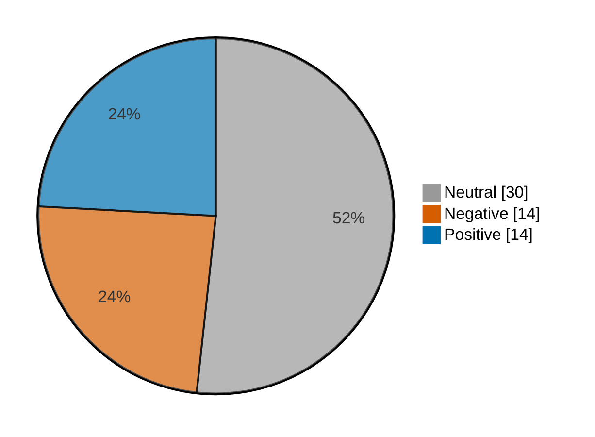

# Newsmood — 2026-11-11

**Mood index: +3.6** (roughly flat) · 58 headlines from 3 sources · model unsure on 4

## Mood at a glance

Negative 14 (24.1%) · Positive 14 (24.1%) · Neutral 30 (51.7%)

## What happened

Financial news was roughly flat today (index +3.6, up 12.1 from yesterday) from 58 headlines, with no single theme in the lead.

**Clusters:**

- 3 headlines on surging today, stock surging, surging: 1 negative, 2 neutral · -2.2% of the day's movement
- 4 headlines on analysis, analysis questions, answered: 4 neutral · +0.0% of the day's movement
- 3 headlines on earnings preview, preview, preview watch: 3 neutral · +0.0% of the day's movement

_Themes use TF-IDF fit on 1341 headlines (2026-10-12–2026-11-11)._

## Recommended articles (highest model certainty, not most important)

### Negative

- [Colombia stocks lower at close of trade; COLCAP down 1.64%](<https://www.investing.com/news/stock-market-news/colombia-stocks-lower-at-close-of-trade-colcap-down-164-5019882>) · 97% · 4.1% of the day's movement · investing-stocks
- [Fed's Goolsbee calls inflation report 'borderline disturbing' as central bank weighs more hikes](<https://www.cnbc.com/2026/11/11/goolsbee-october-inflation-fed-rates-disturbing-distressing.html>) · 95% · 4.0% of the day's movement · cnbc-finance
- [Falling oil prices are no longer enough to bring down borrowing costs in the world’s most important bond market](<https://www.marketwatch.com/story/falling-oil-prices-are-no-longer-enough-to-bring-down-borrowing-costs-in-the-worlds-most-important-bond-market-3176d25a?mod=mw_rss_topstories>) · 94% · 3.9% of the day's movement · marketwatch-top

### Positive

- [Taiwan stocks higher at close of trade; Taiwan Weighted up 3.11%](<https://www.investing.com/news/stock-market-news/taiwan-stocks-higher-at-close-of-trade-taiwan-weighted-up-311-5017744>) · 97% · 4.1% of the day's movement · investing-stocks
- [Mexico stocks higher at close of trade; S&P/BMV IPC up 0.13%](<https://www.investing.com/news/stock-market-news/mexico-stocks-higher-at-close-of-trade-spbmv-ipc-up-013-5019890>) · 97% · 4.1% of the day's movement · investing-stocks
- [Canada stocks higher at close of trade; S&P/TSX Composite up 0.67%](<https://www.investing.com/news/stock-market-news/canada-stocks-higher-at-close-of-trade-sptsx-composite-up-067-5019888>) · 97% · 4.1% of the day's movement · investing-stocks

### Neutral

- [Cisco earnings preview: EPS, margins, and guidance in focus](<https://www.investing.com/news/stock-market-news/cisco-earnings-preview-eps-margins-and-guidance-in-focus-93CH-5019656>) · 98% · investing-stocks
- [Rigetti Computing earnings analysis: questions answered and next catalysts](<https://www.investing.com/news/stock-market-news/rigetti-computing-earnings-analysis-questions-answered-and-next-catalysts-93CH-5019653>) · 98% · investing-stocks

## Sources

| Source | Headlines | Negative | Neutral | Positive |
|---|--:|--:|--:|--:|
| investing-stocks | 39 | 9 | 19 | 11 |
| marketwatch-top | 17 | 4 | 11 | 2 |
| cnbc-finance | 2 | 1 | 0 | 1 |

All 58 headlines

| Sentiment | Certainty | Headline | Source |
|---|--:|---|---|
| negative | 97% | [Colombia stocks lower at close of trade; COLCAP down 1.64%](<https://www.investing.com/news/stock-market-news/colombia-stocks-lower-at-close-of-trade-colcap-down-164-5019882>) | investing-stocks |
| negative | 95% | [Fed's Goolsbee calls inflation report 'borderline disturbing' as central bank weighs more hikes](<https://www.cnbc.com/2026/11/11/goolsbee-october-inflation-fed-rates-disturbing-distressing.html>) | cnbc-finance |
| negative | 94% | [Falling oil prices are no longer enough to bring down borrowing costs in the world’s most important bond market](<https://www.marketwatch.com/story/falling-oil-prices-are-no-longer-enough-to-bring-down-borrowing-costs-in-the-worlds-most-important-bond-market-3176d25a?mod=mw_rss_topstories>) | marketwatch-top |
| negative | 94% | [Market angst is driving investors into low-volatility stocks as AI trade stumbles](<https://www.marketwatch.com/story/market-angst-is-driving-investors-into-low-volatility-stocks-as-ai-trade-stumbles-23d905e9?mod=mw_rss_topstories>) | marketwatch-top |
| negative | 90% | [Jefferies cuts BASF on chemical oversupply and deteriorating spreads](<https://www.investing.com/news/stock-market-news/jefferies-cuts-basf-on-chemical-oversupply-and-deteriorating-spreads-5018408>) | investing-stocks |
| negative | 88% | [Lutnick stalled Trump crackdown on diversion of Nvidia chips to China, Axios reports](<https://www.investing.com/news/stock-market-news/lutnick-stalled-trump-crackdown-on-diversion-of-nvidia-chips-to-china-axios-reports-5019880>) | investing-stocks |
| negative | 84% | [Ganfeng Lithium says battery metal prices harder to predict](<https://www.investing.com/news/stock-market-news/ganfeng-lithium-says-battery-metal-prices-harder-to-predict-93CH-5017740>) | investing-stocks |
| negative | 84% | [China optical stocks rally as Microsoft challenges proposed U.S. import curbs](<https://www.investing.com/news/stock-market-news/china-optical-stocks-rally-as-microsoft-challenges-proposed-us-import-curbs-5017749>) | investing-stocks |
| negative | 78% | [Bloom Energy’s stock is rallying as data-center jitters subside](<https://www.marketwatch.com/story/bloom-energys-stock-is-soaring-as-data-center-jitters-subside-5fda5689?mod=mw_rss_topstories>) | marketwatch-top |
| negative | 71% | [The trillion-dollar mistake corporate America is making about retirement](<https://www.marketwatch.com/story/corporate-america-is-making-a-trillion-dollar-mistake-about-retirement-234c8996?mod=mw_rss_topstories>) | marketwatch-top |
| negative | 70% | [CAR-T trial deaths do not deter lupus patients hoping for a cure](<https://www.investing.com/news/stock-market-news/cart-trial-deaths-do-not-deter-lupus-patients-hoping-for-a-cure-5018382>) | investing-stocks |
| negative | 63% | [India garment makers rethink reliance on US after tariff shock](<https://www.investing.com/news/stock-market-news/india-garment-makers-rethink-reliance-onusafter-tariff-shock-5017723>) | investing-stocks |
| negative | 53% (unsure) | [Why is Valens Semiconductor stock surging today?](<https://www.investing.com/news/stock-market-news/why-is-valens-semiconductor-stock-surging-today-93CH-5018436>) | investing-stocks |
| negative | 46% (unsure) | [How Nvidia CEO Jensen Huang got entangled in a China chip and spy scandal](<https://www.investing.com/news/stock-market-news/how-nvidia-ceo-jensen-huang-got-entangled-in-a-china-chip-and-spy-scandal-5019824>) | investing-stocks |
| positive | 97% | [Taiwan stocks higher at close of trade; Taiwan Weighted up 3.11%](<https://www.investing.com/news/stock-market-news/taiwan-stocks-higher-at-close-of-trade-taiwan-weighted-up-311-5017744>) | investing-stocks |
| positive | 97% | [Mexico stocks higher at close of trade; S&P/BMV IPC up 0.13%](<https://www.investing.com/news/stock-market-news/mexico-stocks-higher-at-close-of-trade-spbmv-ipc-up-013-5019890>) | investing-stocks |
| positive | 97% | [Canada stocks higher at close of trade; S&P/TSX Composite up 0.67%](<https://www.investing.com/news/stock-market-news/canada-stocks-higher-at-close-of-trade-sptsx-composite-up-067-5019888>) | investing-stocks |
| positive | 97% | [Russia stocks higher at close of trade; MOEX Russia Index up 1.84%](<https://www.investing.com/news/stock-market-news/russia-stocks-higher-at-close-of-trade-moex-russia-index-up-184-5019874>) | investing-stocks |
| positive | 96% | [U.S. stocks higher at close of trade; Dow Jones Industrial Average up 0.48%](<https://www.investing.com/news/stock-market-news/us-stocks-higher-at-close-of-trade-dow-jones-industrial-average-up-048-5019892>) | investing-stocks |
| positive | 95% | [European shares near record high as earnings absorb tech volatility](<https://www.investing.com/news/stock-market-news/european-shares-near-record-high-as-earnings-absorb-tech-volatility-5017971>) | investing-stocks |
| positive | 95% | [Telecom Italia reports Q3 revenue growth, regains investment grade; shares up](<https://www.investing.com/news/stock-market-news/telecom-italia-reports-q3-revenue-growth-regains-investment-grade-shares-up-93CH-5018355>) | investing-stocks |
| positive | 94% | [Wachtell, Nvidia’s pick for Huang probe, built reputation in boardroom battles](<https://www.investing.com/news/stock-market-news/wachtell-nvidias-pick-for-huang-probe-built-reputation-in-boardroom-battles-5019665>) | investing-stocks |
| positive | 94% | [Sandisk’s stock just staged a big gain. Here’s how it could march even higher.](<https://www.marketwatch.com/story/sandisks-stock-is-soaring-and-these-three-trends-could-send-it-even-higher-b0d7d5ec?mod=mw_rss_topstories>) | marketwatch-top |
| positive | 93% | [Nasdaq futures climb amid upbeat CoreWeave outlook, Anthropic IPO hopes](<https://www.investing.com/news/stock-market-news/us-stock-futures-tick-higher-after-wall-st-slips-on-hot-cpi-nvidia-losses-5017417>) | investing-stocks |
| positive | 92% | [Among full-size SUVs, the 2027 Ford Expedition is worth a look for its spacious seating and mighty engine](<https://www.marketwatch.com/story/among-full-size-suvs-the-2027-ford-expedition-is-worth-a-look-for-its-spacious-seating-and-mighty-engine-2c169852?mod=mw_rss_topstories>) | marketwatch-top |
| positive | 91% | [Nvidia, chip stocks rebound premarket after CoreWeave lifts revenue outlook](<https://www.investing.com/news/stock-market-news/nvidia-chip-stocks-rebound-premarket-after-coreweave-lifts-revenue-outlook-5018395>) | investing-stocks |
| positive | 74% | [China PLA-linked university bought Nvidia H200 chips despite U.S. curbs - Reuters](<https://www.investing.com/news/stock-market-news/china-plalinked-university-bought-nvidia-h200-chips-despite-us-curbs--reuters-5017739>) | investing-stocks |
| positive | 74% | [Prediction markets tied to clinical trials and drug approvals draw lawmakers' ire](<https://www.cnbc.com/2026/11/11/kalsi-polymarket-prediction-market-senators-hhs-drug-approval.html>) | cnbc-finance |
| neutral | 98% | [Cisco earnings preview: EPS, margins, and guidance in focus](<https://www.investing.com/news/stock-market-news/cisco-earnings-preview-eps-margins-and-guidance-in-focus-93CH-5019656>) | investing-stocks |
| neutral | 98% | [Rigetti Computing earnings analysis: questions answered and next catalysts](<https://www.investing.com/news/stock-market-news/rigetti-computing-earnings-analysis-questions-answered-and-next-catalysts-93CH-5019653>) | investing-stocks |
| neutral | 98% | [Applied Materials fiscal Q4 2026 earnings preview: what to watch for in the print](<https://www.investing.com/news/stock-market-news/applied-materials-fiscal-q4-2026-earnings-preview-what-to-watch-for-in-the-print-93CH-5019657>) | investing-stocks |
| neutral | 98% | [Mercury Systems earnings analysis: questions answered and next catalysts](<https://www.investing.com/news/stock-market-news/mercury-systems-earnings-analysis-questions-answered-and-next-catalysts-93CH-5019651>) | investing-stocks |
| neutral | 98% | [StubHub earnings analysis: questions answered and next catalysts](<https://www.investing.com/news/stock-market-news/stubhub-earnings-analysis-questions-answered-and-next-catalysts-93CH-5019654>) | investing-stocks |
| neutral | 98% | [Warburg Pincus targets $5 billion for second Capital Solutions fund - Bloomberg](<https://www.investing.com/news/stock-market-news/warburg-pincus-targets-5-billion-for-second-capital-solutions-fund--bloomberg-93CH-5019900>) | investing-stocks |
| neutral | 98% | [CoreWeave earnings analysis: questions answered and next catalysts](<https://www.investing.com/news/stock-market-news/coreweave-earnings-analysis-questions-answered-and-next-catalysts-93CH-5019649>) | investing-stocks |
| neutral | 98% | [Nebius earnings preview: what to watch when Q3 results hit Thursday](<https://www.investing.com/news/stock-market-news/nebius-earnings-preview-what-to-watch-when-q3-results-hit-thursday-93CH-5019658>) | investing-stocks |
| neutral | 97% | [Meta’s longtime infrastructure head Janardhan to depart in early 2027](<https://www.investing.com/news/stock-market-news/metas-longtime-infrastructure-headjanardhan-to-depart-in-early-2027-5019662>) | investing-stocks |
| neutral | 97% | [Cerebras Systems Q3 2026 earnings preview: key metrics and risks to watch](<https://www.investing.com/news/stock-market-news/cerebras-systems-q3-2026-earnings-preview-key-metrics-and-risks-to-watch-93CH-5019659>) | investing-stocks |
| neutral | 96% | [Tiger Woods has another private, 18-hole golf destination in the works — this one for Long Island’s Gold Coast](<https://www.marketwatch.com/story/tiger-woods-has-another-private-18-hole-golf-destination-in-the-works-this-one-for-long-islands-gold-coast-7e8e669c?mod=mw_rss_topstories>) | marketwatch-top |
| neutral | 95% | [It’s not ‘Medicare for All,’ but ‘Medicare for More.’ What this could mean for workers over 50.](<https://www.marketwatch.com/story/its-not-medicare-for-all-but-medicare-for-more-what-this-could-mean-for-workers-over-50-4a5c51a3?mod=mw_rss_topstories>) | marketwatch-top |
| neutral | 95% | [Why is TSMC stock rallying today?](<https://www.investing.com/news/stock-market-news/why-is-tsmc-stock-rallying-today-93CH-5017738>) | investing-stocks |
| neutral | 95% | [Why Goldman Sachs is now changing its Federal Reserve interest-rate forecast](<https://www.marketwatch.com/story/why-goldman-sachs-is-now-changing-its-federal-reserve-interest-rate-forecast-3753f968?mod=mw_rss_topstories>) | marketwatch-top |
| neutral | 94% | [Why is Nomura stock rallying today?](<https://www.investing.com/news/stock-market-news/why-is-nomura-stock-rallying-today-93CH-5019814>) | investing-stocks |
| neutral | 91% | [Need money for a down payment? More employers are offering to help.](<https://www.marketwatch.com/story/need-money-for-a-down-payment-more-employers-are-offering-to-help-59c57da3?mod=mw_rss_topstories>) | marketwatch-top |
| neutral | 90% | [CoreWeave just gave a shot in the arm to Micron, Lumentum and the rest of the AI trade](<https://www.marketwatch.com/story/micron-and-other-ai-stocks-surge-as-coreweave-calms-wall-streets-worst-fears-0a18152a?mod=mw_rss_topstories>) | marketwatch-top |
| neutral | 90% | [I’m 63 and want to spend $95,000 on a roof deck for my $500,000 home. Is that a good investment?](<https://www.marketwatch.com/story/im-63-and-want-to-spend-95-000-on-a-roof-deck-for-my-500-000-home-is-that-a-good-investment-f1a59c27?mod=mw_rss_topstories>) | marketwatch-top |
| neutral | 88% | [RWE and KKR develop 2.8 GW offshore wind project in Britain](<https://www.investing.com/news/stock-market-news/rwe-and-kkr-develop-28-gw-offshore-wind-project-in-britain-93CH-5017722>) | investing-stocks |
| neutral | 88% | [From living in his car to a 756 credit score: How one veteran rebuilt his finances](<https://www.marketwatch.com/story/from-living-in-his-car-to-a-756-credit-score-how-one-veteran-rebuilt-his-finances-026c3336?mod=mw_rss_topstories>) | marketwatch-top |
| neutral | 85% | [Why this ‘big idea’ to fix Social Security relies on a massive stock-market gamble](<https://www.marketwatch.com/story/why-this-big-idea-to-fix-social-security-relies-on-a-massive-stock-market-gamble-5423f50f?mod=mw_rss_topstories>) | marketwatch-top |
| neutral | 84% | [GoPro: A Brand That Ran Out of Runway](<https://www.investing.com/news/stock-market-news/gopro-a-brand-that-ran-out-of-runway-93CH-5018389>) | investing-stocks |
| neutral | 83% | [Anthropic’s IPO roadshow kicks off — and the big money is already lining up](<https://www.marketwatch.com/story/anthropics-ipo-roadshow-kicks-off-and-the-big-money-is-already-lining-up-7cdd4f8b?mod=mw_rss_topstories>) | marketwatch-top |
| neutral | 82% | [TSMC board approves $1 bln investment in Anthropic, OpenAI; shares rise](<https://www.investing.com/news/stock-market-news/tsmc-board-approves-1-bln--investment-in-anthropic-openai-shares-rise-93CH-5017730>) | investing-stocks |
| neutral | 76% | [Has Nvidia flown too close to the sun? One analyst warns of major scrutiny ahead.](<https://www.marketwatch.com/story/has-nvidia-flown-too-close-to-the-sun-one-analyst-warns-of-major-scrutiny-ahead-a323c4dd?mod=mw_rss_topstories>) | marketwatch-top |
| neutral | 74% | [Why is PEXA stock sliding today?](<https://www.investing.com/news/stock-market-news/why-is-pexa-stock-sliding-today-93CH-5017725>) | investing-stocks |
| neutral | 70% | [Netflix trades at under 18x earnings after a steep valuation reset](<https://www.investing.com/news/stock-market-news/netflix-trades-at-under-18x-earnings-after-a-steep-valuation-reset-93CH-5018417>) | investing-stocks |
| neutral | 62% | [Why is Tandy Leather Factory stock surging today?](<https://www.investing.com/news/stock-market-news/why-is-tandy-leather-factory-stock-surging-today-93CH-5018415>) | investing-stocks |
| neutral | 51% (unsure) | [Opening trading-card packs has become a $2 billion market. New apps are trying to cash in.](<https://www.marketwatch.com/story/opening-trading-card-packs-has-become-a-2-billion-market-new-apps-are-trying-to-cash-in-b7ba11f5?mod=mw_rss_topstories>) | marketwatch-top |
| neutral | 49% (unsure) | [Why is NRW Holdings stock surging today?](<https://www.investing.com/news/stock-market-news/why-is-nrw-holdings-stock-surging-today-93CH-5017724>) | investing-stocks |

---

Certainty is the model's confidence in its label; below 60% it is marked unsure.

"Of the day's movement" is a headline's certainty over the sum of every non-neutral headline's certainty: its part in moving the index. Neutral headlines move it by 0.

Links go to the original publisher; some limit free articles.

Model: kkrit-tinna/newsmood-distilbert-financial@be7b809e0d8f7bd50e77d902aee199363b7e2a66 · Gates: 2/2 passed · Not financial advice.
