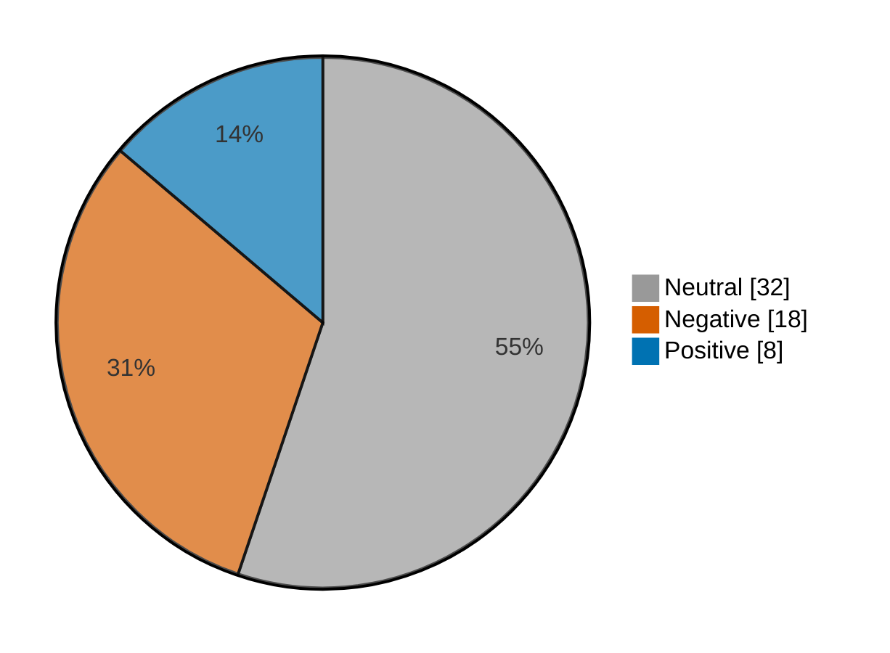

# Newsmood — 2026-11-12

**Mood index: -16.2** (moderately negative) · 58 headlines from 3 sources · model unsure on 6

## Mood at a glance

Negative 18 (31.0%) · Positive 8 (13.8%) · Neutral 32 (55.2%)

## What happened

Financial news leaned moderately negative today (index -16.2, a drop of 13.2 from yesterday) over 58 headlines, with no dominant theme.

**Clusters:**

- 4 headlines on sliding, sliding today, stock sliding: 4 neutral · +0.0% of the day's movement

_Themes use TF-IDF fit on 1390 headlines (2026-10-13–2026-11-12)._

## Recommended articles (highest model certainty, not most important)

### Negative

- [Taiwan stocks lower at close of trade; Taiwan Weighted down 2.79%](<https://www.investing.com/news/stock-market-news/taiwan-stocks-lower-at-close-of-trade-taiwan-weighted-down-279-5020418>) · 97% · 4.5% of the day's movement · investing-stocks
- [U.S. stocks lower at close of trade; Dow Jones Industrial Average down 0.36%](<https://www.investing.com/news/stock-market-news/us-stocks-lower-at-close-of-trade-dow-jones-industrial-average-down-036-5023324>) · 97% · 4.4% of the day's movement · investing-stocks
- [Mexico stocks lower at close of trade; S&P/BMV IPC down 0.37%](<https://www.investing.com/news/stock-market-news/mexico-stocks-lower-at-close-of-trade-spbmv-ipc-down-037-5023317>) · 97% · 4.4% of the day's movement · investing-stocks

### Positive

- [FTSE 100 today: Stocks edge higher on strong GDP, upbeat company earnings](<https://www.investing.com/news/stock-market-news/ftse-100-nears-record-high-as-uk-reports-robust-q3-growth-5020634>) · 97% · 4.5% of the day's movement · investing-stocks
- [U.K. stocks higher at close of trade; Investing.com United Kingdom 100 up 0.40%](<https://www.investing.com/news/stock-market-news/uk-stocks-higher-at-close-of-trade-investingcom-united-kingdom-100-up-040-5022829>) · 97% · 4.4% of the day's movement · investing-stocks
- [Analysis-AI shakeout lands convertible investors better terms](<https://www.investing.com/news/stock-market-news/analysisai-shakeout-lands-convertible-investors-better-terms-5021024>) · 94% · 4.3% of the day's movement · investing-stocks

### Neutral

- [After-Hours Movers: CBRS, CSCO, AMAT, NMAX, FLO](<https://www.investing.com/news/stock-market-news/afterhours-movers-cbrs-csco-amat-nmax-flo-432SI-5023311>) · 99% · investing-stocks
- [Anthropic’s IPO is about six times oversubscribed, Bloomberg News reports](<https://www.investing.com/news/stock-market-news/anthropics-ipo-is-about-six-times-oversubscribed-bloomberg-news-reports-5023345>) · 99% · investing-stocks

## Sources

| Source | Headlines | Negative | Neutral | Positive |
|---|--:|--:|--:|--:|
| investing-stocks | 39 | 16 | 18 | 5 |
| marketwatch-top | 16 | 2 | 13 | 1 |
| cnbc-finance | 3 | 0 | 1 | 2 |

All 58 headlines

| Sentiment | Certainty | Headline | Source |
|---|--:|---|---|
| negative | 97% | [Taiwan stocks lower at close of trade; Taiwan Weighted down 2.79%](<https://www.investing.com/news/stock-market-news/taiwan-stocks-lower-at-close-of-trade-taiwan-weighted-down-279-5020418>) | investing-stocks |
| negative | 97% | [U.S. stocks lower at close of trade; Dow Jones Industrial Average down 0.36%](<https://www.investing.com/news/stock-market-news/us-stocks-lower-at-close-of-trade-dow-jones-industrial-average-down-036-5023324>) | investing-stocks |
| negative | 97% | [Mexico stocks lower at close of trade; S&P/BMV IPC down 0.37%](<https://www.investing.com/news/stock-market-news/mexico-stocks-lower-at-close-of-trade-spbmv-ipc-down-037-5023317>) | investing-stocks |
| negative | 96% | [Australia stocks lower at close of trade; S&P/ASX 200 down 0.07%](<https://www.investing.com/news/stock-market-news/australia-stocks-lower-at-close-of-trade-spasx-200-down-007-5020392>) | investing-stocks |
| negative | 96% | [Canada stocks lower at close of trade; S&P/TSX Composite down 0.75%](<https://www.investing.com/news/stock-market-news/canada-stocks-lower-at-close-of-trade-sptsx-composite-down-075-5023303>) | investing-stocks |
| negative | 96% | [SMIC Q4 margin forecast falls short of Q3 level despite revenue growth outlook](<https://www.investing.com/news/stock-market-news/smic-q4-margin-forecast-falls-short-of-q3-level-despite-revenue-growth-outlook-93CH-5021126>) | investing-stocks |
| negative | 95% | [Value manager Sprucegrove to shutter following steep asset declines - Bloomberg](<https://www.investing.com/news/stock-market-news/value-manager-sprucegrove-to-shutter-following-steep-asset-declines--bloomberg-5023427>) | investing-stocks |
| negative | 95% | [Alibaba, Tencent shares fall on report U.S. weighs curbs on remote AI chip access](<https://www.investing.com/news/stock-market-news/alibaba-tencent-shares-fall-on-report-us-weighs-curbs-on-remote-ai-chip-access-5020375>) | investing-stocks |
| negative | 90% | [Nvidia CEO Jensen Huang resigns in big blow to AI boom](<https://www.investing.com/news/stock-market-news/nvidia-ceo-jensen-huang-to-step-down-in-big-blow-to-ai-boom-5021980>) | investing-stocks |
| negative | 88% | [Why is Aristocrat Leisure stock falling today?](<https://www.investing.com/news/stock-market-news/why-is-aristocrat-leisure-stock-falling-today-93CH-5020386>) | investing-stocks |
| negative | 87% | [Jensen Huang built Nvidia into a behemoth. His scandal puts the entire AI boom in jeopardy.](<https://www.marketwatch.com/story/jensen-huang-built-nvidia-into-a-behemoth-his-scandal-puts-the-entire-ai-boom-in-jeopardy-c374b079?mod=mw_rss_topstories>) | marketwatch-top |
| negative | 82% | [Global Payments falls 9% as CD&R, GTCR abandon takeover talks](<https://www.investing.com/news/stock-market-news/global-payments-falls-9-as-cdr-gtcr-abandon-takeover-talks-5022836>) | investing-stocks |
| negative | 82% | [TSX futures subdued amid reports Nvidia board preparing ouster of CEO Jensen Huang](<https://www.investing.com/news/stock-market-news/tsx-futures-subdued-amid-reports-nvidia-board-preparing-ouster-of-ceo-jensen-huang-5021099>) | investing-stocks |
| negative | 79% | [Wall St recovers as energy shares climb; Nvidia woes deepen](<https://www.investing.com/news/stock-market-news/nasdaq-futures-fall-as-nvidia-turmoil-rattles-ai-stocks-5020761>) | investing-stocks |
| negative | 56% (unsure) | [Stifel keeps Brightstar Lottery a top pick after Q3 miss, cuts target price to $18](<https://www.investing.com/news/stock-market-news/stifel-keeps-brightstar-lottery-a-top-pick-after-q3-miss-cuts-target-price-to-18-5023344>) | investing-stocks |
| negative | 55% (unsure) | [The bond market now has an even bigger fear than the AI fallout](<https://www.marketwatch.com/story/the-bond-market-now-has-an-even-bigger-fear-than-the-ai-fallout-b6401b54?mod=mw_rss_topstories>) | marketwatch-top |
| negative | 50% (unsure) | [Union Pacific turns fuel surcharges into profits as rivals lag](<https://www.investing.com/news/stock-market-news/union-pacific-turns-fuel-surcharges-into-profits-as-rivals-lag-5022858>) | investing-stocks |
| negative | 49% (unsure) | [Why is Xero stock surging today?](<https://www.investing.com/news/stock-market-news/why-is-xero-stock-surging-today-93CH-5020421>) | investing-stocks |
| positive | 97% | [FTSE 100 today: Stocks edge higher on strong GDP, upbeat company earnings](<https://www.investing.com/news/stock-market-news/ftse-100-nears-record-high-as-uk-reports-robust-q3-growth-5020634>) | investing-stocks |
| positive | 97% | [U.K. stocks higher at close of trade; Investing.com United Kingdom 100 up 0.40%](<https://www.investing.com/news/stock-market-news/uk-stocks-higher-at-close-of-trade-investingcom-united-kingdom-100-up-040-5022829>) | investing-stocks |
| positive | 94% | [Analysis-AI shakeout lands convertible investors better terms](<https://www.investing.com/news/stock-market-news/analysisai-shakeout-lands-convertible-investors-better-terms-5021024>) | investing-stocks |
| positive | 92% | [Cerebras lifts annual sales forecast on strong AI-linked demand, shares surge](<https://www.investing.com/news/stock-market-news/cerebras-raises-annual-sales-forecast-on-strong-ailinked-demand-5023203>) | investing-stocks |
| positive | 85% | [European shares close at new high as rising yields and Nvidia slump stifle rally](<https://www.investing.com/news/stock-market-news/european-shares-hit-record-highs-as-defensive-appeal-offsets-nvidia-shock-5020450>) | investing-stocks |
| positive | 83% | [China's Ministry of State Security thrust into the spotlight by Nvidia CEO affair](<https://www.cnbc.com/2026/11/12/china-ministry-state-security-nvidia-ceo.html>) | cnbc-finance |
| positive | 76% | [Oil prices rise after Trump says no Iran deal needed: 'We've got their Strait'](<https://www.cnbc.com/2026/11/12/oil-prices-jump-after-trump-says-no-iran-deal-needed-weve-got-their-strait.html>) | cnbc-finance |
| positive | 66% | [The 10 best stocks for a year-end momentum trade](<https://www.marketwatch.com/story/the-10-best-stocks-for-a-year-end-momentum-trade-8d4cf8f7?mod=mw_rss_topstories>) | marketwatch-top |
| neutral | 99% | [After-Hours Movers: CBRS, CSCO, AMAT, NMAX, FLO](<https://www.investing.com/news/stock-market-news/afterhours-movers-cbrs-csco-amat-nmax-flo-432SI-5023311>) | investing-stocks |
| neutral | 99% | [Anthropic’s IPO is about six times oversubscribed, Bloomberg News reports](<https://www.investing.com/news/stock-market-news/anthropics-ipo-is-about-six-times-oversubscribed-bloomberg-news-reports-5023345>) | investing-stocks |
| neutral | 98% | [I’m 17 and will be a first-generation college student. Is law school worth being $200,000 in debt?](<https://www.marketwatch.com/story/im-17-and-will-be-a-first-generation-college-student-is-law-school-worth-being-200-000-in-debt-df9b23c3?mod=mw_rss_topstories>) | marketwatch-top |
| neutral | 98% | [Metro Bank opens sale process despite no buyer approaches](<https://www.investing.com/news/stock-market-news/metro-bank-opens-sale-process-despite-no-buyer-approaches-5021048>) | investing-stocks |
| neutral | 98% | [The prostate-cancer screening rules just changed. Here’s when men should get tested.](<https://www.marketwatch.com/story/the-prostate-cancer-screening-rules-just-changed-heres-when-men-should-get-tested-894418bb?mod=mw_rss_topstories>) | marketwatch-top |
| neutral | 97% | [Am I overpaying for health insurance? How to answer the key question this open-enrollment season.](<https://www.marketwatch.com/story/am-i-overpaying-for-health-insurance-how-to-answer-the-key-question-this-open-enrollment-season-2d00ed55?mod=mw_rss_topstories>) | marketwatch-top |
| neutral | 97% | [I inherited $1.4 million from my father. Am I wrong to ask my husband of 25 years for a postnuptial agreement?](<https://www.marketwatch.com/story/i-inherited-1-4-million-from-my-father-am-i-wrong-to-ask-my-husband-of-25-years-for-a-postnuptial-agreement-b739c51d?mod=mw_rss_topstories>) | marketwatch-top |
| neutral | 97% | [Here’s what Megaspeed, the company at the forefront of the Nvidia scandal, is now saying](<https://www.marketwatch.com/story/heres-what-megaspeed-the-company-at-the-forefront-of-the-nvidia-scandal-is-now-saying-b73f8d0b?mod=mw_rss_topstories>) | marketwatch-top |
| neutral | 97% | [SpaceX, Tesla merger talks progress, Bloomberg News reports](<https://www.investing.com/news/stock-market-news/spacex-tesla-merger-talks-progress-bloomberg-news-reports-5023102>) | investing-stocks |
| neutral | 96% | [Prince Harry and Meghan Markle move into new home in Cotswolds](<https://www.marketwatch.com/story/prince-harry-and-meghan-markle-move-into-new-home-in-cotswolds-e9bb0739?mod=mw_rss_topstories>) | marketwatch-top |
| neutral | 96% | [The S&P 500 is shrugging off Nvidia’s selloff. Here’s what’s keeping the rest of the market afloat.](<https://www.marketwatch.com/story/the-s-p-500-is-shrugging-off-nvidias-selloff-heres-whats-keeping-the-rest-of-the-market-afloat-7cdf2f05?mod=mw_rss_topstories>) | marketwatch-top |
| neutral | 95% | [How Anthropic stacks up against some of the biggest US IPOs](<https://www.investing.com/news/stock-market-news/howanthropic-stacks-up-against-some-of-the-biggest-us-ipos-5021001>) | investing-stocks |
| neutral | 95% | [Why is Applied Digital stock sliding today?](<https://www.investing.com/news/stock-market-news/why-is-applied-digital-stock-sliding-today-93CH-5022865>) | investing-stocks |
| neutral | 94% | [Analysis-From SpaceX to Anthropic, markets have a new playbook for mega-share debuts](<https://www.investing.com/news/stock-market-news/analysisfrom-spacex-to-anthropic-markets-have-a-new-playbook-for-megashare-debuts-5020374>) | investing-stocks |
| neutral | 94% | [Why is Hankyu Hanshin stock rallying today?](<https://www.investing.com/news/stock-market-news/why-is-hankyu-hanshin-stock-rallying-today-93CH-5020417>) | investing-stocks |
| neutral | 94% | [SpaceX plans over $74 billion investment in Texas, Arizona AI campuses](<https://www.investing.com/news/stock-market-news/spacex-to-invest-over-74-billion-in-supercompute-facilities-in-texas-arizona-5022690>) | investing-stocks |
| neutral | 92% | [In a policy switch, the Fed says its October 2027 meeting will not see a vote on interest rates](<https://www.cnbc.com/2026/11/12/in-policy-switch-fed-says-its-october-2027-meeting-will-not-see-a-vote-on-interest-rates.html>) | cnbc-finance |
| neutral | 87% | [Why is Cleveland-Cliffs stock gaining today?](<https://www.investing.com/news/stock-market-news/why-is-clevelandcliffs-stock-gaining-today-93CH-5021087>) | investing-stocks |
| neutral | 87% | [Why is MDU Resources stock climbing today?](<https://www.investing.com/news/stock-market-news/why-is-mdu-resources-stock-climbing-today-93CH-5021088>) | investing-stocks |
| neutral | 86% | [Nvidia’s stock selloff may be just beginning, even after shedding 30% from its peak](<https://www.marketwatch.com/story/nvidias-stock-is-on-sale-after-jensen-huangs-exit-but-is-the-selloff-just-beginning-84121513?mod=mw_rss_topstories>) | marketwatch-top |
| neutral | 85% | [Why is Victoria’s Secret stock sliding today?](<https://www.investing.com/news/stock-market-news/why-is-victorias-secret-stock-sliding-today-93CH-5021085>) | investing-stocks |
| neutral | 83% | [Why is Yadea stock sliding today?](<https://www.investing.com/news/stock-market-news/why-is-yadea-stock-sliding-today-93CH-5020420>) | investing-stocks |
| neutral | 82% | [‘He calls my plans a fantasy’: My husband says we can’t afford our $200,000-a-year dream retirement. I think he’s cheap.](<https://www.marketwatch.com/story/he-calls-my-plans-a-fantasy-my-husband-says-we-cant-afford-our-200-000-a-year-dream-retirement-i-think-hes-cheap-45bc5b4e?mod=mw_rss_topstories>) | marketwatch-top |
| neutral | 82% | [Why is Mid Penn Bancorp stock climbing today?](<https://www.investing.com/news/stock-market-news/why-is-mid-penn-bancorp-stock-climbing-today-93CH-5021127>) | investing-stocks |
| neutral | 80% | [Trump administration is hiring debt collectors to go after defaulted student-loan borrowers for first time in 6 years](<https://www.marketwatch.com/story/trump-administration-is-hiring-debt-collectors-for-first-time-in-6-years-to-go-after-defaulted-student-loan-borrowers-8bae13ad?mod=mw_rss_topstories>) | marketwatch-top |
| neutral | 80% | [Why is PLDT stock sliding today?](<https://www.investing.com/news/stock-market-news/why-is-pldt-stock-sliding-today-93CH-5020416>) | investing-stocks |
| neutral | 72% | [Nvidia faces governance risks; watch these 2 chip stocks for buy opportunities](<https://www.investing.com/news/stock-market-news/nvidia-faces-governance-risks-watch-these-2-chip-stocks-for-buy-opportunities-93CH-5020413>) | investing-stocks |
| neutral | 72% | [The scandal at Nvidia is exactly what’s wrong with the S&P 500](<https://www.marketwatch.com/story/the-scandal-at-nvidia-is-exactly-whats-wrong-with-the-s-p-500-7307457e?mod=mw_rss_topstories>) | marketwatch-top |
| neutral | 67% | [Exclusive-CD&R, GTCR drop pursuit of Global Payments, sources say](<https://www.investing.com/news/stock-market-news/exclusivecdr-gtcr-drop-pursuit-of-global-payments-sources-say-5022862>) | investing-stocks |
| neutral | 61% | [Why is Aevex stock surging today?](<https://www.investing.com/news/stock-market-news/why-is-aevex-stock-surging-today-93CH-5021089>) | investing-stocks |
| neutral | 55% (unsure) | [Tech stocks may soon enjoy a ‘violent bounce’ — but one strategist warns investors not to take the bait](<https://www.marketwatch.com/story/tech-stocks-may-soon-enjoy-a-violent-bounce-but-one-strategist-warns-investors-not-to-take-the-bait-1a41f9c4?mod=mw_rss_topstories>) | marketwatch-top |
| neutral | 42% (unsure) | [Nvidia is spending more than ever on Washington lobbying. It may not stop Congress from limiting China chip sales now.](<https://www.marketwatch.com/story/nvidia-is-spending-more-than-ever-on-washington-lobbying-it-still-may-not-be-able-to-stop-congress-from-limiting-its-china-chip-sales-now-d4c34c66?mod=mw_rss_topstories>) | marketwatch-top |

---

Certainty is the model's confidence in its label; below 60% it is marked unsure.

"Of the day's movement" is a headline's certainty over the sum of every non-neutral headline's certainty: its part in moving the index. Neutral headlines move it by 0.

Links go to the original publisher; some limit free articles.

Model: kkrit-tinna/newsmood-distilbert-financial@be7b809e0d8f7bd50e77d902aee199363b7e2a66 · Gates: 2/2 passed · Not financial advice.
