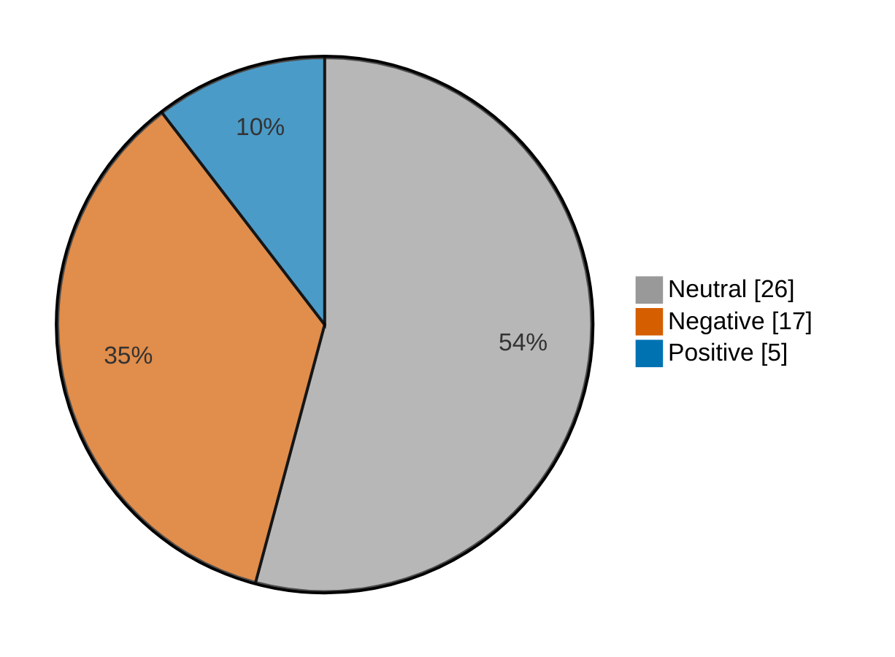

# Newsmood — 2026-11-13

**Mood index: -21.8** (moderately negative) · 48 headlines from 3 sources · model unsure on 10

## Mood at a glance

Negative 17 (35.4%) · Positive 5 (10.4%) · Neutral 26 (54.2%)

## What happened

Financial news leaned moderately negative today (index -21.8, a drop of 12.8 from yesterday) over 48 headlines, with 3 headlines on lower close, stocks lower and lower doing most of the work.

**Clusters:**

- 3 headlines on lower close, stocks lower, lower: 3 negative · -17.0% of the day's movement

_Themes use TF-IDF fit on 1432 headlines (2026-10-14–2026-11-13)._

## Recommended articles (highest model certainty, not most important)

### Negative

- [Bitcoin is now below $69,000 and could fall even further if investors cash out to buy into the Anthropic IPO](<https://www.marketwatch.com/story/bitcoin-could-fall-even-further-if-investors-cash-out-to-buy-into-the-anthropic-ipo-5a14f46a?mod=mw_rss_topstories>) · 97% · 5.7% of the day's movement · marketwatch-top
- [Colombia stocks lower at close of trade; COLCAP down 0.06%](<https://www.investing.com/news/stock-market-news/colombia-stocks-lower-at-close-of-trade-colcap-down-006-5026542>) · 97% · 5.7% of the day's movement · investing-stocks
- [Mexico stocks lower at close of trade; S&P/BMV IPC down 1.04%](<https://www.investing.com/news/stock-market-news/mexico-stocks-lower-at-close-of-trade-spbmv-ipc-down-104-5026551>) · 97% · 5.7% of the day's movement · investing-stocks

### Positive

- [Land Securities raises FY28 earnings growth outlook to high single-digit](<https://www.investing.com/news/stock-market-news/land-securities-raises-fy28-earnings-growth-outlook-to-high-singledigit-93CH-5024882>) · 98% · 5.7% of the day's movement · investing-stocks
- [S&P Global Ratings upgrades RTX to A- on strong demand and debt reduction](<https://www.investing.com/news/stock-market-news/sp-global-ratings-upgrades-rtx-to-a-on-strong-demand-and-debt-reduction-5026261>) · 97% · 5.7% of the day's movement · investing-stocks
- [European shares end best week since June as strong earnings lift sentiment](<https://www.investing.com/news/stock-market-news/european-shares-retreat-from-record-highs-ai-uncertainty-weighs-5024437>) · 97% · 5.7% of the day's movement · investing-stocks

### Neutral

- [Vvardis Holding Opens At $14, IPO Priced At $18](<https://www.investing.com/news/stock-market-news/vvardis-holding-opens-at-14-ipo-priced-at-18-432SI-5026264>) · 99% · investing-stocks
- [vVARDIS prices IPO at $18 per share on NYSE under ticker VVVV](<https://www.investing.com/news/stock-market-news/vvardis-prices-ipo-at-18-per-share-on-nyse-under-ticker-vvvv-432SI-5024151>) · 99% · investing-stocks

## Sources

| Source | Headlines | Negative | Neutral | Positive |
|---|--:|--:|--:|--:|
| investing-stocks | 30 | 12 | 14 | 4 |
| marketwatch-top | 16 | 5 | 11 | 0 |
| cnbc-finance | 2 | 0 | 1 | 1 |

All 48 headlines

| Sentiment | Certainty | Headline | Source |
|---|--:|---|---|
| negative | 97% | [Bitcoin is now below $69,000 and could fall even further if investors cash out to buy into the Anthropic IPO](<https://www.marketwatch.com/story/bitcoin-could-fall-even-further-if-investors-cash-out-to-buy-into-the-anthropic-ipo-5a14f46a?mod=mw_rss_topstories>) | marketwatch-top |
| negative | 97% | [Colombia stocks lower at close of trade; COLCAP down 0.06%](<https://www.investing.com/news/stock-market-news/colombia-stocks-lower-at-close-of-trade-colcap-down-006-5026542>) | investing-stocks |
| negative | 97% | [Mexico stocks lower at close of trade; S&P/BMV IPC down 1.04%](<https://www.investing.com/news/stock-market-news/mexico-stocks-lower-at-close-of-trade-spbmv-ipc-down-104-5026551>) | investing-stocks |
| negative | 97% | [Australia stocks lower at close of trade; S&P/ASX 200 down 0.71%](<https://www.investing.com/news/stock-market-news/australia-stocks-lower-at-close-of-trade-spasx-200-down-071-5024165>) | investing-stocks |
| negative | 96% | [Canada stocks lower at close of trade; S&P/TSX Composite down 0.09%](<https://www.investing.com/news/stock-market-news/canada-stocks-lower-at-close-of-trade-sptsx-composite-down-009-5026547>) | investing-stocks |
| negative | 94% | [Barclays to cut about 200 investment banking jobs in New York and London - report](<https://www.investing.com/news/stock-market-news/barclays-to-cut-about-200-investment-banking-jobs-in-new-york-and-london--report-5026272>) | investing-stocks |
| negative | 90% | [U.S. stock futures climb amid upcoming inflation data, Nvidia fallout](<https://www.investing.com/news/stock-market-news/us-stock-futures-rise-after-nvidia-ceo-exit-spooks-wall-st-5023780>) | investing-stocks |
| negative | 89% | [Why is Cognizant Technology Solutions stock slipping today?](<https://www.investing.com/news/stock-market-news/why-is-cognizant-technology-solutions-stock-slipping-today-93CH-5024892>) | investing-stocks |
| negative | 87% | [AI risks top financial stability concerns, Fed reports](<https://www.investing.com/news/stock-market-news/ai-risks-top-financial-stability-concerns-fed-reports-93CH-5026543>) | investing-stocks |
| negative | 81% | [AMD and other chip stocks slide as Wall Street rethinks the AI trade without Jensen Huang](<https://www.marketwatch.com/story/amd-and-other-chip-stocks-slide-as-wall-street-rethinks-the-ai-trade-without-jensen-huang-2fb74547?mod=mw_rss_topstories>) | marketwatch-top |
| negative | 60% (unsure) | [Why is Liftoff Mobile stock surging 20% today?](<https://www.investing.com/news/stock-market-news/why-is-liftoff-mobile-stock-surging-20-today-93CH-5024877>) | investing-stocks |
| negative | 56% (unsure) | [Nvidia’s stock is on a losing streak not seen in 14 years. What comes next?](<https://www.marketwatch.com/story/nvidias-stock-is-on-a-losing-streak-not-seen-in-14-years-what-comes-next-a07e801e?mod=mw_rss_topstories>) | marketwatch-top |
| negative | 51% (unsure) | [Profit surprises are normalizing — and that may signal a healthier stock market, say Citi strategists](<https://www.marketwatch.com/story/profit-surprises-are-normalizing-and-that-may-signal-a-healthier-stock-market-say-citi-strategists-d8cce7c2?mod=mw_rss_topstories>) | marketwatch-top |
| negative | 51% (unsure) | [Why is Newsmax stock surging 15% today?](<https://www.investing.com/news/stock-market-news/why-is-newsmax-stock-surging-15-today-93CH-5024884>) | investing-stocks |
| negative | 49% (unsure) | [Canada’s Stelco to recall 175 laid-off workers, restart Hamilton plant finishing lines](<https://www.investing.com/news/stock-market-news/canadas-stelco-to-recall-175-laidoff-workers-restart-hamilton-plant-finishing-lines-5026395>) | investing-stocks |
| negative | 49% (unsure) | [FAA declares rare, nationwide ground stop on flights, citing ‘extraordinary circumstances’](<https://www.marketwatch.com/story/faa-declares-rare-widespread-ground-outage-bdc46393?mod=mw_rss_topstories>) | marketwatch-top |
| negative | 47% (unsure) | [Microsoft says still attempting to fix major outage hitting Teams, Outlook](<https://www.investing.com/news/stock-market-news/microsoft-says-still-attempting-to-fix-major-outage-hitting-teams-outlook-5024175>) | investing-stocks |
| positive | 98% | [Land Securities raises FY28 earnings growth outlook to high single-digit](<https://www.investing.com/news/stock-market-news/land-securities-raises-fy28-earnings-growth-outlook-to-high-singledigit-93CH-5024882>) | investing-stocks |
| positive | 97% | [S&P Global Ratings upgrades RTX to A- on strong demand and debt reduction](<https://www.investing.com/news/stock-market-news/sp-global-ratings-upgrades-rtx-to-a-on-strong-demand-and-debt-reduction-5026261>) | investing-stocks |
| positive | 97% | [European shares end best week since June as strong earnings lift sentiment](<https://www.investing.com/news/stock-market-news/european-shares-retreat-from-record-highs-ai-uncertainty-weighs-5024437>) | investing-stocks |
| positive | 79% | [Chicago Fed's Goolsbee says central bank 'has definitely got work to do' on inflation](<https://www.cnbc.com/2026/11/13/chicago-feds-goolsbee-says-central-bank-has-definitely-got-work-to-do-on-inflation.html>) | cnbc-finance |
| positive | 52% (unsure) | [U.S. stocks mixed at close of trade; Dow Jones Industrial Average up 0.10%](<https://www.investing.com/news/stock-market-news/us-stocks-mixed-at-close-of-trade-dow-jones-industrial-average-up-010-5026559>) | investing-stocks |
| neutral | 99% | [Vvardis Holding Opens At $14, IPO Priced At $18](<https://www.investing.com/news/stock-market-news/vvardis-holding-opens-at-14-ipo-priced-at-18-432SI-5026264>) | investing-stocks |
| neutral | 99% | [vVARDIS prices IPO at $18 per share on NYSE under ticker VVVV](<https://www.investing.com/news/stock-market-news/vvardis-prices-ipo-at-18-per-share-on-nyse-under-ticker-vvvv-432SI-5024151>) | investing-stocks |
| neutral | 98% | [I am turning 18 next month and want to start investing. What do I do first?](<https://www.marketwatch.com/story/i-am-turning-18-next-month-and-want-to-start-investing-what-do-i-do-first-75370ff3?mod=mw_rss_topstories>) | marketwatch-top |
| neutral | 98% | [Anthropic CEO discusses AI safety and enterprise adoption](<https://www.investing.com/news/stock-market-news/anthropic-ceo-discusses-ai-safety-and-enterprise-adoption-5026259>) | investing-stocks |
| neutral | 98% | [If you could change one thing about caregiving, what would it be?](<https://www.marketwatch.com/story/if-you-could-change-one-thing-about-caregiving-what-would-it-be-8b20be29?mod=mw_rss_topstories>) | marketwatch-top |
| neutral | 98% | [14 dividend stocks selected for long-term growth](<https://www.marketwatch.com/story/14-dividend-stocks-selected-for-long-term-growth-0a095c0d?mod=mw_rss_topstories>) | marketwatch-top |
| neutral | 97% | [Morgan Stanley MUFG upgrades Japan Focus List with AI and insurance plays](<https://www.investing.com/news/stock-market-news/morgan-stanley-mufg-upgrades-japan-focus-list-with-ai-and-insurance-plays-5026284>) | investing-stocks |
| neutral | 97% | [Exclusive-Amazon’s plan to own the world’s product data and fight AI shopping agents](<https://www.investing.com/news/stock-market-news/exclusiveamazons-plan-to-own-the-worlds-product-data-and-fight-ai-shopping-agents-5024784>) | investing-stocks |
| neutral | 96% | [My wife has dementia and may outlive me. How do we prepare for long-term memory care?](<https://www.marketwatch.com/story/my-wife-has-dementia-and-may-outlive-me-how-do-we-prepare-for-long-term-memory-care-9c23efaa?mod=mw_rss_topstories>) | marketwatch-top |
| neutral | 96% | [Jensen Huang was a ‘China salesman’ for Nvidia. His exit is weighing on Chinese tech stocks.](<https://www.marketwatch.com/story/jensen-huang-was-a-china-salesman-for-nvidia-his-exit-is-weighing-on-chinese-tech-stocks-e46351e4?mod=mw_rss_topstories>) | marketwatch-top |
| neutral | 95% | [Earnings growth is set to peter out — but not the bull market, says Goldman Sachs. Here’s what the firm recommends.](<https://www.marketwatch.com/story/earnings-growth-is-set-to-peter-out-but-not-the-bull-market-says-goldman-sachs-heres-what-the-firm-recommends-bf409a6d?mod=mw_rss_topstories>) | marketwatch-top |
| neutral | 94% | [Why is NerdWallet stock rallying today?](<https://www.investing.com/news/stock-market-news/why-is-nerdwallet-stock-rallying-today-93CH-5026270>) | investing-stocks |
| neutral | 93% | [SpaceX is about to attempt the ‘holy grail’ of rocketry](<https://www.marketwatch.com/story/spacex-is-about-to-attempt-the-holy-grail-of-rocketry-44e79dcc?mod=mw_rss_topstories>) | marketwatch-top |
| neutral | 92% | [Why is Floor & Decor stock sliding today?](<https://www.investing.com/news/stock-market-news/why-is-floor--decor-stock-sliding-today-93CH-5024894>) | investing-stocks |
| neutral | 89% | [Huang exit and US scrutiny imperil $3 billion in Chinese AI projects reliant on Nvidia](<https://www.investing.com/news/stock-market-news/exclusivehuang-exit-and-us-scrutiny-imperil-3-billion-in-chinese-ai-projects-reliant-on-nvidia-5024462>) | investing-stocks |
| neutral | 88% | [How low does Nvidia’s stock need to go before it’s a screaming bargain?](<https://www.marketwatch.com/story/how-low-does-nvidias-stock-need-to-go-before-its-a-screaming-bargain-c25302ed?mod=mw_rss_topstories>) | marketwatch-top |
| neutral | 85% | [Premarket movers: Modine surges; Cerebras jumps on Microsoft deal](<https://www.investing.com/news/stock-market-news/premarket-movers-modine-surges-cerebras-jumps-on-microsoft-deal-5024934>) | investing-stocks |
| neutral | 84% | [FAA orders nationwide U.S. flight ground stop over air traffic control issues](<https://www.investing.com/news/stock-market-news/faa-orders-nationwide-ground-stop-citing-extraordinary-safety-concerns-5026489>) | investing-stocks |
| neutral | 83% | [Nasdaq futures dip as Nvidia tumult keeps investors on edge](<https://www.investing.com/news/stock-market-news/nasdaq-futures-dip-as-nvidia-tumult-keeps-investors-on-edge-5024713>) | investing-stocks |
| neutral | 82% | [‘She has a history of financial mismanagement’: My brother cut my sister out of his will. I’m getting everything. Do I tell her?](<https://www.marketwatch.com/story/she-has-a-history-of-financial-mismanagement-my-brother-cut-my-sister-out-of-his-will-im-getting-everything-do-i-tell-her-3e537851?mod=mw_rss_topstories>) | marketwatch-top |
| neutral | 79% | [Why is Alexandria Real Estate stock sliding today?](<https://www.investing.com/news/stock-market-news/why-is-alexandria-real-estate-stock-sliding-today-93CH-5024878>) | investing-stocks |
| neutral | 77% | [Jindal Power signs $470 mln loan for Botswana power project - report](<https://www.investing.com/news/stock-market-news/jindal-power-signs-470-mln-loan-for-botswana-power-project--report-93CH-5024176>) | investing-stocks |
| neutral | 77% | [Lutnick faces questions over Nvidia spy scandal. His sons’ firm has deep ties to the chipmaker](<https://www.cnbc.com/2026/11/13/howard-lutnick-nvidia-jensen-huang-china-cantor-fitzgerald.html>) | cnbc-finance |
| neutral | 65% | [Global oil supplies are suddenly flowing. Why a crude glut won’t mean cheaper diesel.](<https://www.marketwatch.com/story/global-oil-supplies-are-suddenly-flowing-why-a-crude-glut-wont-mean-cheaper-diesel-a5fa80c8?mod=mw_rss_topstories>) | marketwatch-top |
| neutral | 49% (unsure) | [Investors are underestimating AI. But the real challenge is diversification, this strategist says.](<https://www.marketwatch.com/story/investors-are-underestimating-ai-but-the-real-challenge-is-diversification-this-strategist-says-8bd956c1?mod=mw_rss_topstories>) | marketwatch-top |
| neutral | 48% (unsure) | [US Congress Democrats plot ’must-have’ victories in 2027](<https://www.investing.com/news/stock-market-news/us-congress-democrats-plot-musthave-victories-in-2027-5024779>) | investing-stocks |

---

Certainty is the model's confidence in its label; below 60% it is marked unsure.

"Of the day's movement" is a headline's certainty over the sum of every non-neutral headline's certainty: its part in moving the index. Neutral headlines move it by 0.

Links go to the original publisher; some limit free articles.

Model: kkrit-tinna/newsmood-distilbert-financial@be7b809e0d8f7bd50e77d902aee199363b7e2a66 · Gates: 2/2 passed · Not financial advice.
