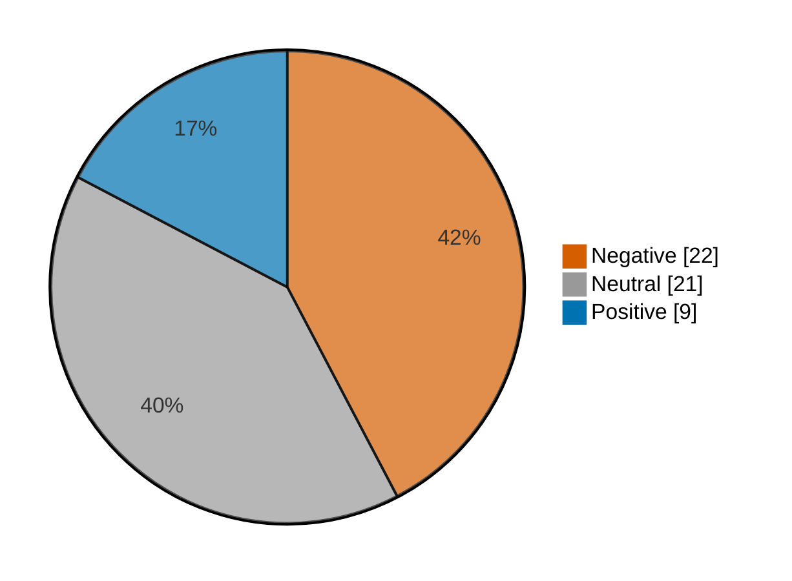

# Newsmood — 2026-11-16

**Mood index: -26.8** (moderately negative) · 52 headlines from 3 sources · model unsure on 6

## Mood at a glance

Negative 22 (42.3%) · Positive 9 (17.3%) · Neutral 21 (40.4%)

## What happened

Market news leaned moderately negative today (index -26.8, 11.3 higher than yesterday) from 52 headlines, with no single theme in the lead.

**Clusters:** no clear theme today.

_Themes use TF-IDF fit on 1442 headlines (2026-10-17–2026-11-16)._

## Recommended articles (highest model certainty, not most important)

### Negative

- [U.S. stocks lower at close of trade; Dow Jones Industrial Average down 1.41%](<https://www.investing.com/news/stock-market-news/us-stocks-lower-at-close-of-trade-dow-jones-industrial-average-down-141-5030993>) · 97% · 3.8% of the day's movement · investing-stocks
- [Russia stocks lower at close of trade; MOEX Russia Index down 1.20%](<https://www.investing.com/news/stock-market-news/russia-stocks-lower-at-close-of-trade-moex-russia-index-down-120-5030949>) · 97% · 3.8% of the day's movement · investing-stocks
- [Spain stocks lower at close of trade; IBEX 35 down 0.37%](<https://www.investing.com/news/stock-market-news/spain-stocks-lower-at-close-of-trade-ibex-35-down-037-5030597>) · 97% · 3.8% of the day's movement · investing-stocks

### Positive

- [These 13 S&P 500 stocks can rise up to 70% over the next year, according to analysts](<https://www.marketwatch.com/story/these-13-s-p-500-stocks-can-rise-up-to-70-over-the-next-year-according-to-analysts-21119af9?mod=mw_rss_topstories>) · 97% · 3.8% of the day's movement · marketwatch-top
- [SpaceX widens its lead in the space race, even as a tech selloff weighs on its stock](<https://www.marketwatch.com/story/spacex-widens-its-lead-in-the-space-race-even-as-a-tech-selloff-weighs-on-its-stock-975f5c1f?mod=mw_rss_topstories>) · 95% · 3.7% of the day's movement · marketwatch-top
- [UniCredit wins EU and US approval for Commerzbank acquisition](<https://www.investing.com/news/stock-market-news/unicredit-wins-eu-and-us-approval-for-commerzbank-acquisition-5029209>) · 95% · 3.7% of the day's movement · investing-stocks

### Neutral

- [Berkshire lowers Bank of America, Capital One stakes](<https://www.investing.com/news/stock-market-news/berkshire-lowers-bank-of-america-capital-one-stakes-5031074>) · 98% · investing-stocks
- [Former NFL star Chris Simms sells his 300-year-old Greenwich, Conn., home for $5.5 million](<https://www.marketwatch.com/story/former-nfl-star-chris-simms-sells-his-300-year-old-greenwich-conn-home-for-5-5-million-0ae1fdc2?mod=mw_rss_topstories>) · 98% · marketwatch-top

## Sources

| Source | Headlines | Negative | Neutral | Positive |
|---|--:|--:|--:|--:|
| investing-stocks | 30 | 13 | 11 | 6 |
| marketwatch-top | 20 | 8 | 10 | 2 |
| cnbc-finance | 2 | 1 | 0 | 1 |

All 52 headlines

| Sentiment | Certainty | Headline | Source |
|---|--:|---|---|
| negative | 97% | [U.S. stocks lower at close of trade; Dow Jones Industrial Average down 1.41%](<https://www.investing.com/news/stock-market-news/us-stocks-lower-at-close-of-trade-dow-jones-industrial-average-down-141-5030993>) | investing-stocks |
| negative | 97% | [Russia stocks lower at close of trade; MOEX Russia Index down 1.20%](<https://www.investing.com/news/stock-market-news/russia-stocks-lower-at-close-of-trade-moex-russia-index-down-120-5030949>) | investing-stocks |
| negative | 97% | [Spain stocks lower at close of trade; IBEX 35 down 0.37%](<https://www.investing.com/news/stock-market-news/spain-stocks-lower-at-close-of-trade-ibex-35-down-037-5030597>) | investing-stocks |
| negative | 97% | [U.K. stocks lower at close of trade; Investing.com United Kingdom 100 down 0.17%](<https://www.investing.com/news/stock-market-news/uk-stocks-lower-at-close-of-trade-investingcom-united-kingdom-100-down-017-5030599>) | investing-stocks |
| negative | 97% | [Canada stocks lower at close of trade; S&P/TSX Composite down 1.06%](<https://www.investing.com/news/stock-market-news/canada-stocks-lower-at-close-of-trade-sptsx-composite-down-106-5030985>) | investing-stocks |
| negative | 97% | [Australia stocks lower at close of trade; S&P/ASX 200 down 0.41%](<https://www.investing.com/news/stock-market-news/australia-stocks-lower-at-close-of-trade-spasx-200-down-041-5028375>) | investing-stocks |
| negative | 97% | [FTSE 100 today: Stocks edge lower; defence shares lead and oil falls](<https://www.investing.com/news/stock-market-news/ftse-100-today-stocks-edge-up-as-iran-tensions-simmer-5028639>) | investing-stocks |
| negative | 96% | [Nvidia’s stock extends declines following harsh words from the U.S. government](<https://www.marketwatch.com/story/nvidias-stock-extends-declines-following-harsh-words-from-the-u-s-government-d721188e?mod=mw_rss_topstories>) | marketwatch-top |
| negative | 96% | [U.S. crude oil declines to $87 a barrel on recovering Middle East exports](<https://www.cnbc.com/2026/11/16/us-crude-oil-declines-to-87-a-barrel-on-recovering-middle-east-exports.html>) | cnbc-finance |
| negative | 96% | [Micron, AMD and other AI stocks fall as the chip sector’s selloff intensifies](<https://www.marketwatch.com/story/micron-amd-and-other-ai-stocks-fall-as-the-chip-sectors-selloff-intensifies-48e38bdf?mod=mw_rss_topstories>) | marketwatch-top |
| negative | 93% | [European shares fall as Nvidia turmoil lingers and markets brace for AI mega-tests](<https://www.investing.com/news/stock-market-news/european-shares-flat-as-nvidia-turmoil-lingers-and-markets-brace-for-ai-megatests-5028357>) | investing-stocks |
| negative | 93% | [JPMorgan says software bug slows its transactions](<https://www.investing.com/news/stock-market-news/downdetector-reports-outages-at-major-us-banks-5030747>) | investing-stocks |
| negative | 93% | [U.S. stock futures fall as investors await Nvidia earnings](<https://www.investing.com/news/stock-market-news/us-stock-futures-little-changed-as-investors-await-nvidia-earnings-5028292>) | investing-stocks |
| negative | 91% | [Deutsche Bank warns markets may be underestimating rate hike risks](<https://www.investing.com/news/stock-market-news/deutsche-bank-warns-markets-may-be-underestimating-rate-hike-risks-5029111>) | investing-stocks |
| negative | 88% | [Chase says ‘software bug’ could be causing disruptions at major U.S. banks](<https://www.marketwatch.com/story/customers-of-chase-bank-of-america-and-other-u-s-banks-report-service-outages-18fe23b8?mod=mw_rss_topstories>) | marketwatch-top |
| negative | 82% | [Market positioning risks: why falling P/E ratios may signal a valuation trap](<https://www.investing.com/news/stock-market-news/market-positioning-risks-why-falling-pe-ratios-may-signal-a-valuation-trap-93CH-5030629>) | investing-stocks |
| negative | 73% | [Analysis-AI selloff has investors scrambling to measure their true exposure](<https://www.investing.com/news/stock-market-news/analysisai-selloff-has-investors-scrambling-to-measure-their-true-exposure-5028994>) | investing-stocks |
| negative | 71% | [The FDA declined to approve one of biotech’s most closely watched cancer drugs](<https://www.marketwatch.com/story/the-fda-declined-to-approve-one-of-biotechs-most-closely-watched-cancer-drugs-d7c6a0a3?mod=mw_rss_topstories>) | marketwatch-top |
| negative | 68% | [Here’s how much the stock market could crumble if AI is a bubble that bursts, according to former White House economist](<https://www.marketwatch.com/story/heres-how-much-the-stock-market-could-crumble-if-ai-is-a-bubble-that-bursts-according-to-former-white-house-economist-3a4c15e1?mod=mw_rss_topstories>) | marketwatch-top |
| negative | 60% (unsure) | [Why this 40-year market veteran is making a lonely bet on a 40% stock-market crash — and $500 oil](<https://www.marketwatch.com/story/why-this-40-year-market-veteran-is-making-a-lonely-bet-on-a-40-stock-market-crash-and-500-oil-c62aefdb?mod=mw_rss_topstories>) | marketwatch-top |
| negative | 50% (unsure) | [Nvidia investors will be clamoring for these answers during a historic earnings call](<https://www.marketwatch.com/story/nvidia-investors-will-be-clamoring-for-answers-to-these-questions-during-the-companys-hotly-anticipated-earnings-call-a49ec19d?mod=mw_rss_topstories>) | marketwatch-top |
| negative | 49% (unsure) | [Why Nvidia can avoid the fate of most stocks that reached the apex by market cap, according to one strategist](<https://www.marketwatch.com/story/why-nvidia-can-avoid-the-fate-of-most-stocks-that-reached-the-apex-by-market-cap-according-to-one-strategist-461e33be?mod=mw_rss_topstories>) | marketwatch-top |
| positive | 97% | [These 13 S&P 500 stocks can rise up to 70% over the next year, according to analysts](<https://www.marketwatch.com/story/these-13-s-p-500-stocks-can-rise-up-to-70-over-the-next-year-according-to-analysts-21119af9?mod=mw_rss_topstories>) | marketwatch-top |
| positive | 95% | [SpaceX widens its lead in the space race, even as a tech selloff weighs on its stock](<https://www.marketwatch.com/story/spacex-widens-its-lead-in-the-space-race-even-as-a-tech-selloff-weighs-on-its-stock-975f5c1f?mod=mw_rss_topstories>) | marketwatch-top |
| positive | 95% | [UniCredit wins EU and US approval for Commerzbank acquisition](<https://www.investing.com/news/stock-market-news/unicredit-wins-eu-and-us-approval-for-commerzbank-acquisition-5029209>) | investing-stocks |
| positive | 90% | [Barclays upgrades chemical makers on pricing strength, tighter supply](<https://www.investing.com/news/stock-market-news/barclays-upgrades-chemical-makers-on-pricing-strength-tighter-supply-5029180>) | investing-stocks |
| positive | 84% | [Tesla to invest €3 billion to expand Berlin factory for Cybercab](<https://www.investing.com/news/stock-market-news/tesla-to-invest-3-billion-to-expand-berlin-factory-for-cybercab-93CH-5030628>) | investing-stocks |
| positive | 79% | [European stocks ease as tech and miners drag](<https://www.investing.com/news/stock-market-news/european-shares-hover-near-record-highs-tech-stocks-lag-5028657>) | investing-stocks |
| positive | 59% (unsure) | [Neighborhood Intelligence stock rises on $25M buyback plan](<https://www.investing.com/news/stock-market-news/neighborhood-intelligence-stock-rises-on-25m-buyback-plan-5031057>) | investing-stocks |
| positive | 52% (unsure) | [Citi raises SpaceX stock price target on Starship progress](<https://www.investing.com/news/stock-market-news/citi-raises-spacex-stock-price-target-on-starship-progress-93CH-5029136>) | investing-stocks |
| positive | 44% (unsure) | [Fed Chairman Kevin Warsh stresses importance of AI to economy, but says it could ‘disappoint’](<https://www.cnbc.com/2026/11/16/fed-ai-task-force-kevin-warsh.html>) | cnbc-finance |
| neutral | 98% | [Berkshire lowers Bank of America, Capital One stakes](<https://www.investing.com/news/stock-market-news/berkshire-lowers-bank-of-america-capital-one-stakes-5031074>) | investing-stocks |
| neutral | 98% | [Former NFL star Chris Simms sells his 300-year-old Greenwich, Conn., home for $5.5 million](<https://www.marketwatch.com/story/former-nfl-star-chris-simms-sells-his-300-year-old-greenwich-conn-home-for-5-5-million-0ae1fdc2?mod=mw_rss_topstories>) | marketwatch-top |
| neutral | 97% | [Now’s the perfect time for networking. Here’s how to send a cringe-free email.](<https://www.marketwatch.com/story/nows-the-perfect-time-for-networking-heres-how-to-send-a-cringe-free-email-73ad34ea?mod=mw_rss_topstories>) | marketwatch-top |
| neutral | 97% | [BC Partners Credit to acquire majority stake in CION Investment](<https://www.investing.com/news/stock-market-news/bc-partners-credit-to-acquire-majority-stake-in-cion-investment-93CH-5030617>) | investing-stocks |
| neutral | 97% | [I’m in my 40s. Should I accept a lower pension in exchange for naming my husband or child as a beneficiary?](<https://www.marketwatch.com/story/im-in-my-40s-should-i-accept-a-lower-pension-in-exchange-for-naming-my-husband-or-child-as-a-beneficiary-b2352059?mod=mw_rss_topstories>) | marketwatch-top |
| neutral | 97% | [Nvidia set to deliver first life-after-Huang briefing](<https://www.investing.com/news/stock-market-news/nvidia-set-to-deliver-first-lifeafterhuang-briefing-5029204>) | investing-stocks |
| neutral | 96% | [What’s the most tax-efficient way to donate to charity?](<https://www.marketwatch.com/story/whats-the-most-tax-efficient-way-to-donate-to-charity-3f5864bb?mod=mw_rss_topstories>) | marketwatch-top |
| neutral | 96% | [Visa, Mastercard urge approval of $38 billion swipe fee settlement](<https://www.investing.com/news/stock-market-news/visa-mastercard-urge-approval-of-38-billion-swipe-fee-settlement-5030740>) | investing-stocks |
| neutral | 95% | [Investors cooled on data center stocks in third quarter, filings show](<https://www.investing.com/news/stock-market-news/investors-cooled-on-data-center-stocks-in-third-quarter-filings-show-5030947>) | investing-stocks |
| neutral | 95% | [Angelina Jolie reportedly buys a Connecticut mansion after selling L.A. estate](<https://www.marketwatch.com/story/angelina-jolie-reportedly-buys-a-connecticut-mansion-after-selling-l-a-estate-049f914b?mod=mw_rss_topstories>) | marketwatch-top |
| neutral | 93% | [Why is Humana stock climbing today?](<https://www.investing.com/news/stock-market-news/why-is-humana-stock-climbing-today-93CH-5029193>) | investing-stocks |
| neutral | 92% | [My husband is happily retired at 64 and thinks I should keep working. Is he being fair?](<https://www.marketwatch.com/story/my-husband-is-happily-retired-at-64-and-thinks-i-should-keep-working-is-he-being-fair-325c5f38?mod=mw_rss_topstories>) | marketwatch-top |
| neutral | 90% | [Apple veteran Corey Fugman to lead Apple Pay and Wallet unit - Bloomberg](<https://www.investing.com/news/stock-market-news/apple-veteran-corey-fugman-to-lead-apple-pay-and-wallet-unit--bloomberg-93CH-5030625>) | investing-stocks |
| neutral | 87% | [Rare-earth stocks sink deeper into the red. Here’s the latest catalyst.](<https://www.marketwatch.com/story/rare-earth-stocks-sinks-deeper-into-the-red-heres-the-latest-catalyst-3033c8d0?mod=mw_rss_topstories>) | marketwatch-top |
| neutral | 86% | [Why is USA Rare Earth stock sliding today?](<https://www.investing.com/news/stock-market-news/why-is-usa-rare-earth-stock-sliding-today-93CH-5029106>) | investing-stocks |
| neutral | 81% | [U.S. plans to name Nvidia among AI ‘national champions’, WSJ reports](<https://www.investing.com/news/stock-market-news/us-plans-to-name-nvidia-among-ai-national-champions-wsj-reports-5028365>) | investing-stocks |
| neutral | 77% | [Why is CVR Energy stock gaining today?](<https://www.investing.com/news/stock-market-news/why-is-cvr-energy-stock-gaining-today-93CH-5029108>) | investing-stocks |
| neutral | 68% | [How will AI shake up the economy? Warsh says the Fed is starting to figure that out.](<https://www.marketwatch.com/story/how-will-ai-shake-up-the-economy-warsh-says-the-fed-is-starting-to-figure-that-out-a72f80c4?mod=mw_rss_topstories>) | marketwatch-top |
| neutral | 66% | [Why Morgan Stanley says it’s time to go ‘max’ overweight on stocks](<https://www.marketwatch.com/story/why-morgan-stanley-says-its-time-to-go-max-overweight-on-stocks-bd33b103?mod=mw_rss_topstories>) | marketwatch-top |
| neutral | 61% | [Market positioning risks ahead of Nvidia earnings](<https://www.investing.com/news/stock-market-news/market-positioning-risks-ahead-of-nvidia-earnings-93CH-5031075>) | investing-stocks |
| neutral | 61% | [‘I felt so seen’: Why families across America are laughing — and crying — over SNL’s ‘Sister’ sketch](<https://www.marketwatch.com/story/so-sad-and-so-true-has-your-family-talked-about-snls-sister-sketch-yet-19bf9d67?mod=mw_rss_topstories>) | marketwatch-top |

---

Certainty is the model's confidence in its label; below 60% it is marked unsure.

"Of the day's movement" is a headline's certainty over the sum of every non-neutral headline's certainty: its part in moving the index. Neutral headlines move it by 0.

Links go to the original publisher; some limit free articles.

Model: kkrit-tinna/newsmood-distilbert-financial@be7b809e0d8f7bd50e77d902aee199363b7e2a66 · Gates: 2/2 passed · Not financial advice.
