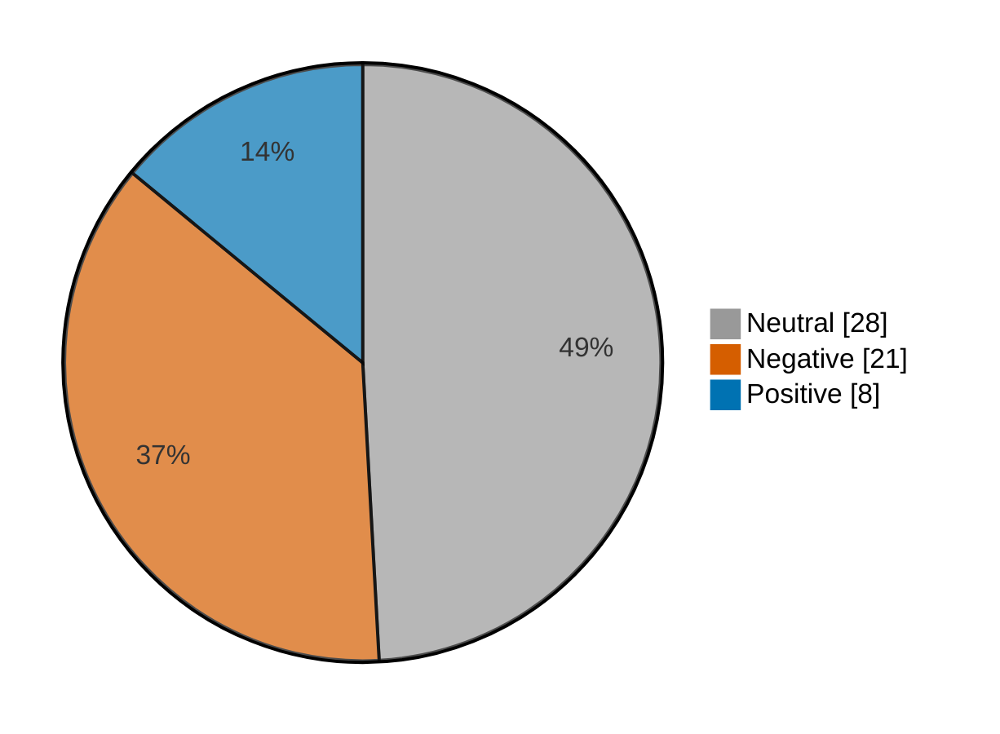

# Newsmood — 2026-11-17

**Mood index: -22.6** (moderately negative) · 57 headlines from 3 sources · model unsure on 5

## Mood at a glance

Negative 21 (36.8%) · Positive 8 (14.0%) · Neutral 28 (49.1%)

## What happened

Financial coverage leaned moderately negative today (index -22.6, 6.7 higher than yesterday) across 57 headlines, with no single theme in the lead.

**Clusters:** no clear theme today.

_Themes use TF-IDF fit on 1498 headlines (2026-10-18–2026-11-17)._

## Recommended articles (highest model certainty, not most important)

### Negative

- [U.S. stocks lower at close of trade; Dow Jones Industrial Average down 1.64%](<https://www.investing.com/news/stock-market-news/us-stocks-lower-at-close-of-trade-dow-jones-industrial-average-down-164-5034091>) · 97% · 4.2% of the day's movement · investing-stocks
- [Australia stocks lower at close of trade; S&P/ASX 200 down 1.79%](<https://www.investing.com/news/stock-market-news/australia-stocks-lower-at-close-of-trade-spasx-200-down-179-5031664>) · 97% · 4.2% of the day's movement · investing-stocks
- [Mexico stocks lower at close of trade; S&P/BMV IPC down 1.00%](<https://www.investing.com/news/stock-market-news/mexico-stocks-lower-at-close-of-trade-spbmv-ipc-down-100-5034086>) · 97% · 4.2% of the day's movement · investing-stocks

### Positive

- [Exclusive-GM plans 20% boost in robotics as factory costs rise](<https://www.investing.com/news/stock-market-news/exclusivegm-plans-20-boost-in-robotics-as-factory-costs-rise-5032317>) · 97% · 4.2% of the day's movement · investing-stocks
- [Disney beats earnings forecasts, plans to increase content spending](<https://www.investing.com/news/stock-market-news/disney-beats-earnings-forecasts-plans-to-increase-content-spending-5032413>) · 94% · 4.1% of the day's movement · investing-stocks
- [Optimum nears creditor deal to slash $26B debt load by more than half - Bloomberg](<https://www.investing.com/news/stock-market-news/optimum-nears-creditor-deal-to-slash-26b-debt-load-by-more-than-half--bloomberg-5033685>) · 87% · 3.8% of the day's movement · investing-stocks

### Neutral

- [If you own a Nasdaq-100 fund, you’ll own Anthropic shares after 15 trading days — whether you want to or not](<https://www.marketwatch.com/story/if-you-own-a-nasdaq-100-fund-youll-own-anthropic-shares-after-15-trading-days-whether-you-want-to-or-not-19b08485?mod=mw_rss_topstories>) · 99% · marketwatch-top
- [After-Hours Movers: NVDA, CRWV, NBIS, AAOI, SLS](<https://www.investing.com/news/stock-market-news/afterhours-movers-nvda-crwv-nbis-aaoi-sls-432SI-5034129>) · 99% · investing-stocks

## Sources

| Source | Headlines | Negative | Neutral | Positive |
|---|--:|--:|--:|--:|
| investing-stocks | 37 | 13 | 17 | 7 |
| marketwatch-top | 19 | 7 | 11 | 1 |
| cnbc-finance | 1 | 1 | 0 | 0 |

All 57 headlines

| Sentiment | Certainty | Headline | Source |
|---|--:|---|---|
| negative | 97% | [U.S. stocks lower at close of trade; Dow Jones Industrial Average down 1.64%](<https://www.investing.com/news/stock-market-news/us-stocks-lower-at-close-of-trade-dow-jones-industrial-average-down-164-5034091>) | investing-stocks |
| negative | 97% | [Australia stocks lower at close of trade; S&P/ASX 200 down 1.79%](<https://www.investing.com/news/stock-market-news/australia-stocks-lower-at-close-of-trade-spasx-200-down-179-5031664>) | investing-stocks |
| negative | 97% | [Mexico stocks lower at close of trade; S&P/BMV IPC down 1.00%](<https://www.investing.com/news/stock-market-news/mexico-stocks-lower-at-close-of-trade-spbmv-ipc-down-100-5034086>) | investing-stocks |
| negative | 96% | [FTSE 100 today: Stocks extend fall on U.S. chip curbs; UK jobless rate dips](<https://www.investing.com/news/stock-market-news/ftse-100-today-stocks-fall-as-miners-slide-us-chip-curbs-bite-5031960>) | investing-stocks |
| negative | 96% | [Vinci October motorway traffic falls 6.1% as high fuel prices weigh](<https://www.investing.com/news/stock-market-news/vinci-october-motorway-traffic-falls-61-as-high-fuel-prices-weigh-5033722>) | investing-stocks |
| negative | 94% | [Measles cases in the U.S. are at a 35-year high. Here’s the staggering cost of falling vaccination rates for Americans.](<https://www.marketwatch.com/story/measles-cases-in-the-u-s-are-at-a-35-year-high-heres-the-staggering-cost-of-falling-vaccination-rates-for-americans-e80a7ac6?mod=mw_rss_topstories>) | marketwatch-top |
| negative | 93% | [Private equity has been buying up hospice centers — with striking consequences](<https://www.marketwatch.com/story/private-equity-has-been-buying-up-hospice-centers-with-striking-consequences-63642545?mod=mw_rss_topstories>) | marketwatch-top |
| negative | 93% | [Why Salesforce’s stock is leading S&P 500 decliners amid tech jitters](<https://www.marketwatch.com/story/why-salesforces-stock-is-leading-s-p-500-decliners-amid-tech-jitters-17510caf?mod=mw_rss_topstories>) | marketwatch-top |
| negative | 89% | [The latest tech failure: U.S. classified national security communications network](<https://www.marketwatch.com/story/the-latest-tech-failure-u-s-classified-national-security-communications-network-ad271899?mod=mw_rss_topstories>) | marketwatch-top |
| negative | 85% | [European shares fall on fresh U.S. chip curbs; Nvidia awaited](<https://www.investing.com/news/stock-market-news/european-shares-slip-on-fresh-us-chip-curbs-5031847>) | investing-stocks |
| negative | 81% | [Applied Optoelectronics falls 8% on $550 million stock offering plan](<https://www.investing.com/news/stock-market-news/applied-optoelectronics-falls-8-on-550-million-stock-offering-plan-5034098>) | investing-stocks |
| negative | 78% | [Moncler price action remains bearish near 52-week lows. Is now a good time to buy?](<https://www.investing.com/news/stock-market-news/moncler-price-action-remains-bearish-near-52week-lows-is-now-a-good-time-to-buy-93CH-5032411>) | investing-stocks |
| negative | 76% | [India bank unions call strike over IDBI sale to Fairfax](<https://www.investing.com/news/stock-market-news/india-bank-unions-call-strike-over-idbi-sale-to-fairfax-93CH-5031655>) | investing-stocks |
| negative | 70% | [Analysis-Nvidia turmoil marks the end of easy money for the AI trade](<https://www.investing.com/news/stock-market-news/analysisnvidia-turmoil-marks-the-end-of-easy-money-for-the-ai-trade-5032324>) | investing-stocks |
| negative | 69% | [Here’s how much of Deutsche Bank’s market cap has been wiped away after reports on 15 million leaked documents](<https://www.marketwatch.com/story/heres-how-much-of-deutsche-banks-market-cap-has-been-wiped-away-after-reports-on-15-million-leaked-documents-fe3db078?mod=mw_rss_topstories>) | marketwatch-top |
| negative | 67% | [Summit Therapeutics’ stock tumbles again as FDA recommends new trial for lung-cancer drug](<https://www.marketwatch.com/story/summit-therapeutics-stock-tumbles-again-as-fda-recommends-new-trial-for-lung-cancer-drug-dcb8ff55?mod=mw_rss_topstories>) | marketwatch-top |
| negative | 66% | [People react to US AI chip curbs that threaten data centre boom](<https://www.investing.com/news/stock-market-news/people-react-to-us-ai-chip-curbs-that-threaten-data-centre-boom-5031675>) | investing-stocks |
| negative | 66% | [U.S. companies from Nvidia to Apple face a growing China dilemma](<https://www.cnbc.com/2026/11/17/us-tech-firms-china-ties-political-pressure.html>) | cnbc-finance |
| negative | 65% | [Wall Street futures dip ahead of key Nvidia earnings](<https://www.investing.com/news/stock-market-news/wall-street-futures-muted-as-nvidia-earnings-loom-amid-ai-jitters-5031353>) | investing-stocks |
| negative | 63% | [Why is China’s SMIC stock surging today?](<https://www.investing.com/news/stock-market-news/why-is-chinas-smic-stock-surging-today-93CH-5031648>) | investing-stocks |
| negative | 49% (unsure) | [Coherent and Lumentum stocks climb as potential U.S. import ban threatens Chinese rivals](<https://www.marketwatch.com/story/coherent-and-lumentum-stocks-climb-as-potential-u-s-import-ban-threatens-chinese-rivals-e20dfb79?mod=mw_rss_topstories>) | marketwatch-top |
| positive | 97% | [Exclusive-GM plans 20% boost in robotics as factory costs rise](<https://www.investing.com/news/stock-market-news/exclusivegm-plans-20-boost-in-robotics-as-factory-costs-rise-5032317>) | investing-stocks |
| positive | 94% | [Disney beats earnings forecasts, plans to increase content spending](<https://www.investing.com/news/stock-market-news/disney-beats-earnings-forecasts-plans-to-increase-content-spending-5032413>) | investing-stocks |
| positive | 87% | [Optimum nears creditor deal to slash $26B debt load by more than half - Bloomberg](<https://www.investing.com/news/stock-market-news/optimum-nears-creditor-deal-to-slash-26b-debt-load-by-more-than-half--bloomberg-5033685>) | investing-stocks |
| positive | 83% | [Only two ‘Magnificent Seven’ stocks have managed to beat the S&P 500 since the start of 2025](<https://www.marketwatch.com/story/only-two-magnificent-seven-stocks-have-managed-to-beat-the-s-p-500-since-the-start-of-2025-a3daa0f8?mod=mw_rss_topstories>) | marketwatch-top |
| positive | 81% | [​Nvidia forecasts quarterly revenue above estimates in first report since Huang’s exit as CEO​](<https://www.investing.com/news/stock-market-news/nvidia-forecasts-quarterly-revenue-above-estimates-in-first-report-since-huangs-exit-as-ceo-5034097>) | investing-stocks |
| positive | 77% | [Alphabet’s Google acquires AI scheduling startup Howie to bolster agent lineup](<https://www.investing.com/news/stock-market-news/alphabets-google-acquires-ai-scheduling-startup-howie-to-bolster-agent-lineup-5033699>) | investing-stocks |
| positive | 57% (unsure) | [Exclusive-Trump’s China data center curb advances despite Amazon, Google, Meta lobbying](<https://www.investing.com/news/stock-market-news/exclusivetrumps-china-data-center-curb-advances-despite-amazon-google-meta-lobbying-5032280>) | investing-stocks |
| positive | 50% (unsure) | [Huang would ’be honored’ to return as Nvidia CEO after affair scandal forced him out](<https://www.investing.com/news/stock-market-news/nvidia-board-forms-committee-for-national-security-and-export-control-oversight-5032154>) | investing-stocks |
| neutral | 99% | [If you own a Nasdaq-100 fund, you’ll own Anthropic shares after 15 trading days — whether you want to or not](<https://www.marketwatch.com/story/if-you-own-a-nasdaq-100-fund-youll-own-anthropic-shares-after-15-trading-days-whether-you-want-to-or-not-19b08485?mod=mw_rss_topstories>) | marketwatch-top |
| neutral | 99% | [After-Hours Movers: NVDA, CRWV, NBIS, AAOI, SLS](<https://www.investing.com/news/stock-market-news/afterhours-movers-nvda-crwv-nbis-aaoi-sls-432SI-5034129>) | investing-stocks |
| neutral | 98% | [Home Depot names finance chief McPhail as CEO](<https://www.investing.com/news/stock-market-news/home-depot-names-finance-chief-mcphail-as-ceo-5032246>) | investing-stocks |
| neutral | 98% | [GM taps executive search firm to find successor to CEO Barra, WSJ reports](<https://www.investing.com/news/stock-market-news/gm-taps-executive-search-firm-to-find-possible-successor-to-ceo-mary-barra-wsj-reports-5033678>) | investing-stocks |
| neutral | 98% | [High-debt stocks: ten non-financial names that pass a leverage screen](<https://www.investing.com/news/stock-market-news/highdebt-stocks-ten-nonfinancial-names-that-pass-a-leverage-screen-93CH-5032441>) | investing-stocks |
| neutral | 98% | [Sellas Life Sciences stock falls on $150M stock offering](<https://www.investing.com/news/stock-market-news/sellas-life-sciences-stock-falls-on-150m-stock-offering-5034146>) | investing-stocks |
| neutral | 97% | [US releases details of Megaspeed probe, says investigation began in 2024](<https://www.investing.com/news/stock-market-news/us-releases-details-ofmegaspeed-probe-says-investigation-began-in-2024-5031663>) | investing-stocks |
| neutral | 97% | [NYSE parent ICE launches tool to assess data-center construction delays](<https://www.investing.com/news/stock-market-news/nyse-parent-ice-launches-tool-to-assess-datacenter-construction-delays-5033393>) | investing-stocks |
| neutral | 94% | [House, Senate lawmakers reach deal on key aviation safety provisions](<https://www.investing.com/news/stock-market-news/house-senate-lawmakers-reach-deal-on-key-aviation-safety-provisions-5033695>) | investing-stocks |
| neutral | 93% | [Anthropic: have been approved to list our class a common stock on NASDAQ Global Select market under symbol “ANT”](<https://www.investing.com/news/stock-market-news/anthropic-have-been-approved-to-list-our-class-a-common-stock-on-nasdaq-global-select-market-under-symbol-ant-432SI-5032359>) | investing-stocks |
| neutral | 93% | [Gold is in a bear market — and hackproof in an increasingly digital world. Is now a good time to buy?](<https://www.marketwatch.com/story/gold-is-in-a-bear-market-and-hackproof-in-an-increasingly-digital-world-is-this-a-good-time-to-buy-fabfd528?mod=mw_rss_topstories>) | marketwatch-top |
| neutral | 93% | [‘Breaking Bad’ star Dean Norris is selling 11-acre California estate for $3.2 million amid divorce](<https://www.marketwatch.com/story/breaking-bad-star-dean-norris-is-selling-11-acre-california-estate-for-3-2-million-amid-divorce-03963997?mod=mw_rss_topstories>) | marketwatch-top |
| neutral | 93% | [Parents told us what it’s like to help their kids battle sports-gambling addiction: ‘There’s no handbook’](<https://www.marketwatch.com/story/parents-told-us-what-its-like-to-help-their-kids-battle-sports-gambling-addiction-theres-no-handbook-6e2d5bb2?mod=mw_rss_topstories>) | marketwatch-top |
| neutral | 91% | [Ardent Health stock tumbles on 7M share secondary offering](<https://www.investing.com/news/stock-market-news/ardent-health-stock-tumbles-on-7m-share-secondary-offering-5034152>) | investing-stocks |
| neutral | 88% | [Jensen Huang now wants to return as Nvidia’s CEO. This is why that could be difficult.](<https://www.marketwatch.com/story/jensen-huangs-fans-want-him-back-as-nvidia-ceo-this-is-why-thats-unlikely-2be28ac2?mod=mw_rss_topstories>) | marketwatch-top |
| neutral | 87% | [Why is Tencent stock sliding today?](<https://www.investing.com/news/stock-market-news/why-is-tencent-stock-sliding-today-93CH-5031669>) | investing-stocks |
| neutral | 85% | [Buy the Stellantis stock amid fresh record lows?](<https://www.investing.com/news/stock-market-news/buy-the-stellantis-stock-amid-fresh-record-lows-93CH-5032393>) | investing-stocks |
| neutral | 84% | [Exclusive-Authorities raid factory making illegal Chinese vapes in the US](<https://www.investing.com/news/stock-market-news/exclusiveauthorities-raid-factory-making-illegal-chinesevapes-in-the-us-5032051>) | investing-stocks |
| neutral | 83% | [Pick the two sectors where earnings growth will accelerate — as long as the 10-year stays below this key level, say strategists](<https://www.marketwatch.com/story/pick-the-two-sectors-where-earnings-growth-will-accelerate-as-long-as-the-10-year-stays-below-this-key-level-say-strategists-e7c13914?mod=mw_rss_topstories>) | marketwatch-top |
| neutral | 80% | [‘It is heartbreaking, exhausting and downright dirty’: My brother took over our ailing mother’s life and finances. What can I do?](<https://www.marketwatch.com/story/it-is-heartbreaking-exhausting-and-downright-dirty-my-brother-took-over-our-ailing-mothers-life-and-finances-what-can-i-do-b4d48817?mod=mw_rss_topstories>) | marketwatch-top |
| neutral | 80% | [Tepper, Loeb among fund managers piling into Nvidia and other megacap tech on the eve of October drawdown](<https://www.marketwatch.com/story/tepper-loeb-among-fund-managers-piling-into-nvidia-and-other-megacap-tech-on-the-eve-of-october-drawdown-de45f572?mod=mw_rss_topstories>) | marketwatch-top |
| neutral | 80% | [Citi’s software stock picks: AI upside and a new contender enters the spotlight](<https://www.investing.com/news/stock-market-news/citis-software-stock-picks-ai-upside-and-a-new-contender-enters-the-spotlight-5031678>) | investing-stocks |
| neutral | 73% | [Supermodel Bella Hadid snaps up a charming Colorado compound for $5.5 million](<https://www.marketwatch.com/story/supermodel-bella-hadid-snaps-up-a-charming-colorado-compound-for-5-5-million-b907958c?mod=mw_rss_topstories>) | marketwatch-top |
| neutral | 70% | [‘Nvidia spooked me’: Should I sell my stocks or ride out the market turmoil?](<https://www.marketwatch.com/story/nvidia-spooked-me-should-i-sell-my-stocks-or-ride-out-the-market-turmoil-560583c6?mod=mw_rss_topstories>) | marketwatch-top |
| neutral | 67% | [Why is Alibaba stock sliding today?](<https://www.investing.com/news/stock-market-news/why-is-alibaba-stock-sliding-today-93CH-5031671>) | investing-stocks |
| neutral | 60% | [Watch these Chinese chip stocks as U.S. tightens access to Nvidia hardware](<https://www.investing.com/news/stock-market-news/watch-these-chinese-chip-stocks-as-us-tightens-access-to-nvidia-hardware-93CH-5031673>) | investing-stocks |
| neutral | 60% (unsure) | [Popular websites subverted in bid to steal crypto, target iPhone users](<https://www.investing.com/news/stock-market-news/popular-websites-subverted-in-bid-to-steal-crypto-target-iphone-users-5031640>) | investing-stocks |
| neutral | 57% (unsure) | [As stocks struggle, bonds are finally helping investors play defense again. There’s just one problem.](<https://www.marketwatch.com/story/as-stocks-struggle-bonds-are-finally-helping-investors-play-defense-again-theres-just-one-problem-94c8a1d8?mod=mw_rss_topstories>) | marketwatch-top |

---

Certainty is the model's confidence in its label; below 60% it is marked unsure.

"Of the day's movement" is a headline's certainty over the sum of every non-neutral headline's certainty: its part in moving the index. Neutral headlines move it by 0.

Links go to the original publisher; some limit free articles.

Model: kkrit-tinna/newsmood-distilbert-financial@be7b809e0d8f7bd50e77d902aee199363b7e2a66 · Gates: 2/2 passed · Not financial advice.
