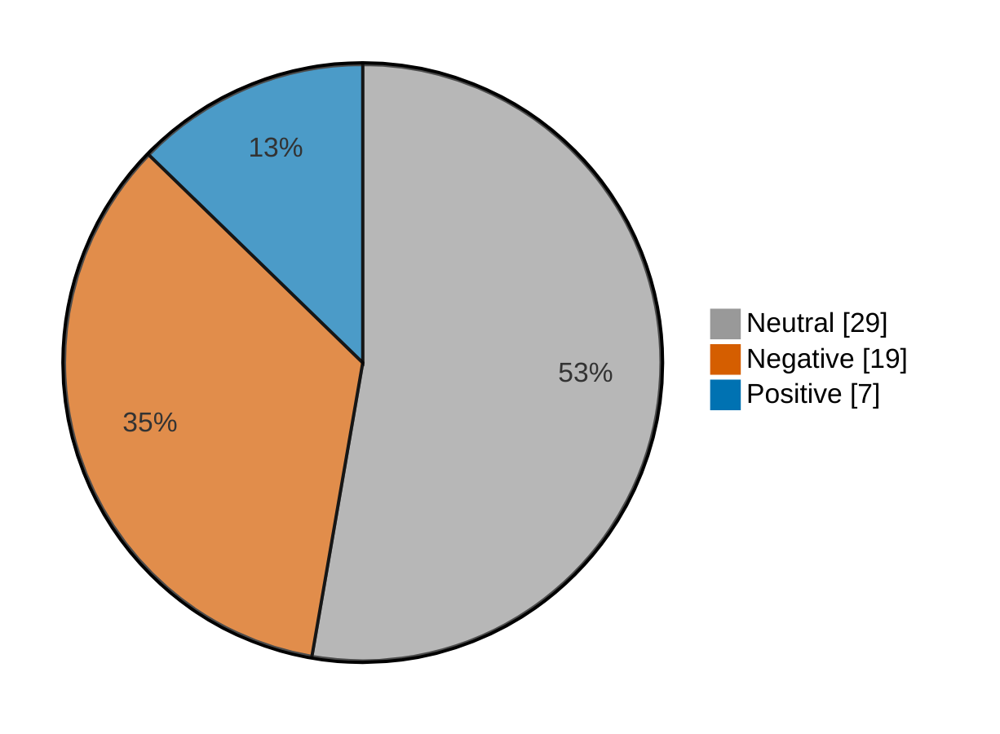

# Newsmood — 2026-11-18

**Mood index: -23.3** (moderately negative) · 55 headlines from 3 sources · model unsure on 9

## Mood at a glance

Negative 19 (34.5%) · Positive 7 (12.7%) · Neutral 29 (52.7%)

## What happened

Market news leaned moderately negative today (index -23.3) across 55 headlines, with no single theme in the lead.

**Clusters:** no clear theme today.

_Themes use TF-IDF fit on 1558 headlines (2026-10-19–2026-11-18)._

## Recommended articles (highest model certainty, not most important)

### Negative

- [Baidu shares hit record low as Q3 earnings, AI concerns weigh](<https://www.investing.com/news/stock-market-news/baidu-shares-hit-record-low-as-q3-earnings-ai-concerns-weigh-5034738>) · 97% · 4.7% of the day's movement · investing-stocks
- [Australia stocks lower at close of trade; S&P/ASX 200 down 0.69%](<https://www.investing.com/news/stock-market-news/australia-stocks-lower-at-close-of-trade-spasx-200-down-069-5034741>) · 97% · 4.7% of the day's movement · investing-stocks
- [Nearly half of home builders are cutting prices and offering lower mortgage rates as they struggle to find buyers](<https://www.marketwatch.com/story/nearly-half-of-home-builders-are-cutting-prices-and-offering-lower-mortgage-rates-as-they-struggle-to-find-buyers-033351e1?mod=mw_rss_topstories>) · 95% · 4.6% of the day's movement · marketwatch-top

### Positive

- [Palo Alto Networks’ stock soars as earnings show AI has upped the stakes for cybersecurity](<https://www.marketwatch.com/story/palo-alto-networks-stock-soars-as-earnings-show-ai-has-upped-the-stakes-for-cybersecurity-308e34b8?mod=mw_rss_topstories>) · 96% · 4.7% of the day's movement · marketwatch-top
- [Anthropic options could begin trading on Monday, expected to draw strong demand](<https://www.investing.com/news/stock-market-news/anthropic-options-could-begin-trading-on-monday-expected-to-draw-strong-demand-5036728>) · 75% · 3.7% of the day's movement · investing-stocks
- [Wall Street prepares for Anthropic IPO frenzy, despite broader AI stock slump](<https://www.investing.com/news/stock-market-news/wall-street-prepares-for-anthropic-ipo-frenzy-despite-broader-ai-stock-slump-5035325>) · 73% · 3.6% of the day's movement · investing-stocks

### Neutral

- [After-Hours Movers: PANW, CRWD, P, RRGB](<https://www.investing.com/news/stock-market-news/afterhours-movers-panw-crwd-p-rrgb-432SI-5037183>) · 98% · investing-stocks
- [Hedge funds eye Europe-over-US volatility trade as S&P 500 options reprice](<https://www.investing.com/news/stock-market-news/hedge-funds-eye-europeoverus-volatility-trade-as-sp-500-options-reprice-93CH-5036724>) · 98% · investing-stocks

## Sources

| Source | Headlines | Negative | Neutral | Positive |
|---|--:|--:|--:|--:|
| investing-stocks | 30 | 11 | 14 | 5 |
| marketwatch-top | 21 | 5 | 14 | 2 |
| cnbc-finance | 4 | 3 | 1 | 0 |

All 55 headlines

| Sentiment | Certainty | Headline | Source |
|---|--:|---|---|
| negative | 97% | [Baidu shares hit record low as Q3 earnings, AI concerns weigh](<https://www.investing.com/news/stock-market-news/baidu-shares-hit-record-low-as-q3-earnings-ai-concerns-weigh-5034738>) | investing-stocks |
| negative | 97% | [Australia stocks lower at close of trade; S&P/ASX 200 down 0.69%](<https://www.investing.com/news/stock-market-news/australia-stocks-lower-at-close-of-trade-spasx-200-down-069-5034741>) | investing-stocks |
| negative | 95% | [Nearly half of home builders are cutting prices and offering lower mortgage rates as they struggle to find buyers](<https://www.marketwatch.com/story/nearly-half-of-home-builders-are-cutting-prices-and-offering-lower-mortgage-rates-as-they-struggle-to-find-buyers-033351e1?mod=mw_rss_topstories>) | marketwatch-top |
| negative | 94% | [Tencent quarterly revenue growth slows, cloud unit benefits from AI demand](<https://www.investing.com/news/stock-market-news/tencent-quarterly-revenue-growth-slows-cloud-unit-benefits-from-ai-demand-5035220>) | investing-stocks |
| negative | 92% | [FTSE 100 today: Stocks extend drop as metals slump; UK CPI rises to 3.6%](<https://www.investing.com/news/stock-market-news/ftse-100-today-stocks-slip-as-miners-sink-on-metals-rout-cpi-at-36-5035095>) | investing-stocks |
| negative | 89% | [Deutsche Bank shares open 1.9% lower a day after leak news](<https://www.investing.com/news/stock-market-news/deutsche-bank-shares-open-19-lower-a-day-after-leak-news-5035097>) | investing-stocks |
| negative | 87% | [Copper’s plunge could make the AI data-center buildout more painful](<https://www.marketwatch.com/story/coppers-plunge-could-make-the-ai-data-center-buildout-more-painful-7057f41c?mod=mw_rss_topstories>) | marketwatch-top |
| negative | 86% | [Fed officials expect more rate hikes, worry about AI impact on inflation, minutes show](<https://www.cnbc.com/2026/11/18/fed-minutes-october-2026.html>) | cnbc-finance |
| negative | 85% | [Tech outages are causing people to panic-buy. Costco is benefiting, Mizuho says](<https://www.cnbc.com/2026/11/18/tech-outage-costco-panic-buying.html>) | cnbc-finance |
| negative | 85% | [Exclusive-Trump administration weighs forcing US firms to disclose Chinese AI use](<https://www.investing.com/news/stock-market-news/exclusivetrump-administration-weighs-forcing-us-firms-to-disclose-chinese-ai-use-5035455>) | investing-stocks |
| negative | 83% | [Fed’s Waller says central bank may need to ‘shock people’ with half-point rate hike](<https://www.cnbc.com/2026/11/18/federal-reserve-governor-christopher-waller.html>) | cnbc-finance |
| negative | 80% | [Why Nvidia broke with its usual practice in holding back its quarterly SEC report](<https://www.marketwatch.com/story/why-nvidia-broke-with-its-usual-practice-in-holding-back-its-quarterly-sec-report-1489d492?mod=mw_rss_topstories>) | marketwatch-top |
| negative | 78% | [Fed minutes show growing unease about the outlook for inflation](<https://www.marketwatch.com/story/fed-minutes-show-growing-unease-about-the-outlook-for-inflation-59e3c13d?mod=mw_rss_topstories>) | marketwatch-top |
| negative | 76% | [Pennsylvania confirms eighth measles-related death amid US outbreak](<https://www.investing.com/news/stock-market-news/pennsylvania-confirms-eighth-measlesrelated-death-amid-outbreak-5036902>) | investing-stocks |
| negative | 74% | [Worried investors are paying a premium for these stocks — some with as much as 49% upside, analysts say](<https://www.marketwatch.com/story/worried-investors-are-paying-up-for-these-stocks-some-with-up-to-49-upside-analysts-say-ea8f2c6f?mod=mw_rss_topstories>) | marketwatch-top |
| negative | 72% | [Patching in the AI age may underlie some of the major tech outages, experts say](<https://www.investing.com/news/stock-market-news/patching-in-the-ai-age-may-underlie-some-of-the-major-tech-outages-experts-say-5036726>) | investing-stocks |
| negative | 59% (unsure) | [California bans Waymo freeway operations after safety incidents](<https://www.investing.com/news/stock-market-news/california-bans-waymo-freeway-operations-after-safety-incidents-93CH-5034771>) | investing-stocks |
| negative | 57% (unsure) | [AI stocks rally as Nvidia outlook calms demand fears](<https://www.investing.com/news/stock-market-news/ai-stocks-rally-as-nvidia-outlook-calms-demand-fears-5035514>) | investing-stocks |
| negative | 55% (unsure) | [As Meta bets big on Muse AI agent, early safety mishaps surface](<https://www.investing.com/news/stock-market-news/as-meta-bets-big-on-muse-ai-agent-early-safety-mishaps-surface-5035458>) | investing-stocks |
| positive | 96% | [Palo Alto Networks’ stock soars as earnings show AI has upped the stakes for cybersecurity](<https://www.marketwatch.com/story/palo-alto-networks-stock-soars-as-earnings-show-ai-has-upped-the-stakes-for-cybersecurity-308e34b8?mod=mw_rss_topstories>) | marketwatch-top |
| positive | 75% | [Anthropic options could begin trading on Monday, expected to draw strong demand](<https://www.investing.com/news/stock-market-news/anthropic-options-could-begin-trading-on-monday-expected-to-draw-strong-demand-5036728>) | investing-stocks |
| positive | 73% | [Wall Street prepares for Anthropic IPO frenzy, despite broader AI stock slump](<https://www.investing.com/news/stock-market-news/wall-street-prepares-for-anthropic-ipo-frenzy-despite-broader-ai-stock-slump-5035325>) | investing-stocks |
| positive | 71% | [Bernstein names top semiconductor equipment stocks as chip spending accelerates](<https://www.investing.com/news/stock-market-news/bernstein-names-top-semiconductor-equipment-stocks-as-chip-spending-accelerates-5034726>) | investing-stocks |
| positive | 69% | [Grand Theft Auto VI draws rave reviews as gamers enter Vice City](<https://www.investing.com/news/stock-market-news/gamers-get-ready-to-enter-vice-city-as-grand-theft-auto-vi-begins-globalrollout-5035485>) | investing-stocks |
| positive | 68% | [Europe shares steady after Nvidia results; reels from steepest drop since March](<https://www.investing.com/news/stock-market-news/europe-shares-steady-after-nvidia-results--reels-from-steepest-drop-since-march-5034786>) | investing-stocks |
| positive | 59% (unsure) | [Target is seeing a revival — but it still needs to work on shoes and women’s clothing](<https://www.marketwatch.com/story/target-is-seeing-a-revival-but-it-still-needs-to-work-on-shoes-and-womens-clothing-afb16799?mod=mw_rss_topstories>) | marketwatch-top |
| neutral | 98% | [After-Hours Movers: PANW, CRWD, P, RRGB](<https://www.investing.com/news/stock-market-news/afterhours-movers-panw-crwd-p-rrgb-432SI-5037183>) | investing-stocks |
| neutral | 98% | [Hedge funds eye Europe-over-US volatility trade as S&P 500 options reprice](<https://www.investing.com/news/stock-market-news/hedge-funds-eye-europeoverus-volatility-trade-as-sp-500-options-reprice-93CH-5036724>) | investing-stocks |
| neutral | 98% | [DJ Zedd sells his Hollywood Hills home for $4 million](<https://www.marketwatch.com/story/dj-zedd-sells-his-hollywood-hills-home-for-4-million-92a04353?mod=mw_rss_topstories>) | marketwatch-top |
| neutral | 98% | [Anthropic prices blockbuster IPO at $83 a share, source says](<https://www.investing.com/news/stock-market-news/anthropic-prices-blockbuster-ipo-at-83-a-share-source-says-5037110>) | investing-stocks |
| neutral | 97% | [I watched Trump, Xi and Putin gather in China. Here are my top takeaways](<https://www.cnbc.com/2026/11/18/trump-xi-putin-apec-shenzhen-china.html>) | cnbc-finance |
| neutral | 97% | [Colette Kress, the CFO who challenged Huang’s bets, is Nvidia’s interim CEO](<https://www.investing.com/news/stock-market-news/colette-kress-the-cfo-who-challenged-huangs-bets-is-nvidias-interim-ceo-5036760>) | investing-stocks |
| neutral | 97% | [Anthropic IPO to mint thousands of millionaires](<https://www.investing.com/news/stock-market-news/anthropic-ipo-to-mint-thousands-ofmillionaires-5036941>) | investing-stocks |
| neutral | 97% | [What Wall Street analysts are now saying after Nvidia’s beat-and-raise quarter](<https://www.marketwatch.com/story/what-wall-street-analysts-are-now-saying-after-nvidias-beat-and-raise-quarter-9311c85d?mod=mw_rss_topstories>) | marketwatch-top |
| neutral | 97% | [US lawmakers seek Microsoft briefing on reported AI deal talks with ByteDance](<https://www.investing.com/news/stock-market-news/us-house-panel-seeks-microsoft-briefing-on-reported-ai-deal-talks-with-chinas-bytedance-5036932>) | investing-stocks |
| neutral | 96% | [Ford ships first battery cells using CATL technology](<https://www.investing.com/news/stock-market-news/ford-ships-first-batterycells-using-catl-technology-5036719>) | investing-stocks |
| neutral | 93% | [’Business as usual’: Nvidia’s Kress passes first test as board slams door on Huang](<https://www.investing.com/news/stock-market-news/business-as-usual-nvidias-kress-passes-first-test-as-board-slams-door-on-huang-5034739>) | investing-stocks |
| neutral | 92% | [‘New Girl’ star Jake Johnson sells Pasadena home in just 2 weeks for $530K over asking price](<https://www.marketwatch.com/story/new-girl-star-jake-johnson-sells-pasadena-home-in-just-2-weeks-for-530k-over-asking-price-bc4d04c6?mod=mw_rss_topstories>) | marketwatch-top |
| neutral | 92% | [Strategists say investors should start asking ‘what could go right’ after tech’s 42% valuation reset](<https://www.marketwatch.com/story/strategists-say-investors-should-start-asking-what-could-go-right-after-techs-42-valuation-reset-279a640a?mod=mw_rss_topstories>) | marketwatch-top |
| neutral | 91% | [Ackman blasts Nvidia board over Jensen Huang exit, questions fiduciary duties](<https://www.investing.com/news/stock-market-news/ackman-blasts-nvidia-board-over-jensen-huang-exit-questions-fiduciary-duties-5036745>) | investing-stocks |
| neutral | 88% | [What’s next for the AI trade after Nvidia’s blowout results are met with a shrug](<https://www.marketwatch.com/story/whats-next-for-the-ai-trade-after-nvidias-blowout-results-are-met-with-a-shrug-853c7abe?mod=mw_rss_topstories>) | marketwatch-top |
| neutral | 88% | [It’s not too late to add U.S. energy companies to your 401(k). They’ve been making out like bandits.](<https://www.marketwatch.com/story/its-not-too-late-to-add-u-s-energy-companies-to-your-401-k-theyve-been-making-out-like-bandits-e77a8d6a?mod=mw_rss_topstories>) | marketwatch-top |
| neutral | 81% | [Social Security should be shut down, this Republican senator says](<https://www.marketwatch.com/story/social-security-should-be-shut-down-this-republican-senator-says-8f7fef81?mod=mw_rss_topstories>) | marketwatch-top |
| neutral | 79% | [Why is Weibo stock sliding today?](<https://www.investing.com/news/stock-market-news/why-is-weibo-stock-sliding-today-93CH-5034722>) | investing-stocks |
| neutral | 78% | [Analysis-Deutsche Bank leaks test CEO Sewing’s pledge to reform](<https://www.investing.com/news/stock-market-news/analysisdeutsche-bank-leaks-test-ceo-sewings-pledge-to-reform-5033810>) | investing-stocks |
| neutral | 78% | [The S&P 500 just broke a crucial support level. Here’s what history shows may happen now.](<https://www.marketwatch.com/story/the-s-p-500-just-broke-a-crucial-support-level-heres-what-history-shows-may-happen-now-776f6da2?mod=mw_rss_topstories>) | marketwatch-top |
| neutral | 77% | [Google turns to a volcano and rock-melting technology in a wild new bid to power AI](<https://www.marketwatch.com/story/google-turns-to-a-volcano-and-rock-melting-technology-in-a-wild-new-bid-to-power-ai-fbbe57ef?mod=mw_rss_topstories>) | marketwatch-top |
| neutral | 72% | [TD Cowen names its best stock pick for 2027](<https://www.investing.com/news/stock-market-news/td-cowen-names-its-best-stock-pick-for-2027-5034755>) | investing-stocks |
| neutral | 71% | [I tried TikTok’s viral ‘corporate slop lunch hacks’ — and finally escaped the $20 desk salad](<https://www.marketwatch.com/story/i-tried-tiktoks-viral-corporate-slop-lunch-hacks-and-finally-escaped-the-20-desk-salad-60daf133?mod=mw_rss_topstories>) | marketwatch-top |
| neutral | 69% | [‘I’ve been a stay-at-home mom’: I’m 50 and have a chronic illness. My husband lost his job. Should he raid his 401(k)?](<https://www.marketwatch.com/story/ive-been-a-stay-at-home-mom-im-50-and-have-a-chronic-illness-my-husband-lost-his-job-should-he-raid-his-401-k-63e59123?mod=mw_rss_topstories>) | marketwatch-top |
| neutral | 57% (unsure) | [Has the stock market’s slump hit bottom yet? Here’s what these contrarian indicators say.](<https://www.marketwatch.com/story/has-the-stock-markets-correction-hit-bottom-yet-heres-what-these-contrarian-indicators-say-f9104879?mod=mw_rss_topstories>) | marketwatch-top |
| neutral | 53% (unsure) | [Lowe’s raises annual sales forecast betting on home repair demand](<https://www.investing.com/news/stock-market-news/lowes-raises-annual-sales-forecast-5035489>) | investing-stocks |
| neutral | 50% (unsure) | [U.S. stock futures advance as Nvidia earnings soothe AI worries](<https://www.investing.com/news/stock-market-news/us-stock-futures-jump-as-nvidia-earnings-revive-ai-optimism-5034391>) | investing-stocks |
| neutral | 48% (unsure) | [The good news: Bubble predictions vastly outnumber actual episodes. The bad: There may be a 97% chance of one, right now.](<https://www.marketwatch.com/story/the-good-news-bubble-predictions-vastly-outnumber-actual-episodes-the-bad-there-may-be-a-97-chance-of-one-right-now-8ca55732?mod=mw_rss_topstories>) | marketwatch-top |
| neutral | 46% (unsure) | [The Fed is tightening, the economy is slowing — and that’s the perfect setup to buy bonds, this trader argues](<https://www.marketwatch.com/story/the-fed-is-tightening-the-economy-is-slowing-and-thats-the-perfect-setup-to-buy-bonds-this-trader-argues-b1c88b23?mod=mw_rss_topstories>) | marketwatch-top |

---

Certainty is the model's confidence in its label; below 60% it is marked unsure.

"Of the day's movement" is a headline's certainty over the sum of every non-neutral headline's certainty: its part in moving the index. Neutral headlines move it by 0.

Links go to the original publisher; some limit free articles.

Model: kkrit-tinna/newsmood-distilbert-financial@be7b809e0d8f7bd50e77d902aee199363b7e2a66 · Gates: 2/2 passed · Not financial advice.
