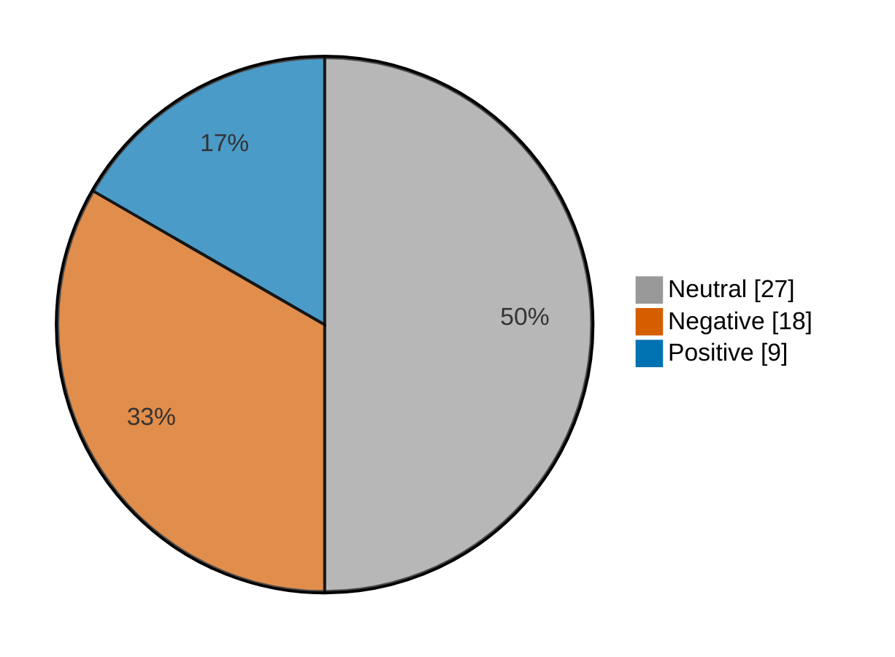

# Newsmood — 2026-11-19

**Mood index: -18.5** (moderately negative) · 54 headlines from 3 sources · model unsure on 4

## Mood at a glance

Negative 18 (33.3%) · Positive 9 (16.7%) · Neutral 27 (50.0%)

## What happened

Financial coverage leaned moderately negative today (index -18.5) across 54 headlines, with no single theme in the lead.

**Clusters:**

- 3 headlines on surging today, stock surging, surging: 3 neutral · +0.0% of the day's movement

_Themes use TF-IDF fit on 1589 headlines (2026-10-20–2026-11-19)._

## Recommended articles (highest model certainty, not most important)

### Negative

- [Nvidia’s stock falls further. It has lost $669 billion in six trading days.](<https://www.marketwatch.com/story/nvidias-stock-falls-further-it-has-lost-611-billion-in-six-trading-days-434af231?mod=mw_rss_topstories>) · 97% · 4.1% of the day's movement · marketwatch-top
- [U.S. stocks lower at close of trade; Dow Jones Industrial Average down 2.19%](<https://www.investing.com/news/stock-market-news/us-stocks-lower-at-close-of-trade-dow-jones-industrial-average-down-219-5040081>) · 97% · 4.1% of the day's movement · investing-stocks
- [Australia stocks lower at close of trade; S&P/ASX 200 down 1.04%](<https://www.investing.com/news/stock-market-news/australia-stocks-lower-at-close-of-trade-spasx-200-down-104-5037760>) · 97% · 4.1% of the day's movement · investing-stocks

### Positive

- [South Korean entertainment stocks surge up to 30% on China trade deal](<https://www.investing.com/news/stock-market-news/south-korean-entertainment-stocks-surge-up-to-30-on-china-trade-deal-5037752>) · 97% · 4.1% of the day's movement · investing-stocks
- [Musk pledges higher Tesla output at China plant, Chinese state media says](<https://www.investing.com/news/stock-market-news/musk-pledges-higher-tesla-output-at-china-plant-chinese-state-media-says-5037774>) · 97% · 4.1% of the day's movement · investing-stocks
- [Australia’s NextDC raises annual forecast on sales growth, cost savings](<https://www.investing.com/news/stock-market-news/australias-nextdc-raises-annual-forecast-on-sales-growth-cost-savings-5040168>) · 96% · 4.1% of the day's movement · investing-stocks

### Neutral

- [After-Hours Movers: BSP, INTU, ESTC, GAP, ROST](<https://www.investing.com/news/stock-market-news/afterhours-movers-bsp-intu-estc-gap-rost-432SI-5040092>) · 98% · investing-stocks
- [Sandisk’s stock split is almost here. This is what investors need to know.](<https://www.marketwatch.com/story/sandisks-stock-split-is-almost-here-this-is-what-investors-need-to-know-e0a18461?mod=mw_rss_topstories>) · 98% · marketwatch-top

## Sources

| Source | Headlines | Negative | Neutral | Positive |
|---|--:|--:|--:|--:|
| investing-stocks | 33 | 12 | 15 | 6 |
| marketwatch-top | 20 | 6 | 12 | 2 |
| cnbc-finance | 1 | 0 | 0 | 1 |

All 54 headlines

| Sentiment | Certainty | Headline | Source |
|---|--:|---|---|
| negative | 97% | [Nvidia’s stock falls further. It has lost $669 billion in six trading days.](<https://www.marketwatch.com/story/nvidias-stock-falls-further-it-has-lost-611-billion-in-six-trading-days-434af231?mod=mw_rss_topstories>) | marketwatch-top |
| negative | 97% | [U.S. stocks lower at close of trade; Dow Jones Industrial Average down 2.19%](<https://www.investing.com/news/stock-market-news/us-stocks-lower-at-close-of-trade-dow-jones-industrial-average-down-219-5040081>) | investing-stocks |
| negative | 97% | [Australia stocks lower at close of trade; S&P/ASX 200 down 1.04%](<https://www.investing.com/news/stock-market-news/australia-stocks-lower-at-close-of-trade-spasx-200-down-104-5037760>) | investing-stocks |
| negative | 97% | [Mexico stocks lower at close of trade; S&P/BMV IPC down 0.61%](<https://www.investing.com/news/stock-market-news/mexico-stocks-lower-at-close-of-trade-spbmv-ipc-down-061-5040078>) | investing-stocks |
| negative | 96% | [Japan AI selloff: These chips and electronics stocks were the worst hit](<https://www.investing.com/news/stock-market-news/japan-ai-selloff-these-chips-and-electronics-stocks-were-the-worst-hit-93CH-5037748>) | investing-stocks |
| negative | 96% | [European stocks close down despite AI enthusiasm sparked by Anthropic IPO](<https://www.investing.com/news/stock-market-news/european-stocks-inch-up-as-massive-anthropic-ipo-counters-hawkish-fed-5037955>) | investing-stocks |
| negative | 95% | [UnitedHealth’s stock keeps plunging after government signals crackdown on Medicare Advantage fraud](<https://www.marketwatch.com/story/unitedhealths-stock-keeps-plunging-after-government-signals-crackdown-on-medicare-advantage-fraud-c4770a45?mod=mw_rss_topstories>) | marketwatch-top |
| negative | 95% | [Deutsche Bank’s Italian unit hid up to €800 mln in losses - report](<https://www.investing.com/news/stock-market-news/deutsche-banks-italian-unit-hid-up-to-800-mln-in-losses--report-93CH-5037779>) | investing-stocks |
| negative | 94% | [Wall St falls sharply as Anthropic debut fails to reignite AI trade](<https://www.investing.com/news/stock-market-news/nasdaq-futures-jump-as-anthropics-record-ipo-pricing-fuels-hopes-for-strong-debut-5038156>) | investing-stocks |
| negative | 94% | [Anthropic hits $2 trillion market value in debut; major indexes fall](<https://www.investing.com/news/stock-market-news/anthropic-set-to-soar-in-debut-will-ai-peers-follow-5039533>) | investing-stocks |
| negative | 93% | [Anthropic shares retreat from $2 trillion debut valuation after record IPO](<https://www.investing.com/news/stock-market-news/anthropic-opens-34-above-ipo-price-reaches-2-trillion-valuation-in-nasdaq-debut-5039595>) | investing-stocks |
| negative | 91% | [Accenture launches plan to cut 950 Meta-linked jobs in Portugal](<https://www.investing.com/news/stock-market-news/accenture-launches-plan-to-cut-950-metalinked-jobs-in-portugal-5038446>) | investing-stocks |
| negative | 90% | [CK Hutchison shares fall as Panama files criminal complaint amid ports dispute](<https://www.investing.com/news/stock-market-news/ck-hutchison-shares-fall-as-panama-files-criminal-complaint-amid-ports-dispute-5037751>) | investing-stocks |
| negative | 90% | [Wall Street ends sharply lower as Anthropic’s debut fails to revive AI fervor](<https://www.investing.com/news/stock-market-news/wall-street-ends-sharply-lower-asanthropics-debut-fails-to-revive-ai-fervor-5040108>) | investing-stocks |
| negative | 86% | [Anthropic’s IPO poses this big risk to an already shaky stock market](<https://www.marketwatch.com/story/anthropics-ipo-poses-this-big-risk-to-an-already-shaky-stock-market-83ce7794?mod=mw_rss_topstories>) | marketwatch-top |
| negative | 84% | [Why Micron, Broadcom and other AI stocks gave up their gains Thursday](<https://www.marketwatch.com/story/why-micron-intel-and-other-ai-stocks-are-getting-a-lift-on-thursday-cf6f59f8?mod=mw_rss_topstories>) | marketwatch-top |
| negative | 64% | [‘Buyers are out for blood’: With home sales at a record low, buyers are calling the shots](<https://www.marketwatch.com/story/buyers-are-out-for-blood-as-housing-market-finally-hits-rock-bottom-fa5093a6?mod=mw_rss_topstories>) | marketwatch-top |
| negative | 61% | [Markets are sending troubling signals about the state of the economy](<https://www.marketwatch.com/story/markets-are-sending-troubling-signals-about-the-state-of-the-economy-8043f20e?mod=mw_rss_topstories>) | marketwatch-top |
| positive | 97% | [South Korean entertainment stocks surge up to 30% on China trade deal](<https://www.investing.com/news/stock-market-news/south-korean-entertainment-stocks-surge-up-to-30-on-china-trade-deal-5037752>) | investing-stocks |
| positive | 97% | [Musk pledges higher Tesla output at China plant, Chinese state media says](<https://www.investing.com/news/stock-market-news/musk-pledges-higher-tesla-output-at-china-plant-chinese-state-media-says-5037774>) | investing-stocks |
| positive | 96% | [Australia’s NextDC raises annual forecast on sales growth, cost savings](<https://www.investing.com/news/stock-market-news/australias-nextdc-raises-annual-forecast-on-sales-growth-cost-savings-5040168>) | investing-stocks |
| positive | 95% | [Houston refinery restart tests Trump’s push to boost US fuel output](<https://www.investing.com/news/stock-market-news/houston-refinery-restart-tests-trumps-push-to-boost-us-fuel-output-5039669>) | investing-stocks |
| positive | 92% | [Trump praises ‘great relationship’ with Putin after meeting, as Ukraine war takes center stage](<https://www.cnbc.com/2026/11/19/trump-xi-putin-china-apec-.html>) | cnbc-finance |
| positive | 91% | [Exclusive: Upstart CEO sees path to high growth as business transforms](<https://www.investing.com/news/stock-market-news/exclusive-upstart-ceo-sees-path-to-high-growth-as-business-transforms-5039682>) | investing-stocks |
| positive | 71% | [US federal regulators approve Cheniere’s Sabine Pass expansion project](<https://www.investing.com/news/stock-market-news/federal-regulators-approve-chenieres-sabine-pass-expansion-project-5039760>) | investing-stocks |
| positive | 65% | [Alibaba’s cloud business is thriving. But those profits are completely offset by losses from its AI labs.](<https://www.marketwatch.com/story/alibabas-cloud-business-is-thriving-but-those-profits-are-completely-offset-by-losses-from-its-ai-labs-74bf4b3c?mod=mw_rss_topstories>) | marketwatch-top |
| positive | 50% (unsure) | [Why Walmart is making a bigger bet on fast-food delivery](<https://www.marketwatch.com/story/why-walmart-is-making-a-bigger-bet-on-fast-food-delivery-27263735?mod=mw_rss_topstories>) | marketwatch-top |
| neutral | 98% | [After-Hours Movers: BSP, INTU, ESTC, GAP, ROST](<https://www.investing.com/news/stock-market-news/afterhours-movers-bsp-intu-estc-gap-rost-432SI-5040092>) | investing-stocks |
| neutral | 98% | [Sandisk’s stock split is almost here. This is what investors need to know.](<https://www.marketwatch.com/story/sandisks-stock-split-is-almost-here-this-is-what-investors-need-to-know-e0a18461?mod=mw_rss_topstories>) | marketwatch-top |
| neutral | 98% | [Trump’s defamation case against New York Times may proceed, judge rules](<https://www.investing.com/news/stock-market-news/trumps-defamation-case-against-new-york-times-may-proceed-judge-rules-5039668>) | investing-stocks |
| neutral | 98% | [Former Fox News anchor Maria Bartiromo sells $7 million N.Y.C. townhouse](<https://www.marketwatch.com/story/former-fox-news-anchor-maria-bartiromo-sells-7-million-n-y-c-townhouse-ef993dbb?mod=mw_rss_topstories>) | marketwatch-top |
| neutral | 97% | [This closely-watched investing guru just sold all of his stocks](<https://www.marketwatch.com/story/this-closely-watched-guru-just-sold-everything-474b4389?mod=mw_rss_topstories>) | marketwatch-top |
| neutral | 97% | [My wife pays thousands of dollars for her family to visit from Argentina. How can I convince her to stop?](<https://www.marketwatch.com/story/my-wife-pays-thousands-of-dollars-for-her-family-to-visit-from-argentina-how-can-i-convince-her-to-stop-9381351c?mod=mw_rss_topstories>) | marketwatch-top |
| neutral | 96% | [I have two children. How can I turn them into millionaires by the time they retire?](<https://www.marketwatch.com/story/i-have-two-children-how-can-i-turn-them-into-millionaires-by-the-time-they-retire-547444eb?mod=mw_rss_topstories>) | marketwatch-top |
| neutral | 95% | [Intuit to sell Mailchimp to Bending Spoons for $3.68 billion](<https://www.investing.com/news/stock-market-news/intuit-to-sell-mailchimp-to-bending-spoons-for-368-billion-5039975>) | investing-stocks |
| neutral | 95% | [Why is BE Semiconductor Industries stock rallying today?](<https://www.investing.com/news/stock-market-news/why-is-be-semiconductor-industries-stock-rallying-today-93CH-5038502>) | investing-stocks |
| neutral | 95% | [Why is Infineon Technologies stock rallying today?](<https://www.investing.com/news/stock-market-news/why-is-infineon-technologies-stock-rallying-today-93CH-5038503>) | investing-stocks |
| neutral | 93% | [Forget data centers. The next great AI stocks are hiding in plain sight in these four sectors.](<https://www.marketwatch.com/story/forget-data-centers-the-next-great-ai-stocks-are-hiding-in-plain-sight-in-these-four-sectors-ee9833b1?mod=mw_rss_topstories>) | marketwatch-top |
| neutral | 92% | [Want to create more competition in grocery delivery? Let DoorDash and Instacart merge.](<https://www.marketwatch.com/story/want-to-create-more-competition-in-grocery-delivery-let-doordash-and-instacart-merge-10505ad0?mod=mw_rss_topstories>) | marketwatch-top |
| neutral | 91% | [The real beneficiary of the AI tech revolution fueled by Anthropic may surprise you](<https://www.marketwatch.com/story/the-real-beneficiary-of-the-ai-tech-revolution-fueled-by-anthropic-may-surprise-you-6fa098b2?mod=mw_rss_topstories>) | marketwatch-top |
| neutral | 90% | [Apple camera software chief McCormack retires after 8 years - Bloomberg](<https://www.investing.com/news/stock-market-news/apple-camera-software-chief-mccormack-retires-after-8-years--bloomberg-93CH-5039661>) | investing-stocks |
| neutral | 88% | [Anthropic is coming to your 401(k). Love it or hate it, AI is becoming a bigger part of your financial plan.](<https://www.marketwatch.com/story/anthropic-is-coming-to-your-401-k-love-it-or-hate-it-ai-is-becoming-a-bigger-part-of-your-financial-plan-2e9ae533?mod=mw_rss_topstories>) | marketwatch-top |
| neutral | 88% | [We’re in our 50s and terrified of a market crash. Should we put $400,000 of our $1 million retirement savings into an annuity?](<https://www.marketwatch.com/story/were-in-our-50s-and-terrified-of-a-market-crash-should-we-put-400-000-of-our-1-million-retirement-savings-into-an-annuity-1943f240?mod=mw_rss_topstories>) | marketwatch-top |
| neutral | 87% | [Analysts bullish on Airtel Money as mobile payments drive growth](<https://www.investing.com/news/stock-market-news/analysts-bullish-on-airtel-money-as-mobile-payments-drive-growth-5038453>) | investing-stocks |
| neutral | 86% | [A CoreWeave co-founder just made an unconventional $30 million wager on its battered bonds](<https://www.marketwatch.com/story/a-coreweave-co-founder-just-made-an-unconventional-30-million-wager-on-its-battered-bonds-5586b0e9?mod=mw_rss_topstories>) | marketwatch-top |
| neutral | 85% | [Trump unveils $17 billion of Southeast Asia deals for US firms, White House says](<https://www.investing.com/news/stock-market-news/trump-unveils-17-billion-of-southeast-asia-deals-for-us-firms-white-house-says-5038267>) | investing-stocks |
| neutral | 84% | [SEC’s Daly sees no chance of launching 3x, 5x single-stock leveraged ETFs](<https://www.investing.com/news/stock-market-news/secs-daly-sees-no-chance-of-launching-3x-5x-singlestock-leveraged-etfs-5040162>) | investing-stocks |
| neutral | 83% | [The US IPO market is bigger than ever, but not busier](<https://www.investing.com/news/stock-market-news/the-us-ipo-market-is-bigger-than-ever-but-not-busier-5038432>) | investing-stocks |
| neutral | 75% | [Bernstein names top China semiconductor equipment stocks](<https://www.investing.com/news/stock-market-news/bernstein-names-top-china-semiconductor-equipment-stocks-5037769>) | investing-stocks |
| neutral | 69% | [Here’s the precise moment when cyberattacks started increasing exponentially](<https://www.marketwatch.com/story/heres-the-precise-moment-when-cyberattacks-started-increasing-exponentially-244a4294?mod=mw_rss_topstories>) | marketwatch-top |
| neutral | 64% | [Why is ASML stock surging today?](<https://www.investing.com/news/stock-market-news/why-is-asml-stock-surging-today-93CH-5038522>) | investing-stocks |
| neutral | 54% (unsure) | [Why is Aixtron stock surging today?](<https://www.investing.com/news/stock-market-news/why-is-aixtron-stock-surging-today-93CH-5038493>) | investing-stocks |
| neutral | 52% (unsure) | [Why is ASM International stock surging today?](<https://www.investing.com/news/stock-market-news/why-is-asm-international-stock-surging-today-93CH-5038489>) | investing-stocks |
| neutral | 51% (unsure) | [FCC votes to ban Chinese telecoms from direct access to US phone numbers](<https://www.investing.com/news/stock-market-news/fcc-votes-to-ban-chinese-telecoms-from-direct-access-to-us-phone-numbers-5039586>) | investing-stocks |

---

Certainty is the model's confidence in its label; below 60% it is marked unsure.

"Of the day's movement" is a headline's certainty over the sum of every non-neutral headline's certainty: its part in moving the index. Neutral headlines move it by 0.

Links go to the original publisher; some limit free articles.

Model: kkrit-tinna/newsmood-distilbert-financial@be7b809e0d8f7bd50e77d902aee199363b7e2a66 · Gates: 2/2 passed · Not financial advice.
