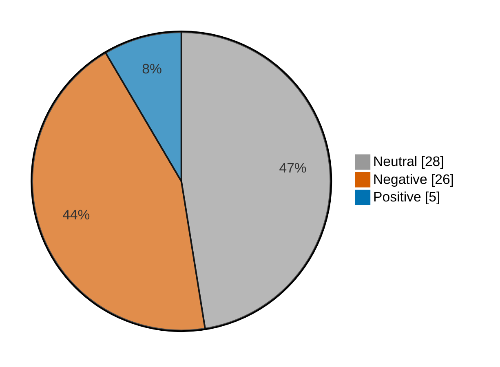

# Newsmood — 2026-11-20

**Mood index: -36.3** (strongly negative) · 59 headlines from 3 sources · model unsure on 3

## Mood at a glance

Negative 26 (44.1%) · Positive 5 (8.5%) · Neutral 28 (47.5%)

## What happened

Financial news leaned strongly negative today (index -36.3, down 17.5 from yesterday) from 59 headlines, with no dominant theme.

**Clusters:** no clear theme today.

_Themes use TF-IDF fit on 1616 headlines (2026-10-21–2026-11-20)._

## Recommended articles (highest model certainty, not most important)

### Negative

- [Taiwan stocks lower at close of trade; Taiwan Weighted down 6.63%](<https://www.investing.com/news/stock-market-news/taiwan-stocks-lower-at-close-of-trade-taiwan-weighted-down-663-5040720>) · 97% · 3.6% of the day's movement · investing-stocks
- [U.S. stocks lower at close of trade; Dow Jones Industrial Average down 1.93%](<https://www.investing.com/news/stock-market-news/us-stocks-lower-at-close-of-trade-dow-jones-industrial-average-down-193-5042683>) · 97% · 3.6% of the day's movement · investing-stocks
- [Spain stocks lower at close of trade; IBEX 35 down 1.57%](<https://www.investing.com/news/stock-market-news/spain-stocks-lower-at-close-of-trade-ibex-35-down-157-5042308>) · 97% · 3.6% of the day's movement · investing-stocks

### Positive

- [S&P upgrades Snap to ‘BB’ on margin expansion and stronger ad monetization](<https://www.investing.com/news/stock-market-news/sp-upgrades-snap-to-bb-on-margin-expansion-and-stronger-ad-monetization-5042734>) · 97% · 3.6% of the day's movement · investing-stocks
- [HSBC upgrades Tesla, more than doubles target on SpaceX merger potential](<https://www.investing.com/news/stock-market-news/hsbc-upgrades-tesla-more-than-doubles-target-on-spacex-merger-potential-5041374>) · 93% · 3.5% of the day's movement · investing-stocks
- [Sen. Ron Johnson’s Social Security fix could add trillions to the national debt](<https://www.marketwatch.com/story/this-proposed-social-security-fix-could-add-trillions-to-the-national-debt-17197e91?mod=mw_rss_topstories>) · 89% · 3.3% of the day's movement · marketwatch-top

### Neutral

- [GM board evaluates CEO succession options with Sterling Anderson in focus - report](<https://www.investing.com/news/stock-market-news/gm-board-evaluates-ceo-succession-options-with-sterling-anderson-in-focus--report-5042699>) · 98% · investing-stocks
- [KKR weighs $8B to $10B deal for Partners Group’s EdgeCore - Bloomberg](<https://www.investing.com/news/stock-market-news/kkr-weighs-8b-to-10b-deal-for-partners-groups-edgecore--bloomberg-5042338>) · 97% · investing-stocks

## Sources

| Source | Headlines | Negative | Neutral | Positive |
|---|--:|--:|--:|--:|
| investing-stocks | 37 | 17 | 17 | 3 |
| marketwatch-top | 18 | 6 | 10 | 2 |
| cnbc-finance | 4 | 3 | 1 | 0 |

All 59 headlines

| Sentiment | Certainty | Headline | Source |
|---|--:|---|---|
| negative | 97% | [Taiwan stocks lower at close of trade; Taiwan Weighted down 6.63%](<https://www.investing.com/news/stock-market-news/taiwan-stocks-lower-at-close-of-trade-taiwan-weighted-down-663-5040720>) | investing-stocks |
| negative | 97% | [U.S. stocks lower at close of trade; Dow Jones Industrial Average down 1.93%](<https://www.investing.com/news/stock-market-news/us-stocks-lower-at-close-of-trade-dow-jones-industrial-average-down-193-5042683>) | investing-stocks |
| negative | 97% | [Spain stocks lower at close of trade; IBEX 35 down 1.57%](<https://www.investing.com/news/stock-market-news/spain-stocks-lower-at-close-of-trade-ibex-35-down-157-5042308>) | investing-stocks |
| negative | 97% | [U.K. stocks lower at close of trade; Investing.com United Kingdom 100 down 1.04%](<https://www.investing.com/news/stock-market-news/uk-stocks-lower-at-close-of-trade-investingcom-united-kingdom-100-down-104-5042309>) | investing-stocks |
| negative | 97% | [Australia stocks lower at close of trade; S&P/ASX 200 down 1.58%](<https://www.investing.com/news/stock-market-news/australia-stocks-lower-at-close-of-trade-spasx-200-down-158-5040678>) | investing-stocks |
| negative | 96% | [Mexico stocks lower at close of trade; S&P/BMV IPC down 0.15%](<https://www.investing.com/news/stock-market-news/mexico-stocks-lower-at-close-of-trade-spbmv-ipc-down-015-5042676>) | investing-stocks |
| negative | 96% | [Scout24 shares fall 6% as J.P. Morgan flags AI threat to property portals](<https://www.investing.com/news/stock-market-news/scout24-shares-fall-6-as-jp-morgan-flags-ai-threat-to-property-portals-5041347>) | investing-stocks |
| negative | 96% | [FTSE 100 today: Stocks plunge to worst week since March on tech, metals rout](<https://www.investing.com/news/stock-market-news/ftse-100-today-stocks-fall-on-tech-metals-rout-despite-uk-retail-beat-5040931>) | investing-stocks |
| negative | 96% | [China’s Kuaishou slumps to record low after weak Q3 results](<https://www.investing.com/news/stock-market-news/chinas-kuaishou-slumps-to-record-low-after-weak-q3-results-5040694>) | investing-stocks |
| negative | 95% | [One thing Thanksgiving travelers can be thankful for: Gas prices are down 75 cents from this year’s peak](<https://www.marketwatch.com/story/one-thing-thanksgiving-travelers-can-be-thankful-for-gas-prices-are-down-75-cents-from-this-years-peak-efac1809?mod=mw_rss_topstories>) | marketwatch-top |
| negative | 94% | [Investors fled to healthcare stocks for safety. Now insurance and hospital shares are plunging.](<https://www.marketwatch.com/story/investors-fled-to-healthcare-stocks-for-safety-now-insurance-and-hospital-shares-are-plunging-9cb6a96c?mod=mw_rss_topstories>) | marketwatch-top |
| negative | 94% | [Anthropic’s IPO bank closed position meant to stabilize stock, removing source of support](<https://www.investing.com/news/stock-market-news/anthropics-ipo-bank-closed-position-meant-to-stabilize-stock-removing-source-of-support-5042311>) | investing-stocks |
| negative | 89% | [Nvidia’s stock heads for a stretch of weekly losses unseen since 2008](<https://www.marketwatch.com/story/nvidias-stock-heads-for-a-stretch-of-weekly-losses-unseen-since-2008-91aba9a6?mod=mw_rss_topstories>) | marketwatch-top |
| negative | 89% | [Prediction markets outlook for stocks in 2026 dims amid AI sell-off](<https://www.cnbc.com/2026/11/20/sp-500-8000-kalshi-odds-ai-selloff.html>) | cnbc-finance |
| negative | 85% | [European shares tumble again as Anthropic debut fails to halt tech rout](<https://www.investing.com/news/stock-market-news/european-shares-near-1month-lows-as-anthropics-debut-fails-to-halt-tech-rout-5040695>) | investing-stocks |
| negative | 83% | [Nasdaq plunges 5% a day after Anthropic debut, but investors still believe in AI](<https://www.investing.com/news/stock-market-news/nasdaq-plunges-5-a-day-after-anthropic-debut-but-investors-still-believe-in-ai-5042641>) | investing-stocks |
| negative | 83% | [Why is Oklo stock lower and volatile today?](<https://www.investing.com/news/stock-market-news/why-is-oklo-stock-lower-and-volatile-today-93CH-5041314>) | investing-stocks |
| negative | 83% | [Anthropic’s stock slides closer to IPO price and drags down the AI trade](<https://www.marketwatch.com/story/anthropics-stock-slides-closer-to-ipo-price-and-drags-down-the-ai-trade-cc43a0c4?mod=mw_rss_topstories>) | marketwatch-top |
| negative | 82% | [Big Pharma, with eye on Anthropic, says AI is shrinking drug discovery timelines](<https://www.investing.com/news/stock-market-news/big-pharma-with-eye-on-anthropic-says-ai-is-shrinking-drug-discovery-timelines-5041287>) | investing-stocks |
| negative | 82% | [S&P and Dow enter correction territory, Nasdaq turns red for the year amid AI rout](<https://www.investing.com/news/stock-market-news/wall-street-futures-fall-as-anthropic-debut-fails-to-revive-ai-trade-5040450>) | investing-stocks |
| negative | 81% | [Apple seems to be building its own AI agent. This could be bad news for Meta’s Muse.](<https://www.marketwatch.com/story/apple-seems-to-be-building-its-own-ai-agent-this-could-be-bad-news-for-metas-muse-8d9be2a7?mod=mw_rss_topstories>) | marketwatch-top |
| negative | 81% | [TSMC tightens China AI chip curbs as new US rules close manufacturing loophole, sources say](<https://www.investing.com/news/stock-market-news/tsmc-tightens-china-ai-chip-curbs-as-new-us-rules-close-manufacturing-loophole-sources-say-5038806>) | investing-stocks |
| negative | 77% | [Why year-end portfolio rebalancing is a risky bet that bonds will beat stocks in 2027](<https://www.marketwatch.com/story/why-year-end-portfolio-rebalancing-is-a-risky-bet-that-bonds-will-beat-stocks-in-2027-1b438892?mod=mw_rss_topstories>) | marketwatch-top |
| negative | 68% | [The bull market has a new problem. The 'smart money' is selling](<https://www.cnbc.com/2026/11/20/equity-issuance-bull-market-problem.html>) | cnbc-finance |
| negative | 67% | [Robinhood faces shareholder challenge as SEC loosens proxy oversight](<https://www.investing.com/news/stock-market-news/robinhood-faces-shareholder-challenge-as-sec-loosens-proxy-oversight-5041256>) | investing-stocks |
| negative | 58% (unsure) | [U.S.-China trade, Taiwan and tech tensions remain unresolved as Trump returns from Asia](<https://www.cnbc.com/2026/11/20/apec-summit-trump-xi-china-trade-taiwan.html>) | cnbc-finance |
| positive | 97% | [S&P upgrades Snap to ‘BB’ on margin expansion and stronger ad monetization](<https://www.investing.com/news/stock-market-news/sp-upgrades-snap-to-bb-on-margin-expansion-and-stronger-ad-monetization-5042734>) | investing-stocks |
| positive | 93% | [HSBC upgrades Tesla, more than doubles target on SpaceX merger potential](<https://www.investing.com/news/stock-market-news/hsbc-upgrades-tesla-more-than-doubles-target-on-spacex-merger-potential-5041374>) | investing-stocks |
| positive | 89% | [Sen. Ron Johnson’s Social Security fix could add trillions to the national debt](<https://www.marketwatch.com/story/this-proposed-social-security-fix-could-add-trillions-to-the-national-debt-17197e91?mod=mw_rss_topstories>) | marketwatch-top |
| positive | 85% | [Here’s what’s been proven to help GLP-1 users from losing too much muscle from the drug](<https://www.marketwatch.com/story/heres-whats-been-proven-to-help-glp-1-users-who-have-lost-muscle-from-the-drug-2c71cdbf?mod=mw_rss_topstories>) | marketwatch-top |
| positive | 63% | [’Black Friday’ brings consumer spending into focus for AI-rocked market](<https://www.investing.com/news/stock-market-news/black-friday-brings-consumer-spending-into-focus-for-airocked-market-5041258>) | investing-stocks |
| neutral | 98% | [GM board evaluates CEO succession options with Sterling Anderson in focus - report](<https://www.investing.com/news/stock-market-news/gm-board-evaluates-ceo-succession-options-with-sterling-anderson-in-focus--report-5042699>) | investing-stocks |
| neutral | 97% | [KKR weighs $8B to $10B deal for Partners Group’s EdgeCore - Bloomberg](<https://www.investing.com/news/stock-market-news/kkr-weighs-8b-to-10b-deal-for-partners-groups-edgecore--bloomberg-5042338>) | investing-stocks |
| neutral | 97% | [The hidden catch in Anthropic’s IPO: Billions of locked-up shares are waiting in the wings](<https://www.marketwatch.com/story/the-hidden-catch-in-anthropics-ipo-billions-of-locked-up-shares-are-waiting-in-the-wings-279d33ce?mod=mw_rss_topstories>) | marketwatch-top |
| neutral | 97% | [TD Cowen names top software stock for 2027](<https://www.investing.com/news/stock-market-news/td-cowen-names-top-software-stock-for-2027-5040716>) | investing-stocks |
| neutral | 96% | [Warsh wants Fed officials to talk less. Instead, they’re talking more](<https://www.cnbc.com/2026/11/20/warsh-fed-forward-guidance-rate-hikes.html>) | cnbc-finance |
| neutral | 96% | [CrowdStrike in talks to acquire Zscaler, sources say](<https://www.investing.com/news/stock-market-news/crowdstrike-in-talks-to-acquire-zscaler-sources-say-5042720>) | investing-stocks |
| neutral | 96% | [Exclusive-Taiwan tells Meta thousands of China-linked accounts seek to influence elections](<https://www.investing.com/news/stock-market-news/exclusivetaiwan-tells-meta-thousands-of-chinalinked-accounts-seek-to-influence-elections-5040684>) | investing-stocks |
| neutral | 94% | [‘GTA 6’ has taken over. Is it too late to buy the developer’s stock?](<https://www.marketwatch.com/story/gta-6-has-taken-over-is-it-too-late-to-buy-the-developers-stock-69a5cbc5?mod=mw_rss_topstories>) | marketwatch-top |
| neutral | 93% | [How Bear Grylls lived in the harsh conditions of his own home on an abandoned island with ‘no power, no water, no roof’](<https://www.marketwatch.com/story/how-bear-grylls-lived-in-the-harsh-conditions-of-his-own-home-on-an-abandoned-island-with-no-power-no-water-no-roof-8c3e17c4?mod=mw_rss_topstories>) | marketwatch-top |
| neutral | 92% | [Tesla proposes $3.1 billion Texas polysilicon plant for solar manufacturing](<https://www.investing.com/news/stock-market-news/tesla-proposes-31-billion-texas-polysilicon-plant-for-solar-manufacturing-5042320>) | investing-stocks |
| neutral | 90% | [Micron and Sandisk stocks might look like bargains, but analysts say that’s actually a red flag](<https://www.marketwatch.com/story/micron-and-sandisk-stocks-might-look-like-bargains-but-analysts-say-thats-actually-a-red-flag-da1f1f5d?mod=mw_rss_topstories>) | marketwatch-top |
| neutral | 90% | [Citi warns a key stock-market signal is close to flashing red](<https://www.marketwatch.com/story/citi-warns-a-key-stock-market-signal-is-close-to-flashing-red-5cbee1c3?mod=mw_rss_topstories>) | marketwatch-top |
| neutral | 90% | [Missouri judge approves Bayer’s $7.25 billion Roundup settlement](<https://www.investing.com/news/stock-market-news/missouri-judge-approves-bayers-725-billion-roundup-settlement-5042643>) | investing-stocks |
| neutral | 89% | [Analysis-Scientists are learning more about the rare Ebola virus in Congo outbreak](<https://www.investing.com/news/stock-market-news/analysisscientists-are-learning-more-about-the-rare-ebola-virus-in-congo-outbreak-5041257>) | investing-stocks |
| neutral | 88% | [Signal restricts screenshots to block AI agents from reading messages](<https://www.investing.com/news/stock-market-news/exclusivesignal-restricts-screenshots-to-block-ai-agents-from-reading-messages-5040998>) | investing-stocks |
| neutral | 88% | [Everyone’s making money off ‘GTA 6’ this week — except investors in Take-Two’s stock](<https://www.marketwatch.com/story/everyones-making-money-off-gta-6-this-week-except-investors-in-take-twos-stock-489ee01b?mod=mw_rss_topstories>) | marketwatch-top |
| neutral | 87% | [Here’s what happened next after previous times the S&P 500 losing streak reached six sessions](<https://www.marketwatch.com/story/heres-what-happened-next-after-previous-times-the-s-p-500-losing-streak-reached-six-sessions-13ff7704?mod=mw_rss_topstories>) | marketwatch-top |
| neutral | 87% | [Why is Advantest stock tumbling 10% today?](<https://www.investing.com/news/stock-market-news/why-is-advantest-stock-tumbling-10-today-93CH-5040687>) | investing-stocks |
| neutral | 84% | [Why is SVRN stock sliding today?](<https://www.investing.com/news/stock-market-news/why-is-svrn-stock-sliding-today-93CH-5041243>) | investing-stocks |
| neutral | 83% | [Why is the Japanese yen rising today?](<https://www.investing.com/news/stock-market-news/why-is-the-japanese-yen-rising-today-93CH-5040686>) | investing-stocks |
| neutral | 83% | [The tech wreck is one stock trade Trump can’t ‘TACO’ away](<https://www.marketwatch.com/story/the-tech-wreck-is-one-stock-trade-trump-cant-taco-away-516b3883?mod=mw_rss_topstories>) | marketwatch-top |
| neutral | 81% | [Indonesia asks Google to explain removal of 19,000 YouTube channels](<https://www.investing.com/news/stock-market-news/indonesia-asks-google-to-explain-removal-of-19000-youtube-channels-93CH-5040696>) | investing-stocks |
| neutral | 75% | [Medicare beneficiaries could skip the nursing home for cheaper care at home under new bill](<https://www.marketwatch.com/story/medicare-beneficiaries-could-skip-the-nursing-home-for-cheaper-care-at-home-under-new-bill-e289c8d0?mod=mw_rss_topstories>) | marketwatch-top |
| neutral | 73% | [Why is Abivax stock tumbling today?](<https://www.investing.com/news/stock-market-news/why-is-abivax-stock-tumbling-today-93CH-5042307>) | investing-stocks |
| neutral | 65% | [My husband spent $80,000 on a boat, yet says my plans for a $100,000 pottery studio are irresponsible. Who’s right?](<https://www.marketwatch.com/story/my-husband-spent-80-000-on-a-boat-yet-says-my-plans-for-a-100-000-pottery-studio-are-irresponsible-whos-right-1a69436a?mod=mw_rss_topstories>) | marketwatch-top |
| neutral | 62% | [Why is Eastman Chemical stock sliding today?](<https://www.investing.com/news/stock-market-news/why-is-eastman-chemical-stock-sliding-today-93CH-5041308>) | investing-stocks |
| neutral | 50% (unsure) | [ABB considers listing robotics unit if SoftBank sale collapses, Reuters says](<https://www.investing.com/news/stock-market-news/abb-considers-listing-robotics-unit-if-softbank-sale-collapses-reuters-says-5042312>) | investing-stocks |
| neutral | 49% (unsure) | [Commerzbank CEO raises 2026 profit outlook as UniCredit takeover nears](<https://www.investing.com/news/stock-market-news/commerzbank-ceo-raises-2026-profit-outlook-as-unicredit-takeover-nears-5041313>) | investing-stocks |

---

Certainty is the model's confidence in its label; below 60% it is marked unsure.

"Of the day's movement" is a headline's certainty over the sum of every non-neutral headline's certainty: its part in moving the index. Neutral headlines move it by 0.

Links go to the original publisher; some limit free articles.

Model: kkrit-tinna/newsmood-distilbert-financial@be7b809e0d8f7bd50e77d902aee199363b7e2a66 · Gates: 2/2 passed · Not financial advice.
