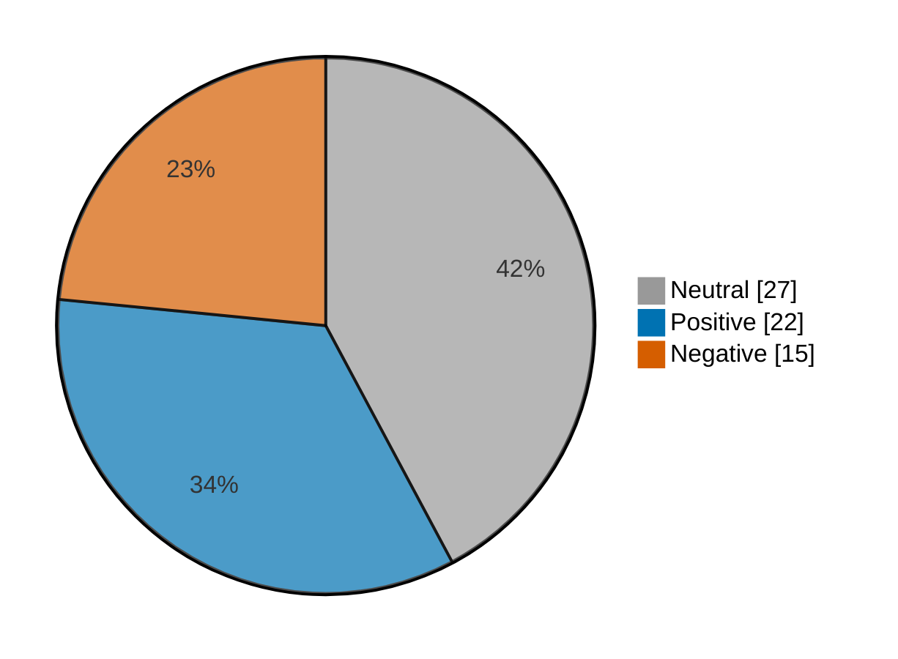

# Newsmood — 2026-11-23

**Mood index: +13.6** (mildly positive) · 64 headlines from 3 sources · model unsure on 11

## Mood at a glance

Negative 15 (23.4%) · Positive 22 (34.4%) · Neutral 27 (42.2%)

## What happened

Financial news leaned mildly positive today (index +13.6, a rise of 36.7 from yesterday) across 64 headlines, with no dominant theme.

**Clusters:**

- 8 headlines on surging today, stock surging, surging: 3 negative, 5 neutral · -5.5% of the day's movement

_Themes use TF-IDF fit on 1645 headlines (2026-10-24–2026-11-23)._

## Recommended articles (highest model certainty, not most important)

### Negative

- [Australia stocks lower at close of trade; S&P/ASX 200 down 0.26%](<https://www.investing.com/news/stock-market-news/australia-stocks-lower-at-close-of-trade-spasx-200-down-026-5044359>) · 97% · 3.2% of the day's movement · investing-stocks
- [The number of 401(k) millionaires drops amid stock-market swings](<https://www.marketwatch.com/story/the-number-of-401-k-millionaires-drops-amid-stock-market-swings-23939b94?mod=mw_rss_topstories>) · 95% · 3.1% of the day's movement · marketwatch-top
- [Consumer stocks, seen as safe bet amid cracks in AI trade, are among the S&P 500’s biggest losers Monday](<https://www.marketwatch.com/story/consumer-stocks-seen-as-safe-bet-amid-cracks-in-ai-trade-are-among-the-s-p-500s-biggest-losers-monday-80cf8f81?mod=mw_rss_topstories>) · 94% · 3.1% of the day's movement · marketwatch-top

### Positive

- [Taiwan stocks higher at close of trade; Taiwan Weighted up 2.35%](<https://www.investing.com/news/stock-market-news/taiwan-stocks-higher-at-close-of-trade-taiwan-weighted-up-235-5044392>) · 97% · 3.2% of the day's movement · investing-stocks
- [Mexico stocks higher at close of trade; S&P/BMV IPC up 0.99%](<https://www.investing.com/news/stock-market-news/mexico-stocks-higher-at-close-of-trade-spbmv-ipc-up-099-5046474>) · 97% · 3.2% of the day's movement · investing-stocks
- [Russia stocks higher at close of trade; MOEX Russia Index up 1.22%](<https://www.investing.com/news/stock-market-news/russia-stocks-higher-at-close-of-trade-moex-russia-index-up-122-5046445>) · 97% · 3.2% of the day's movement · investing-stocks

### Neutral

- [LibertyStream files S-1 with SEC for proposed Nasdaq IPO](<https://www.investing.com/news/stock-market-news/libertystream-files-s1-with-sec-for-proposed-nasdaq-ipo-432SI-5046514>) · 98% · investing-stocks
- [Options on Anthropic shares start trading in brisk volume](<https://www.investing.com/news/stock-market-news/anthropic-options-debut-with-brisk-volume-5046078>) · 98% · investing-stocks

## Sources

| Source | Headlines | Negative | Neutral | Positive |
|---|--:|--:|--:|--:|
| investing-stocks | 39 | 10 | 18 | 11 |
| marketwatch-top | 23 | 5 | 9 | 9 |
| cnbc-finance | 2 | 0 | 0 | 2 |

All 64 headlines

| Sentiment | Certainty | Headline | Source |
|---|--:|---|---|
| negative | 97% | [Australia stocks lower at close of trade; S&P/ASX 200 down 0.26%](<https://www.investing.com/news/stock-market-news/australia-stocks-lower-at-close-of-trade-spasx-200-down-026-5044359>) | investing-stocks |
| negative | 95% | [The number of 401(k) millionaires drops amid stock-market swings](<https://www.marketwatch.com/story/the-number-of-401-k-millionaires-drops-amid-stock-market-swings-23939b94?mod=mw_rss_topstories>) | marketwatch-top |
| negative | 94% | [Consumer stocks, seen as safe bet amid cracks in AI trade, are among the S&P 500’s biggest losers Monday](<https://www.marketwatch.com/story/consumer-stocks-seen-as-safe-bet-amid-cracks-in-ai-trade-are-among-the-s-p-500s-biggest-losers-monday-80cf8f81?mod=mw_rss_topstories>) | marketwatch-top |
| negative | 93% | [UnitedHealth, Humana and CVS stocks slide as U.S targets Medicare Advantage ratings](<https://www.marketwatch.com/story/unitedhealth-humana-and-cvs-stocks-slide-as-u-s-targets-medicare-advantage-ratings-6c2be5bb?mod=mw_rss_topstories>) | marketwatch-top |
| negative | 93% | [UBS cuts Tele2 as cost savings fade and Swedish price competition intensifies](<https://www.investing.com/news/stock-market-news/ubs-cuts-tele2-as-cost-savings-fade-and-swedish-price-competition-intensifies-5044992>) | investing-stocks |
| negative | 91% | [UK shares rise from 5-month low as banks, miners gain](<https://www.investing.com/news/stock-market-news/uk-shares-rise-from-5month-low-as-banks-miners-gain-5044996>) | investing-stocks |
| negative | 90% | [How Nvidia’s billion-dollar turnaround in China is threatened by Huang’s exit](<https://www.investing.com/news/stock-market-news/how-nvidias-billiondollar-turnaround-in-china-is-threatened-by-huangs-exit-5044929>) | investing-stocks |
| negative | 83% | [The U.S. may enter a recession if the Fed raises rates, hedge-fund manager Bill Ackman says](<https://www.marketwatch.com/story/the-u-s-may-enter-a-recession-if-the-fed-raises-rates-hedge-fund-manager-bill-ackman-says-16738971?mod=mw_rss_topstories>) | marketwatch-top |
| negative | 78% | [US lawmakers criticize Nvidia decision to reinstate Huang as CEO](<https://www.investing.com/news/stock-market-news/lawmakers-criticize-nvidia-decision-to-reinstate-huang-as-ceo-5045977>) | investing-stocks |
| negative | 77% | [Anthropic shares rise premarket after Friday selloff nearly erased IPO gains](<https://www.investing.com/news/stock-market-news/anthropic-shares-rise-premarket-after-friday-selloff-nearly-erased-ipo-gains-5045032>) | investing-stocks |
| negative | 63% | [Why is United Microelectronics stock surging today?](<https://www.investing.com/news/stock-market-news/why-is-united-microelectronics-stock-surging-today-93CH-5044379>) | investing-stocks |
| negative | 53% (unsure) | [Why is Alchip Technologies stock surging today?](<https://www.investing.com/news/stock-market-news/why-is-alchip-technologies-stock-surging-today-93CH-5044372>) | investing-stocks |
| negative | 52% (unsure) | [US blacklists Megaspeed chip firm linked to Nvidia scandal](<https://www.investing.com/news/stock-market-news/us-to-blacklist-megaspeed-chip-firm-linked-to-nvidia-scandal-source-says-5046337>) | investing-stocks |
| negative | 52% (unsure) | [Why is Elastic stock surging today?](<https://www.investing.com/news/stock-market-news/why-is-elastic-stock-surging-today-93CH-5046183>) | investing-stocks |
| negative | 43% (unsure) | [Grocery stores have ‘staggering deals’ for Thanksgiving — but don’t get used to these lower prices just yet](<https://www.marketwatch.com/story/grocery-stores-have-staggering-deals-for-thanksgiving-but-dont-get-used-to-these-lower-prices-just-yet-7adfc7f5?mod=mw_rss_topstories>) | marketwatch-top |
| positive | 97% | [Taiwan stocks higher at close of trade; Taiwan Weighted up 2.35%](<https://www.investing.com/news/stock-market-news/taiwan-stocks-higher-at-close-of-trade-taiwan-weighted-up-235-5044392>) | investing-stocks |
| positive | 97% | [Mexico stocks higher at close of trade; S&P/BMV IPC up 0.99%](<https://www.investing.com/news/stock-market-news/mexico-stocks-higher-at-close-of-trade-spbmv-ipc-up-099-5046474>) | investing-stocks |
| positive | 97% | [Russia stocks higher at close of trade; MOEX Russia Index up 1.22%](<https://www.investing.com/news/stock-market-news/russia-stocks-higher-at-close-of-trade-moex-russia-index-up-122-5046445>) | investing-stocks |
| positive | 97% | [Colombia stocks higher at close of trade; COLCAP up 2.00%](<https://www.investing.com/news/stock-market-news/colombia-stocks-higher-at-close-of-trade-colcap-up-200-5046443>) | investing-stocks |
| positive | 97% | [Europe’s STOXX logs strongest day in over six months on tech boost](<https://www.investing.com/news/stock-market-news/european-stocks-recover-after-steep-technologyled-selloff-5044629>) | investing-stocks |
| positive | 96% | [Oracle and CoreWeave stocks stage big gains as investors bet the AI cash will keep flowing](<https://www.marketwatch.com/story/oracle-and-coreweave-stocks-stage-big-gains-as-investors-bet-the-ai-cash-will-keep-flowing-eeb1aa85?mod=mw_rss_topstories>) | marketwatch-top |
| positive | 96% | [U.S. stocks higher at close of trade; Dow Jones Industrial Average up 3.01%](<https://www.investing.com/news/stock-market-news/us-stocks-higher-at-close-of-trade-dow-jones-industrial-average-up-301-5046476>) | investing-stocks |
| positive | 96% | [U.S. stocks see best day in more than a year, as return of Jensen Huang revives AI enthusiasm](<https://www.marketwatch.com/story/u-s-stocks-see-best-day-in-more-than-a-year-as-return-of-jensen-huang-revives-ai-enthusiasm-c3b9d274?mod=mw_rss_topstories>) | marketwatch-top |
| positive | 95% | [BMO reaffirmed this top pick in apparel and footwear](<https://www.investing.com/news/stock-market-news/bmo-reaffirmed-this-top-pick-in-apparel-and-footwear-5046189>) | investing-stocks |
| positive | 94% | [TSX notches best day since November 2023 as base metals, tech lift sentiment](<https://www.investing.com/news/stock-market-news/tsx-futures-rise-as-wall-street-bounces-following-ai-selloff-5045504>) | investing-stocks |
| positive | 94% | [Short sellers get smoked as Nvidia tallies biggest one-day gain in stock-market history](<https://www.marketwatch.com/story/short-sellers-get-smoked-as-nvidia-tallies-biggest-one-day-gain-in-stock-market-history-e9dc6e9c?mod=mw_rss_topstories>) | marketwatch-top |
| positive | 94% | [These stocks are the biggest gainers after Jensen Huang’s return to Nvidia](<https://www.marketwatch.com/story/these-stocks-are-the-biggest-gainers-after-jensen-huangs-return-to-nvidia-bb886140?mod=mw_rss_topstories>) | marketwatch-top |
| positive | 93% | [The return of Jensen Huang has saved the U.S. stock market — for now. Why the rebound may not last.](<https://www.marketwatch.com/story/the-return-of-jensen-huang-has-saved-the-u-s-stock-market-for-now-why-the-rebound-may-not-last-f72656ce?mod=mw_rss_topstories>) | marketwatch-top |
| positive | 87% | [European shares catch modest bid after brutal sell-off](<https://www.investing.com/news/stock-market-news/european-shares-catch-modest-bid-after-brutal-selloff-5044371>) | investing-stocks |
| positive | 87% | [More AI jobs are coming. That’s one of the big hiring trends in 2027.](<https://www.marketwatch.com/story/more-ai-jobs-are-coming-thats-one-of-the-big-hiring-trends-in-2027-3d810209?mod=mw_rss_topstories>) | marketwatch-top |
| positive | 80% | [Stock-market slides this steep and fast trigger a rebound 91% of the time over the last decade](<https://www.marketwatch.com/story/stock-market-slides-this-steep-and-fast-trigger-a-rebound-91-of-the-time-over-the-last-decade-798bd2c2?mod=mw_rss_topstories>) | marketwatch-top |
| positive | 72% | [Fed's John Williams indicates higher interest rates likely 'over time' to address inflation](<https://www.cnbc.com/2026/11/23/john-williams-fed-inflation-rate-hikes.html>) | cnbc-finance |
| positive | 71% | [HPE just posted its strongest growth ever — but its stock is wavering](<https://www.marketwatch.com/story/hpe-just-posted-its-strongest-growth-ever-and-its-stock-is-tacking-on-more-big-gains-4421cebb?mod=mw_rss_topstories>) | marketwatch-top |
| positive | 65% | [Wall Street futures rebound as battered AI stocks gain ground](<https://www.investing.com/news/stock-market-news/wall-street-futures-rebound-after-rough-week-for-ailinked-shares-5044594>) | investing-stocks |
| positive | 58% (unsure) | [‘This establishes a bottom’: Jensen Huang’s return seen as likely to stop market sell-off, for now](<https://www.cnbc.com/2026/11/23/nvidia-jensen-huang-ceo-market-rally.html>) | cnbc-finance |
| positive | 53% (unsure) | [Goldman’s Snider outlines 3 signs of a market recovery](<https://www.investing.com/news/stock-market-news/goldmans-snider-outlines-3-signs-of-a-market-recovery-5044987>) | investing-stocks |
| positive | 44% (unsure) | [Nvidia stock bounces as Trump administration pushes for rehiring of Jensen Huang](<https://www.marketwatch.com/story/nvidia-stock-bounces-as-trump-administration-pushes-for-rehiring-of-jensen-huang-08057c29?mod=mw_rss_topstories>) | marketwatch-top |
| neutral | 98% | [LibertyStream files S-1 with SEC for proposed Nasdaq IPO](<https://www.investing.com/news/stock-market-news/libertystream-files-s1-with-sec-for-proposed-nasdaq-ipo-432SI-5046514>) | investing-stocks |
| neutral | 98% | [Options on Anthropic shares start trading in brisk volume](<https://www.investing.com/news/stock-market-news/anthropic-options-debut-with-brisk-volume-5046078>) | investing-stocks |
| neutral | 98% | [Coca-Cola names David Elkins as next CFO](<https://www.investing.com/news/stock-market-news/cocacola-names-david-elkins-as-next-cfo-5046532>) | investing-stocks |
| neutral | 98% | [Nothing launches AI earbuds with recording on Dec. 8 - Bloomberg](<https://www.investing.com/news/stock-market-news/nothing-launches-ai-earbuds-with-recording-on-dec-8--bloomberg-93CH-5046164>) | investing-stocks |
| neutral | 97% | [James Bond films were shot all over the world. Here are 5 properties made famous by 007.](<https://www.marketwatch.com/story/james-bond-films-were-shot-all-over-the-world-here-are-5-properties-made-famous-by-007-dabafbe6?mod=mw_rss_topstories>) | marketwatch-top |
| neutral | 95% | [CrowdStrike bets on network security with $43.9 billion Zscaler deal](<https://www.investing.com/news/stock-market-news/crowdstrike-bets-on-network-security-with-439-billion-zscaler-deal-5044856>) | investing-stocks |
| neutral | 95% | [Why is BHP stock rallying today?](<https://www.investing.com/news/stock-market-news/why-is-bhp-stock-rallying-today-93CH-5044374>) | investing-stocks |
| neutral | 94% | [Google co-founder Sergey Brin and ex-wife Nicole Shanahan list Malibu home for $33.5 million](<https://www.marketwatch.com/story/google-co-founder-sergey-brin-and-ex-wife-nicole-shanahan-list-malibu-home-for-33-5-million-0121adcd?mod=mw_rss_topstories>) | marketwatch-top |
| neutral | 92% | [Why is Life360 stock climbing today?](<https://www.investing.com/news/stock-market-news/why-is-life360-stock-climbing-today-93CH-5046182>) | investing-stocks |
| neutral | 91% | [I’ve been married for 58 years. It’s ‘our’ money, not ‘his’ and ‘hers.’ Why don’t others feel the same?](<https://www.marketwatch.com/story/ive-been-married-for-58-years-its-our-money-not-his-and-hers-why-dont-others-feel-the-same-c5745889?mod=mw_rss_topstories>) | marketwatch-top |
| neutral | 90% | [Switzerland’s Clariant, CD&R in talks to buy chemicals firm Ashland](<https://www.investing.com/news/stock-market-news/switzerlands-clariant-cdr-in-talks-to-buy-chemicals-firm-ashland-5046550>) | investing-stocks |
| neutral | 90% | [Nvidia’s stock is surging again. What to know before chasing the AI rally.](<https://www.marketwatch.com/story/nvidias-stock-is-surging-again-what-to-know-before-chasing-the-ai-rally-226688d7?mod=mw_rss_topstories>) | marketwatch-top |
| neutral | 89% | [Jensen Huang is back at Nvidia, and the stock market is surging. Can it last?](<https://www.marketwatch.com/story/trump-wants-jensen-huang-back-at-nvidia-what-will-it-take-to-stop-the-tech-selloff-3f6b091f?mod=mw_rss_topstories>) | marketwatch-top |
| neutral | 88% | [Why is Taiwan Weighted stock rallying today?](<https://www.investing.com/news/stock-market-news/why-is-taiwan-weighted-stock-rallying-today-93CH-5044370>) | investing-stocks |
| neutral | 87% | [AI tools help brands curb Black Friday deals, from clothes to skincare](<https://www.investing.com/news/stock-market-news/ai-tools-help-brands-curb-black-friday-deals-from-clothes-to-skincare-5044922>) | investing-stocks |
| neutral | 83% | [US agency to vote to ease ownership limits on local TV, radio stations](<https://www.investing.com/news/stock-market-news/us-agency-to-vote-to-ease-ownership-limits-on-local-tv-radio-stations-5046494>) | investing-stocks |
| neutral | 80% | [Why is CrowdStrike stock tumbling today?](<https://www.investing.com/news/stock-market-news/why-is-crowdstrike-stock-tumbling-today-93CH-5045041>) | investing-stocks |
| neutral | 77% | [The surprising reason businesses can’t keep up with customer demand. Hint: It’s not just a strong U.S. economy.](<https://www.marketwatch.com/story/the-surprising-reason-businesses-cant-keep-up-with-customer-demand-hint-its-not-just-a-strong-u-s-economy-70be4a01?mod=mw_rss_topstories>) | marketwatch-top |
| neutral | 73% | [Why is BeautySkin stock surging today?](<https://www.investing.com/news/stock-market-news/why-is-beautyskin-stock-surging-today-93CH-5044380>) | investing-stocks |
| neutral | 73% | [Amazon may have just found a ‘cheap’ way to get a lot more out of its chips](<https://www.marketwatch.com/story/amazon-may-have-just-found-a-cheap-way-to-get-a-lot-more-out-of-its-chips-bd822bd5?mod=mw_rss_topstories>) | marketwatch-top |
| neutral | 67% | [Why is Curocell stock surging today?](<https://www.investing.com/news/stock-market-news/why-is-curocell-stock-surging-today-93CH-5044383>) | investing-stocks |
| neutral | 67% | [Why is Invivyd stock surging today?](<https://www.investing.com/news/stock-market-news/why-is-invivyd-stock-surging-today-93CH-5046166>) | investing-stocks |
| neutral | 64% | [A 66-year-old nurse faces retirement with just $500 saved. Who’s to blame?](<https://www.marketwatch.com/story/a-66-year-old-nurse-faces-retirement-with-just-500-saved-whos-to-blame-4249a0fd?mod=mw_rss_topstories>) | marketwatch-top |
| neutral | 59% (unsure) | [Trump thinks China will buy another 250 Boeing airplanes](<https://www.investing.com/news/stock-market-news/trump-thinks-china-will-buy-another-250-boeing-airplanes-5046050>) | investing-stocks |
| neutral | 56% (unsure) | [Why is Hyulim Robot stock surging today?](<https://www.investing.com/news/stock-market-news/why-is-hyulim-robot-stock-surging-today-93CH-5044385>) | investing-stocks |
| neutral | 53% (unsure) | [Why is MediaTek stock surging today?](<https://www.investing.com/news/stock-market-news/why-is-mediatek-stock-surging-today-93CH-5044381>) | investing-stocks |
| neutral | 47% (unsure) | [Stocks are serving up a ‘fat pitch’ for investors right now, says Morgan Stanley’s top strategist](<https://www.marketwatch.com/story/stocks-are-serving-up-a-fat-pitch-for-investors-right-now-as-morgan-stanleys-top-strategist-19abe30a?mod=mw_rss_topstories>) | marketwatch-top |

---

Certainty is the model's confidence in its label; below 60% it is marked unsure.

"Of the day's movement" is a headline's certainty over the sum of every non-neutral headline's certainty: its part in moving the index. Neutral headlines move it by 0.

Links go to the original publisher; some limit free articles.

Model: kkrit-tinna/newsmood-distilbert-financial@be7b809e0d8f7bd50e77d902aee199363b7e2a66 · Gates: 2/2 passed · Not financial advice.
