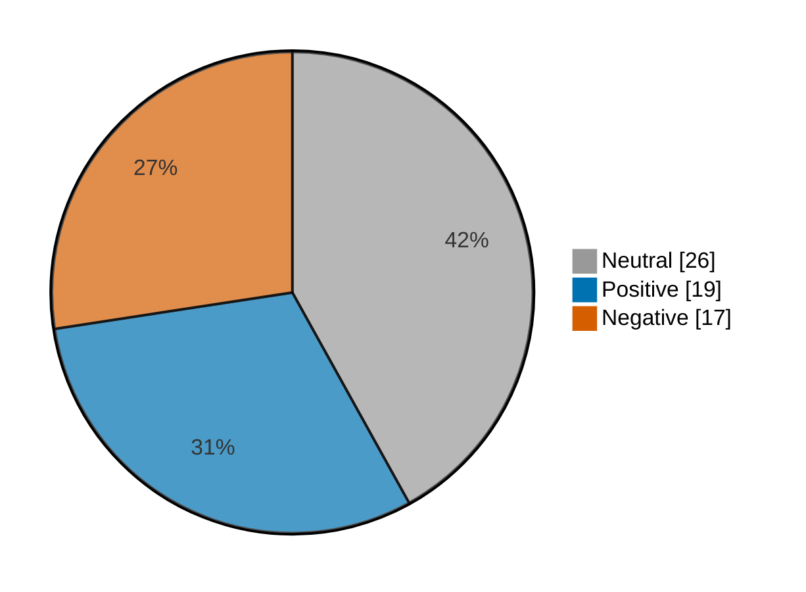

# Newsmood — 2026-11-24

**Mood index: +2.3** (roughly flat) · 62 headlines from 3 sources · model unsure on 7

## Mood at a glance

Negative 17 (27.4%) · Positive 19 (30.6%) · Neutral 26 (41.9%)

## What happened

Financial coverage was roughly flat today (index +2.3, down 10.1 from yesterday) from 62 headlines, with no dominant theme.

**Clusters:** no clear theme today.

_Themes use TF-IDF fit on 1703 headlines (2026-10-25–2026-11-24)._

## Recommended articles (highest model certainty, not most important)

### Negative

- [Colombia stocks lower at close of trade; COLCAP down 0.13%](<https://www.investing.com/news/stock-market-news/colombia-stocks-lower-at-close-of-trade-colcap-down-013-5049077>) · 97% · 3.2% of the day's movement · investing-stocks
- [Russia stocks lower at close of trade; MOEX Russia Index down 2.01%](<https://www.investing.com/news/stock-market-news/russia-stocks-lower-at-close-of-trade-moex-russia-index-down-201-5049047>) · 97% · 3.2% of the day's movement · investing-stocks
- [Canada stocks lower at close of trade; S&P/TSX Composite down 0.35%](<https://www.investing.com/news/stock-market-news/canada-stocks-lower-at-close-of-trade-sptsx-composite-down-035-5049085>) · 96% · 3.2% of the day's movement · investing-stocks

### Positive

- [This bank stock offers 23% upside as PC Financial deal boosts its growth prospects](<https://www.investing.com/news/stock-market-news/this-bank-stock-offers-23-upside-as-pc-financial-deal-boosts-its-growth-prospects-5048802>) · 97% · 3.3% of the day's movement · investing-stocks
- [Mexico stocks higher at close of trade; S&P/BMV IPC up 0.03%](<https://www.investing.com/news/stock-market-news/mexico-stocks-higher-at-close-of-trade-spbmv-ipc-up-003-5049091>) · 97% · 3.3% of the day's movement · investing-stocks
- [Australia stocks higher at close of trade; S&P/ASX 200 up 1.82%](<https://www.investing.com/news/stock-market-news/australia-stocks-higher-at-close-of-trade-spasx-200-up-182-5047056>) · 97% · 3.3% of the day's movement · investing-stocks

### Neutral

- [After-Hours Movers: DELL, HPQ, ADSK, WDAY, NTNX, URBN, CLSK](<https://www.investing.com/news/stock-market-news/afterhours-movers-dell-hpq-adsk-wday-ntnx-urbn-clsk-432SI-5049079>) · 98% · investing-stocks
- [SpaceX, Tesla appoint five directors to guide merger talks, FT reports](<https://www.investing.com/news/stock-market-news/spacex-and-tesla-entrusts-five-directors-for-merger-talks-ft-reports-5047055>) · 98% · investing-stocks

## Sources

| Source | Headlines | Negative | Neutral | Positive |
|---|--:|--:|--:|--:|
| investing-stocks | 40 | 8 | 17 | 15 |
| marketwatch-top | 20 | 8 | 9 | 3 |
| cnbc-finance | 2 | 1 | 0 | 1 |

All 62 headlines

| Sentiment | Certainty | Headline | Source |
|---|--:|---|---|
| negative | 97% | [Colombia stocks lower at close of trade; COLCAP down 0.13%](<https://www.investing.com/news/stock-market-news/colombia-stocks-lower-at-close-of-trade-colcap-down-013-5049077>) | investing-stocks |
| negative | 97% | [Russia stocks lower at close of trade; MOEX Russia Index down 2.01%](<https://www.investing.com/news/stock-market-news/russia-stocks-lower-at-close-of-trade-moex-russia-index-down-201-5049047>) | investing-stocks |
| negative | 96% | [Canada stocks lower at close of trade; S&P/TSX Composite down 0.35%](<https://www.investing.com/news/stock-market-news/canada-stocks-lower-at-close-of-trade-sptsx-composite-down-035-5049085>) | investing-stocks |
| negative | 96% | [Nvidia stock falls nearly 6% after Huang’s return sparks best day in over 23 years](<https://www.investing.com/news/stock-market-news/nvidia-shares-fall-by-6-following-huang-return-rally-5048533>) | investing-stocks |
| negative | 94% | [U.S. chip stocks fall premarket after Nvidia-led rally on Huang’s return](<https://www.investing.com/news/stock-market-news/us-chip-stocks-fall-premarket-after-nvidialed-rally-on-huangs-return-5047723>) | investing-stocks |
| negative | 89% | [This billionaire bought Nvidia in anticipation of Jensen Huang’s return — and warns the S&P 500 could fall by a third](<https://www.marketwatch.com/story/this-billionaire-bought-nvidia-in-anticipation-of-jensen-huangs-return-and-warns-the-s-p-500-could-fall-by-a-third-dcff9489?mod=mw_rss_topstories>) | marketwatch-top |
| negative | 89% | [European shares lower after month-best rally on Nvidia euphoria](<https://www.investing.com/news/stock-market-news/european-shares-pause-after-monthbest-rally-on-nvidia-euphoria-5047076>) | investing-stocks |
| negative | 87% | [Anthropic’s stock just broke below its IPO price for the first time](<https://www.marketwatch.com/story/anthropics-stock-just-broke-below-its-ipo-price-for-the-first-time-5dc82668?mod=mw_rss_topstories>) | marketwatch-top |
| negative | 87% | [Micron’s stock falls as an analyst warns about a future supply glut](<https://www.marketwatch.com/story/microns-stock-falls-as-an-analyst-warns-about-a-future-supply-glut-f7fbeefb?mod=mw_rss_topstories>) | marketwatch-top |
| negative | 82% | [The stock market is hardly cheap, even taking recent declines into account](<https://www.marketwatch.com/story/the-stock-market-is-hardly-cheap-even-taking-recent-declines-into-account-fe0a7989?mod=mw_rss_topstories>) | marketwatch-top |
| negative | 82% | [Utah drops criminal charges against Kalshi founders after company suspended operations in state](<https://www.cnbc.com/2026/11/24/utah-drops-charges-against-kalshi-after-it-halted-operations-in-state.html>) | cnbc-finance |
| negative | 81% | [Nvidia’s stock drops as these major questions loom over Jensen Huang’s return](<https://www.marketwatch.com/story/nvidias-stock-drops-as-these-major-questions-loom-over-jensen-huangs-return-9096636f?mod=mw_rss_topstories>) | marketwatch-top |
| negative | 78% | [Nvidia slips as investors assess risks surrounding Huang’s return as CEO](<https://www.investing.com/news/stock-market-news/nvidia-slips-as-investors-assess-risks-surrounding-huangs-return-as-ceo-5047757>) | investing-stocks |
| negative | 77% | [Dell lifts annual forecasts after record quarter on surging AI server demand](<https://www.investing.com/news/stock-market-news/dell-lifts-annual-forecasts-after-record-quarter-on-surging-ai-server-demand-5049024>) | investing-stocks |
| negative | 74% | [Coming next year: Medicare Advantage plans without drug coverage for almost 640,000 people and fewer choices for the rest](<https://www.marketwatch.com/story/coming-next-year-medicare-advantage-plans-without-drug-coverage-for-almost-640-000-people-and-fewer-choices-for-the-rest-25242d69?mod=mw_rss_topstories>) | marketwatch-top |
| negative | 73% | [Americans don’t like Trump’s tariffs. He’s doubling down anyway — as soon as this week.](<https://www.marketwatch.com/story/americans-dont-like-trumps-tariffs-hes-doubling-down-anyway-as-soon-as-this-week-74c8bed5?mod=mw_rss_topstories>) | marketwatch-top |
| negative | 51% (unsure) | [The AI debt market isn’t convinced the worst is over for investors](<https://www.marketwatch.com/story/the-ai-debt-market-isnt-convinced-the-worst-is-over-for-investors-c70eaede?mod=mw_rss_topstories>) | marketwatch-top |
| positive | 97% | [This bank stock offers 23% upside as PC Financial deal boosts its growth prospects](<https://www.investing.com/news/stock-market-news/this-bank-stock-offers-23-upside-as-pc-financial-deal-boosts-its-growth-prospects-5048802>) | investing-stocks |
| positive | 97% | [Mexico stocks higher at close of trade; S&P/BMV IPC up 0.03%](<https://www.investing.com/news/stock-market-news/mexico-stocks-higher-at-close-of-trade-spbmv-ipc-up-003-5049091>) | investing-stocks |
| positive | 97% | [Australia stocks higher at close of trade; S&P/ASX 200 up 1.82%](<https://www.investing.com/news/stock-market-news/australia-stocks-higher-at-close-of-trade-spasx-200-up-182-5047056>) | investing-stocks |
| positive | 97% | [Dell’s stock rises as the AI boom helps sales more than double](<https://www.marketwatch.com/story/dells-stock-rises-as-the-ai-boom-helps-sales-more-than-double-cfb8cf65?mod=mw_rss_topstories>) | marketwatch-top |
| positive | 96% | [Dollar Tree stock jumps on earnings beat and raised outlook](<https://www.investing.com/news/stock-market-news/dollar-tree-stock-jumps-on-earnings-beat-and-raised-outlook-5047743>) | investing-stocks |
| positive | 96% | [Europe new car registrations rise 3.4% in Oct as EV, hybrids maintain lead- ACEA](<https://www.investing.com/news/stock-market-news/europe-new-car-registrations-rise-34-in-oct-as-ev-hybrids-maintain-lead-acea-5047054>) | investing-stocks |
| positive | 95% | [Trump’s Nvidia holdings may have gained up to $15 mln in Monday rally: FT](<https://www.investing.com/news/stock-market-news/trumps-nvidia-holdings-may-have-gained-up-to-15-mln-in-monday-rally-ft-5047041>) | investing-stocks |
| positive | 94% | [TD Cowen sees nearly 30% upside in this stock on senior housing growth](<https://www.investing.com/news/stock-market-news/td-cowen-sees-nearly-30-upside-in-this-stock-on-senior-housing-growth-5048803>) | investing-stocks |
| positive | 94% | [J.P. Morgan bullish on Elia as German grid returns drive earnings growth](<https://www.investing.com/news/stock-market-news/jp-morgan-bullish-on-elia-as-german-grid-returns-drive-earnings-growth-5047733>) | investing-stocks |
| positive | 93% | [U.S. stock futures tick higher after Nvidia-led Wall Street rally](<https://www.investing.com/news/stock-market-news/us-stock-futures-steady-after-nvidialed-wall-street-rally-5046750>) | investing-stocks |
| positive | 90% | [Possible Tesla merger could aid SpaceX’s S&P 500 entry, ⁠J.P. Morgan says](<https://www.investing.com/news/stock-market-news/possible-tesla-merger-could-aid-spacexs-sp-500-entry-jp-morgan-says-5048726>) | investing-stocks |
| positive | 87% | [Kalshi daily volume of ‘perps’ trading begins to top its prediction markets](<https://www.cnbc.com/2026/11/24/kalshi-perps-volume-prediction-markets.html>) | cnbc-finance |
| positive | 86% | [Gold producer offers 86% upside as Canadian mine deal adds value for its investors](<https://www.investing.com/news/stock-market-news/gold-producer-offers-86-upside-as-canadian-mine-deal-adds-value-for-its-investors-5048800>) | investing-stocks |
| positive | 83% | [These auto stocks are the best-positioned for 2027](<https://www.investing.com/news/stock-market-news/these-auto-stocks-are-the-bestpositioned-for-2027-93CH-5047074>) | investing-stocks |
| positive | 61% | [From horsepower to firepower, Japan draws auto suppliers into major arms buildup](<https://www.investing.com/news/stock-market-news/from-horsepower-to-firepower-japan-draws-auto-suppliers-into-major-arms-buildup-5046991>) | investing-stocks |
| positive | 55% (unsure) | [U.S. stocks mixed at close of trade; Dow Jones Industrial Average up 0.86%](<https://www.investing.com/news/stock-market-news/us-stocks-mixed-at-close-of-trade-dow-jones-industrial-average-up-086-5049102>) | investing-stocks |
| positive | 50% (unsure) | [The ‘epic’ buying of retail investors paid off after Nvidia’s 31% stock surge, says strategist](<https://www.marketwatch.com/story/the-epic-buying-of-retail-investors-paid-off-after-nvidias-31-stock-surge-says-strategist-c8f9a502?mod=mw_rss_topstories>) | marketwatch-top |
| positive | 48% (unsure) | [Analysis-Huang’s Nvidia return sparks relief for battered AI trade, but questions remain](<https://www.investing.com/news/stock-market-news/analysishuangs-stunning-nvidia-return-sparks-relief-for-battered-ai-trade-5046322>) | investing-stocks |
| positive | 36% (unsure) | [How much more are richest Americans spending on the holidays compared to everyone else?](<https://www.marketwatch.com/story/see-how-much-more-money-the-richest-americans-are-spending-on-the-holidays-compared-to-everyone-else-f0ff3f4b?mod=mw_rss_topstories>) | marketwatch-top |
| neutral | 98% | [After-Hours Movers: DELL, HPQ, ADSK, WDAY, NTNX, URBN, CLSK](<https://www.investing.com/news/stock-market-news/afterhours-movers-dell-hpq-adsk-wday-ntnx-urbn-clsk-432SI-5049079>) | investing-stocks |
| neutral | 98% | [SpaceX, Tesla appoint five directors to guide merger talks, FT reports](<https://www.investing.com/news/stock-market-news/spacex-and-tesla-entrusts-five-directors-for-merger-talks-ft-reports-5047055>) | investing-stocks |
| neutral | 98% | [Wonder not pursuing Grubhub sale, The Information says](<https://www.investing.com/news/stock-market-news/wonder-not-pursuing-grubhub-sale-the-information-says-5049199>) | investing-stocks |
| neutral | 98% | [I’m in my 70s and buying a new BMW X1. Should I put my only son on the title?](<https://www.marketwatch.com/story/im-in-my-70s-and-buying-a-new-bmw-x1-should-i-put-my-only-son-on-the-title-25731040?mod=mw_rss_topstories>) | marketwatch-top |
| neutral | 98% | [SpaceX, Tesla directors negotiate potential $3.5 trillion merger, FT reports](<https://www.investing.com/news/stock-market-news/spacex-tesla-directors-negotiate-potential-35-trillion-merger-ft-reports-5047091>) | investing-stocks |
| neutral | 97% | [Zendaya and Tom Holland buy a home on 1 acre in London for $10 million](<https://www.marketwatch.com/story/zendaya-and-tom-holland-buy-a-home-on-1-acre-in-london-for-10-million-a433e7cd?mod=mw_rss_topstories>) | marketwatch-top |
| neutral | 97% | [CFTC staff advisory says crypto can count toward reserves, not liquidity rule](<https://www.investing.com/news/stock-market-news/cftc-staff-advisory-says-crypto-can-count-toward-reserves-not-liquidity-rule-5046749>) | investing-stocks |
| neutral | 97% | [Here’s your chance to bid on Alex Trebek’s former $6.45 million California ranch and winery](<https://www.marketwatch.com/story/heres-your-chance-to-bid-on-alex-trebeks-former-6-45-million-california-ranch-and-winery-0f0cd4f5?mod=mw_rss_topstories>) | marketwatch-top |
| neutral | 96% | [Pentagon in talks with GM, Ford for military drones, WSJ reports](<https://www.investing.com/news/stock-market-news/pentagon-in-talks-with-general-motors-and-ford-on-military-drones-wsj-reports-5047560>) | investing-stocks |
| neutral | 96% | [The biggest biotech deal in nearly three years carries a hefty $41 billion price tag](<https://www.marketwatch.com/story/the-biggest-biotech-deal-in-nearly-three-years-carries-a-hefty-41-billion-price-tag-dd7fa228?mod=mw_rss_topstories>) | marketwatch-top |
| neutral | 96% | [Factbox-Major deals involving US drugmakers and biotechs over the past decade](<https://www.investing.com/news/stock-market-news/factboxmajor-deals-involving-us-drugmakers-and-biotechs-over-the-past-decade-5047693>) | investing-stocks |
| neutral | 96% | [China Southern Airlines unit to buy 50 Boeing 737-8 aircraft at $7.4 billion list price](<https://www.investing.com/news/stock-market-news/china-southern-airlines-unit-to-buy-50-boeing-7378-aircraft-5047529>) | investing-stocks |
| neutral | 95% | [Shein to pay $100 million to settle US claims, FTC official says](<https://www.investing.com/news/stock-market-news/shein-to-pay-100-million-to-settle-us-claims-ftc-official-says-5048743>) | investing-stocks |
| neutral | 95% | [A 10% cap on credit-card interest rates? Holiday shoppers shouldn’t bank on it.](<https://www.marketwatch.com/story/trump-is-open-to-capping-credit-card-interest-rates-but-holiday-shoppers-shouldnt-bank-on-it-yet-34260705?mod=mw_rss_topstories>) | marketwatch-top |
| neutral | 93% | [Premarket movers: Nvidia slips; HPE, Semtech fall](<https://www.investing.com/news/stock-market-news/premarket-movers-nvidia-slips-hpe-semtech-fall-5047572>) | investing-stocks |
| neutral | 93% | [My husband secretly sends his ex-wife $1,500 a month after she lost her job. We have $2.4 million saved. Has he lied by omission?](<https://www.marketwatch.com/story/my-husband-secretly-sends-his-ex-wife-1-500-a-month-after-she-lost-her-job-we-have-2-4-million-saved-has-he-lied-by-omission-ede1972a?mod=mw_rss_topstories>) | marketwatch-top |
| neutral | 91% | [12 days of sardines and Croc charms: Are Advent calendars getting out of control?](<https://www.marketwatch.com/story/12-days-of-sardines-and-croc-charms-are-advent-calendars-getting-out-of-control-81f24548?mod=mw_rss_topstories>) | marketwatch-top |
| neutral | 91% | [Singapore to continue probe of Nvidia-linked chip firm Megaspeed](<https://www.investing.com/news/stock-market-news/singapore-to-continue-probe-of-nvidialinked-chip-firm-megaspeed-93CH-5047053>) | investing-stocks |
| neutral | 90% | [Roth IRA conversions aren’t free money. Watch out for these 5 costly mistakes.](<https://www.marketwatch.com/story/roth-ira-conversions-arent-free-money-watch-out-for-these-5-costly-mistakes-39b182d3?mod=mw_rss_topstories>) | marketwatch-top |
| neutral | 80% | [xAI co-founders launch Epochal to build predictive AI models](<https://www.investing.com/news/stock-market-news/former-xai-cofounders-launch-epochal-to-build-predictive-ai-models-5048830>) | investing-stocks |
| neutral | 79% | [Dollar Tree raises annual profit forecast](<https://www.investing.com/news/stock-market-news/dollar-tree-raises-annual-profit-forecast-5047718>) | investing-stocks |
| neutral | 74% | [Exclusive-Blackstone, Warburg Pincus, Apollo in talks to back GTCR’s $50 billion Global Payments deal, sources say](<https://www.investing.com/news/stock-market-news/exclusiveblackstone-warburg-pincus-apollo-in-talks-to-back-gtcrs-50-billion-global-payments-deal-sources-say-5048817>) | investing-stocks |
| neutral | 72% | [Elon Musk asks US appeals court to throw out Twitter fraud verdict](<https://www.investing.com/news/stock-market-news/elon-musk-asks-us-appeals-court-to-throw-out-twitter-fraud-verdict-5048808>) | investing-stocks |
| neutral | 66% | [MSCI denies softer stance on Indonesia’s market status, review ongoing](<https://www.investing.com/news/stock-market-news/msci-says-no-decision-made-on-indonesia-market-downgrade-proposal-5046965>) | investing-stocks |
| neutral | 57% (unsure) | [The bull and bear surprises that could ambush investors next year, according to Bank of America](<https://www.marketwatch.com/story/the-bull-and-bear-surprises-that-could-ambush-investors-next-year-according-to-bank-of-america-1cf7dc26?mod=mw_rss_topstories>) | marketwatch-top |
| neutral | 53% (unsure) | [Braemar Hotels stock jumps on 2027 dividend plan, $20M buyback](<https://www.investing.com/news/stock-market-news/braemar-hotels-stock-jumps-on-2027-dividend-plan-20m-buyback-5049171>) | investing-stocks |

---

Certainty is the model's confidence in its label; below 60% it is marked unsure.

"Of the day's movement" is a headline's certainty over the sum of every non-neutral headline's certainty: its part in moving the index. Neutral headlines move it by 0.

Links go to the original publisher; some limit free articles.

Model: kkrit-tinna/newsmood-distilbert-financial@be7b809e0d8f7bd50e77d902aee199363b7e2a66 · Gates: 2/2 passed · Not financial advice.
