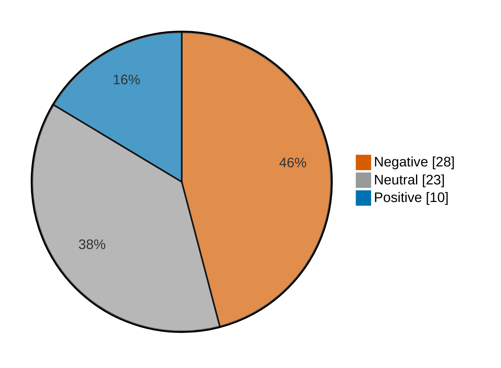

# Newsmood — 2026-11-25

**Mood index: -31.2** (moderately negative) · 61 headlines from 3 sources · model unsure on 16

## Mood at a glance

Negative 28 (45.9%) · Positive 10 (16.4%) · Neutral 23 (37.7%)

## What happened

Financial coverage leaned moderately negative today (index -31.2, 38.3 lower than yesterday) from 61 headlines, with no dominant theme.

**Clusters:**

- 6 headlines on surging today, stock surging, surging: 3 negative, 3 neutral · -5.4% of the day's movement

_Themes use TF-IDF fit on 1764 headlines (2026-10-26–2026-11-25)._

## Recommended articles (highest model certainty, not most important)

### Negative

- [Italy stocks lower at close of trade; Investing.com Italy 40 down 1.81%](<https://www.investing.com/news/stock-market-news/italy-stocks-lower-at-close-of-trade-investingcom-italy-40-down-181-5051277>) · 97% · 3.3% of the day's movement · investing-stocks
- [Spain stocks lower at close of trade; IBEX 35 down 2.00%](<https://www.investing.com/news/stock-market-news/spain-stocks-lower-at-close-of-trade-ibex-35-down-200-5051282>) · 97% · 3.3% of the day's movement · investing-stocks
- [U.K. stocks lower at close of trade; Investing.com United Kingdom 100 down 0.43%](<https://www.investing.com/news/stock-market-news/uk-stocks-lower-at-close-of-trade-investingcom-united-kingdom-100-down-043-5051283>) · 97% · 3.3% of the day's movement · investing-stocks

### Positive

- [Mexico stocks higher at close of trade; S&P/BMV IPC up 3.06%](<https://www.investing.com/news/stock-market-news/mexico-stocks-higher-at-close-of-trade-spbmv-ipc-up-306-5051513>) · 97% · 3.3% of the day's movement · investing-stocks
- [SpaceX wins landmark FCC backing for 1 million-satellite data center constellation](<https://www.investing.com/news/stock-market-news/spacex-wins-landmark-fcc-backing-for-1-millionsatellite-data-center-constellation-5051292>) · 96% · 3.2% of the day's movement · investing-stocks
- [Nvidia’s stock has given back more than half of Monday’s rally as dip buyers cash in](<https://www.marketwatch.com/story/nvidias-stock-is-giving-back-more-than-half-of-mondays-rally-as-dip-buyers-cash-in-ee4fa52c?mod=mw_rss_topstories>) · 94% · 3.2% of the day's movement · marketwatch-top

### Neutral

- [NBA star Kevin Durant lists Arizona mansion for $13.9 million, a year after trade to Houston](<https://www.marketwatch.com/story/nba-star-kevin-durant-lists-arizona-mansion-for-13-9-million-a-year-after-trade-to-houston-1b0ae57e?mod=mw_rss_topstories>) · 97% · marketwatch-top
- [How to spot ‘bogus boutiques’ and other Black Friday shopping scams](<https://www.marketwatch.com/story/how-to-spot-bogus-boutiques-and-other-black-friday-shopping-scams-86cc182d?mod=mw_rss_topstories>) · 97% · marketwatch-top

## Sources

| Source | Headlines | Negative | Neutral | Positive |
|---|--:|--:|--:|--:|
| investing-stocks | 39 | 22 | 12 | 5 |
| marketwatch-top | 20 | 6 | 10 | 4 |
| cnbc-finance | 2 | 0 | 1 | 1 |

All 61 headlines

| Sentiment | Certainty | Headline | Source |
|---|--:|---|---|
| negative | 97% | [Italy stocks lower at close of trade; Investing.com Italy 40 down 1.81%](<https://www.investing.com/news/stock-market-news/italy-stocks-lower-at-close-of-trade-investingcom-italy-40-down-181-5051277>) | investing-stocks |
| negative | 97% | [Spain stocks lower at close of trade; IBEX 35 down 2.00%](<https://www.investing.com/news/stock-market-news/spain-stocks-lower-at-close-of-trade-ibex-35-down-200-5051282>) | investing-stocks |
| negative | 97% | [U.K. stocks lower at close of trade; Investing.com United Kingdom 100 down 0.43%](<https://www.investing.com/news/stock-market-news/uk-stocks-lower-at-close-of-trade-investingcom-united-kingdom-100-down-043-5051283>) | investing-stocks |
| negative | 97% | [Netherlands stocks lower at close of trade; AEX down 1.30%](<https://www.investing.com/news/stock-market-news/netherlands-stocks-lower-at-close-of-trade-aex-down-130-5051279>) | investing-stocks |
| negative | 97% | [Portugal stocks lower at close of trade; PSI down 0.85%](<https://www.investing.com/news/stock-market-news/portugal-stocks-lower-at-close-of-trade-psi-down-085-5051280>) | investing-stocks |
| negative | 97% | [Australia stocks lower at close of trade; S&P/ASX 200 down 0.39%](<https://www.investing.com/news/stock-market-news/australia-stocks-lower-at-close-of-trade-spasx-200-down-039-5049741>) | investing-stocks |
| negative | 95% | [FTSE 100 today: Stocks fall as U.S. tech stocks dent sentiment](<https://www.investing.com/news/stock-market-news/ftse-100-today-stocks-rise-as-consumer-shares-lead-us-pce-awaited-5049957>) | investing-stocks |
| negative | 95% | [Deere forecasts fiscal 2027 net income below estimates amid muted farm equipment demand](<https://www.investing.com/news/stock-market-news/deere-forecasts-fiscal-2027-net-income-below-estimates-5050370>) | investing-stocks |
| negative | 95% | [Vertex shares drop 7.5% as FDA extends review for kidney drug povetacicept](<https://www.investing.com/news/stock-market-news/vertex-shares-drop-75-as-fda-extends-review-for-kidney-drug-povetacicept-5051552>) | investing-stocks |
| negative | 95% | [The latest stock-market drop could lower your tax bill over your lifetime](<https://www.marketwatch.com/story/the-latest-stock-market-drop-could-lower-your-tax-bill-over-your-lifetime-99420b97?mod=mw_rss_topstories>) | marketwatch-top |
| negative | 95% | [Europe stocks drop as autos, pharma gain, chipmakers drag](<https://www.investing.com/news/stock-market-news/europe-stocks-climb-as-autos-luxury-rally-eyes-on-us-pce-fed-hike-bets-5049961>) | investing-stocks |
| negative | 94% | [Oracle’s stock sinks toward a 3-year low as the AI trade continues to unravel](<https://www.marketwatch.com/story/oracles-stock-sinks-toward-a-3-year-low-as-the-ai-trade-continues-to-unravel-d4698d77?mod=mw_rss_topstories>) | marketwatch-top |
| negative | 93% | [In olive branch to banks, Italy plans to drop curbs on home renovation tax credits](<https://www.investing.com/news/stock-market-news/in-olive-branch-to-banks-italy-plans-to-drop-curbs-on-home-renovation-tax-credits-5051276>) | investing-stocks |
| negative | 88% | [‘My life is in the stock market’: Recent volatility is shaking up holiday spending plans for these shoppers](<https://www.marketwatch.com/story/my-life-is-in-the-stock-market-recent-volatility-is-shaking-up-holiday-spending-plans-for-these-shoppers-bd9485b3?mod=mw_rss_topstories>) | marketwatch-top |
| negative | 87% | [Why is Taiwan Weighted stock plunging today?](<https://www.investing.com/news/stock-market-news/why-is-taiwan-weighted-stock-plunging-today-93CH-5049730>) | investing-stocks |
| negative | 83% | [New-home sales just hit a 2026 high as builders dangle low mortgages and Black Friday deals](<https://www.marketwatch.com/story/new-home-sales-just-hit-a-2026-high-as-builders-dangle-low-mortgages-and-black-friday-deals-291a3b62?mod=mw_rss_topstories>) | marketwatch-top |
| negative | 73% | [Why is Vertex Pharmaceuticals stock sliding today?](<https://www.investing.com/news/stock-market-news/why-is-vertex-pharmaceuticals-stock-sliding-today-93CH-5051579>) | investing-stocks |
| negative | 67% | [Inflation gets worse. Now the Fed has no choice but to raise U.S. interest rates.](<https://www.marketwatch.com/story/inflation-gets-worse-now-the-fed-no-choice-but-to-raise-u-s-interest-rates-8b0c2c1f?mod=mw_rss_topstories>) | marketwatch-top |
| negative | 66% | [Macy’s Thanksgiving Day Parade in New York City postponed due to storm projections](<https://www.investing.com/news/stock-market-news/macys-thanksgiving-day-parade-postponed-due-to-storm-projections-us-media-reports-5051483>) | investing-stocks |
| negative | 66% | [Malaysia regulator files lawsuits against Google seeking $146 million over ’harmful’ content](<https://www.investing.com/news/stock-market-news/malaysia-regulator-files-lawsuits-against-google-seeking-146-million-over-harmful-content-5049766>) | investing-stocks |
| negative | 65% | [The S&P 500 is headed to 8,200 — and downturns like this one are actually part of the reason, says JPMorgan](<https://www.marketwatch.com/story/the-s-p-500-is-headed-to-8-200-and-downturns-like-this-one-are-actually-part-of-the-reason-why-says-jpmorgan-b6acae4b?mod=mw_rss_topstories>) | marketwatch-top |
| negative | 60% | [Why is Renault stock surging today?](<https://www.investing.com/news/stock-market-news/why-is-renault-stock-surging-today-93CH-5050385>) | investing-stocks |
| negative | 57% (unsure) | [Why is Palo Alto Networks stock sliding today?](<https://www.investing.com/news/stock-market-news/why-is-palo-alto-networks-stock-sliding-today-93CH-5051576>) | investing-stocks |
| negative | 54% (unsure) | [Wall Street cuts losses after brutal rout, but mood glum heading into Thanksgiving](<https://www.investing.com/news/stock-market-news/wall-st-futures-fall-after-sp-500-nasdaq-end-lower-inflation-data-eyed-5049469>) | investing-stocks |
| negative | 54% (unsure) | [Trump’s newest order curtailing birthright citizenship is blocked by second judge](<https://www.investing.com/news/stock-market-news/trumps-newest-order-curtailing-birthright-citizenship-is-blocked-by-second-judge-5051543>) | investing-stocks |
| negative | 54% (unsure) | [Why is Targa Resources stock sliding today?](<https://www.investing.com/news/stock-market-news/why-is-targa-resources-stock-sliding-today-93CH-5051574>) | investing-stocks |
| negative | 53% (unsure) | [Why is Vera Therapeutics stock surging today?](<https://www.investing.com/news/stock-market-news/why-is-vera-therapeutics-stock-surging-today-93CH-5051578>) | investing-stocks |
| negative | 49% (unsure) | [Why is Volkswagen stock surging today?](<https://www.investing.com/news/stock-market-news/why-is-volkswagen-stock-surging-today-93CH-5050378>) | investing-stocks |
| positive | 97% | [Mexico stocks higher at close of trade; S&P/BMV IPC up 3.06%](<https://www.investing.com/news/stock-market-news/mexico-stocks-higher-at-close-of-trade-spbmv-ipc-up-306-5051513>) | investing-stocks |
| positive | 96% | [SpaceX wins landmark FCC backing for 1 million-satellite data center constellation](<https://www.investing.com/news/stock-market-news/spacex-wins-landmark-fcc-backing-for-1-millionsatellite-data-center-constellation-5051292>) | investing-stocks |
| positive | 94% | [Nvidia’s stock has given back more than half of Monday’s rally as dip buyers cash in](<https://www.marketwatch.com/story/nvidias-stock-is-giving-back-more-than-half-of-mondays-rally-as-dip-buyers-cash-in-ee4fa52c?mod=mw_rss_topstories>) | marketwatch-top |
| positive | 83% | [HP’s stock is a standout gainer in the tech rout, as an earnings beat still matters](<https://www.marketwatch.com/story/hps-stock-is-a-standout-gainer-in-the-tech-rout-as-an-earnings-beat-still-matters-8f6c76ad?mod=mw_rss_topstories>) | marketwatch-top |
| positive | 78% | [The Fed says inflation hasn’t gotten any better ahead of its key December vote to raise rates](<https://www.marketwatch.com/story/the-fed-says-inflation-hasnt-gotten-any-better-ahead-of-its-key-december-vote-to-raise-rates-65024d33?mod=mw_rss_topstories>) | marketwatch-top |
| positive | 66% | [US grocers serve up Thanksgiving deals even as turkey prices climb](<https://www.investing.com/news/stock-market-news/us-grocers-serve-up-thanksgiving-deals-even-as-turkey-prices-climb-5050352>) | investing-stocks |
| positive | 65% | [How one Wall St. strategist predicted the S&P 500’s wild 2-week swing](<https://www.investing.com/news/stock-market-news/how-one-wall-st-strategist-predicted-the-sp-500s-wild-2week-swing-5050391>) | investing-stocks |
| positive | 59% (unsure) | [Prediction markets push OpenAI IPO expectations later into 2027](<https://www.cnbc.com/2026/11/25/openai-ipo-odds-2027-prediction-markets.html>) | cnbc-finance |
| positive | 57% (unsure) | [This strategist’s bond-trading model is outperforming by a wide margin. The Fed slowing the economy is a good thing, he argues](<https://www.marketwatch.com/story/this-strategists-bond-trading-model-is-outperforming-by-a-wide-margin-the-fed-slowing-the-economy-is-a-good-thing-he-argues-f39dfc5f?mod=mw_rss_topstories>) | marketwatch-top |
| positive | 54% (unsure) | [U.S. stocks mixed at close of trade; Dow Jones Industrial Average up 0.33%](<https://www.investing.com/news/stock-market-news/us-stocks-mixed-at-close-of-trade-dow-jones-industrial-average-up-033-5051523>) | investing-stocks |
| neutral | 97% | [NBA star Kevin Durant lists Arizona mansion for $13.9 million, a year after trade to Houston](<https://www.marketwatch.com/story/nba-star-kevin-durant-lists-arizona-mansion-for-13-9-million-a-year-after-trade-to-houston-1b0ae57e?mod=mw_rss_topstories>) | marketwatch-top |
| neutral | 97% | [How to spot ‘bogus boutiques’ and other Black Friday shopping scams](<https://www.marketwatch.com/story/how-to-spot-bogus-boutiques-and-other-black-friday-shopping-scams-86cc182d?mod=mw_rss_topstories>) | marketwatch-top |
| neutral | 97% | [Why macro investor Raoul Pal says the dollar is the signal to watch for stocks and crypto](<https://www.marketwatch.com/story/why-macro-investor-raoul-pal-says-the-dollar-is-the-signal-to-watch-for-stocks-and-crypto-d36f3c49?mod=mw_rss_topstories>) | marketwatch-top |
| neutral | 95% | [Why is Mercedes-Benz stock rallying today?](<https://www.investing.com/news/stock-market-news/why-is-mercedesbenz-stock-rallying-today-93CH-5050379>) | investing-stocks |
| neutral | 94% | [Liesman: Nvidia whiplash tests Kevin Warsh’s push to read market signals](<https://www.cnbc.com/2026/11/25/nvidia-kevin-warsh-fed-market-signals.html>) | cnbc-finance |
| neutral | 94% | [Why is Ferrari stock rallying today?](<https://www.investing.com/news/stock-market-news/why-is-ferrari-stock-rallying-today-93CH-5050388>) | investing-stocks |
| neutral | 91% | [How soon Trump’s new tariffs could hit the economy — and your wallet](<https://www.marketwatch.com/story/u-s-proposes-fresh-tariffs-on-china-others-as-trump-doubles-down-on-his-favorite-trade-weapon-cd9a1df9?mod=mw_rss_topstories>) | marketwatch-top |
| neutral | 90% | [I hate that Jensen Huang is back at Nvidia, but I love what it’s done for my 401(k). Am I a hypocrite?](<https://www.marketwatch.com/story/i-hate-that-jensen-huang-is-back-at-nvidia-but-i-love-what-its-done-for-my-401-k-am-i-a-hypocrite-f63c0303?mod=mw_rss_topstories>) | marketwatch-top |
| neutral | 89% | [Why is Volvo stock climbing today?](<https://www.investing.com/news/stock-market-news/why-is-volvo-stock-climbing-today-93CH-5050382>) | investing-stocks |
| neutral | 89% | [We are living in perilous times if Nvidia’s Jensen Huang dictates your 401(k) balance](<https://www.marketwatch.com/story/we-are-living-in-perilous-times-if-nvidias-jensen-huang-dictates-your-401-k-balance-e0942d1e?mod=mw_rss_topstories>) | marketwatch-top |
| neutral | 89% | [Kylie Jenner again relists concrete mansion in L.A. for $38 million](<https://www.marketwatch.com/story/kylie-jenner-again-relists-concrete-mansion-in-l-a-for-38-million-2e5143e5?mod=mw_rss_topstories>) | marketwatch-top |
| neutral | 85% | [Why is Harvey Norman stock sliding today?](<https://www.investing.com/news/stock-market-news/why-is-harvey-norman-stock-sliding-today-93CH-5049731>) | investing-stocks |
| neutral | 84% | [Malaysia Airlines parent orders 10 Boeing 787s to replace older Airbus jets](<https://www.investing.com/news/stock-market-news/malaysia-airlines-parent-to-buy-10-boeing-787dreamliners-ceo-says-5049604>) | investing-stocks |
| neutral | 77% | [Elon Musk and SpaceX to donate roughly $17.8 billion to ‘Trump accounts’](<https://www.marketwatch.com/story/elon-musk-and-spacex-to-donate-roughly-17-8-billion-to-trump-accounts-071c12e1?mod=mw_rss_topstories>) | marketwatch-top |
| neutral | 63% | [Malaysia’s MCMC sues Google for RM300mil over YouTube content](<https://www.investing.com/news/stock-market-news/malaysias-mcmc-sues-google-for-rm300mil-over-youtube-content-93CH-5049771>) | investing-stocks |
| neutral | 62% | [Nvidia is heading for its first ‘death cross’ since March 2025 as stock continues to struggle](<https://www.marketwatch.com/story/nvidia-is-heading-for-its-first-death-cross-since-march-2025-as-stock-continues-to-struggle-a611b99c?mod=mw_rss_topstories>) | marketwatch-top |
| neutral | 56% (unsure) | [Why is Bayerische Motoren Werke stock surging today?](<https://www.investing.com/news/stock-market-news/why-is-bayerische-motoren-werke-stock-surging-today-93CH-5050381>) | investing-stocks |
| neutral | 55% (unsure) | [Why is Advantest stock plunging today?](<https://www.investing.com/news/stock-market-news/why-is-advantest-stock-plunging-today-93CH-5049726>) | investing-stocks |
| neutral | 52% (unsure) | [AI credit default swap spreads widen on unease over cash flow](<https://www.investing.com/news/stock-market-news/ai-credit-default-swap-spreads-widen-on-unease-over-cash-flow-5049729>) | investing-stocks |
| neutral | 52% (unsure) | [Why this stock-market selloff is probably going to get worse before it gets better](<https://www.marketwatch.com/story/why-this-stock-market-selloff-is-probably-going-to-get-worse-before-it-gets-better-fce63a89?mod=mw_rss_topstories>) | marketwatch-top |
| neutral | 49% (unsure) | [Why is Kinetik Holdings stock surging today?](<https://www.investing.com/news/stock-market-news/why-is-kinetik-holdings-stock-surging-today-93CH-5051573>) | investing-stocks |
| neutral | 48% (unsure) | [Why is Stellantis stock surging today?](<https://www.investing.com/news/stock-market-news/why-is-stellantis-stock-surging-today-93CH-5050392>) | investing-stocks |
| neutral | 47% (unsure) | [Why is Bilibili stock surging today?](<https://www.investing.com/news/stock-market-news/why-is-bilibili-stock-surging-today-93CH-5049728>) | investing-stocks |

---

Certainty is the model's confidence in its label; below 60% it is marked unsure.

"Of the day's movement" is a headline's certainty over the sum of every non-neutral headline's certainty: its part in moving the index. Neutral headlines move it by 0.

Links go to the original publisher; some limit free articles.

Model: kkrit-tinna/newsmood-distilbert-financial@be7b809e0d8f7bd50e77d902aee199363b7e2a66 · Gates: 2/2 passed · Not financial advice.
