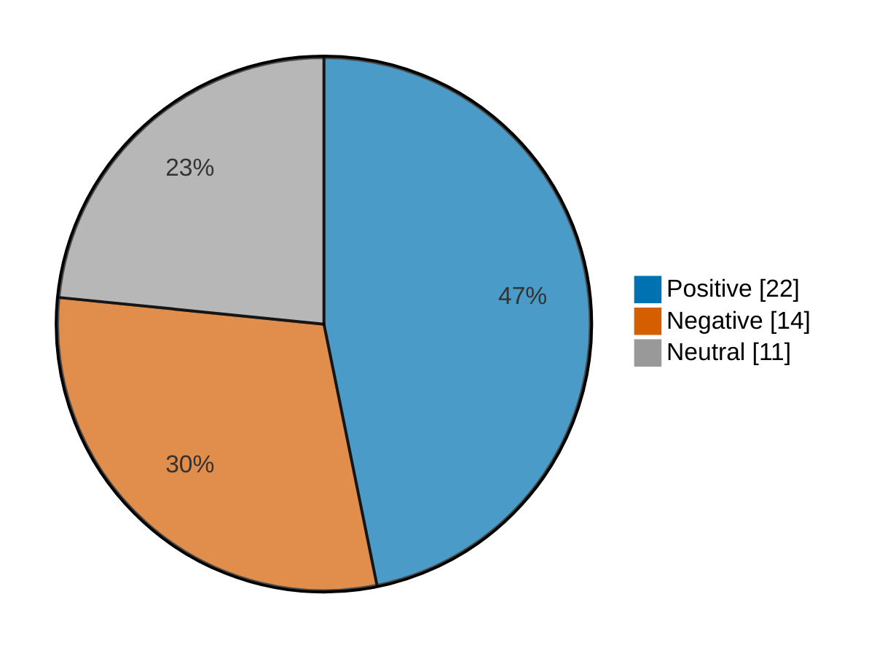

# Newsmood — 2026-11-26

**Mood index: +19.0** (moderately positive) · 47 headlines from 3 sources · model unsure on 3

_Data notes: 81% of headlines from investing-stocks._

## Mood at a glance

Negative 14 (29.8%) · Positive 22 (46.8%) · Neutral 11 (23.4%)

## What happened

Financial news leaned moderately positive today (index +19.0, up 46.4 from yesterday) over 47 headlines, with 7 headlines on higher close, stocks higher and higher doing most of the work.

**Clusters:**

- 7 headlines on higher close, stocks higher, higher: 7 positive · +21.1% of the day's movement
- 3 headlines on surging today, stock surging, surging: 1 negative, 2 neutral · -1.7% of the day's movement

_Themes use TF-IDF fit on 1773 headlines (2026-10-27–2026-11-26)._

## Recommended articles (highest model certainty, not most important)

### Negative

- [Russia stocks lower at close of trade; MOEX Russia Index down 0.80%](<https://www.investing.com/news/stock-market-news/russia-stocks-lower-at-close-of-trade-moex-russia-index-down-080-5052722>) · 97% · 3.0% of the day's movement · investing-stocks
- [Mexico stocks lower at close of trade; S&P/BMV IPC down 1.33%](<https://www.investing.com/news/stock-market-news/mexico-stocks-lower-at-close-of-trade-spbmv-ipc-down-133-5052726>) · 97% · 3.0% of the day's movement · investing-stocks
- [US chip curbs will slow Asia data-center investment, Fitch says](<https://www.investing.com/news/stock-market-news/us-chip-curbs-will-slow-asia-datacenter-investment-fitch-says-5052417>) · 96% · 3.0% of the day's movement · investing-stocks

### Positive

- [Canada stocks higher at close of trade; S&P/TSX Composite up 0.72%](<https://www.investing.com/news/stock-market-news/canada-stocks-higher-at-close-of-trade-sptsx-composite-up-072-5052724>) · 97% · 3.0% of the day's movement · investing-stocks
- [Netherlands stocks higher at close of trade; AEX up 1.86%](<https://www.investing.com/news/stock-market-news/netherlands-stocks-higher-at-close-of-trade-aex-up-186-5052641>) · 97% · 3.0% of the day's movement · investing-stocks
- [Brazil stocks higher at close of trade; Bovespa up 4.30%](<https://www.investing.com/news/stock-market-news/brazil-stocks-higher-at-close-of-trade-bovespa-up-430-5052714>) · 97% · 3.0% of the day's movement · investing-stocks

### Neutral

- [Musk says every U.S. child will receive two SpaceX shares](<https://www.investing.com/news/stock-market-news/musk-says-every-us-child-will-receive-two-spacex-shares-5052023>) · 98% · investing-stocks
- [Semiconductor chips are the new oil. Here's why](<https://www.cnbc.com/2026/11/26/semiconductor-chips-are-the-new-oil-heres-why.html>) · 98% · cnbc-finance

## Sources

| Source | Headlines | Negative | Neutral | Positive |
|---|--:|--:|--:|--:|
| investing-stocks | 38 | 12 | 6 | 20 |
| marketwatch-top | 5 | 1 | 3 | 1 |
| cnbc-finance | 4 | 1 | 2 | 1 |

All 47 headlines

| Sentiment | Certainty | Headline | Source |
|---|--:|---|---|
| negative | 97% | [Russia stocks lower at close of trade; MOEX Russia Index down 0.80%](<https://www.investing.com/news/stock-market-news/russia-stocks-lower-at-close-of-trade-moex-russia-index-down-080-5052722>) | investing-stocks |
| negative | 97% | [Mexico stocks lower at close of trade; S&P/BMV IPC down 1.33%](<https://www.investing.com/news/stock-market-news/mexico-stocks-lower-at-close-of-trade-spbmv-ipc-down-133-5052726>) | investing-stocks |
| negative | 96% | [US chip curbs will slow Asia data-center investment, Fitch says](<https://www.investing.com/news/stock-market-news/us-chip-curbs-will-slow-asia-datacenter-investment-fitch-says-5052417>) | investing-stocks |
| negative | 94% | [Barclays downgrades European forklift makers as Chinese imports jump 51% in Q3](<https://www.investing.com/news/stock-market-news/barclays-downgrades-european-forklift-makers-as-chinese-imports-jump-51-in-q3-5052419>) | investing-stocks |
| negative | 94% | [Bitcoin technical outlook: bear trend with oversold signals near $61,000](<https://www.investing.com/news/stock-market-news/bitcoin-technical-outlook-bear-trend-with-oversold-signals-near-61000-93CH-5052026>) | investing-stocks |
| negative | 88% | [Buyer beware? Nvidia's volatile swings expose risks of single-stock ETFs](<https://www.cnbc.com/2026/11/26/nvidias-volatile-swings-expose-risks-of-single-stock-etfs.html>) | cnbc-finance |
| negative | 88% | [The tech rout should bottom soon, with a 25% rally for the S&P 500 to follow, says Deutsche Bank](<https://www.marketwatch.com/story/the-tech-rout-should-bottom-soon-with-a-25-rally-for-the-s-p-500-to-follow-says-deutsche-bank-c9070bf6?mod=mw_rss_topstories>) | marketwatch-top |
| negative | 87% | [Micron faces Taiwan uncertainty as labor dispute threatens expansion, report warns](<https://www.investing.com/news/stock-market-news/micron-faces-taiwan-uncertainty-as-labor-dispute-threatens-expansion-report-warns-5052030>) | investing-stocks |
| negative | 85% | [Mexico urges Asian trade partners to crack down on tariff dodging](<https://www.investing.com/news/stock-market-news/mexico-urges-asian-trade-partners-to-crack-down-on-tariff-dodging-5052646>) | investing-stocks |
| negative | 85% | [Dutch minister says US chip curbs bill would hurt Europe](<https://www.investing.com/news/stock-market-news/dutch-minister-says-us-chip-curbs-bill-would-hurt-europe-5052431>) | investing-stocks |
| negative | 85% | [Apple pulls MiniMax AI chatbot from App Store over child safety concerns](<https://www.investing.com/news/stock-market-news/apple-pulls-minimax-ai-chatbot-from-app-store-over-child-safety-concerns-5052028>) | investing-stocks |
| negative | 82% | [Canadian bonds extend rally amid AI jitters, Macklem comments](<https://www.investing.com/news/stock-market-news/canadian-bonds-extend-rally-amid-ai-jitters-macklem-comments-5052727>) | investing-stocks |
| negative | 79% | [Stocks rally in Asia, US tariffs not as dire as feared](<https://www.investing.com/news/stock-market-news/asia-shares-bounce-ai-and-tariffs-lurk-in-background-5051871>) | investing-stocks |
| negative | 54% (unsure) | [Why is Kioxia stock surging today?](<https://www.investing.com/news/stock-market-news/why-is-kioxia-stock-surging-today-93CH-5052031>) | investing-stocks |
| positive | 97% | [Canada stocks higher at close of trade; S&P/TSX Composite up 0.72%](<https://www.investing.com/news/stock-market-news/canada-stocks-higher-at-close-of-trade-sptsx-composite-up-072-5052724>) | investing-stocks |
| positive | 97% | [Netherlands stocks higher at close of trade; AEX up 1.86%](<https://www.investing.com/news/stock-market-news/netherlands-stocks-higher-at-close-of-trade-aex-up-186-5052641>) | investing-stocks |
| positive | 97% | [Brazil stocks higher at close of trade; Bovespa up 4.30%](<https://www.investing.com/news/stock-market-news/brazil-stocks-higher-at-close-of-trade-bovespa-up-430-5052714>) | investing-stocks |
| positive | 97% | [U.K. stocks higher at close of trade; Investing.com United Kingdom 100 up 1.88%](<https://www.investing.com/news/stock-market-news/uk-stocks-higher-at-close-of-trade-investingcom-united-kingdom-100-up-188-5052644>) | investing-stocks |
| positive | 97% | [Spain stocks higher at close of trade; IBEX 35 up 2.35%](<https://www.investing.com/news/stock-market-news/spain-stocks-higher-at-close-of-trade-ibex-35-up-235-5052643>) | investing-stocks |
| positive | 97% | [Australia stocks higher at close of trade; S&P/ASX 200 up 0.82%](<https://www.investing.com/news/stock-market-news/australia-stocks-higher-at-close-of-trade-spasx-200-up-082-5052032>) | investing-stocks |
| positive | 97% | [Portugal stocks higher at close of trade; PSI up 1.33%](<https://www.investing.com/news/stock-market-news/portugal-stocks-higher-at-close-of-trade-psi-up-133-5052642>) | investing-stocks |
| positive | 97% | [Colombia stocks higher at close of trade; COLCAP up 0.97%](<https://www.investing.com/news/stock-market-news/colombia-stocks-higher-at-close-of-trade-colcap-up-097-5052723>) | investing-stocks |
| positive | 97% | [France stocks higher at close of trade; CAC 40 up 1.61%](<https://www.investing.com/news/stock-market-news/france-stocks-higher-at-close-of-trade-cac-40-up-161-5052638>) | investing-stocks |
| positive | 97% | [India stocks higher at close of trade; Nifty 50 up 0.25%](<https://www.investing.com/news/stock-market-news/india-stocks-higher-at-close-of-trade-nifty-50-up-025-5052374>) | investing-stocks |
| positive | 97% | [Germany stocks higher at close of trade; DAX up 2.14%](<https://www.investing.com/news/stock-market-news/germany-stocks-higher-at-close-of-trade-dax-up-214-5052639>) | investing-stocks |
| positive | 96% | [Italy stocks higher at close of trade; Investing.com Italy 40 up 2.47%](<https://www.investing.com/news/stock-market-news/italy-stocks-higher-at-close-of-trade-investingcom-italy-40-up-247-5052640>) | investing-stocks |
| positive | 96% | [Belgium stocks higher at close of trade; BEL 20 up 1.57%](<https://www.investing.com/news/stock-market-news/belgium-stocks-higher-at-close-of-trade-bel-20-up-157-5052637>) | investing-stocks |
| positive | 96% | [Text Group stock jumps 17% on strong Q2 profit results](<https://www.investing.com/news/stock-market-news/text-group-stock-jumps-17-on-strong-q2-profit-results-93CH-5052355>) | investing-stocks |
| positive | 96% | [Futures point to Black Friday gains for Wall Street as global markets welcome U.S. resilience.](<https://www.marketwatch.com/story/futures-point-to-black-friday-gains-for-wall-street-as-global-markets-welcome-u-s-resilience-ad6bcef2?mod=mw_rss_topstories>) | marketwatch-top |
| positive | 94% | [US malls make a holiday comeback as shoppers seek more than deals](<https://www.investing.com/news/stock-market-news/us-malls-make-a-holiday-comeback-as-shoppers-seek-more-than-deals-5052721>) | investing-stocks |
| positive | 93% | [European shares rise as benign U.S. tariffs and Thanksgiving lull offer relief](<https://www.investing.com/news/stock-market-news/european-shares-as-benign-us-tariffs-and-thanksgiving-lull-offer-relief-5052089>) | investing-stocks |
| positive | 93% | [Beware higher correlation but nab high U.S. credit yields, fund managers say](<https://www.cnbc.com/2026/11/26/mispricing-risk-fund-managers-ai-volatility.html>) | cnbc-finance |
| positive | 89% | [TSX ends higher after whipsaw session, helped by battery metal stocks & labor data](<https://www.investing.com/news/stock-market-news/canadas-tsx-futures-flat-in-holidaythinned-trade--and-macklems-warning-5052325>) | investing-stocks |
| positive | 65% | [Why did Fisher & Paykel Healthcare shares hit a record high today?](<https://www.investing.com/news/stock-market-news/why-did-fisher--paykel-healthcare-shares-hit-a-record-high-today-93CH-5052038>) | investing-stocks |
| positive | 59% (unsure) | [Asian stocks rally as Taiwan, South Korea rebound; Nvidia risks linger](<https://www.investing.com/news/stock-market-news/asian-stocks-rally-as-taiwan-south-korea-rebound-nvidia-risks-linger-5052021>) | investing-stocks |
| positive | 57% (unsure) | [UK miners rise as copper rebounds from 11-month low](<https://www.investing.com/news/stock-market-news/uk-miners-rise-as-copper-rebounds-from-11month-low-5052372>) | investing-stocks |
| neutral | 98% | [Musk says every U.S. child will receive two SpaceX shares](<https://www.investing.com/news/stock-market-news/musk-says-every-us-child-will-receive-two-spacex-shares-5052023>) | investing-stocks |
| neutral | 98% | [Semiconductor chips are the new oil. Here's why](<https://www.cnbc.com/2026/11/26/semiconductor-chips-are-the-new-oil-heres-why.html>) | cnbc-finance |
| neutral | 97% | [FINAL HOUR: Your last chance to get 60% off InvestingPro BEFORE BLACK FRIDAY ENDS](<https://www.investing.com/news/stock-market-news/final-hour-your-last-chance-to-grab-our-best-black-friday-deal-of-the-year-5052364>) | investing-stocks |
| neutral | 95% | [Capital preservation rather than chasing the market is how hedge funds are negotiating this volatility](<https://www.marketwatch.com/story/capital-preservation-rather-than-chasing-the-market-higher-is-how-hedge-funds-are-negotiating-market-volatility-f4288b71?mod=mw_rss_topstories>) | marketwatch-top |
| neutral | 95% | [Is the stock market open for Thanksgiving? The answer might surprise you.](<https://www.marketwatch.com/story/is-the-stock-market-open-for-thanksgiving-the-answer-might-surprise-you-e68114d4?mod=mw_rss_topstories>) | marketwatch-top |
| neutral | 94% | [Robots could be doing household chores in just 1-2 years, Chinese EV firm says](<https://www.cnbc.com/2026/11/26/china-ev-xpeng-humanoid-robots-household-chores.html>) | cnbc-finance |
| neutral | 93% | [Nvidia and the whole AI trade aren’t out of the woods — not by a long shot](<https://www.marketwatch.com/story/nvidia-and-the-whole-ai-trade-arent-out-of-the-woods-not-by-a-long-shot-bccc0025?mod=mw_rss_topstories>) | marketwatch-top |
| neutral | 84% | [Bradesco’s Trabuco accepts invitation to be Brazil’s finance minister, source says](<https://www.investing.com/news/stock-market-news/brazils-lula-sounds-out-bradescochairman-as-finance-minister-sources-say-5052498>) | investing-stocks |
| neutral | 74% | [Why is NRW Holdings stock rising today?](<https://www.investing.com/news/stock-market-news/why-is-nrw-holdings-stock-rising-today-93CH-5052037>) | investing-stocks |
| neutral | 73% | [Why is Text stock surging today?](<https://www.investing.com/news/stock-market-news/why-is-text-stock-surging-today-93CH-5052362>) | investing-stocks |
| neutral | 68% | [Why is ams OSRAM stock surging today?](<https://www.investing.com/news/stock-market-news/why-is-ams-osram-stock-surging-today-93CH-5052382>) | investing-stocks |

---

Certainty is the model's confidence in its label; below 60% it is marked unsure.

"Of the day's movement" is a headline's certainty over the sum of every non-neutral headline's certainty: its part in moving the index. Neutral headlines move it by 0.

Links go to the original publisher; some limit free articles.

Model: kkrit-tinna/newsmood-distilbert-financial@be7b809e0d8f7bd50e77d902aee199363b7e2a66 · Gates: 2/2 passed · 1 data note · Not financial advice.
