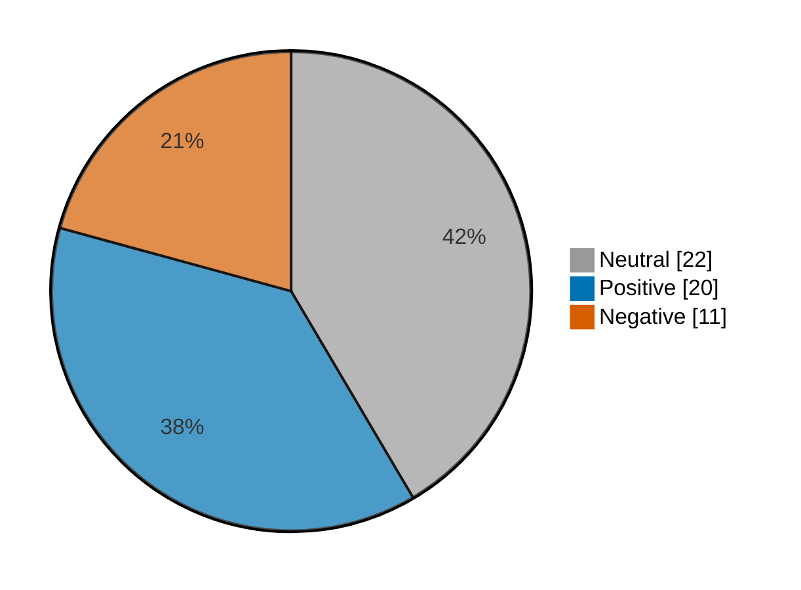

# Newsmood — 2026-11-27

**Mood index: +23.9** (moderately positive) · 53 headlines from 3 sources · model unsure on 6

_Data notes: 74% of headlines from investing-stocks._

## Mood at a glance

Negative 11 (20.8%) · Positive 20 (37.7%) · Neutral 22 (41.5%)

## What happened

Market news leaned moderately positive today (index +23.9) from 53 headlines, with no single theme in the lead.

**Clusters:**

- 3 headlines on climbing today, stock climbing, climbing: 3 neutral · +0.0% of the day's movement

_Themes use TF-IDF fit on 1763 headlines (2026-10-28–2026-11-27)._

## Recommended articles (highest model certainty, not most important)

### Negative

- [US housing market 2026: high rates, slow sales, and a buyer’s dilemma](<https://www.investing.com/news/stock-market-news/us-housing-market-2026-high-rates-slow-sales-and-a-buyers-dilemma-93CH-5053342>) · 94% · 3.6% of the day's movement · investing-stocks
- [SAP reportedly to cut 10,000 jobs. It marks the latest in a brutal year for tech layoffs.](<https://www.marketwatch.com/story/sap-reportedly-to-cut-10-000-jobs-it-marks-the-latest-in-a-brutal-year-for-tech-layoffs-c7989744?mod=mw_rss_topstories>) · 92% · 3.5% of the day's movement · marketwatch-top
- [The AI stock crash is mostly over, JPMorgan says — but a worse phase could be coming in 2027](<https://www.marketwatch.com/story/the-ai-stock-crash-is-mostly-over-jpmorgan-says-but-a-worse-phase-could-be-coming-in-2027-fa769fbd?mod=mw_rss_topstories>) · 83% · 3.2% of the day's movement · marketwatch-top

### Positive

- [Mexico stocks higher at close of trade; S&P/BMV IPC up 1.93%](<https://www.investing.com/news/stock-market-news/mexico-stocks-higher-at-close-of-trade-spbmv-ipc-up-193-5053883>) · 97% · 3.7% of the day's movement · investing-stocks
- [Canada stocks higher at close of trade; S&P/TSX Composite up 1.20%](<https://www.investing.com/news/stock-market-news/canada-stocks-higher-at-close-of-trade-sptsx-composite-up-120-5053880>) · 97% · 3.7% of the day's movement · investing-stocks
- [Russia stocks higher at close of trade; MOEX Russia Index up 1.29%](<https://www.investing.com/news/stock-market-news/russia-stocks-higher-at-close-of-trade-moex-russia-index-up-129-5053864>) · 97% · 3.7% of the day's movement · investing-stocks

### Neutral

- [Is the stock market open on Black Friday?](<https://www.marketwatch.com/story/is-the-stock-market-open-on-black-friday-0a735c45?mod=mw_rss_topstories>) · 98% · marketwatch-top
- [Stocks look like a Black Friday bargain. Read the fine print.](<https://www.marketwatch.com/story/stocks-look-like-a-black-friday-bargain-read-the-fine-print-b6546539?mod=mw_rss_topstories>) · 98% · marketwatch-top

## Sources

| Source | Headlines | Negative | Neutral | Positive |
|---|--:|--:|--:|--:|
| investing-stocks | 39 | 7 | 13 | 19 |
| marketwatch-top | 13 | 4 | 8 | 1 |
| cnbc-finance | 1 | 0 | 1 | 0 |

All 53 headlines

| Sentiment | Certainty | Headline | Source |
|---|--:|---|---|
| negative | 94% | [US housing market 2026: high rates, slow sales, and a buyer’s dilemma](<https://www.investing.com/news/stock-market-news/us-housing-market-2026-high-rates-slow-sales-and-a-buyers-dilemma-93CH-5053342>) | investing-stocks |
| negative | 92% | [SAP reportedly to cut 10,000 jobs. It marks the latest in a brutal year for tech layoffs.](<https://www.marketwatch.com/story/sap-reportedly-to-cut-10-000-jobs-it-marks-the-latest-in-a-brutal-year-for-tech-layoffs-c7989744?mod=mw_rss_topstories>) | marketwatch-top |
| negative | 83% | [The AI stock crash is mostly over, JPMorgan says — but a worse phase could be coming in 2027](<https://www.marketwatch.com/story/the-ai-stock-crash-is-mostly-over-jpmorgan-says-but-a-worse-phase-could-be-coming-in-2027-fa769fbd?mod=mw_rss_topstories>) | marketwatch-top |
| negative | 78% | [Market Swings Spooked Retail Traders—And Lifted CME Group Up 18%](<https://www.investing.com/news/stock-market-news/market-swings-spooked-retail-tradersand-lifted-cme-group-up-18-5053438>) | investing-stocks |
| negative | 76% | [Artificial intelligence usage is exploding, yet spending is stalling. Why a foundational rule of economics is breaking.](<https://www.marketwatch.com/story/artificial-intelligence-usage-is-exploding-yet-spending-is-stalling-why-a-foundational-rule-of-economics-is-breaking-9c7ad4b3?mod=mw_rss_topstories>) | marketwatch-top |
| negative | 68% | [Goldman Sachs sees US GDP at 2.4% in 2027 with lower inflation](<https://www.investing.com/news/stock-market-news/goldman-sachs-sees-us-gdp-at-24-in-2027-with-lower-inflation-93CH-5053340>) | investing-stocks |
| negative | 67% | [European shares extend rally, but bruising November leaves AI scars](<https://www.investing.com/news/stock-market-news/european-shares-extend-rally-but-bruising-november-leaves-ai-scars-5053023>) | investing-stocks |
| negative | 62% | [Nvidia’s stock has tumbled 27% over one chaotic month. The next big test lies in the week ahead](<https://www.marketwatch.com/story/nvidias-stock-has-tumbled-27-over-one-chaotic-month-the-next-big-test-lies-in-the-week-ahead-06449777?mod=mw_rss_topstories>) | marketwatch-top |
| negative | 58% (unsure) | [Why is Waaree Renewable Technologies stock surging today?](<https://www.investing.com/news/stock-market-news/why-is-waaree-renewable-technologies-stock-surging-today-93CH-5052953>) | investing-stocks |
| negative | 48% (unsure) | [Why is Arcadia Minerals stock surging today?](<https://www.investing.com/news/stock-market-news/why-is-arcadia-minerals-stock-surging-today-93CH-5052899>) | investing-stocks |
| negative | 47% (unsure) | [Why is Tokyo Electric Power stock rising today?](<https://www.investing.com/news/stock-market-news/why-is-tokyo-electric-power-stock-rising-today-93CH-5052915>) | investing-stocks |
| positive | 97% | [Mexico stocks higher at close of trade; S&P/BMV IPC up 1.93%](<https://www.investing.com/news/stock-market-news/mexico-stocks-higher-at-close-of-trade-spbmv-ipc-up-193-5053883>) | investing-stocks |
| positive | 97% | [Canada stocks higher at close of trade; S&P/TSX Composite up 1.20%](<https://www.investing.com/news/stock-market-news/canada-stocks-higher-at-close-of-trade-sptsx-composite-up-120-5053880>) | investing-stocks |
| positive | 97% | [Russia stocks higher at close of trade; MOEX Russia Index up 1.29%](<https://www.investing.com/news/stock-market-news/russia-stocks-higher-at-close-of-trade-moex-russia-index-up-129-5053864>) | investing-stocks |
| positive | 97% | [Spain stocks higher at close of trade; IBEX 35 up 1.72%](<https://www.investing.com/news/stock-market-news/spain-stocks-higher-at-close-of-trade-ibex-35-up-172-5053740>) | investing-stocks |
| positive | 97% | [Colombia stocks higher at close of trade; COLCAP up 1.53%](<https://www.investing.com/news/stock-market-news/colombia-stocks-higher-at-close-of-trade-colcap-up-153-5053878>) | investing-stocks |
| positive | 97% | [Australia stocks higher at close of trade; S&P/ASX 200 up 0.80%](<https://www.investing.com/news/stock-market-news/australia-stocks-higher-at-close-of-trade-spasx-200-up-080-5052929>) | investing-stocks |
| positive | 97% | [Netherlands stocks higher at close of trade; AEX up 1.24%](<https://www.investing.com/news/stock-market-news/netherlands-stocks-higher-at-close-of-trade-aex-up-124-5053738>) | investing-stocks |
| positive | 97% | [These stocks soared the most during a wild week highlighted by Huang’s return to Nvidia](<https://www.marketwatch.com/story/these-stocks-soared-the-most-during-a-wild-week-highlighted-by-huangs-return-to-nvidia-578b3f9a?mod=mw_rss_topstories>) | marketwatch-top |
| positive | 97% | [Portugal stocks higher at close of trade; PSI up 1.20%](<https://www.investing.com/news/stock-market-news/portugal-stocks-higher-at-close-of-trade-psi-up-120-5053739>) | investing-stocks |
| positive | 97% | [Brazil stocks higher at close of trade; Bovespa up 0.05%](<https://www.investing.com/news/stock-market-news/brazil-stocks-higher-at-close-of-trade-bovespa-up-005-5053837>) | investing-stocks |
| positive | 97% | [U.K. stocks higher at close of trade; Investing.com United Kingdom 100 up 0.77%](<https://www.investing.com/news/stock-market-news/uk-stocks-higher-at-close-of-trade-investingcom-united-kingdom-100-up-077-5053741>) | investing-stocks |
| positive | 97% | [France stocks higher at close of trade; CAC 40 up 0.58%](<https://www.investing.com/news/stock-market-news/france-stocks-higher-at-close-of-trade-cac-40-up-058-5053735>) | investing-stocks |
| positive | 97% | [Italy stocks higher at close of trade; Investing.com Italy 40 up 1.84%](<https://www.investing.com/news/stock-market-news/italy-stocks-higher-at-close-of-trade-investingcom-italy-40-up-184-5053737>) | investing-stocks |
| positive | 96% | [Germany stocks higher at close of trade; DAX up 0.86%](<https://www.investing.com/news/stock-market-news/germany-stocks-higher-at-close-of-trade-dax-up-086-5053736>) | investing-stocks |
| positive | 96% | [European shares log strong weekly gains; markets await Spanish election](<https://www.investing.com/news/stock-market-news/european-stocks-extend-recovery-as-tech-miners-advance-5053129>) | investing-stocks |
| positive | 93% | [AI Chip Stocks Swung Wildly—While Warren Buffett’s Apple Climbed 26%](<https://www.investing.com/news/stock-market-news/ai-chip-stocks-swung-wildlywhile-warren-buffetts-apple-climbed-26-5053436>) | investing-stocks |
| positive | 87% | [How Sanofi’s new CEO struck a rapid $41 billion deal for Insmed](<https://www.investing.com/news/stock-market-news/sanofi-ceo-got-to-work-on-41-billion-insmed-deal-straight-after-taking-office-5052971>) | investing-stocks |
| positive | 84% | [Qantas set to award Boeing bulk of 20-jet order, Bloomberg reports](<https://www.investing.com/news/stock-market-news/qantas-set-to-award-boeing-bulk-of-20jet-order-bloomberg-reports-5052952>) | investing-stocks |
| positive | 67% | [FTSE 100 today: Stocks climb as miners lead on metals rebound; Entain gains](<https://www.investing.com/news/stock-market-news/ftse-100-today-stocks-rise-as-miners-lead-on-metals-rebound-5053108>) | investing-stocks |
| positive | 60% | [Chinese stocks rebound from 1-yr lows after Beijing pledges more support](<https://www.investing.com/news/stock-market-news/chinese-stocks-rebound-from-1yr-lows-after-beijing-pledges-more-support-5052940>) | investing-stocks |
| neutral | 98% | [Is the stock market open on Black Friday?](<https://www.marketwatch.com/story/is-the-stock-market-open-on-black-friday-0a735c45?mod=mw_rss_topstories>) | marketwatch-top |
| neutral | 98% | [Stocks look like a Black Friday bargain. Read the fine print.](<https://www.marketwatch.com/story/stocks-look-like-a-black-friday-bargain-read-the-fine-print-b6546539?mod=mw_rss_topstories>) | marketwatch-top |
| neutral | 97% | [Citi flags solar, storage, and SST sector updates ahead of key policy moves](<https://www.investing.com/news/stock-market-news/citi-flags-solar-storage-and-sst-sector-updates-ahead-of-key-policy-moves-93CH-5053348>) | investing-stocks |
| neutral | 97% | [Don’t miss out: Get 60% off InvestingPro before our Black Friday sale ends](<https://www.investing.com/news/stock-market-news/dont-miss-out-get-60-off-investingpro-before-our-black-friday-sale-ends-5053334>) | investing-stocks |
| neutral | 95% | [Exclusive-Hackers breach US Air Force flagship Cloud One computing platform](<https://www.investing.com/news/stock-market-news/exclusivehackers-breach-us-air-force-flagship-cloud-one-computing-platform-5053314>) | investing-stocks |
| neutral | 95% | [Hollywood Hills home of the late Presley Gerber listed for $3.6 million, 2 months after his death](<https://www.marketwatch.com/story/hollywood-hills-home-of-the-late-presley-gerber-listed-for-3-6-million-2-months-after-his-death-92497183?mod=mw_rss_topstories>) | marketwatch-top |
| neutral | 94% | [Why is Meituan stock rallying today?](<https://www.investing.com/news/stock-market-news/why-is-meituan-stock-rallying-today-93CH-5052916>) | investing-stocks |
| neutral | 94% | [Why is International Gemological Institute stock climbing today?](<https://www.investing.com/news/stock-market-news/why-is-international-gemological-institute-stock-climbing-today-93CH-5052913>) | investing-stocks |
| neutral | 94% | [Why is Cloudflare stock rallying today?](<https://www.investing.com/news/stock-market-news/why-is-cloudflare-stock-rallying-today-93CH-5053338>) | investing-stocks |
| neutral | 93% | [Is today’s Black Friday tech rebound a real rally—or a dead cat bounce?](<https://www.investing.com/news/stock-market-news/is-todays-black-friday-tech-rebound-a-real-rallyor-a-dead-cat-bounce-5053485>) | investing-stocks |
| neutral | 92% | [My friends play ‘credit-card roulette’ to see who pays for dinner — but one ‘winner’ still Venmoed me afterward. Should I say something?](<https://www.marketwatch.com/story/my-friends-play-credit-card-roulette-to-see-who-pays-for-dinner-but-one-winner-still-venmoed-me-afterward-should-i-say-something-0a657eee?mod=mw_rss_topstories>) | marketwatch-top |
| neutral | 90% | [Why is Marco Polo Marine stock climbing today?](<https://www.investing.com/news/stock-market-news/why-is-marco-polo-marine-stock-climbing-today-93CH-5052912>) | investing-stocks |
| neutral | 89% | [The warnings behind this week’s stock-market rally](<https://www.marketwatch.com/story/the-warnings-behind-this-weeks-stock-market-rally-86e5319c?mod=mw_rss_topstories>) | marketwatch-top |
| neutral | 87% | [This investment strategist is 100% in cash — and warns that buying the Nasdaq dip is like catching a falling knife](<https://www.marketwatch.com/story/this-investment-strategist-is-100-in-cash-and-warns-that-buying-the-nasdaq-dip-is-like-catching-a-falling-knife-64f5b233?mod=mw_rss_topstories>) | marketwatch-top |
| neutral | 87% | [Explainer-Black Friday test for retailers as tight budgets meet AI-savvy shoppers](<https://www.investing.com/news/stock-market-news/explainerblack-friday-test-for-retailers-as-tight-budgets-meet-aisavvy-shoppers-5053309>) | investing-stocks |
| neutral | 86% | [Why is Strategy stock gaining today?](<https://www.investing.com/news/stock-market-news/why-is-strategy-stock-gaining-today-93CH-5053886>) | investing-stocks |
| neutral | 79% | [Why is KPI Green Energy stock climbing today?](<https://www.investing.com/news/stock-market-news/why-is-kpi-green-energy-stock-climbing-today-93CH-5052914>) | investing-stocks |
| neutral | 76% | [US equity funds post biggest outflows in 11 weeks as tech rout weighs](<https://www.investing.com/news/stock-market-news/us-equity-funds-post-biggest-outflows-in-11-weeks-as-tech-rout-weighs-5053333>) | investing-stocks |
| neutral | 71% | [Stocks are poised for a Friday jump — right into a $100 billion wave of automated selling, Goldman Sachs warns](<https://www.marketwatch.com/story/stocks-are-poised-for-a-friday-jump-right-into-a-100-billion-wave-of-automated-selling-goldman-sachs-warns-aba6440f?mod=mw_rss_topstories>) | marketwatch-top |
| neutral | 53% (unsure) | [Millions of Americans are retiring—lifting this wealth stock 13%](<https://www.investing.com/news/stock-market-news/millions-of-americans-are-retiringlifting-this-wealth-stock-13-5053441>) | investing-stocks |
| neutral | 49% (unsure) | [The S&P 500 is in a correction. Bear markets and recessions don't always follow](<https://www.cnbc.com/2026/11/27/the-sp-500-is-in-a-correction-bear-markets-and-recessions-dont-always-follow.html>) | cnbc-finance |
| neutral | 47% (unsure) | [Clearing out my parents’ house was a legal nightmare. How can I downsize without putting my children through the same ordeal?](<https://www.marketwatch.com/story/clearing-out-my-parents-house-was-a-legal-nightmare-how-can-i-downsize-without-putting-my-children-through-the-same-ordeal-6537d804?mod=mw_rss_topstories>) | marketwatch-top |

---

Certainty is the model's confidence in its label; below 60% it is marked unsure.

"Of the day's movement" is a headline's certainty over the sum of every non-neutral headline's certainty: its part in moving the index. Neutral headlines move it by 0.

Links go to the original publisher; some limit free articles.

Model: kkrit-tinna/newsmood-distilbert-financial@be7b809e0d8f7bd50e77d902aee199363b7e2a66 · Gates: 2/2 passed · 1 data note · Not financial advice.
